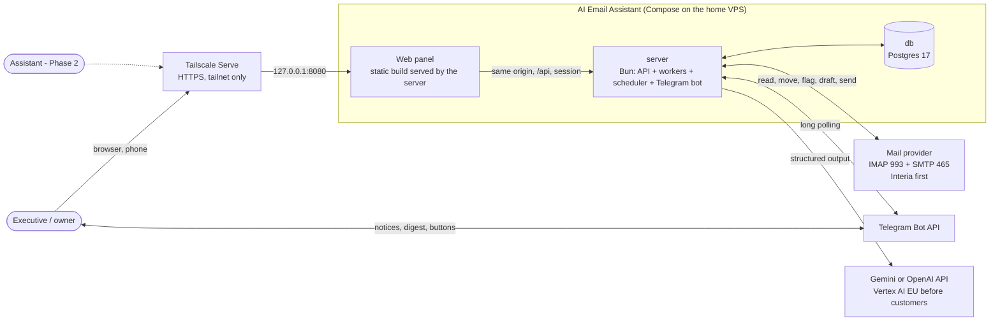
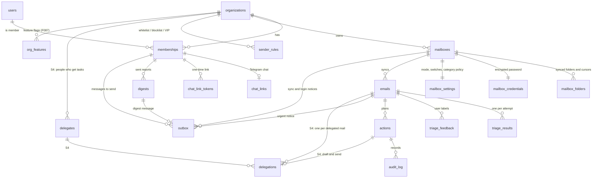

# Architecture — AI Email Assistant

> **Accepted 2026-11-02** (user). Revised 2026-11-02 after the cold review (`spec/features/done/2026-11/F016-mvp-plan-review/plan.md`), the user's answers and a second review of the rewrite (`spec/features/done/2026-11/F009-docs-and-adr-review/plan.md`):
> pilot mailbox = Interia over IMAP, pilot host = home VPS, own Postgres. Based on `docs/product-brief.md`.
> Decisions are in `docs/decisions/` (ADR 0001–0017). The old specs in `.ai/architecture/` are history. When they disagree with this file, this file wins.
> Behaviour detail per capability (rules, entry points, limits): `docs/capabilities/` (PD-009). This file keeps goals, context, layout, module rules, ports, invariants, data model, security and deployment.

## 1. Goals and constraints

| Driver                                                                              | Consequence for the architecture                                                                                                       |
| ----------------------------------------------------------------------------------- | -------------------------------------------------------------------------------------------------------------------------------------- |
| Sell-ready multi-tenant product for business owners and managers (not sold, PD-001) | Tenant-aware data model from day one; strict tenant isolation; GDPR.                                                                   |
| Trust is the product value                                                          | Every decision is logged with its reason; every mailbox change has an Undo; the user can correct each decision.                        |
| No send without the user's direct command                                           | The LLM never acts. Code plans, a policy checks, a committer acts. "Send" needs an approval record.                                    |
| Telegram first, mobile app later                                                    | One channel-neutral backend API for notices, approvals and commands.                                                                   |
| IMAP + SMTP first (Interia), Gmail / Microsoft 365 later                            | Mail access behind a `MailProvider` port (ADR 0010).                                                                                   |
| Polish + English, < 200 mails/day/mailbox, small LLM budget                         | Polling is enough; one cheap model call per mail; cost caps (ADR 0012).                                                                |
| One developer, home VPS                                                             | One repo, one server process, two containers (`server`, `db`), no open inbound port (the web panel is reached through Tailscale only). |

## 2. System context



All connections from the server go out, except the web panel: Tailscale Serve on the host proxies tailnet requests to `127.0.0.1:8080` (ADR 0017).
The server port is bound to the loopback address of the host. The router has no open port.

## 3. Repository layout

One repo, Bun workspaces (ADR 0002).

```
apps/
  server/              Bun + Hono. One process: API, workers, scheduler, Telegram bot.
    src/modules/
      tenancy/         organizations, users, memberships, roles, tenant context
      mail/            MailProvider port; imap/ adapter; sync cursor; connect; credentials
      triage/          rules, classifier (LLM), planners, policy call, feedback
      actions/         committer, approvals, undo, retries
      delegation/      delegates, delegations, delegation reminders (S4)
      loops/           open loops of the user's own sent mail: analysis, close rules, follow-ups, the one chaser (F116, ADR 0036)
      reports/         digest builder, schedule
      channels/        ChatChannel port; telegram/ adapter; chat linking
      config/          per-mailbox mode and switches, category policy, sender rules, style text
      audit/           append-only action log
    src/platform/      db, llm client, crypto, logger, env config, scheduler, http, auth
                       (`auth.ts`: Better Auth on our Postgres, ADR 0016)
  web/                 Astro static build with React islands; served by the server; talks only to `/api` (ADR 0016).
  docs/                Starlight site (`@ea/docs`): the public docs, built in CI and published on GitHub Pages; no server, no database (ADR 0030).
packages/
  core/                Pure TypeScript: domain types, Zod schemas, categories, rules, policy, planners, digest. No I/O.
db/migrations/         SQL migrations (source of truth)
db/roles.sql           Postgres roles (`app`, `migrator`)
deploy/                compose.yaml, Dockerfile for server, backup script
deploy/db-init/        Init script that runs `db/roles.sql` in the db container
evals/                 Eval runner + synthetic and injection cases (no real mail in git)
docs/                  product-brief.md, architecture.md, modules.md, roadmap.md, decisions/, known-alerts.md, code-patterns.md
```

Full list of modules, sub-modules, jobs and pages: `docs/modules.md`. Code rules for agents: `docs/code-patterns.md`.

Module rules:

- A module exposes one `index.ts`. Other modules import only from it.
- `packages/core` has no I/O. Business rules there are unit-tested without mocks.
- Ports (interfaces) live in the module that owns them: `MailProvider` in `mail`, `ChatChannel` in `channels`.

## 4. The email pipeline

### 4.1 Flow

```mermaid
flowchart TD
    Tick["Scheduler: every MAIL_SYNC_EVERY_MIN min (default 2)"] --> Sync[mail.sync: INBOX and the synced folders above each folder's UID cursor]
    Sync -->|known mail back in a synced folder after a system move| Ret[(emails.returned_at set)]
    Ret --> FB[triage.returned writes triage_feedback: wrong]
    Sync -->|new dedup key| Store[(emails: status = pending)]
    Store --> Claim[triage.worker: claim pending email<br/>FOR UPDATE SKIP LOCKED]
    Claim --> Rules{hard rules}
    Rules -->|blocklist| PSpam[plan: move to AI/Spam]
    Rules -->|reply in a delegation thread - S4| Answered[delegation: answered + notice<br/>(the job loops.match closes Waiting loops on the same reply)]
    Answered --> Classify
    Rules -->|other| Classify[LLM: category, confidence, reason, fields, summary<br/>Zod structured output]
    Classify --> Conf{confidence at least the category threshold?}
    Conf -->|no| PManual[plan: unsure, NEEDS ACTION, move to AI/Manual only if that switch is ON]
    Conf -->|yes| Plan[planner of the category builds an ExecutionPlan]
    PSpam --> Policy
    PManual --> Policy
    Plan --> Policy{policy: pure function, same transaction}
    Policy -->|log only| Logged[(actions: logged)]
    Policy -->|apply| Ready[(actions: ready)]
    Policy -->|needs the user| Await[(actions: awaiting_approval)]
    Ready --> Commit[actions.committer: applying, then applied]
    Await -->|button tap| Approved[(actions: approved)]
    Approved --> Commit
    Await -->|reject or 48 h| Closed[(actions: rejected / expired)]
    Commit -->|error, tries left: same status, retry later| Commit
    Commit -->|3 hard errors| Failed[(actions: failed + notice)]
    Logged --> Audit[(audit_log)]
    Commit --> Audit
    Closed --> Audit
    Failed --> Audit
```

Each step that crosses a module border is a DB status change that the next worker picks up (`docs/modules.md` §2).

Pipeline rules:

1. **Hard rules before AI.** Blocklisted sender → spam, no LLM call. Whitelisted or VIP sender → the classifier gets the category list without `spam`.
   The system reads INBOX and the synced folders of `mailbox_folders` (ADR 0014; at Interia `Oferty`, `Społeczności`, `Rachunki` and the spam folder `Wiadomości-śmieci`).
   It never reads `AI/*`, Drafts, Trash or the user's own folders, so that mail is never touched.
   The only mail that the system writes into INBOX is the report mail of a member who chose the channel `mail` or `both` (IMAP APPEND, flag `report_mail`, ADR 0022, §6.1); the sync skips it as own mail.
   It reads the Sent folder (`folder_map.sent`) only read-only, into its own table, and only when the organization flag `sent_sync` and the mailbox switch are on (ADR 0029; [capabilities/sent-mail.md](capabilities/sent-mail.md)).
2. **The LLM returns data only:** category, confidence, reason code + short reason, extracted fields, a delegate id from a given list,
   and the summary for `info` mail. It never names a free-form recipient.
   The delegate id comes from the delegates list in the prompt: the output schema allows only these ids (or null), and the code checks the id again.
   The recipient of a draft comes from the `delegates` row, or from the sender address of the mail (a clarification), never from LLM text.
3. **Planners are pure.** A planner turns (email, analysis, config) into an `ExecutionPlan`. Planners live in `packages/core`.
4. **The policy decides, inside the triage transaction.** The triage worker calls the pure policy and writes actions as
   `ready`, `awaiting_approval` or `logged`. There is no separate gate job and no `planned` status. Truth table: §4.3.
5. **Only the committer changes the mailbox or sends.** It applies one action at a time.
   For a non-idempotent action (`create_draft`, `send`) it first commits status `applying`. After the call it writes
   the provider result, the audit row and the new status in one transaction.
6. **Exactly-once for mail and drafts, at-most-once for send.** Unique key per email: `(mailbox_id, dedup_key)` (§6.1).
   Each action has an idempotency key. Drafts and sent mail carry the header `X-EA-Action-Id`.
   - Moved to [docs/capabilities/actions-and-undo.md](capabilities/actions-and-undo.md) § Rules (F095).
   - Moved to [docs/capabilities/drafts-and-send.md](capabilities/drafts-and-send.md) § Rules (F095).
   - **Send limits (PD-044, F099).** Each mailbox sends at most `SEND_LIMIT_MAILBOX_HOUR` (20) mails an hour and `SEND_LIMIT_MAILBOX_DAY` (100) in 24 h; one mailbox sends to one recipient at most `SEND_LIMIT_RECIPIENT_DAY` (5) times in 24 h. The count reads `actions` rows of type `send` with `send_started_at` in the window and status `applying`, `applied`, or `failed` with `status_reason = 'outcome_unknown'` (the mail may have gone out). A send that the server refused counts for nothing. The count runs in the transaction that marks the send `applying`, under a per-mailbox advisory lock (`startSendWithinLimits`), so two committers count one after the other. A send over a limit stays `approved` with `next_attempt_at` at the end of the window and `last_error = send_limit:<kind>`; it counts no attempt. The 48 h approval clock still runs from the tap: a send held longer ends `expired` / `held_timeout`. The soft-error cap of 6 h also counts from the tap, so a send held longer than 6 h that then gets a soft SMTP error fails at once and the user can tap "Send again". Rule: `docs/code-patterns.md` § Side effects; user and operator view: [docs/capabilities/drafts-and-send.md](capabilities/drafts-and-send.md).

7. **Retries live on the row that failed.** LLM errors retry the email (`emails.attempts`); mailbox errors retry the action (`actions.attempts`).
   Soft errors wait with backoff (`next_attempt_at`) and do not count; the row keeps its status.
   Hard errors add 1 to `attempts`. After 3 hard errors: an email becomes `unsure` (reason `triage_error`);
   an action becomes `failed`, and the user gets a notice. Rule 6 wins for `send`.

   Moved to [docs/capabilities/triage.md](capabilities/triage.md) § Rules (F095).

   Moved to [docs/capabilities/actions-and-undo.md](capabilities/actions-and-undo.md) § Rules (F095).

8. **Cost limits.**

   Moved to [docs/capabilities/triage.md](capabilities/triage.md) § Rules (F095).

### 4.2 Categories and folders

One category per mail (Zod enum `Category` in `packages/core`). One folder per mail. Tags use IMAP keywords when the server allows them; else they live only in the DB.

| Category          | Meaning                                                                             | Plan in `assist` mode                                                                                                                                                                                                                                                                                                                                     |
| ----------------- | ----------------------------------------------------------------------------------- | --------------------------------------------------------------------------------------------------------------------------------------------------------------------------------------------------------------------------------------------------------------------------------------------------------------------------------------------------------- |
| `urgent`          | Needs the user today                                                                | Flag, stays in INBOX, Telegram notice now                                                                                                                                                                                                                                                                                                                 |
| `needs_reply`     | Needs the user's own answer. Meeting requests go here in MVP (meetings are Phase 2) | Stays in INBOX; digest section NEEDS ACTION                                                                                                                                                                                                                                                                                                               |
| `delegation` (S4) | A task for a delegate                                                               | A `delegation` draft to the chosen delegate (fixed template with the task, the due date and the quoted original) + its `send` that waits for approval + a `delegations` row. No delegate fits but the model gives a question: a `clarification` draft to the sender (not to a no-reply address) + its `send`. Neither: no action, the mail stays in INBOX |
| `info`            | Information, no action                                                              | Summary saved; move to `AI/Info`                                                                                                                                                                                                                                                                                                                          |
| `notification`    | Automatic mail from systems                                                         | Mark read; move to `AI/Notifications`                                                                                                                                                                                                                                                                                                                     |
| `spam`            | Unwanted mail (blocklist or AI)                                                     | Move to `AI/Spam` (not the provider's spam folder, so Undo is easy)                                                                                                                                                                                                                                                                                       |
| `unsure`          | Low confidence, or triage failed 3 times                                            | Digest section NEEDS ACTION. Move to `AI/Manual` only if the switch `move_unsure` is ON (default OFF: the mail stays in INBOX)                                                                                                                                                                                                                            |

- **VIP** is a sender flag (`sender_rules.kind = vip`), not a category. A VIP is also whitelisted. The system never moves or marks read a VIP mail automatically (also not into INBOX, and also for spam folder mail).
- **Mail from the spam folder (ADR 0014, D11, D12).** The mail goes through the same pipeline, to find a valid mail that landed there by accident. The plan differs from the table above:
  `spam` → no action (the mail stays in the spam folder); `info` and `notification` → as in the table;
  `urgent`, `needs_reply` and `delegation` → a move into INBOX (the "rescue", no flag); `delegation` gets no draft, no send and no approval message; `unsure` → as in the table.
  The rescue move follows the policy of §4.3, so it is `log_only` while the `auto` flag of its category is OFF.
- **`AI/Manual`** is the "Manual Handling" folder of the product brief: the system puts mail there and never reads that folder again.
- Folder names come from `mailboxes.folder_map` (per provider). The connect step creates the `AI/*` folders.
- Confidence threshold: one per category, set from the S1b eval data (start value 0.7). Stored in `mailbox_settings.category_policy`.
- `unsure` has no precision, so it has no go/no-go bar. Only the `move_unsure` switch controls its move (decision 2026-11-02, safer default).

### 4.3 Mailbox modes and the policy table

| Mode                                 | Meaning                                                                             |
| ------------------------------------ | ----------------------------------------------------------------------------------- |
| `shadow` (default for a new mailbox) | The system changes nothing in the mailbox. It logs what it would do and reports it. |
| `assist`                             | The system applies allowed actions. Send happens only after the user's approval.    |

There is no auto-send mode in MVP (ADR 0003). Each action type has an ON/OFF switch per mailbox (`tool_switches`).
The policy is the first gate. `ACTIONS_SCOPE` (env, S3) is a second gate next to the mode, and the committer checks it when it claims:
`off` (default) = the committer applies no mailbox change (only `save_summary`); `synthetic` = mailbox changes only for mail with a synthetic `Message-ID` (`@ea-seed.test>`), in every mailbox;
`all` = every active mailbox of an organization that is not `suspended` ([tenancy-and-plans.md](capabilities/tenancy-and-plans.md) § Rules, rule 3), by the mode, the switches and the `auto` flags of each mailbox. The modes are the consent (D2): `shadow` changes nothing in the mailbox. No scope reads `TEST_MAILBOX_ADDRESS` (only the `testmail` and probe tools read it).
Actions that the scope holds back stay `ready` and wait (they expire after 24 h, §4.1 rule 7). `synthetic` is a test gate, not a security boundary: any sender can write such an id.
`SEND_SCOPE` (env, S4) is a third gate, for the send only. `off` (default) = no send goes out: an approved send waits and ends as `held_timeout` 48 h after the tap; `self` = only a send whose every recipient is in `SEND_TEST_ADDRESSES`; `all` = every send of every active mailbox of an organization that is not `suspended` (delegations, reminders and clarification questions to the original sender); a send still needs the owner's tap. The server refuses `self` without a valid address list. A draft is made under `ACTIONS_SCOPE`: with `off`, no draft is made, so no approval request goes out. A tap on 📤 Send is the approval; the scope still decides whether the mail goes out.
The mode, the `auto` flags and the switches change only through `bun run mailbox:settings` (audit rows `mailbox.mode_changed`, `mailbox.policy_changed`, `mailbox.switch_changed`).
A change that closes a gate (`mode shadow`, `auto … off`, `switch … off`, and `mode assist` without `--keep-switches` for each switch it turns off) also expires the `ready` rows it closes, in the same transaction. `mode shadow` also expires every `awaiting_approval` send (`policy_changed`); `switch create_draft off` expires the sends of every kind except the reply sends, and `switch reply_drafts off` expires only the reply sends (a reply draft has its own switch, PD-082). `saveTriage` share-locks the settings row and compares the settings version: a triage batch planned under old settings writes nothing and releases its mails.
A category gets automatic moves only when the evidence rule of ADR 0028 allows it. With the flag `trust_ladder` on, global holdout evidence for the running model, prompt and endpoint decides; the history check of the mailbox and the real labels (30 or more) can only block; a tripwire pauses a category that the user corrects; and every `auto` stores the key it was earned under, so a model or endpoint switch ends it until the re-gate re-grants it ([trust.md](capabilities/trust.md) rules 1, 5, 9, 10). With the flag off the old bar of the S1b report applies (default: precision ≥ 98% on at least 30 labels).
The policy returns one of three values per action: `apply`, `await_approval`, `log_only`.
The rescue move of spam folder mail into INBOX (§4.2) follows the same go/no-go rule: the category needs `auto` ON. `delegation` has no `auto` flag, so its rescue is always `log_only`.
The urgent notice skips mail from the spam folder (D23): an injected "urgent" text must not push such mail to the phone. The digest still shows it with its folder.
The known limits of the folder sync are in ADR 0014 (D24).

| Action                                                        | `shadow`              | `assist`                                                                                                                                               | Sender is VIP                                       |
| ------------------------------------------------------------- | --------------------- | ------------------------------------------------------------------------------------------------------------------------------------------------------ | --------------------------------------------------- |
| Telegram notice, digest line                                  | apply                 | apply                                                                                                                                                  | apply                                               |
| Save summary (DB only)                                        | apply                 | apply                                                                                                                                                  | apply                                               |
| Move to an `AI/*` folder or, for spam folder mail, into INBOX | log only              | apply if the switch is ON, the category passed go/no-go (`unsure`: only the `move_unsure` switch) and the mailbox supports moves (§6.1); else log only | log only                                            |
| Mark read                                                     | log only              | apply if the switch is ON and the category passed go/no-go; else log only                                                                              | log only                                            |
| Flag                                                          | log only              | apply if the switch is ON                                                                                                                              | apply if the switch is ON                           |
| Create draft (APPEND to Drafts)                               | log only              | apply if the switch is ON                                                                                                                              | apply if the switch is ON                           |
| Send (SMTP)                                                   | log only (never sent) | await approval (the committer then also needs `SEND_SCOPE`); log only when its draft is log only                                                       | await approval; log only when its draft is log only |
| Undo (reverse plan)                                           | —                     | apply on the user's tap                                                                                                                                | apply on the user's tap                             |

### 4.4 Feedback, Undo and the success metric

- Moved to [docs/capabilities/triage.md](capabilities/triage.md) § Rules (F095).
- Moved to [docs/capabilities/actions-and-undo.md](capabilities/actions-and-undo.md) § Rules (F095).
- Moved to [docs/capabilities/triage.md](capabilities/triage.md) § Rules (F095).
- Moved to [docs/capabilities/delegation.md](capabilities/delegation.md) § Rules (F095).

### 4.5 Approval flow (Telegram and the panel)

Moved to [docs/capabilities/drafts-and-send.md](capabilities/drafts-and-send.md) § Rules (F095).

**Edits in the mail client (F115, ADR 0033).** The system never sends text that it read back from the mail client and never deletes a draft that the user changed. After the APPEND, the committer reads the Drafts copy once and stores a hash of it (`provider_result.copy_hash`: the text, the Subject, To, Cc and the attachment names). Before the SMTP call it reads the copy again: the same hash sends the approved text; another hash stops the send with `draft_changed` (the user sends it from the mail client); a missing copy ends `sent_by_user` when the mail was answered, else `draft_missing`. A reply draft always runs this check; the other kinds run it while the org flag `draft_copy_check` is on (default off). A reply send also runs the answered pass first ([docs/capabilities/reply-drafts.md](capabilities/reply-drafts.md) rule 10). Expiry, reject and supersede remove the copy only when its hash matches.

The web panel is a second channel for the same approval. With the flag `approvals_page` on, an owner approves, rejects or edits a waiting send at `/approvals`. The routes call the same `approve` and `reject` as the Telegram taps, with `via: "web"`, so no mail leaves before the send is `approved`, and the 48 h limit and `SEND_SCOPE` hold. An edit changes no row: it adds a new draft and a new send, each with `supersedes_action_id` set to the old row, in one transaction, and the old send ends `expired` with the reason `superseded`. The new send needs its own approval. Every decision on a send (a tap, a panel approve, reject or edit, an expiry that a tap or a panel approve finds, a cancel of a delegation) queues one `approval_edit` outbox row for each other sent Telegram card of the send, in the same transaction, so the old Send button goes away. `actions` reaches `channels` only through the hook `ApprovalHooks.onDecided`, which `channels` implements (`cardEditHooks`). Rules: [drafts-and-send.md](capabilities/drafts-and-send.md) rules 12 to 14 and [digest-and-notices.md](capabilities/digest-and-notices.md) rule 13; the route contract: ADR 0023.

### 4.6 Status flows

Moved to [docs/capabilities/triage.md](capabilities/triage.md) § Data (F095).

Moved to [docs/capabilities/actions-and-undo.md](capabilities/actions-and-undo.md) § Data (F095).

Moved to [docs/capabilities/delegation.md](capabilities/delegation.md) § Data (F095).

## 5. Data model (MVP, tenant-aware)



| Table                 | Key columns                                                                                                                                                                                                                                                                                                                                                                                                                                                                                                                                                                                                                                                                                                                                                                                                                                                                                                                                                                                                                                                                                                                                                                                                                                                                                                                                                                                                                                                                                                                                                                                                                                                                                                                                                                                                                                                                                                                                                                                                                                                                                                                                                                                                                                                                                                                                                                                                                                                                                                                                                                                                                                                                                                                         | Slice    |
| --------------------- | ----------------------------------------------------------------------------------------------------------------------------------------------------------------------------------------------------------------------------------------------------------------------------------------------------------------------------------------------------------------------------------------------------------------------------------------------------------------------------------------------------------------------------------------------------------------------------------------------------------------------------------------------------------------------------------------------------------------------------------------------------------------------------------------------------------------------------------------------------------------------------------------------------------------------------------------------------------------------------------------------------------------------------------------------------------------------------------------------------------------------------------------------------------------------------------------------------------------------------------------------------------------------------------------------------------------------------------------------------------------------------------------------------------------------------------------------------------------------------------------------------------------------------------------------------------------------------------------------------------------------------------------------------------------------------------------------------------------------------------------------------------------------------------------------------------------------------------------------------------------------------------------------------------------------------------------------------------------------------------------------------------------------------------------------------------------------------------------------------------------------------------------------------------------------------------------------------------------------------------------------------------------------------------------------------------------------------------------------------------------------------------------------------------------------------------------------------------------------------------------------------------------------------------------------------------------------------------------------------------------------------------------------------------------------------------------------------------------------------------- | -------- |
| `organizations`       | id, name, timezone, data_retention_days (default 30), style_text, plan (`trial` / `active` / `suspended`; the column default is `active`, `org:create` sets `trial`), trial_ends_at (set exactly when `plan = 'trial'`), max_mailboxes (default 2), resumed_at (set when the plan leaves `suspended`), sso_required (boolean, default false: the organization refuses password sign-in for its members, F119)                                                                                                                                                                                                                                                                                                                                                                                                                                                                                                                                                                                                                                                                                                                                                                                                                                                                                                                                                                                                                                                                                                                                                                                                                                                                                                                                                                                                                                                                                                                                                                                                                                                                                                                                                                                                                                                                                                                                                                                                                                                                                                                                                                                                                                                                                                                       | S0       |
| `users`               | id, email (stored lower-case: a check `users_email_lower_check`), display_name, email_verified, image, updated_at (the login columns of Better Auth, ADR 0016), locale (`pl` / `en`, nullable; set by `org:invite` and by the Account choice, `PATCH /api/me/locale`), terms_version and terms_accepted_at (null together or set together; S6b), two_factor_enabled (boolean, default false; set by the Better Auth `two-factor` plugin, F105)                                                                                                                                                                                                                                                                                                                                                                                                                                                                                                                                                                                                                                                                                                                                                                                                                                                                                                                                                                                                                                                                                                                                                                                                                                                                                                                                                                                                                                                                                                                                                                                                                                                                                                                                                                                                                                                                                                                                                                                                                                                                                                                                                                                                                                                                                      | S0       |
| `auth_sessions`       | id, user_id, token (unique), expires_at, ip_address, user_agent, created_at, updated_at. Written only by Better Auth; no `org_id`, keyed by user (ON DELETE CASCADE); sign_in_method (`password` / `sso`, default `password`) and sso_started_at (set exactly for `sso`), and the trigger `auth_sessions_sso_cap` that caps an SSO session at 12 h after sso_started_at (F119)                                                                                                                                                                                                                                                                                                                                                                                                                                                                                                                                                                                                                                                                                                                                                                                                                                                                                                                                                                                                                                                                                                                                                                                                                                                                                                                                                                                                                                                                                                                                                                                                                                                                                                                                                                                                                                                                                                                                                                                                                                                                                                                                                                                                                                                                                                                                                      | S5       |
| `auth_accounts`       | id, user_id, account_id, provider_id (`credential` for a password, or the organization id for a company sign-in link: F119), password (hash), token columns (unused), created_at, updated_at; unique (provider_id, account_id). Written only by Better Auth; no `org_id`                                                                                                                                                                                                                                                                                                                                                                                                                                                                                                                                                                                                                                                                                                                                                                                                                                                                                                                                                                                                                                                                                                                                                                                                                                                                                                                                                                                                                                                                                                                                                                                                                                                                                                                                                                                                                                                                                                                                                                                                                                                                                                                                                                                                                                                                                                                                                                                                                                                            | S5       |
| `auth_verifications`  | id, identifier, value, expires_at, created_at, updated_at (the one-time password-reset token). Written only by Better Auth; no `org_id`                                                                                                                                                                                                                                                                                                                                                                                                                                                                                                                                                                                                                                                                                                                                                                                                                                                                                                                                                                                                                                                                                                                                                                                                                                                                                                                                                                                                                                                                                                                                                                                                                                                                                                                                                                                                                                                                                                                                                                                                                                                                                                                                                                                                                                                                                                                                                                                                                                                                                                                                                                                             | S5       |
| `auth_lockouts`       | user_id (primary key, ON DELETE CASCADE), window_started_at, failed_count, locked_until, mail_day, mail_count, updated_at (the sign-in lock, §7). Written by `platform/auth-lockout.ts`; no `org_id`, keyed by user                                                                                                                                                                                                                                                                                                                                                                                                                                                                                                                                                                                                                                                                                                                                                                                                                                                                                                                                                                                                                                                                                                                                                                                                                                                                                                                                                                                                                                                                                                                                                                                                                                                                                                                                                                                                                                                                                                                                                                                                                                                                                                                                                                                                                                                                                                                                                                                                                                                                                                                 | S6b      |
| `ops_alerts`          | id, kind (one of the five service-level codes), opened_at, open_sent_at, last_sent_at, notice_count, resolved_at, resolved_sent_at, facts (jsonb, numbers only). One row per incident; a partial unique index allows one open incident per kind. Host-wide state: no `org_id`, no personal data. Written by `modules/operator/alerts-repo.ts`                                                                                                                                                                                                                                                                                                                                                                                                                                                                                                                                                                                                                                                                                                                                                                                                                                                                                                                                                                                                                                                                                                                                                                                                                                                                                                                                                                                                                                                                                                                                                                                                                                                                                                                                                                                                                                                                                                                                                                                                                                                                                                                                                                                                                                                                                                                                                                                       | F114     |
| `auth_two_factors`    | id, user_id (unique, ON DELETE CASCADE), secret and backup_codes (both encrypted by Better Auth with `WEB_AUTH_SECRET`), verified, failed_verification_count, locked_until, created_at (the second factor, §7). Written by Better Auth and by the operator reset (`resetTwoFactorRows`); no `org_id`, keyed by user                                                                                                                                                                                                                                                                                                                                                                                                                                                                                                                                                                                                                                                                                                                                                                                                                                                                                                                                                                                                                                                                                                                                                                                                                                                                                                                                                                                                                                                                                                                                                                                                                                                                                                                                                                                                                                                                                                                                                                                                                                                                                                                                                                                                                                                                                                                                                                                                                 | F105     |
| `sso_providers`       | id, provider_id (unique; the organization id as text), org_id (unique, ON DELETE CASCADE), issuer, domain (unique), domain_verified, domain_proof (`dns` / `attested`), oidc_config (the plugin JSON with the client secret in clear), saml_config (always null), user_id, created_at, updated_at. One company identity provider per organization (F119, [web-panel.md](capabilities/web-panel.md) rule 4). Written by the operator CLI `org:sso` and read by the Better Auth SSO plugin; RLS policy `tenant_rows`; never exported with `oidc_config`                                                                                                                                                                                                                                                                                                                                                                                                                                                                                                                                                                                                                                                                                                                                                                                                                                                                                                                                                                                                                                                                                                                                                                                                                                                                                                                                                                                                                                                                                                                                                                                                                                                                                                                                                                                                                                                                                                                                                                                                                                                                                                                                                                               | F119     |
| `memberships`         | org_id, user_id, role (`owner` / `assistant`), digest_times (default `{08:00,16:00}` since S2; existing rows keep their value), break_glass (boolean, default false; at most one row per organization, owners only; F105)                                                                                                                                                                                                                                                                                                                                                                                                                                                                                                                                                                                                                                                                                                                                                                                                                                                                                                                                                                                                                                                                                                                                                                                                                                                                                                                                                                                                                                                                                                                                                                                                                                                                                                                                                                                                                                                                                                                                                                                                                                                                                                                                                                                                                                                                                                                                                                                                                                                                                                           | S0       |
| `mailboxes`           | id, org_id, protocol (`imap`), address, imap_host, imap_port, smtp_host, smtp_port, smtp_security (`tls` / `starttls`, F049), status (`active` / `auth_error` / `paused` / `host_blocked`, F085), status_changed_at (S2; moves only when the status really changes), uidvalidity, last_uid (both: an unused old copy of the INBOX cursor; nothing writes or reads them, the cursor is in `mailbox_folders`, ADR 0014), last_synced_at, capabilities jsonb, folder_map jsonb                                                                                                                                                                                                                                                                                                                                                                                                                                                                                                                                                                                                                                                                                                                                                                                                                                                                                                                                                                                                                                                                                                                                                                                                                                                                                                                                                                                                                                                                                                                                                                                                                                                                                                                                                                                                                                                                                                                                                                                                                                                                                                                                                                                                                                                     | S1a      |
| `mailbox_folders`     | id, org_id, mailbox_id, key (`inbox`, `offers`, `social`, `bills`, `junk`), path, role (`inbox` / `sort` / `junk`), enabled, uidvalidity, last_uid (the cursor of this folder). One `inbox` row per mailbox; unique (mailbox_id, key) and (mailbox_id, path). Cursor columns of `mailboxes` stay for a code rollback (ADR 0014)                                                                                                                                                                                                                                                                                                                                                                                                                                                                                                                                                                                                                                                                                                                                                                                                                                                                                                                                                                                                                                                                                                                                                                                                                                                                                                                                                                                                                                                                                                                                                                                                                                                                                                                                                                                                                                                                                                                                                                                                                                                                                                                                                                                                                                                                                                                                                                                                     | ADR 0014 |
| `mailbox_sent_sync`   | mailbox_id (PK), org_id, enabled (the switch "Track my sent mail"; no row = off), enabled_at, path (the Sent folder of the last pass), uidvalidity, last_uid (the cursor), first_pass_at, last_pass_at, last_error_code (`no_folder` / `folder_missing` / `failed`), created_at, updated_at (F104, ADR 0029)                                                                                                                                                                                                                                                                                                                                                                                                                                                                                                                                                                                                                                                                                                                                                                                                                                                                                                                                                                                                                                                                                                                                                                                                                                                                                                                                                                                                                                                                                                                                                                                                                                                                                                                                                                                                                                                                                                                                                                                                                                                                                                                                                                                                                                                                                                                                                                                                                        | F104     |
| `sent_emails`         | id, org_id, mailbox_id, dedup_key (unique per mailbox), path, uidvalidity, uid, message_id, parent_message_id, references_ids, thread_key, from_address, to_addresses, cc_addresses (never Bcc), subject, sent_at, internal_date, origin (`user` / `system`), action_id, content (`pending` / `stored` / `headers_only` / `gone`), body_text, auto_submitted, precedence, list_id, has_calendar, created_at, updated_at. Never read by triage (F104, ADR 0029)                                                                                                                                                                                                                                                                                                                                                                                                                                                                                                                                                                                                                                                                                                                                                                                                                                                                                                                                                                                                                                                                                                                                                                                                                                                                                                                                                                                                                                                                                                                                                                                                                                                                                                                                                                                                                                                                                                                                                                                                                                                                                                                                                                                                                                                                      | F104     |
| `open_loops`          | id, org_id, mailbox_id, kind (`waiting` / `promised` / `delegated`), status (`open` / `closed`), close_reason, sent_email_id and last_sent_email_id (FK `SET NULL`), thread_key, message_id, references_ids, subject, to_addresses, cc_addresses, counterpart, delegate_id, text (≤ 80), language, due_at, due_source, wait_from_at, later_count, follow_ups_sent, last_follow_up_at, surfaced_at, auto_reply_at, stale_notified_at, closed_at, closed_by_email_id, closed_by_user_id, texts_cleared_at, created_at, updated_at. A copy of the sent mail data that the loop needs (the Sent row expires); cascade with the mailbox                                                                                                                                                                                                                                                                                                                                                                                                                                                                                                                                                                                                                                                                                                                                                                                                                                                                                                                                                                                                                                                                                                                                                                                                                                                                                                                                                                                                                                                                                                                                                                                                                                                                                                                                                                                                                                                                                                                                                                                                                                                                                                  | F116     |
| `sent_analyses`       | sent_email_id (PK), org_id, mailbox_id, status (`pending` / `done` / `skipped` / `failed`), skip_reason, expects_reply, has_promise, prompt_version, attempts, next_attempt_at, created_at, updated_at. Codes only, no text; cascade with the sent row                                                                                                                                                                                                                                                                                                                                                                                                                                                                                                                                                                                                                                                                                                                                                                                                                                                                                                                                                                                                                                                                                                                                                                                                                                                                                                                                                                                                                                                                                                                                                                                                                                                                                                                                                                                                                                                                                                                                                                                                                                                                                                                                                                                                                                                                                                                                                                                                                                                                              | F116     |
| `reply_requests`      | id, org*id, mailbox_id, email_id (FK `(email_id, org_id)`, cascade), thread_key, folder (of the mail at request time), trigger (`auto` / `tap` / `redraft` / `sample`), status (`pending` / `drafting` / `done` / `no_draft` / `failed` / `cancelled` / `superseded`), reason_code (a code: `^[a-z0-9*]{1,40}$`), instruction (≤ 300; the user's own text, cleared by retention), requested_by (null for `auto`), previous_send_id and send_action_id (FK to `actions`, `SET NULL`), sample_body (≤ 2000; a sample draft, cleared by retention), attempts, next_attempt_at, locked_at, created_at, updated_at. The work list of the reply drafter (F115): after drafting, the actions pair is the truth. Unique `(org_id, email_id)`where`trigger = 'auto'`; partial index `(mailbox_id, next_attempt_at) WHERE status IN ('pending', 'drafting')` for the claim; cascade with the mail and the mailbox                                                                                                                                                                                                                                                                                                                                                                                                                                                                                                                                                                                                                                                                                                                                                                                                                                                                                                                                                                                                                                                                                                                                                                                                                                                                                                                                                                                                                                                                                                                                                                                                                                                                                                                                                                                                                             | F115     |
| `mailbox_profiles`    | mailbox_id (PK), org_id, display_name (≤ 100), signature (≤ 1000), writing_style (≤ 1000), updated_at, updated_by (FK `users`, `SET NULL`). All texts optional. The migration copies `organizations.style_text` into each signature (the organization text stays until E6b); cascade with the mailbox                                                                                                                                                                                                                                                                                                                                                                                                                                                                                                                                                                                                                                                                                                                                                                                                                                                                                                                                                                                                                                                                                                                                                                                                                                                                                                                                                                                                                                                                                                                                                                                                                                                                                                                                                                                                                                                                                                                                                                                                                                                                                                                                                                                                                                                                                                                                                                                                                               | F115     |
| `mailbox_credentials` | mailbox_id, encrypted_secret, secret_kind (`password` / `app_password`), key_version — server only (ADR 0009)                                                                                                                                                                                                                                                                                                                                                                                                                                                                                                                                                                                                                                                                                                                                                                                                                                                                                                                                                                                                                                                                                                                                                                                                                                                                                                                                                                                                                                                                                                                                                                                                                                                                                                                                                                                                                                                                                                                                                                                                                                                                                                                                                                                                                                                                                                                                                                                                                                                                                                                                                                                                                       | S1a      |
| `mailbox_settings`    | mailbox_id, mode, tool_switches jsonb, category_policy jsonb (auto on/off + threshold per category); loop_wait_days (F116: working days before a Waiting loop is due, 1–10, default 3; `tool_switches.auto_follow_up`, default off)                                                                                                                                                                                                                                                                                                                                                                                                                                                                                                                                                                                                                                                                                                                                                                                                                                                                                                                                                                                                                                                                                                                                                                                                                                                                                                                                                                                                                                                                                                                                                                                                                                                                                                                                                                                                                                                                                                                                                                                                                                                                                                                                                                                                                                                                                                                                                                                                                                                                                                 | S1a      |
| `sender_rules`        | org_id, mailbox_id (null = all mailboxes), pattern (address or domain), kind (`whitelist` / `blocklist` / `vip`)                                                                                                                                                                                                                                                                                                                                                                                                                                                                                                                                                                                                                                                                                                                                                                                                                                                                                                                                                                                                                                                                                                                                                                                                                                                                                                                                                                                                                                                                                                                                                                                                                                                                                                                                                                                                                                                                                                                                                                                                                                                                                                                                                                                                                                                                                                                                                                                                                                                                                                                                                                                                                    | S1b      |
| `emails`              | id, org_id, mailbox_id, dedup_key (unique per mailbox), message_id_header, content_hash, uid, folder, returned_at, thread_key, in_reply_to, references_header, from_address, to_addresses, cc_addresses, subject, received_at, body_text (retention), status (§4.6), skip_reason, attempts, next_attempt_at, locked_at, backfilled_at (S1b; set by the one-off backfill), source_folder (ADR 0014; the synced folder where the sync found the mail, default `INBOX`; `folder <> source_folder` means a system move put the mail in `folder`), source_uid (the last known UID in `source_folder`; `uid` is the UID in `folder`; nullable, null on old mail outside INBOX), moved_at (S3; time of the last system move, null in the source folder) and move_pending_at (a system move into a synced folder is in flight. Set by Undo and by the rescue move, cleared when that move ends, D22). The old columns `inbox_uid` and `undo_pending_at` are copies for the rollback window. A trigger (`emails_copy_renamed_columns`) keeps each old and new column equal for every writer until the contract release drops the old ones. Indexes since S3: `emails_claim_idx (mailbox_id, status, received_at)`, `emails_moved_idx (mailbox_id, moved_at) WHERE folder <> source_folder`, `emails_returned_idx (mailbox_id) WHERE returned_at IS NOT NULL`                                                                                                                                                                                                                                                                                                                                                                                                                                                                                                                                                                                                                                                                                                                                                                                                                                                                                                                                                                                                                                                                                                                                                                                                                                                                                                                                                                                                                                                                                                                                                                                                                         | S1a      |
| `triage_results`      | email_id, org_id, category, vip, confidence, reason_code, reason, fields jsonb, model, prompt_version, tokens_in, tokens_out, latency_ms, created_at                                                                                                                                                                                                                                                                                                                                                                                                                                                                                                                                                                                                                                                                                                                                                                                                                                                                                                                                                                                                                                                                                                                                                                                                                                                                                                                                                                                                                                                                                                                                                                                                                                                                                                                                                                                                                                                                                                                                                                                                                                                                                                                                                                                                                                                                                                                                                                                                                                                                                                                                                                                | S1b      |
| `triage_feedback`     | org_id, email_id, verdict (`right` / `wrong`), true_category (nullable), source (`cli` / `telegram` / `undo` / `imap_move` / `web`), user_id, created_at                                                                                                                                                                                                                                                                                                                                                                                                                                                                                                                                                                                                                                                                                                                                                                                                                                                                                                                                                                                                                                                                                                                                                                                                                                                                                                                                                                                                                                                                                                                                                                                                                                                                                                                                                                                                                                                                                                                                                                                                                                                                                                                                                                                                                                                                                                                                                                                                                                                                                                                                                                            | S1b      |
| `email_headers`       | email_id (PK), org_id, from_name, reply_to text[], return_path, auth_results, list_unsubscribe, dkim_signatures jsonb (F134: at most 8 `{ d, h }`, the signing domain and signed header names of each `DKIM-Signature` header, never the signature value; `[]` when none can be trusted; null on a row stored before and after retention), list_unsubscribe_post bool (F110: true when the topmost `List-Unsubscribe-Post` is `List-Unsubscribe=One-Click`; false when absent or other; null on a row stored before; not a text, so retention keeps it), list_id, precedence, auto_submitted, attachments jsonb (names, types, sizes), attachment_count, has_calendar, links jsonb (hosts only), link_count, parts_known, captured_at, texts_cleared_at. One row per mail, written in the transaction that stores the mail; the texts are cleared with the mail body (`organizations.data_retention_days`)                                                                                                                                                                                                                                                                                                                                                                                                                                                                                                                                                                                                                                                                                                                                                                                                                                                                                                                                                                                                                                                                                                                                                                                                                                                                                                                                                                                                                                                                                                                                                                                                                                                                                                                                                                                                                                                                                                                                                                                                                                                                     | F100     |
| `email_flags`         | email_id (PK), org_id, seen, answered, flagged, first_seen_at, first_answered_at, first_flagged_at, checked_at (the last try, not the last read), answered_check (the user's answer to the answered check), answered_check_at, answered_check_by. Written by the flag refresh of sync, at most every 10 min per mailbox                                                                                                                                                                                                                                                                                                                                                                                                                                                                                                                                                                                                                                                                                                                                                                                                                                                                                                                                                                                                                                                                                                                                                                                                                                                                                                                                                                                                                                                                                                                                                                                                                                                                                                                                                                                                                                                                                                                                                                                                                                                                                                                                                                                                                                                                                                                                                                                                             | F100     |
| `action_feedback`     | id, org_id, action_id, kind (`reject_reason` / `mistake`), reason (`wrong_person` / `wrong_content` / `not_needed`, null for a mistake), via (`telegram` / `web` / `cli`), user_id, created_at, updated_at. Source of M3 (b), (c) and (d)                                                                                                                                                                                                                                                                                                                                                                                                                                                                                                                                                                                                                                                                                                                                                                                                                                                                                                                                                                                                                                                                                                                                                                                                                                                                                                                                                                                                                                                                                                                                                                                                                                                                                                                                                                                                                                                                                                                                                                                                                                                                                                                                                                                                                                                                                                                                                                                                                                                                                           | F100     |
| `actions`             | id, org_id, email_id (nullable since F116 stage 9: null for a follow-up of a loop), loop_id (F116 stage 9; composite FK `(loop_id, org_id)` to `open_loops (id, org_id)`, cascade; a check requires exactly one of `email_id` and `loop_id`, and a `loop_id` row is a `create_draft` or `send`; index `actions_loop_idx`), type, payload jsonb, status (§4.6), status_reason, attempts, next_attempt_at, locked_at, last_error (no mail text), provider_result jsonb, idempotency_key, outgoing_message_id, depends_on_action_id, reverses_action_id, send_started_at (F099; set when a `send` becomes `applying`; the send limits count by it; index `actions_send_started_idx (org_id, send_started_at)`), notified_at (S3: also set by the `action_failed` detector), approved_by, approved_at, approved_via, applied_at (S3; set with `applied`; the Undo window counts from it; a check requires it for `applied` and `undone`), result_notified_at (S4; set when the `send_result` notice is queued), supersedes_action_id (F102: the panel edit of a draft; a `create_draft` or `send` row names the row of the same organization that it replaces; unique where not null: one successor). Since S4 `type` also allows `create_draft` and `send`; checks: a `send` in `approved`, `applying` or `applied` has `approved_at`, and a `send` is never `ready`. Indexes since S4: `actions_depends_on_idx`, `actions_org_type_status_idx`. Indexes since S3: `actions_email_type_idx (email_id, type)` and a unique index on `reverses_action_id` (one reverse row per original)                                                                                                                                                                                                                                                                                                                                                                                                                                                                                                                                                                                                                                                                                                                                                                                                                                                                                                                                                                                                                                                                                                                                                 | S1b      |
| `audit_log`           | id, org_id, email_id, action_id, actor (`system` / user id), event, reason_code, data jsonb (ids, codes, numbers only), created_at — append-only. S1b events: `email.triaged`, `email.skipped`, `action.planned`, `llm.call` (`reason_code` = outcome: `ok` or the error code), `email.requeued`. S2 events: `chat.linked`, `chat.unlinked`, `mailbox.paused`, `mailbox.resumed`, `mailbox.password_changed`. S3 events: `action.applied`, `action.failed`, `action.expired`, `action.undo_requested`, `action.undone`, `email.returned`, `mailbox.folder_created`, `mailbox.mode_changed`, `mailbox.policy_changed`, `mailbox.switch_changed`, `mailbox.sent_sync_changed` (data: ids, action types, folder keys, attempts, codes, booleans, counts). S4 events: `action.applying`, `action.approved`, `action.rejected`, `action.send_again`, `action.sent_copy_failed`, `delegate.added`, `delegate.changed`, `delegation.created`, `delegation.sent`, `delegation.answered`, `delegation.overdue`, `delegation.cancelled`, `delegation.done`, `delegation.chaser_run` (ids, codes, counts; no mail text). F102 events: `action.edited` (on the new send of a panel edit: `previous_action_id`, `version`, `delegate_changed`, `via`; never text) and `delegation.remind_requested` (`delegation_id`, `reminder`, `via`; the actor is the user); the rows of the panel routes hold `via` `web`. Web login events (S5, S6b): `web.login`, `web.password_set`, `web.password_changed`, `web.login_locked`, `web.terms_accepted`, `web.telegram_consent` (data: via, consent version), `web.sessions_revoked`, `web.other_sessions_revoked`; F105 events: `web.two_factor_enabled`, `web.two_factor_disabled`, `web.two_factor_reset`, `web.backup_codes_generated`, `web.backup_code_used`, `web.two_factor_locked`, `org.break_glass_set`, `org.break_glass_cleared` (`web.login` has the field `second_factor`: `none`, `totp`, `backup_code` or `trusted_device`); F106 events: `org.exported`, `org.delete_refused`, `dsr.find`, `dsr.erase` (flat data: counts, a code, and the address hash of a DSR; never an address)                                                                                                                                                                                                                                                                                                                                                                                                                                                                                                                                                                                                      | S1b      |
| `chat_links`          | id, org_id, user_id (FK to `memberships`, cascade), channel (`telegram`), external_chat_id (private chat ids only, > 0), linked_at. Unique: `(channel, external_chat_id)` (one user per chat) and `(org_id, user_id, channel)` (one chat per member); a new link replaces the old one                                                                                                                                                                                                                                                                                                                                                                                                                                                                                                                                                                                                                                                                                                                                                                                                                                                                                                                                                                                                                                                                                                                                                                                                                                                                                                                                                                                                                                                                                                                                                                                                                                                                                                                                                                                                                                                                                                                                                                                                                                                                                                                                                                                                                                                                                                                                                                                                                                               | S2       |
| `chat_link_tokens`    | token_hash (SHA-256 hex, the token itself is never stored), org_id, user_id, expires_at (15 min), used_at, created_at                                                                                                                                                                                                                                                                                                                                                                                                                                                                                                                                                                                                                                                                                                                                                                                                                                                                                                                                                                                                                                                                                                                                                                                                                                                                                                                                                                                                                                                                                                                                                                                                                                                                                                                                                                                                                                                                                                                                                                                                                                                                                                                                                                                                                                                                                                                                                                                                                                                                                                                                                                                                               | S2       |
| `digests`             | id, org_id, user_id, slot_key (local wall-clock `YYYY-MM-DDTHH:MM`, unique per member), period_start, period_end, sent_at, created_at. No text: the text is in `outbox.text`                                                                                                                                                                                                                                                                                                                                                                                                                                                                                                                                                                                                                                                                                                                                                                                                                                                                                                                                                                                                                                                                                                                                                                                                                                                                                                                                                                                                                                                                                                                                                                                                                                                                                                                                                                                                                                                                                                                                                                                                                                                                                                                                                                                                                                                                                                                                                                                                                                                                                                                                                        | S2       |
| `outbox`              | id, org_id, user_id, kind (`digest` / `urgent` / `auth_error` / `sync_stale` / `sync_ok` / `action_failed` / `approval` / `approval_set` / `send_result` / `delegation_answered` / `mailbox_removed` / `send_held` / `weekly_report` / `host_blocked` / `approval_edit` / `sent_missing` / `loop_consent` / `replies_ready` / `reply_prompt` / `reply_result`), edit_of_outbox_id (kind `approval_edit` only: the sent card that the row edits; composite FK `(edit_of_outbox_id, org_id)` to `outbox (id, org_id)`, cascade), dedup_key (unique per `(org_id, user_id)`: one row per event), email_id, loop_id (F116 stage 9: the card of a follow-up carries the loop; same composite FK and cascade; the mail-kind checks accept `email_id` or `loop_id`), mailbox_id, digest_id, view jsonb (the facts of the notice: the input of its renderer), channel (`telegram` / `mail` / `push`), push_subscription_id (a `push` row only: the device; composite FK `(push_subscription_id, org_id)`, `SET NULL`), locale (`pl` / `en`), detail (`full` / `minimal`: the level of the send, written with the text), text (the sent text; null until the send), buttons jsonb (the sent buttons), status (`pending` / `sending` / `sent` / `failed`), attempts, next_attempt_at, locked_at, sent_at, external_message_id, error_code (`blocked` / `bad_request` / `expired` / `no_chat` / `outdated` / `too_many_errors` / `bad_view` / `answered_elsewhere`), created_at. Dedup keys: `digest:<slot>`, `urgent:<email id>`, `auth_error:<mailbox id>:<status_changed_at ms>`, `sync_stale:<mailbox id>:<last_synced_at ms or never>`, `sync_ok:<mailbox id>:<episode>`, `action_failed:<action id>`, `approval:<action id>`, `approval_set:<set id>`, `send_result:<action id>`, `delegation_answered:<delegation id>`, `send_held:<mailbox id>:<UTC date>` (F099: sends of an active mailbox wait on a send limit; needs `mailbox_id`), `approval_edit:<card id>:<outcome>` (F102: after a decision on a send, the other owners' sent card shows the result; needs `email_id` and `edit_of_outbox_id`), `host_blocked:<mailbox id>:<status_changed_at ms>` (F085: the mail host guard refuses a host of the mailbox; needs `mailbox_id`), `sent_missing:<mailbox id>:<quiet since ms>` (F104: no mail of the user in Sent for 7 days; needs `mailbox_id`; the CHECK `outbox_sent_missing_mailbox_check`) `loop_consent:<approval or result>:<UTC date>` (F116 stage 11: a fixed line for an owner whose consent does not cover open-loop data), `replies_ready:<user id>:<first send id>` (F115: a count of reply drafts that wait; the detector counts at most every 2 h for an owner; no `email_id`), `reply_prompt:<send id>:<n>` (the question after a Redraft tap; needs `email_id`), `reply_result:<request id>` (the end of a Telegram request with no new card; needs `email_id`); a review card of a reply is kind `approval` with the key `approval:<send id>:r<n>` (`n` counts the review cards of that send that this owner got), `send_held_follow_up:<mailbox id>:<UTC date>` (the follow-up form of `send_held`) (the four S4 kinds need `email_id` or `loop_id`) | S2       |
| `delegates`           | id, org_id, name (1–100 characters), email (lower case; unique per organization), competence_tags text[], active, created_at, updated_at                                                                                                                                                                                                                                                                                                                                                                                                                                                                                                                                                                                                                                                                                                                                                                                                                                                                                                                                                                                                                                                                                                                                                                                                                                                                                                                                                                                                                                                                                                                                                                                                                                                                                                                                                                                                                                                                                                                                                                                                                                                                                                                                                                                                                                                                                                                                                                                                                                                                                                                                                                                            | S4       |
| `delegations`         | id, org_id, mailbox_id, email_id, delegate_id, draft_action_id, send_action_id (unique), task_summary, due_at, status (`drafted` / `sent` / `answered` / `overdue` / `done` / `cancelled`, §4.6), status_reason, sent_message_id, sent_at, last_reminder_at, reminders_sent (0–2), answered_email_id, answered_at, answered_notified_at (S4; set when the `delegation_answered` notice is queued), created_at, updated_at. A check requires `sent_message_id` and `sent_at` for `sent`, `answered` and `overdue`; source (F116: `triage` default / `button`, a Delegate tap)                                                                                                                                                                                                                                                                                                                                                                                                                                                                                                                                                                                                                                                                                                                                                                                                                                                                                                                                                                                                                                                                                                                                                                                                                                                                                                                                                                                                                                                                                                                                                                                                                                                                                                                                                                                                                                                                                                                                                                                                                                                                                                                                                        | S4       |
| `org_features`        | org_id, flag (a key of `packages/core/src/features.ts`), enabled, set_by (`cli` or a user id), set_at; primary key (org_id, flag); ON DELETE CASCADE. No row = the registry default                                                                                                                                                                                                                                                                                                                                                                                                                                                                                                                                                                                                                                                                                                                                                                                                                                                                                                                                                                                                                                                                                                                                                                                                                                                                                                                                                                                                                                                                                                                                                                                                                                                                                                                                                                                                                                                                                                                                                                                                                                                                                                                                                                                                                                                                                                                                                                                                                                                                                                                                                 | F087     |

`unsubscribe_requests` (F110 stages 22 to 24; not in the list above): id, org*id, mailbox_id (FK `(mailbox_id, org_id)`, cascade), sender_lower (lower case, ≤ 254), sender_domain (the end of `sender_lower`), method (`one_click`), status (`requested` / `done` / `failed` / `refused`), code (a short code `^[a-z0-9*]{1,40}$`: `http\_<status>`, `timeout`, `private_host`, `redirect`, `tls`; never a URL), created_at, finished_at. Unique `(mailbox_id, sender_lower)`. Stage 22 only makes the table: it stores no URL and no mail text. A data-request erase of the sender deletes the row (`DSR_ADDRESS_MAP`, rule `delete`).

`sender_profiles` and `sender_suggestions` (sender context, ticket F120; capability page `docs/capabilities/sender-context.md`; not in the list above; migration `20261118120001_sender_context.sql`): both have id, org_id and mailbox_id (one composite FK `(mailbox_id, org_id)` to `mailboxes`, cascade: it carries the organization, so a delete of the mailbox or of the organization removes the rows; there is no separate FK to `organizations`) and `key_hash` (HMAC-SHA256 of the address, 64 lower-case hex characters by CHECK; no plain address fits). `sender_profiles`: counts of the last 90 days (`received`, `moved_back`, `answered`, `flagged`, `unseen_7d`, `user_mails_to`, `delegations_to`; all ≥ 0), `by_category` and `corrections` (category name → count; the CHECK refuses any other key and any value that is not a number ≥ 0), `bulk_signals` (closed list), `median_user_reply_hours` and `median_their_reply_hours` (null or 0 to 100000), `reply_samples_theirs`, `relation`, `first_seen_at` and `last_seen_at` (incoming mail, null for a contact the user only wrote to), `last_user_mail_at`, `refreshed_at`; unique `(mailbox_id, key_hash)`; index `(org_id, key_hash)`. `sender_suggestions`: `scope` (`address`, `domain`), `kind` (`vip`, `whitelist`, `blocklist`), `pattern` (the address or `@domain`, lower case, no whitespace, control character, `<` or `>` by CHECK; null once the row ends), `reason` (numbers ≥ 0 under six fixed keys, CHECK), `status` (`open`, `accepted`, `dismissed`, `withdrawn`, `expired`), `created_at`, `ended_at`, `ended_by`; an open row has no end and an ended row has no pattern (CHECK); unique `(mailbox_id, scope, key_hash, kind)` while `open`. The migration also adds `open_loops.usual_reply_days` (smallint, 1 to 60) and the value `contact` of `open_loops.due_source`. Both tables have the `tenant_rows` policy. The retention job deletes old rows (`deleteOldProfiles`, `deleteEndedSuggestions`), the data-request erase deletes the person's rows by hash and the organization export adds the address to a profile row where the organization still holds it (`docs/capabilities/account-data.md` rules 6, 7 and 10). The pass `contacts.refresh` writes the profiles; the three flags `sender_context`, `contact_wait` and `sender_suggestions` are off by default.

Each slice adds the migration for its own tables (column "Slice"). Column names avoid SQL reserved words (`from`, `to`, `references`).

`push_subscriptions` (F118 stage 02, `spec/features/active/F118-e9b-phone-channel-pwa-push-telegram-detail/`; not in the list above; migration `20261118130001_push_devices.sql`): id, org_id, user_id (composite FK `(org_id, user_id)` to `memberships`, cascade), session_id (FK `auth_sessions`, `SET NULL`: null means the session ended and the device is not live), secret (the endpoint and the keys in the ADR 0009 box, AAD `push:<id>`) with key_version, endpoint_hash (SHA-256 hex of the endpoint; unique per user), device_label (≤ 60), created_at, last_success_at, last_error_code. The same migration adds `outbox.push_subscription_id` (composite FK `(push_subscription_id, org_id)`, `SET NULL (push_subscription_id)`, so a sent row stays as history; CHECK: only `channel = 'push'` may set it), the outbox channel `push`, and `memberships.notice_routes` (jsonb object, default `{}`). Migration `20261119130001_telegram_detail.sql` (F118 stage 10) adds `memberships.telegram_detail` (`full` or `minimal`, default `minimal`; `full` for a member with a chat link at the migration) and `organizations.telegram_minimal_locked` (boolean, default false), and widens `outbox.detail` to `full` and `minimal`. The repository is `apps/server/src/modules/channels/push/repo/` (`subscriptions.ts`, `devices.ts`); the push sender is the job `channels.push` (§6.4, [digest-and-notices.md](capabilities/digest-and-notices.md) rule 3c).

Tenancy:

- Every domain table has `org_id` (copied down for simple filters).
- The server uses its own DB role `app`. Every repository function takes a `TenantContext` and filters by `org_id`. Integration tests check this (ADR 0011).
- Roles: a plain SQL file `db/roles.sql` creates two login roles (passwords from env as `psql` variables): `migrator` owns the tables
  and runs the migrations; `app` is the server's role. The superuser (`POSTGRES_USER`) runs `db/roles.sql` once: the `db` init script on the Mac
  and the VPS, a `psql` step in CI. Migrations grant `app` its rights (default privileges for new tables; on `audit_log` only INSERT and SELECT).
  The server connects as `app`, never as `migrator` or the superuser.
- The three Better Auth tables (`auth_sessions`, `auth_accounts`, `auth_verifications`) have no `org_id`: they are keyed by user. Only the library writes them; our own SQL on them is limited to the places named in `docs/code-patterns.md` § Data access. `auth_lockouts` (S6b) and `auth_two_factors` (F105) have no `org_id` either: they are keyed by user.
  The server finds the tenant of a web request with `listMembershipsOfUser` (the oldest membership of the session user), never from the request (ADR 0016).
- No client reads the DB directly.
- **Row-level security (F092)** is a safety net under the code filter, not the filter. Every table with `org_id`, and `organizations` by `id`, has RLS on and one policy `tenant_rows` for `app`: a row is visible and writable when `app_current_org()` is null or equals its organization. `app_current_org()` reads the setting `app.org_id` (empty = null). A web request under `/api` runs in the tenant scope of the session's organization (`requireTenant` → `withTenantScope`); the scoped driver (`platform/db/scoped-driver.ts`) writes `app.org_id` on each connection acquire. Jobs, CLIs, the Telegram bot, `/api/auth/*`, `/health`, the pages and the operator routes run with the setting empty and see every row; `migrator` and `SECURITY DEFINER` functions bypass the policies (no `FORCE`), and `delete_mailbox` checks the scope itself. RLS is a safety net against a missed `org_id` filter, not a defence against SQL that runs as `app` and sets `app.org_id` itself (an empty value admits every row). Tests: `rls-policy.test.ts` (catalog walk and per-table isolation), `web-tenant-scope.test.ts` (route walk).

## 6. Integrations

### 6.1 Mail: IMAP + SMTP (ADR 0010)

- **Connect:** CLI `bun run mailbox:connect` (S1a), web form in S5. It asks for the address and the password (an app password if the provider has one),
  tests the IMAP and SMTP login, reads the server capabilities and the special-use folders (Drafts, Sent, Trash),
  creates the `AI/*` folders, and stores the encrypted secret. TLS certificates are always checked.
- **SMTP modes (F049):** each mailbox row has `smtp_security`. `tls` (the default) = implicit TLS, as a rule port 465 (`secure: true`).
  `starttls` = port 587: the connection starts plain and nodemailer must upgrade it (`secure: false`, `requireTLS: true`).
  When the server offers no STARTTLS, the connection ends before the login, so the password never goes out in plain text. Both modes check the certificate; no option turns the check off or sets `ignoreTLS`.
  The web form and `mailbox:connect --smtp-security` choose the mode; a preset sets it (iCloud: `smtp.mail.me.com:587` `starttls`, app-specific password). IMAP stays on port 993 with TLS.
- **Synced folders (ADR 0014):** INBOX and the rows of `mailbox_folders`. At Interia the job inserts a row for each default name that the server lists exactly: `Oferty`, `Społeczności`, `Rachunki` (role `sort`) and `Wiadomości-śmieci` (role `junk`; Interia's tabs are folders, `notes/2026-11-07-agentmail-test-mail.md` §10).
  Never `AI/*`, Drafts, Trash or a user folder. The Sent folder is not a synced folder: a separate pass reads it read-only into its own table (ADR 0029). One run per mailbox goes folder by folder: INBOX, the `sort` folders, then the spam folder. An error in a folder other than INBOX gives a warning and the run goes on.
  `bun run mailbox:settings sync-folder --key offers|social|bills|junk --value on|off` is the off switch per folder (INBOX has none); on again clears the cursor (a new 24 h first sync).
- **Sync cursor:** one per folder: `UIDVALIDITY` + last UID in its `mailbox_folders` row. Every `MAIL_SYNC_EVERY_MIN` minutes (default 2): fetch UIDs above the cursor.
  IMAP IDLE (push) can come later.
  Trap: `UID FETCH n:*` also returns the highest message when its UID is below n (RFC 3501 range rule, `*` = highest UID). Filter `uid > last_uid` in code.
- **Dedup key:** `Message-ID` + `content_hash` (hash of the `From` address, the `Date` header (else INTERNALDATE) and RFC822.SIZE).
  Mail without a `Message-ID`: the hash only.
  The same `Message-ID` with a different hash is a new mail (duplicate copies, aliases, a reused id from an outside sender).
- **Which mail is new:** a message in a synced folder with a dedup key that the DB does not know. Skip it only when its `X-EA-Action-Id`
  matches an `actions` row of this mailbox (the system's own draft or sent mail). The owner's address in `From:` is not a reason
  to skip (a sender can forge it).
- **Known mail:** the folder being synced is S. If `emails.folder` ≠ `emails.source_folder` (the system moved it), locate the mail in that folder by identity (`locateMessage`, D3; below).
  The mail is still there → the mail in S is a second identical copy: store it as a new email (dedup key + `#2`, `#3`, …) and triage it.
  The mail is gone → the user moved it back: set `emails.returned_at`, `folder` and `source_folder` = S (§4.4).
  With several known identical copies outside S, the sync checks them in copy order (at most 5) and the first one that is gone is the mail that came back; only when all are still there does it store a new copy. This also covers a first copy that sits in its own source folder: it does not hide a gone later copy.
  If the known mail is in its source folder, update `uid` silently. If it is in its source folder and that is not S, the mail sits in two synced folders (a cross copy): store nothing and count it. If it is gone there, the user moved it between synced folders: set `folder` and `source_folder` = S, with no feedback and no triage.
  In shadow mode the system moves nothing, so no flag is set. Never triage a known mail again.
  While a system move of the mail runs (`emails.move_pending_at` set by Undo or the rescue, younger than 24 h), the sync stores no copy of it (D22).
- **Locate by identity (D3):** the server has no usable `SEARCH HEADER` (Interia), so `locateMessage(provider, folder, key)` (`mail/locate.ts`) reads the folder instead.
  It first fetches the stored UID as a hint and compares the identity; else it searches the folder `SINCE` the day before `received_at`, fetches the candidates in chunks of 100 and compares.
  Identity = the normalized `Message-ID` and the `content_hash` (`sameMailIdentity` in `sync-rules.ts`; mode `strict`, also checked at Interia: a COPY keeps size, INTERNALDATE and the `Message-ID`).
  It skips every message with `\Deleted` and every UID that another `emails` row of the same identity holds in that folder (`listFolderUids`), so identical copies are never taken for one mail.
- **Returned below the cursor (D4):** at the end of each incremental sync, the mail that the system moved in the last 7 days (at most 500, newest `moved_at` first) is looked up only in the folder that it came from
  (in the pass of folder S: the mail that the system moved and whose source folder is S; `listRecentlyMoved({ sourceFolder })`), by its `source_uid` and its folder `uid`. An identity match that is no longer in the system folder means the user put the mail back: `emails.returned_at` is set (§4.4).
  A match that is still in the system folder is a copy below the cursor. The check stores it like a new mail (`#n`, body, header capture, `pending`) in the same per-chunk transaction as the returns, after a second run of the copy rule under the folder lock (`decideBelowCursorCopy`); the run state changes after the commit. It stores nothing when a move of the mail is in flight, another row holds that UID, this run saw the mail in another synced folder, or the mail was found only at another UID. A meta at a UID that a row of its identity holds is dropped before the return match (`dropHeldMetas`), so a stored copy does not hide a real return.
  An RFC server puts a returned mail above the cursor; the rule above marks it first, and this check then does nothing.
  Mail that the flag refresh does not find in its folder is looked for at the same UID in the other synced folders below their cursors (the move finder, `mail/moves.ts`; `docs/capabilities/sync.md` rule 6).
- **First connect:** only mail of the last 24 hours, in INBOX and in every new synced folder (a folder with no cursor yet, also one that is switched on again).
- **After an outage:** the next sync takes all UIDs above the cursor (IMAP keeps them). Mail older than 7 days is stored but not classified (the context mails of a thread that go along with a classified mail can be older; `docs/capabilities/triage.md` rule 3).
- **Backfill (S1b, one-off):** `bun run mailbox:backfill --org-id <uuid> --mailbox-id <uuid> [--days 1-180]` reads INBOX mail of the last days.
  It stores the missing mail with `emails.backfilled_at` set and never moves the cursor. It changes nothing in the mailbox.
  It refuses a window of more than 180 days. Then it re-queues real mail of the window that the worker
  skipped as `too_old`, or that the history check stored as `history_check` (`skipped → pending`, one `email.requeued` audit row for each mail).
  The re-queue sets `backfilled_at` = now, so re-queued mail skips the 7-day rule.
  Pilot exception (user, 2026-11-06): a window above 30 days keeps mail bodies longer than the 30-day retention (§7).
  The retention cleanup clears them when it exists.
- **History backfill (F110, flag `trust_ladder`):** at connect, and again for a `model_switch` check, the job `trust.history` reads INBOX mail of the last 30 days with the purpose `history` of the same backfill function. It stores new mail as `skipped` / `history_check` (inserts only, mail at or below the INBOX cursor only, no digest line, no action), reads the flags `\Seen`, `\Answered` and `\Flagged` of the window, and classifies a capped sample for the history check ([capabilities/trust.md](capabilities/trust.md) rules 7 and 8). Other folders are not read (F060).
- **UIDVALIDITY change:** per folder: rescan that folder's mail of the last 7 days; the dedup key stops duplicates; known mail only gets its new `uid`.
- **Threads:** `thread_key` = the first `Message-ID` in `References`, else `In-Reply-To`, else the mail's own `Message-ID`.
  The LLM gets the last 3 mails with the same `thread_key` from the DB as context.
- **Move:** `UID MOVE` if the server has MOVE; else the adapter's own `UID COPY` + `\Deleted` + `UID EXPUNGE` (needs UIDPLUS; never imapflow's built-in fallback, which deletes the source also when the COPY failed).
  `transferByAppend` is the other move: APPEND of the raw source with its flags (no `\Recent`, `\Deleted`, `$Junk`, `Junk`) and INTERNALDATE, then `UID EXPUNGE` of the source. The committer uses it for a move into INBOX of mail whose source folder is not INBOX (the rescue), and for an Undo into a `sort` folder (U11), because Interia sorts a COPY back (F12). It needs UIDPLUS.
  The reverse move (Undo) goes to `emails.source_folder`.
  A move can give a new UID; the system finds the mail again by identity (above), never by `Message-ID` search. The committer sets `emails.folder`, `uid` and `moved_at` after each move.
  No MOVE and no UIDPLUS: the mailbox is marked "moves not supported", and the policy logs moves only
  (a plain EXPUNGE would also delete the user's own `\Deleted` mail). Every `false` that imapflow returns from a write is a hard error.
- **Folders (D9):** `ensureFolder(name)` lists the folders and, when the folder is missing, creates each missing level, parent first. It returns the path as the server lists it.
  The committer calls it once per target per run. When the real path differs from `mailboxes.folder_map`, it stores the real path (audit `mailbox.folder_created`, folder key only).
  `emails.folder` always holds the real path.
- **Mark read / flag:** `\Seen` / `\Flagged`.
- **Draft (S4):** APPEND to the Drafts folder (the real path from `folder_map`) with the `\Draft` flag, the INTERNALDATE = the action's `created_at` and the header `X-EA-Action-Id` = the id of the draft action. APPEND returns the UID (UIDPLUS).
  The committer finds its own draft again with `locateByActionId(provider, folder, { actionId, hintUid, since })` (`mail/locate.ts`): it fetches the stored UID as a hint and compares the header; else it searches the folder `SINCE` the day before and fetches the headers in chunks.
  It never uses `SEARCH HEADER`. Nothing here writes to the mailbox.
- **Send (S4):** SMTP (`nodemailer`, `SMTPConnection`, port 465 with TLS, or port 587 with required STARTTLS, `smtp_security`) with `X-EA-Action-Id` (= the id of the draft action), a `Message-ID` that the builder made from the draft id (`<ea-<draft id>@<domain>>`) and the committer stored, `In-Reply-To` and `References`.
  The envelope sender is the mailbox address. The raw message is built only by `buildOutgoingMessage` (`packages/core`) and `composeMessage` (nodemailer `MailComposer`), so the draft and the send are byte-equal.
  After the SMTP 250 the action is `applied` at once; then a copy goes to Sent (search first, APPEND with `\Seen` if missing), because Interia saves no sent mail by itself (probe, below). At-most-once: never retry a send by itself (§4.1 rule 6).
  The error stage rule and the outcomes: `docs/capabilities/drafts-and-send.md` § Rules.
- **Own mail comes back (S4):** a send to an address of the same mailbox, or a copy of it, lands in INBOX with the header intact. The sync skips every INBOX message whose `X-EA-Action-Id` matches an `actions` row of the mailbox (`isOwnActionId`, wired in `main.ts` and in `backfillMailbox`); the owner's address in `From:` alone is no reason to skip.
- **Report mail is the only APPEND into INBOX (F110 stage 20, ADR 0022):** the report mail sender APPENDs the digest, the weekly report and the two trust notices of a member with the report channel `mail` or `both` into INBOX of the member's report mailbox (`MailProvider.appendMessage`, no flag, internal date = now), through `openMailboxProvider` without a sender: no SMTP, no relay. The message is `multipart/alternative` (text and escaped HTML), `From` and `To` are the mailbox itself, and the header `X-EA-Action-Id` holds the outbox id, so every sync skips it (`isOwnReportMail`). A retry looks for the fixed Message-ID `<ea-report-<outbox id>@<mailbox domain>>` in INBOX first and appends nothing when it finds the message.
- **Capabilities to check per mailbox (S1a):** IDLE, MOVE, UIDPLUS, CONDSTORE, SPECIAL-USE, custom keywords (`PERMANENTFLAGS \*`), auto-save of sent mail,
  `SEARCH HEADER` on a custom `X-` header.
- **Interia facts (checked 2026-11-03, `notes/2026-11-03-interia-imap-capabilities.md`):** IDLE and UIDPLUS yes; MOVE, CONDSTORE, SPECIAL-USE and custom keywords no.
  So moves use `UID COPY` + `\Deleted` + `UID EXPUNGE`. No `UIDNEXT` on SELECT: the adapter asks `STATUS`, then uses the highest UID + 1.
  `SEARCH HEADER` finds nothing for `X-` headers and for `Message-ID` (Subject works): S3 finds moved mail by identity (above). SMTP does not save sent mail: the committer APPENDs to `Wysłane`.
  A move keeps the UID (against RFC 3501): a mail moved back to INBOX is below the cursor, so S3 has the below-cursor "returned" check and the move finder (above).
- **Interia move facts (S3 stage 1, 2026-11-07, `notes/2026-11-03-interia-imap-capabilities.md` "Move probe"):**
  - The hierarchy delimiter is `/`. A nested folder needs its parent first (`AI/…` with no `AI` gives `NO [ALERT]`).
  - A protocol `UID COPY` returns `COPYUID` and a new UID; a webmail move keeps the UID.
  - A COPY keeps RFC822.SIZE, INTERNALDATE, the envelope date and the `Message-ID`; `SEARCH SINCE` works in other folders.
  - `UID EXPUNGE` removes only the given UID; a COPY back to INBOX lands above the cursor; `\Flagged` and `\Seen` are set and removed as asked.
- **Interia sort folder facts (ADR 0014, `notes/2026-11-03-interia-imap-capabilities.md` § "Sort-folder probe", `notes/2026-11-07-agentmail-test-mail.md` §10):** the tabs `Oferty`, `Społeczności`, `Rachunki` and the spam folder `Wiadomości-śmieci` are IMAP folders (delimiter `/`).
  UIDVALIDITY is 1 for all folders, and the mailbox has one UID counter. STATUS gives `UIDNEXT` 1 for every folder (wrong), so `folderStatus` uses the largest of STATUS, SELECT and the highest UID + 1: the cursor of an empty first sync is the highest UID (D4).
  A `UID COPY` into `Oferty` is sorted into INBOX within minutes; an APPEND into `Oferty` stays; a COPY into `AI/*` and into the spam folder stays. `UID SEARCH SINCE` misses a mail that Interia re-sorted.
- **Interia draft and send facts (S4 stage 1, 2026-11-07, `notes/2026-11-07-send-approval-facts.md`):** the folders are `Wersje robocze` (`\Drafts`) and `Wysłane` (`\Sent`); UIDPLUS and SMTP PIPELINING are on. An APPEND with `\Draft` gives an APPENDUID, `SEARCH SINCE` finds the draft, a FETCH of the UID returns the `X-EA-Action-Id` header, and size, INTERNALDATE and the flag are kept; `UID EXPUNGE` removes it. The SMTP server answers `DATA` with 354 and the end of the data with 250. It saves no copy in `Wysłane` (polled 60 s), so the committer APPENDs one. A mail sent to the mailbox's own address is in INBOX after about 1 s, with the header intact. The test send to a real delegate is stage 22 and 23 of the S4 task (not done).
- **Interia setup:** the user turns on "korzystam z programu pocztowego" (Ustawienia → Główne ustawienia → Parametry).
  IMAP `poczta.interia.pl:993`, SMTP `poczta.interia.pl:465`, both SSL/TLS, login = the full address.
- **Later:** Gmail (OAuth, or an app password with 2-Step Verification) and Microsoft 365 (OAuth / Graph; password IMAP is off) as new adapters.
  Gmail OAuth needs Google verification and a yearly CASA assessment (`notes/2026-11-02-external-facts-gmail-gemini-telegram.md`).

### 6.2 Telegram (ADR 0005)

- One bot per environment: a dev bot and a pilot bot. Telegram allows only one update consumer per bot token.
- Long polling (grammY `bot.start`, `allowed_updates` = `message` and `callback_query`) on the dev machine and on the home VPS.
  A webhook with the `X-Telegram-Bot-Api-Secret-Token` header only when the server has a public HTTPS address.
  A 401 stops polling with one `error` line. A 409 (another process polls this token) logs one `error` line and starts again after 1, 2, 4 … at most 30 minutes.
  Any other polling failure retries on the same schedule. The command list is set with `setMyCommands` at each start.
  Every log line of one update carries `job` `telegram.update` and one `run_id` (first middleware of `createTelegramBot`); the `update_failed` line of `bot.catch` and the polling lines carry none (`update_id` and `bot_id` are number fields).
- Linking: the CLI `telegram:link` (the web panel in S5) creates a one-time token bound to one member, valid for 15 minutes.
  The user opens `t.me/<bot>?start=<token>`. The server stores the `chat_id` for that member (table `chat_links`, §5).
- Private chats only: updates from groups, channels and bots get no reply. The server accepts updates only from linked chats:
  an unlinked chat gets no reply. Exception (D3): `/start <token>` where the token exists but is used or expired gets one short reply
  ("ask for a new link"). A chat that is linked already and sends a used token gets "This chat is linked already" and the help. An unknown token gets no reply. Inline buttons carry only a kind and ids (`callback_data` is max 64 bytes).
- Messages are plain text (no `parse_mode`) with link previews off (`link_preview_options.is_disabled`). Subjects lose links, control characters and bidi marks.
  One digest is one message of at most 4096 characters with at most 15 lines. No silent sends.
- Two bots: the dev bot (`@Email_assistant_local_bot`) and the pilot bot (`@Email_assistant_vps_bot`). Each environment has its own token.
- Token handling (D8): `TELEGRAM_BOT_TOKEN` comes only from env; an empty value switches Telegram off (`telegram is off`). No log line, error text or DB row holds it.
  Telegram errors are logged only as `...telegramErrorFields(error)` (`error`, `error_code`, `method`) or, in a line that E8a has not converted yet, `telegramErrorLabel(error)`, never as `error.message`, `payload` or `description`.
- Fake Bot API (dev only): `TELEGRAM_API_ROOT` points the bot at the local fake `tools/fake-telegram`. Empty = the real Telegram.
  The config accepts only a loopback root (`127.0.0.1`, `localhost`, `[::1]`, no path, no trailing `/`); other values stop the start. The server logs one `warn` line when it is set and Telegram is on. `telegram:check`, `telegram:link` and the Telegram jobs of `job:run` use the same key. Never set it on the VPS.
- Messages to the user are rows in the `outbox` table (§5). A row holds the facts of the notice; the sender renders its text when it sends (ADR 0032 point 5, `docs/code-patterns.md` § Notices are facts). Delivery is at least once: a duplicate is possible only when the process dies
  or the network breaks between the Telegram answer and the DB commit. Command replies and button answers go out at once, not through the outbox.
- Content on Telegram: notices, digest lines (sender, subject, AI summary), draft text for approval. No raw mail bodies.
  Bot chats are not end-to-end encrypted; the user accepts this content on Telegram servers.

### 6.3 LLM (ADR 0007, ADR 0012, ADR 0013, ADR 0015)

- Two providers behind one switch (ADR 0015): `LLM_PROVIDER` = `gemini` (code default) or `openai`; a restart applies it. The shared client is `platform/llm/`; the adapters are `platform/llm/providers/gemini.ts` (the only file that imports `@google/genai`) and `providers/openai.ts` (the only file that imports `openai`; Responses API, strict JSON schema, `store: false`). The pilot VPS runs `openai` with the `light` tier `gpt-6-luna` (default pick, user 2026-11-07). OpenAI keys: `OPENAI_API_KEY`, `OPENAI_TIMEOUT_MS`, `OPENAI_RPM`, `OPENAI_OWN_MODEL`, `OPENAI_BASE_URL`, `OPENAI_ENDPOINT_KIND`, `OPENAI_OWN_API_KEY` (the key of an own server; an own endpoint never gets `OPENAI_API_KEY`). `OPENAI_BASE_URL` picks one endpoint for the whole deployment (default `https://api.openai.com/v1`); `platform/llm/providers/endpoint.ts` checks it at start and sets the endpoint kind `standard`, `eu` (`eu.api.openai.com`) or `own` (a server the operator runs). The adapter always passes the URL to the SDK, so a stray `OPENAI_BASE_URL` in the process env never redirects a call. A hosted OpenAI-compatible API is refused. Every `llm.call` row and every gate file carries the endpoint, and the cost readers price by it: `eu` has its own price rows (unverified until F111 stage 07), `own` costs 0. Rules: `docs/capabilities/triage.md` rule 16. Own model: no outside LLM service gets mail text; the install guide is `docs/own-model.md`. EU endpoint: an option, not verified yet; this install runs the US API (PD-101). A third provider = one adapter file, one registry row, one config block, price rows and one eval run. No automatic fallback.
- Roles come from one role table (`llmRoleTable`, `platform/config-llm.ts`, re-exported by `platform/config.ts`): five roles, `classifier`, `judge`, `drafter`, `extractor`, `stylist`. Every role runs on `LLM_PROVIDER`; the provider row maps the tier of the role (`light` for classifier, drafter, extractor and stylist, `strong` for the judge) to a model, and `llmRoleModels` sets each role's tier and effort level (`packages/core/src/llm-providers.ts`). `OPENAI_OWN_MODEL` is the one model of an own endpoint. `LLM_<ROLE>_TIMEOUT_MS` and `LLM_<ROLE>_RPM` stay; the old per-role provider, model and effort keys are removed, and a value stops config (F141; the list is in `deploy/README.md` § LLM provider tiers). There is one rate limiter per provider, and one more per role with `LLM_<ROLE>_RPM` (D12). The provider SDK client is built at the first call. Code calls `llm.generate({ role, … })` and never picks a model.
  **The writer role is not used in S4:** drafts are templates (`packages/core/src/outgoing/templates.ts`); the fields (delegate id, task, due date, question) come from the classifier (prompt `classifier-v2`). The drafter role replaces the writer role; since F115 it writes reply drafts (prompt `drafter-v1`, module `replies`).
- The `llm.call` audit row carries `role` and `prompt_version`. `countLlmCallsSince` counts per role; rows without a role are classifier rows.
- **Classifier model (provisional, stage 34, 2026-11-05):** `gemini-3.5-flash-lite`. The eval on the 92 synthetic and injection cases ran with it:
  91 cases answered (1 `http_503`), whitelist 12/12, injection 12/12, hard rules 6/6. Precision was 76.5% for `info` and 84.2% for `spam`,
  so no category reaches the 98% bar yet. The comparison with `gemini-3.8-flash` (stage 36) was dropped after the OpenAI switch.
  The model choice lives here and not in ADR 0013.
- **Real-mail result (S1b stage 40, 2026-11-06):** 123 labeled real pilot mails (Gemini 36, `gpt-6-luna` 87). Every category is no-go:
  notification 96.2%, spam 83.6% precision; urgent, needs_reply and info have 1 kept row each. The pilot VPS uses OpenAI `gpt-6-luna` since 2026-11-06.
  Detail: `spec/features/done/2026-11/F025-s1b-shadow-run/plan.md` "Results".
- Structured output: JSON schema from the Zod schema in `packages/core`; the result is checked with Zod again.
- **`classifier-v2` (S4):** the prompt adds the category `delegation` (only when the mailbox has active delegates), a `Delegates` block (id, name, tags) after the sender context, and the fields `delegate_id` (an enum of the listed ids, or null), `task` (at most 300 characters) and `clarification` (at most 200 characters).
  A real-provider check with the delegates block passed on Gemini and OpenAI (a nullable field with an empty list is accepted by both).
- **Eval of `classifier-v2` (S4 stage 20, 2026-11-07, OpenAI `gpt-6-luna`, 108 cases, 0 errors, `evals/results/2026-11-07-gpt-6-luna-classifier-v2.md`):** injection 16/16, whitelist 12/12, delegate pick 8/8, draft kind 16/16. **The gate has one miss:** on the same 92 old cases, `info` precision falls 5.8 points against v1 (limit 5; one mail, `syn-urgent-16`). The result waits for the user's decision; until then no VPS deploy of a commit after `c0340b4`.
- Each call: timeout 30 s (`GEMINI_TIMEOUT_MS`); a rate limiter keeps calls under `GEMINI_RPM` (default 12) in this process.
  Simple calls: no `temperature` and no thinking setting; each model uses its default thinking (`gemini-3.5-flash-lite` defaults to minimal, Google thinking page, read 2026-11-04).
  Error classes (soft, config, safety block, hard) and the pause: §4.1 rule 7.
- `triage_results` stores model, prompt version, tokens in/out and latency. Output tokens include thinking tokens.
- **Triage config keys:** `TRIAGE_LLM_SCOPE` (default `off`): `off` = no triage worker; `synthetic` = only the seeded test mail of every mailbox;
  `all` = also real mail of every active mailbox of an organization that is not `suspended`. The server refuses to start with `synthetic` or `all` and no key for the chosen provider (`GEMINI_API_KEY` or `OPENAI_API_KEY`).
  `LLM_DAILY_CAP` (default 300): the cap of §4.1 rule 8. `LLM_JUNK_DAILY_CAP` (default 100): the part of it for mail from the junk folder (`docs/capabilities/triage.md` rule 8).
  `GEMINI_RPM` (default 12). The LLM pause (§4.1 rule 7) has no key: 5 min, doubling to 60 min. `/status` and the digest read the pause from the `llm.call` audit rows (`latestLlmPause`, at most 200 rows of the last 2 h), so on a very long run the shown start (`since`) can be later than the real start.
- **Data by stage:** OpenAI (pilot, since 2026-11-06): paid API terms, no training on API data, abuse logs up to 30 days, no EU location; accepted by the user for their own mail (ADR 0015). Gemini: pilot = Gemini API free tier for the temporary pilot mailbox (ADR 0013; the free-tier terms allow human review and training;
  accepted by the user 2026-11-04); the paid tier (55-day abuse logging, no EU location, accepted 2026-11-02) when billing goes on.
  An EU endpoint is an option for an install that needs it: ADR 0035 (accepted for decisions 1–5, E11b F111; not verified yet). No outside user is served (PD-001).
- **Billing gate:** free tier only with test data. The temporary pilot Interia mailbox counts as test data (ADR 0013, user 2026-11-04).
  Cloud Billing (or Vertex AI) on before any other person's mail.
- `evals/` holds synthetic and injection cases. A prompt or model change must pass the eval before merge (§9).

### 6.4 Web Push (ADR 0032)

- **What goes out:** one Web Push message per live device of a member, for a notice of a kind in a push group (rule 3f of [digest-and-notices.md](capabilities/digest-and-notices.md)). The body is encrypted for the device (RFC 8291, `aes128gcm`) and signed with a VAPID token (RFC 8292, ES256). Both are own code on `node:crypto` (`apps/server/src/modules/channels/push/`; no library). The body holds `{ v, id, kind, count, itemId, lang }`: no sender, subject or mail text.
- **Who sees what:** the push service of the browser (Google FCM, Mozilla, Apple, Microsoft) sees the encrypted body, the push address of the device, the time, size, `TTL` (24 h), `Urgency` and `Topic` of each message, and the operator contact in the VAPID token. It cannot read the body. It is the sub-processor row `web-push` (`packages/core/src/legal/subprocessors.ts`), active when `VAPID_PRIVATE_KEY` is set.
- **Hosts:** an endpoint must be `https`, port 443, under `fcm.googleapis.com`, `push.services.mozilla.com`, `push.apple.com` or `notify.windows.com`; no redirect is followed (SSRF guard, D19). The server stores the endpoint and the keys of a device in the encrypted `secret` of `push_subscriptions` (ADR 0009 box, AAD `push:<id>`).
- **Env keys:** `VAPID_PUBLIC_KEY`, `VAPID_PRIVATE_KEY`, `VAPID_SUBJECT` (`mailto:<address>` or an `https:` URL): all three or none; none switches Web Push off (the job `channels.push` is not scheduled, `GET /api/me/push` gives a null public key and the write routes answer `409 push_off`). `bun run push:keys` makes the pair. The private key is a secret: env only, never in a log line, an error text or a DB row. A new pair ends every subscribed device (the browser holds the old public key). A new `CREDENTIALS_KEY` drops every stored device ([deploy/README.md](../deploy/README.md) § Phone notices).
- **Flags:** `web_push` (default off) for the push channel, the device API and the cards; `telegram_minimal` (default off) for the Telegram level `minimal` and the lock.
- **The panel:** an installable PWA. `/manifest.webmanifest`, `/sw.js` and `/offline.html` are public paths; the worker caches the app shell only and never answers `/api` ([capabilities/web-panel.md](capabilities/web-panel.md) rule 2).

## 7. Security and privacy

- **Credentials (ADR 0009):** AES-256-GCM in the server, key `CREDENTIALS_KEY` from env with a key version. The secret is decrypted only in memory.
  It never goes to logs, to the web app or to Telegram. The Telegram bot token (`TELEGRAM_BOT_TOKEN`) is also a secret: env only, never in a log line, error text or DB row (§6.2). Prefer an app password: the stored secret opens the whole mailbox.
- **TLS:** IMAP and SMTP always check certificates.
- **Mail host check (S6b):** every IMAP and SMTP connect (connect form, sync, send, checks, probes) resolves the host once. It refuses loopback, private, link-local, `100.64.0.0/10`, `198.18.0.0/15`, `192.0.0.0/24`, multicast, reserved, NAT64, 6to4 and the IPv6 local ranges. It connects to the checked address and passes the host name for the certificate (`modules/mail/host-guard.ts`). `MAIL_ALLOW_LOCAL_HOSTS=true` turns the check off for local hosts: only in dev and e2e (the old name `WEB_MAIL_ALLOW_LOCAL` still works). A host the guard refuses at a sync run or a committer open makes the mailbox `host_blocked`; the owners get one notice; the sync re-checks the host at each run (`docs/capabilities/sync.md`).
- **Web access (ADR 0017):** the panel is reachable only through Tailscale Serve (HTTPS, tailnet members only, no Funnel). The server listens on `127.0.0.1:8080` of the host. The code treats the panel as public; the S6 scope change keeps it behind Tailscale.
- **Web security (ADR 0016):** the server runs these checks. The list is by topic, not in the order of the code.
  - **Secret:** `WEB_AUTH_SECRET` (at least 32 characters, env only, never in a log) signs the session. The config check needs it when `WEB_BASE_URL` is set. An empty `WEB_BASE_URL` turns the web off.
  - **Session cookie:** Better Auth sets it (prefix `ea`): `HttpOnly`, `SameSite=Lax`, `Secure` when `WEB_BASE_URL` starts with `https://`. The session lasts 30 days and renews after one day of use (sliding). There is no cookie cache, so a revoked session ends at the next request. A password reset ends all sessions of the user.
  - **Origin check:** every method except GET, HEAD and OPTIONS under `/api` needs an `Origin` that is `WEB_BASE_URL` or in `WEB_TRUSTED_ORIGINS`. Without an `Origin` (or with `null`), the header `Sec-Fetch-Site` must be `same-origin`. Else the answer is `403 bad_origin`.
  - **Body and headers:** `bodyLimit` of 64 KB under `/api`. `X-Frame-Options: DENY`, `Referrer-Policy: same-origin`, HSTS only on `https://`.
  - **CSP (D5):** the header has `frame-ancestors 'none'`. Astro adds a meta CSP to each page (`default-src 'self'`, `img-src 'self' data:`, `connect-src 'self'`, `font-src 'self'`, `form-action 'self'`, `base-uri 'self'`, `object-src 'none'`) with hashes for the inline island scripts. `script-src` never has `'unsafe-inline'`. `style-src` has it (the Radix scroll lock injects a style); the integration `apps/web/integrations/csp-style-src.ts` sets that after the build. The same integration fails the build when a page loses its CSP meta or gets `'unsafe-inline'` in `script-src` (ADR 0016, amendment Astro 7).
  - **Auth allow-list:** only `sign-in/email`, `sign-out`, `get-session`, `reset-password` (POST, and GET `reset-password/<token>`), `change-password`, `revoke-other-sessions`, `revoke-sessions` and five `/two-factor/*` paths (`enable`, `disable`, `verify-totp`, `verify-backup-code`, `generate-backup-codes`) reach Better Auth, `POST sign-in/sso` and `GET sso/callback/<providerId>` (F119), and `request-password-reset` (POST) when the auth-mail sender is on (else 404). Every other `/api/auth/*` path answers 404. `two-factor/get-totp-uri`, `send-otp` and `verify-otp` answer 404 (the first would show the secret again; no e-mail codes). `list-sessions` is not open: it returns session tokens (the panel uses `GET /api/me/sessions`). Sign-up is off (`disableSignUp`); the password has 12 to 128 characters.
  - **Rate limit and trusted proxy:** Better Auth limits requests per client address (`reset-password` and `change-password`: 5 per 60 s). The server computes that address: the TCP peer, or the last `X-Forwarded-For` hop that is not trusted when the peer is in `WEB_TRUSTED_PROXIES`. It passes the result in `x-client-ip` and deletes any `x-client-ip` from the client. With Tailscale Serve the peer is the Compose gateway, so `WEB_TRUSTED_PROXIES` is that gateway (`deploy/README.md`, Web panel).
  - **Reset request:** `POST /api/auth/request-password-reset` gives the same answer for every address. Limits: 3 per 15 min per client address and 3 per hour per address (the 4th gets the same answer and no mail). The send does not hold the request. A server link lasts 1 hour; a CLI link (`org:invite`, `web:invite`) lasts 24 hours.
  - **Auth mail:** `AUTH_SMTP_HOST`, `AUTH_SMTP_PORT`, `AUTH_SMTP_SECURITY`, `AUTH_SMTP_USER`, `AUTH_SMTP_PASSWORD`, `AUTH_MAIL_FROM`: host, user, password and from are all set or all empty. Certificates are checked; the timeout is 15 s; the mail is plain text with no tracking; no outbox row exists (the link is a secret). A failed mail is a `warn` line (user id and code) and the operator notice `auth_mail_failed` (one per user, code and day). The sender is off on the home VPS: the CLI prints the links.
  - **Lockout:** 10 failed sign-ins in 15 minutes lock the user for 15 minutes. A locked user gets the same answer and time as a wrong password. One mail goes per lock, at most 3 per day. A password reset ends the lock. Audit `web.login_locked`; table `auth_lockouts`.
  - **Two-factor sign-in (F105):** a member can turn on TOTP (6 digits, 30 s step, one step of drift either side) through the Better Auth `two-factor` plugin (`platform/auth-two-factor.ts`). It is optional for members. A sign-in with TOTP on gives a code step first; the session starts after the code. Turning TOTP on makes 10 single-use backup codes (stored encrypted). A trusted device skips the code for 30 days; turning TOTP on ends every older trusted device and every other session of the user, because none of them passed a second factor. Turning TOTP off needs a live session and the password; there is no fresh-session rule (the same rule as `/change-password`). `verify-backup-code` with `disableSession` answers `400 DISABLE_SESSION_REFUSED`. Every used backup code is an audit row. Limits: 5 wrong codes end one sign-in step; 10 failed codes lock the code step of the user for 15 minutes (`429`, also for a right code; audit `web.two_factor_locked`); the plugin allows 3 calls per 10 s per client address on `/two-factor/*`. A password reset does not skip the code. The same TOTP code works again inside its window (accepted, ADR 0026 amendment). The plugin encrypts the secret and the codes with `WEB_AUTH_SECRET`: a new value makes every second factor unreadable, and each user needs `web:two-factor-reset`. Table `auth_two_factors`; flag `users.two_factor_enabled`.
  - **Leaked passwords:** a password set or change asks the Have I Been Pwned range API (`platform/pwned.ts`; 5 hex characters of the SHA-1 leave the server). The timeout is 5 s. The check fails closed: `400 PASSWORD_COMPROMISED` for a listed password, `503 PASSWORD_CHECK_UNAVAILABLE` when the API fails; nothing changes. `AUTH_PWNED_CHECK=off` is for tests only.
  - **Terms:** `TERMS_VERSION` is in `packages/core`. Every password set through a link (`/reset-password`) needs it (`400 TERMS_REQUIRED`); a password change in the Account card does not (B10) and writes `users.terms_version` and `terms_accepted_at`; audit `web.terms_accepted`. A newer version shows a blocking dialog after sign-in; `POST /api/me/terms` accepts it. The stub pages `/legal/{pl,en}/{privacy,terms,dpa}` are public.
  - **Sessions:** the Account card lists the live sessions (device, address, last day of use), never the token (`GET /api/me/sessions`, through the Better Auth internal adapter; `deviceOf` in `packages/core` makes the device text). "Sign out everywhere" writes `web.sessions_revoked` or `web.other_sessions_revoked`.
  - **Tenant and role:** the session gives the user, the user's oldest membership gives the organization and the role (D3). Pages, except `/login`, `/setup`, `/forgot`, the legal pages and the static assets, redirect to `/login` without a session.
  - **Audit:** a login, a first or reset password, a password change, a lock, accepted terms and ended sessions are audit rows (`web.login`, `web.password_set`, `web.password_changed`, `web.login_locked`, `web.terms_accepted`, `web.telegram_consent`, `web.sessions_revoked`, `web.other_sessions_revoked`; ids only). The second factor adds `web.two_factor_enabled`, `web.two_factor_disabled`, `web.two_factor_reset`, `web.backup_codes_generated`, `web.backup_code_used` and `web.two_factor_locked`, and the break-glass mark adds `org.break_glass_set` and `org.break_glass_cleared`. `web.login` carries the field `second_factor` (`none`, `totp`, `backup_code` or `trusted_device`). No row holds a secret, a code or a backup code. The owner security log shows all eight kinds (`securityEvents` in `packages/core/src/security-log.ts`; the lock row shows its end time).
- **Backups hold auth secrets:** the dump holds live `auth_sessions` tokens, password hashes and reset tokens. After a real restore, run `delete from auth_sessions;` and ask the members to sign in again.
- **Tenant isolation:** `TenantContext` in every server query; DB role `app` without superuser rights; tests for the filters (ADR 0011). Postgres row-level security is a safety net against a missed `org_id` filter: a query that forgets the filter returns no row of another organization on a web request (§5 Tenancy).
- **Operator (ADR 0027, F087):** the operator is a user whose id is in `OPERATOR_USER_IDS` (env only; a DB write cannot make an operator). Routes under `/api/operator` are the only web code that reads across organizations; `requireOperator` answers 404 to every other user, also an owner. Today there is one route, `GET /api/operator/flags` (organization ids, flag keys, on or off). The operator must be a member of an organization. An operator without TOTP gets `403 two_factor_required` on `/api/operator/*`; `/operator` sends them to `/settings?two_factor=required` (F105; the session read gives `users.two_factor_enabled`). Operator routes run without the tenant scope (F092), so RLS admits their cross-organization reads.
- **Company sign-in (F119, ADR 0026 points 2–8):** an organization can have one OIDC provider that only the operator sets (`bun run org:sso`). Only an existing member signs in through it (no user is made); an SSO session lasts at most 12 hours (the column `auth_sessions.sign_in_method` and a trigger); an SSO session asks no TOTP code and cannot open the operator console (`403 password_sign_in_required`); "SSO required" refuses password sign-in and reset for the members of an organization, except its break-glass owner. The rules, codes and limits are in [`docs/capabilities/web-panel.md`](capabilities/web-panel.md) rules 3, 4 and 8 and [`docs/capabilities/tenancy-and-plans.md`](capabilities/tenancy-and-plans.md) rule 7.
- **Break-glass owner (F105, ADR 0026):** each organization has at most one owner with `memberships.break_glass`. Only the operator sets it, with `bun run org:break-glass` (no panel route). The user must be an owner and must have TOTP on. The break-glass owner cannot turn TOTP off (`403 BREAK_GLASS_NEEDS_TWO_FACTOR`), and the operator reset clears the mark. "SSO required" (F119) has one exception, the mark: the break-glass owner keeps password and TOTP sign-in.
- **Untrusted text in and out.** Mail text is untrusted, and so is text that the LLM writes from it.
  - **The schema enum:** the email goes into a marked data block (a random id per request); the output schema has enums and ids only. The delegate id is an enum of the ids in the prompt (or null), and the code checks it again. A recipient is never LLM text (§4.1 rule 2).
  - **The marked text:** LLM text that reaches a draft (task, question) goes through `markUntrustedText` and loses line breaks: addresses become `[address]`, links `[link]`, account and phone numbers `[account number]` and `[phone]`, and `@` becomes `(at)`.
  - **Templates and checked free text:** a delegation, clarification or reminder is a fixed template. The LLM fills only the task, the due date and the question. The delegation quotes the original mail under the template line. The approval message shows the quote with links as `[link]`. A reply draft (F115, ADR 0033) is free LLM text under code checks: it gets the mail, the mailbox profile and one line of the user's instruction and no tool; `checkReplyBody` refuses an address, link, phone or account number that the user did not type, a long text, blank-line runs, header-like lines and control characters; a missing fact is a gap `[[label]]` that blocks approval; the recipient is the stored sender, never text; the signature is added by code; the user approves the exact text.
  - **The warning:** the approval message shows the recipient, the original sender with an "external sender" warning, and the full draft (`docs/capabilities/drafts-and-send.md` § Rules). Only an owner can tap Send.
  - **The eval:** `evals/` has prompt-injection cases from S1b and four more for delegation (`inj-13` to `inj-16`); the reply drafter has its own set `evals/cases/reply-injection.json` (14 cases; the run of `drafter-v1` on it passed the 100% bar, while the holdout run missed two bars, `docs/capabilities/reply-drafts.md` Limits). `injectionHolds` fails a case when the model plans any `create_draft` or `send` for an injected mail, or when a payload holds an `@`. Result of `classifier-v2`: 16/16 (§6.3).
- **Logs:** no mail bodies, no passwords, no keys. S3 logs and audit rows hold ids, counts, action types, folder keys (not paths from mail data or user input), codes and times; an error goes through `describeError`.
- **Operator console and security log (F099):** the operator console (`/operator`, `/api/operator/*`, ADR 0027) shows ids, codes, counts and dates: no organization name, no mailbox address, no user address, no mail text. The security log (`GET /api/security-log`, owner only, behind the flag `security_log`) shows the names of the members and the kind of event, no address. Both read audit rows; neither adds a mail text anywhere.
- **Retention:**

  | Data                                                                                                                                    | Where                                                               | Kept                                                                                                                                                                       |
  | --------------------------------------------------------------------------------------------------------------------------------------- | ------------------------------------------------------------------- | -------------------------------------------------------------------------------------------------------------------------------------------------------------------------- |
  | Mail body text                                                                                                                          | `emails.body_text`                                                  | 30 days (`organizations.data_retention_days`)                                                                                                                              |
  | Captured headers (display name, Reply-To, Return-Path, Authentication-Results, List-Unsubscribe, DKIM signing domains and signed header names, List-Id, attachment names, link hosts) | `email_headers`                                                     | as the mail body (`organizations.data_retention_days`); counts and codes stay                                                                                              |
  | Subject, addresses                                                                                                                      | `emails`                                                            | 90 days, then cleared (the row stays for counts)                                                                                                                           |
  | Sent mail text                                                                                                                          | `sent_emails.body_text`                                             | as the mail body (`organizations.data_retention_days`), counted from the INTERNALDATE in Sent; the row stays                                                               |
  | Sent mail subject, addresses                                                                                                            | `sent_emails`                                                       | 90 days from the INTERNALDATE in Sent, then cleared (the row stays: ids and times answer "did the user reply")                                                             |
  | Loop text, subject, addresses (F116)                                                                                                    | `open_loops`                                                        | 90 days after close (`texts_cleared_at`, `clearLoopTexts`; closed loops only); `onSentOff` and the erase clear at once ([retention.md](capabilities/retention.md) rule 7a) |
  | Reply instruction and sample draft text (F115)                                                                                          | `reply_requests.instruction`, `reply_requests.sample_body`          | 90 days (`RETENTION_TEXT_DAYS`, the same for every organization) after the row was made (`created_at`); `clearReplyTexts` clears them. The row stays: codes and times      |
  | Summaries, draft text, reasons, extracted fields                                                                                        | `actions.payload`, `triage_results.reason`, `triage_results.fields` | 90 days                                                                                                                                                                    |
  | Task text                                                                                                                               | `delegations.task_summary`                                          | 90 days after the delegation closes (`done`, `answered`, `cancelled`, or `overdue` with both reminders sent); an open delegation keeps it                                  |
  | Error text                                                                                                                              | `actions.last_error`                                                | 90 days (and no mail text in it)                                                                                                                                           |
  | Message text                                                                                                                            | `outbox.text`, `outbox.view` (digests and notices)                  | 90 days                                                                                                                                                                    |
  | Audit events (ids, codes, numbers)                                                                                                      | `audit_log`                                                         | until the mailbox or organization is removed                                                                                                                               |
  | Labels (no mail text)                                                                                                                   | `triage_feedback`                                                   | until the mailbox or organization is removed                                                                                                                               |
  | Reset and invite tokens                                                                                                                 | `auth_verifications`                                                | 1 day after `expires_at`, then the row is deleted (a user id and a token hash, no text)                                                                                    |
  | Sender profiles (F120)                                                                                                                  | `sender_profiles`                                                   | 365 days after the newest of `last_seen_at` and `last_user_mail_at`, then the row is deleted (`deleteOldProfiles`); counts and a keyed hash, no address                    |
  | Rule suggestions (F120)                                                                                                                 | `sender_suggestions`                                                | an open row ends as `expired` after 30 days (the pattern is cleared); an ended row is deleted 90 days after its end (`deleteEndedSuggestions`)                             |

  The job `platform.retention` runs daily at 02:40 for every organization, of every plan (a paused mailbox, a `suspended` organization and `TRIAGE_LLM_SCOPE=off` change nothing). It clears each text of the table in batches of 1 000 rows, skips rows that another job holds (they wait for the next day), and logs counts only. It never touches `audit_log` or `triage_feedback`. Old `chat_link_tokens` rows go after 1 day (used or expired). Expired `auth_verifications` rows (Better Auth reset and invite tokens) go 1 day after `expires_at`, once per run and not per organization, through `deleteExpiredVerifications` in `platform/auth.ts`; the log line holds the count only. The technical ids `message_id_header`, `dedup_key`, `thread_key` and `content_hash` stay: the sync finds mail by them.
  The rule for pending and processing rows: the body of a `processing` mail stays while its lock is younger than both the retention period and 7 days (the running triage reads it; an older lock is stuck), and the body of a `pending` mail goes only after 7 days. A backfilled `pending` mail that lost its body is `skipped` with `body_expired` (no LLM call). The payload of an `applying` `create_draft` or `send` goes 90 days after its last change; the applied draft of an open delegation keeps its payload (the chaser reads its language and due date). A `pending` or `sending` `outbox` row older than 90 days becomes `failed` / `expired` and loses its text and its view. A draft of a mail without a body quotes nothing, and "Send again" on a failed send without a payload answers `draft_gone`.

- **Delete:** removing a mailbox deletes the mailbox, its credentials, settings, mailbox-scoped sender rules, emails, results, feedback,
  actions, delegations, sent mail (`sent_emails`), the Sent state (`mailbox_sent_sync`) and audit rows, and clears the text and the view of the digest rows in `outbox` of the organization (digests mix mailboxes) — one privileged function.
  Then it tells the user to change the mailbox password.
  The web calls the function `delete_mailbox(org_id, mailbox_id)` (migration `20261111000001`): `SECURITY DEFINER`, owned by `migrator` (it runs the migration), `EXECUTE` only for `app`, a fixed `search_path`.
  It is the only path that deletes `audit_log` rows, because `app` may not. The function also drops pending and sending digest rows and sets the text of sent and failed digest rows to `[removed]` and their view to `{}`.
  The web then queues a `mailbox_removed` notice to every owner (no address in the text).
  Removing an organization deletes everything (F106, `docs/capabilities/account-data.md`): the owner deletes it in the Account card (flag `org_delete`) or the operator runs `org:delete`; both call `delete_organization(org_id)` (migration `20261114160001`), a second `SECURITY DEFINER` function of the same kind. It deletes the audit rows of the organization, the users whose only membership it is (with their sessions, accounts, lockouts, second factors and reset tokens), then the organization; every table with `org_id` goes by cascade. The module `privacy` calls it after it checks the typed name and locks the organization and the member users. Backups keep the rows until they expire; a restore brings back a delete made after the backup, so the operator keeps the `deleted …` line and runs the command again (`deploy/README.md` § Account data (F106)).
- **Export and data-subject requests (F106):** `org:export` writes the tables of `EXPORT_MAP` to one `age`-encrypted file (no password hash, credential, token or session). `org:dsr --find | --erase` finds or erases the data of a sender who is not a user, on the owner's instruction. The erase deletes the mails of the person and the sent mails (`sent_emails`) whose only other parties are own mailboxes (F104), and writes a tombstone per mail (`dsr_tombstones`; the trigger `emails_skip_tombstoned` makes sync, rescan, backfill and the Sent pass skip it), removes the address from kept rows, and blanks the stored digests and approval sets that can list the erased mail. The audit row holds a hash of the address (HMAC with a key from `CREDENTIALS_KEY`), never the address.
- **Privacy by stage:**

  |             | Pilot (the user's own mail)                                                                                                                                                                                | External customers (S6)                                   |
  | ----------- | ---------------------------------------------------------------------------------------------------------------------------------------------------------------------------------------------------------- | --------------------------------------------------------- |
  | LLM         | Gemini API free tier for the temporary pilot mailbox (ADR 0013: human review and training allowed by the free-tier terms, accepted). Paid tier (55-day abuse logging, no EU location) when billing goes on | Vertex AI EU endpoint; zero-data-retention setup          |
  | Server + DB | home VPS of the user                                                                                                                                                                                       | hosted EU VPS                                             |
  | Papers      | Draft privacy policy, terms and DPA and the internal papers ([papers.md](capabilities/papers.md)), cost model in `docs/cost-model.md`                                                                      | Papers stay drafts until a lawyer reads them (ADR 0020)   |

  Changed 2026-11-14 (PD-001, F095 stage 01): no outside user is served now. The column "External customers (S6)" shows the plan for the day outside users come. Production stays on the home VPS (F108); the EU endpoint is an option in ADR 0035 (accepted for decisions 1–5, F111); the privacy policy and DPA belong to E7 (F107).

## 8. Reliability and operations

- **Scheduler** (in the server process, `croner`, one tick never overlaps the next). Every job of the start files in `apps/server/src/start/` (`main.ts` calls them in order); the detail of a job is on its page:

  | Job                    | Schedule                                                                                   | Page                                                        |
  | ---------------------- | ------------------------------------------------------------------------------------------ | ----------------------------------------------------------- |
  | `mail.sync`            | `*/N * * * *` (every `MAIL_SYNC_EVERY_MIN` min; default 2)                                 | [sync.md](capabilities/sync.md)                             |
  | `platform.heartbeat`   | `*/5 * * * *` (every 5 min)                                                                | Liveness, below                                             |
  | `channels.operator`    | `0 13 * * * *` (hourly at minute 13)                                                       | [digest-and-notices.md](capabilities/digest-and-notices.md) |
  | `triage.worker`        | `*/15 * * * * *` (every 15 s; only when the triage scope is not `off`)                     | [triage.md](capabilities/triage.md)                         |
  | `actions.committer`    | `*/15 * * * * *` (every 15 s)                                                              | [actions-and-undo.md](capabilities/actions-and-undo.md)     |
  | `actions.expiry`       | `0 7 * * * *` (hourly at minute 7)                                                         | [drafts-and-send.md](capabilities/drafts-and-send.md)       |
  | `loops.chaser`         | `20 */15 * * * *` (every 15 min; acts from 07:30 local time; replaced `delegation.chaser`) | [open-loops.md](capabilities/open-loops.md) rule 6          |
  | `loops.analyze`        | `35 * * * * *` (every minute at second 35; only when the triage scope is not `off`)        | [open-loops.md](capabilities/open-loops.md) rule 2          |
  | `loops.match`          | `50 */2 * * * *` (every 2 min; needs no model, runs with the scope `off`)                  | [open-loops.md](capabilities/open-loops.md) rule 3          |
  | `contacts.refresh`     | `0 7 * * * *` (hourly at minute 7; needs no model, runs with the scope `off`)              | `docs/capabilities/sender-context.md`                       |
  | `triage.returned`      | `*/15 * * * * *` (every 15 s)                                                              | [actions-and-undo.md](capabilities/actions-and-undo.md)     |
  | `trust.history`        | `*/15 * * * * *` (every 15 s; only when the triage scope is not `off`)                     | [trust.md](capabilities/trust.md) rule 7                    |
  | `trust.regate`         | `20 */5 * * * *` (every 5 min; also once at start, before the triage worker)               | [trust.md](capabilities/trust.md) rule 9                    |
  | `trust.tripwire`       | `0 * * * * *` (every minute; needs no model, runs with the scope `off`)                    | [trust.md](capabilities/trust.md) rule 10                   |
  | `channels.report_mail` | `*/15 * * * * *` (every 15 s; needs no Telegram bot)                                       | [trust.md](capabilities/trust.md) rule 19                   |
  | `channels.push`        | `*/15 * * * * *` (every 15 s; needs the `VAPID_*` keys, no Telegram bot)                   | [digest-and-notices.md](capabilities/digest-and-notices.md) |
  | `platform.retention`   | `0 40 2 * * *` (daily at 02:40; the backup runs at 03:30, from the host cron)              | [retention.md](capabilities/retention.md)                   |
  | `channels.notifier`    | `*/15 * * * * *` (every 15 s; only when Telegram is on)                                    | [digest-and-notices.md](capabilities/digest-and-notices.md) |
  | `channels.digest`      | `5 * * * * *` (every minute at second 5; only when Telegram is on)                         | [digest-and-notices.md](capabilities/digest-and-notices.md) |

- Moved to [docs/capabilities/actions-and-undo.md](capabilities/actions-and-undo.md) § Rules (F095).
- Moved to [docs/capabilities/drafts-and-send.md](capabilities/drafts-and-send.md) § Rules (F095).
- Moved to [docs/capabilities/delegation.md](capabilities/delegation.md) § Rules (F095).
- Moved to [docs/capabilities/drafts-and-send.md](capabilities/drafts-and-send.md) § Rules, rule 10 (F095).
- Moved to [docs/capabilities/tenancy-and-plans.md](capabilities/tenancy-and-plans.md) § Rules (F095).
- Moved to [docs/capabilities/tenancy-and-plans.md](capabilities/tenancy-and-plans.md) § Rules, rule 5 (F095).
- Moved to [docs/capabilities/digest-and-notices.md](capabilities/digest-and-notices.md) § Rules (F095).
- **Work queue:** `emails` and `actions` rows with `status`, `attempts`, `next_attempt_at`, `locked_at`, claimed with `FOR UPDATE SKIP LOCKED`.
- Moved to [docs/capabilities/sync.md](capabilities/sync.md) § Rules (F095).
- Moved to [docs/capabilities/digest-and-notices.md](capabilities/digest-and-notices.md) § Rules (F095).
- **Send limit notice (F099):** the hourly job `channels.operator` sends the operator notice `send_limit` (once per mailbox and UTC day) when a send waits for a limit; a failed notice is tried again the next hour. The owner gets the notice `send_held` in Telegram. The operator console shows the holds. Details: [digest-and-notices.md](capabilities/digest-and-notices.md).
- **Liveness:** the server sends a heartbeat every 5 min to Healthchecks.io (`HEARTBEAT_URL`, outbound only; period 5 min, grace 10 min, email alert). The service alerts when heartbeats stop.
  A Telegram admin notice goes out when the last good sync is older than 30 min. Every digest shows "last sync HH:MM", also when it is empty.
- **`GET /health`:** DB reachable, last good sync per mailbox.
- Moved to [docs/capabilities/backups.md](capabilities/backups.md) § Rules (F095).
- **Logging (ADR 0024):** one JSON object per line (`LOG_FORMAT=json`, the VPS) with `time`, `level`, `module`, `event`, `msg` and allow-listed fields (`platform/log-fields.ts`); every line of a job tick has `job` and `run_id`, every line of an HTTP request has `request_id` (also the `x-request-id` response header); `LOG_FORMAT=text` in dev. The start lines name each job with `job_scheduled`; the schedules are in this section. Every server log line is an event with allow-listed fields of three kinds (uuid, number, code); the lint fails on any other form, and a call of another shape writes `log_call_invalid`. A canary test (F103 stages 15–16) is to prove that no mail string reaches a log (`docs/capabilities/logs.md`, ADR 0024).

## 9. Testing

- **Unit** (`bun test`, `packages/core`): categories, rules, policy, planners, digest. Pure, no mocks, no containers.
- **Integration** (`apps/server/test/integration/`): repositories and tenant filters against Postgres in a container. Start the container once; a normal test runs in a transaction that rolls back.
  Tests that need several connections (`SKIP LOCKED` claims, the crash tests of S3 and S4) use a fresh schema or truncate the tables.
- **Mail adapter:** contract tests — the fake `MailProvider` and the IMAP adapter pass the same suite.
  CI runs the IMAP adapter against a local mail-server container (for example GreenMail). Check that it has the same extensions as Interia.
- **Test mailbox:** there is no second Interia account; the pilot mailbox is the test mailbox (user 2026-11-04). A seed script APPENDs the synthetic eval mails
  (`@ea-seed.test` Message-IDs) into its INBOX (APPEND does not send). Use them for the eval and the 48-hour sync test (S1a).
- **Evals** (`evals/`): synthetic and injection cases in git; real labels only in the DB. Report per category: precision and recall; whitelist rule 100%.
  `bun run llm:check --provider <gemini|openai>` sends the real triage schema to one provider. `bun run eval --provider <id> --model <id>` runs the cases per provider (results in `evals/results/`).
  `bun run eval` options: `--per-category n` (a subset), `--retries n` (soft-error retries per case), resume from a state file in `evals/.runs/`
  (`<model>-<prompt-version>-<set>[-pc<n>].jsonl`, outside git; `--state` sets another file, `--fresh` starts again),
  a minimum support of 30 kept rows per category (`--min-kept`), a confidence histogram, and `--real` (labels from `triage_feedback`, no LLM call).
  Exit code 0 = pass, 1 = a check failed (whitelist, injection, or too many error cases), 2 = the run is not complete (run the same command again).
  `evals/README.md` has the commands.
  CI runs the eval only when `prompts/`, `evals/` or the model config change, with a paid key and a budget alert.
- **Web (Playwright, as built in S5d):** `bun run test:e2e` (`apps/web/e2e/`). Two projects, run one after the other with one worker: `mobile` (Pixel 7) and `desktop` (1280×800). 20 tests per project, 40 in all (specs: auth, account, mailboxes, onboarding, settings, rules, activity).
  The run uses its own database (`E2E_DATABASE_URL`, `E2E_MIGRATOR_DATABASE_URL`; a target that the seed would wipe is refused), the real server on port 8081, the fake Telegram server (`tools/fake-telegram`) on port 8092 and the GreenMail of `bun run dev:up`. The ports come from `E2E_PORT` and `E2E_TELEGRAM_PORT` (the docs check: `DOCS_TEST_PORT`, default 8093), and the mail addresses of a run carry a tag from `E2E_MAIL_TAG`. `scripts/limen-prepare.sh` sets all of them per job, so parallel jobs share no port, no database and no mailbox.
  `bun run e2e:seed` creates the fixed organization. CI has an `e2e` job with the same keys. Server code has route tests with `app.request` (`apps/server/src/**/*.test.ts`) next to the integration tests.
- **CI:** GitHub Actions — lint, typecheck, unit tests, integration tests (service containers: Postgres, mail server).
- **Containers and time (estimates):**

  | Step                             | Container use                                                                    | Time                                           |
  | -------------------------------- | -------------------------------------------------------------------------------- | ---------------------------------------------- |
  | Dev loop on the Mac              | only `db` runs in a container; the server runs with `bun --watch`                | restart < 1 s                                  |
  | Unit tests                       | none                                                                             | seconds                                        |
  | Integration tests                | `db` (and the mail server) already running                                       | seconds to start, plus test time               |
  | CI                               | service containers start in parallel with checkout and install                   | about +10–20 s per run                         |
  | Server image build (deploy only) | `oven/bun` base; the dependency layer is cached while `bun.lock` does not change | first build about 1–2 min, later about 10–30 s |
  | Postgres image                   | stock `postgres:17`, no build                                                    | one pull, start in seconds                     |

## 10. Deployment

- **Dev:** the user's Mac (Docker CLI + Colima, started at login). `docker compose up db`, server with `bun --watch`, the dev Telegram bot, GreenMail as the local test mail server (no second Interia account: the pilot mailbox is the test mailbox, ADR 0013).
- **Pilot:** the home VPS, on all the time. Compose (Docker, user decision 2026-11-03) with two services:
  - `db`: `postgres:17`, a named volume, no public port;
  - `server`: an image built on the VPS from the repo, `restart: unless-stopped`, env file with mode 600.
    `deploy/compose.yaml` is the VPS file; `deploy/compose.dev.yaml` adds the dev `db` port 5433 and GreenMail on the Mac.
    Restart after a reboot: `systemctl enable docker` + `restart: unless-stopped` (reboot test passed 2026-11-03). Facts: `notes/2026-11-03-pilot-vps.md`.
    No inbound port: IMAP, SMTP, Telegram long polling and Gemini are outbound connections.
    The web panel is the one inbound path, and it does not open a port on the router: the server port is published on `127.0.0.1:8080` only (`ports: ["127.0.0.1:8080:8080"]`).
    Tailscale on the host (`tailscale serve --bg 8080`) gives HTTPS at `https://<machine>.<tailnet>.ts.net` to tailnet members only (ADR 0017). `WEB_BASE_URL`, `WEB_AUTH_SECRET` and `WEB_TRUSTED_PROXIES` are the env keys of the web.
    The steps (Tailscale, turn on, first password, access checks, roll back) are in `deploy/README.md`, section Web panel.
- **Sim stack (F113, ADR 0021):** a second Compose project `ea-sim` (`deploy/compose.sim.yaml`) on the same host, with its own database, GreenMail, a fake Telegram, the server and the lab. It plays made-up mail only and sends nothing outside the stack; its panel is on `127.0.0.1:8180`, behind Tailscale Serve port 8443. Detail: `docs/capabilities/live-lab.md`; runbook: `deploy/README.md` § Sim stack.
- **Docs site (E10a, ADR 0030):** a static Starlight build of `apps/docs` on GitHub Pages. It is outside the VPS and the tailnet and holds no user data. CI builds it on every push and pull request (job `docs` in `.github/workflows/ci.yml`). The workflow `.github/workflows/docs-deploy.yml` publishes it when a `v<x.y.z>` tag is the newest release, or when the owner runs it by hand (also on an old tag, as a rollback); the gate is `apps/docs/scripts/deploy-gate.ts`. A deploy first runs every job of `ci.yml` (job `checks`), then makes the page screenshots from the e2e seed and builds the site with them. The server image does not hold the docs app. Rules for pages: `docs/code-patterns.md` § Docs site.
- **Production (E7-T5, F108, ADR 0019):** the home VPS (PD-001), behind Tailscale. No public domain, hosted server or image registry; the image is built on the VPS from the release tag. Two env files: `.env` holds the keys of the server and no database key; `deploy/db.env` (mode 600, git-ignored) holds the three database passwords for Compose interpolation (`--env-file deploy/db.env`), and the server never gets it. Compose gives `server` and `cli` no admin key (only `DATABASE_URL`, role `app`). Migrations run in the one-off service `migrate`, which alone holds the migrator URL. A release that removes a key from the server has two steps: expand, then contract; the contract is done for the database keys. `deploy/env-split.sh` splits an old host; `release.sh`, `rollback.sh` and `restore.sh --target new-host` refuse a host that is not split; `release.sh` runs `deploy/check-server-env.sh` on the running server. A hosted EU VPS with the same Compose files is the path if outside users come later (a new ADR for public access that changes ADR 0017, `restore.sh --target new-host`). Runbook: `deploy/README.md` § Env split.
- **azyl dev server:** demos with test data only. Its home folder is shared with other projects (skill `vps-ssh`).
- **Config:** env only; `.env.example` lists every key; the server checks env with Zod at start.

## 11. Delivery slices

Detail, scope, sizes and dependencies: `docs/roadmap.md`. Goal, done-when, plan and status of each slice: its task file in `tasks/`.

| Slice                             | Content                                                                                                                                                                                                                         | Task file                           |
| --------------------------------- | ------------------------------------------------------------------------------------------------------------------------------------------------------------------------------------------------------------------------------- | ----------------------------------- |
| S0 Foundation                     | Workspaces, env check, logger, DB layer + migration runner, tenancy tables, Compose `db` for dev, CI, `/health`, old code removed                                                                                               | `s0-foundation.md`                  |
| S1a IMAP read + pilot host        | IMAP adapter (read), connect CLI, encrypted password, sync with the IMAP rules, test mailbox, Compose on the home VPS, heartbeat, backups                                                                                       | `s1a-imap-read-pilot-host.md`       |
| S1b Shadow triage                 | Hard rules, classifier, planners, policy (`shadow`), audit, feedback table, labeling CLI, eval runner, cost caps; gate: free tier only for the temporary pilot mailbox (ADR 0013), Cloud Billing before any other person's mail | `s1b-shadow-triage.md`              |
| S2 Telegram                       | Bot, chat linking, shadow digest with feedback buttons, urgent and `auth_error` notices, commands                                                                                                                               | `s2-telegram.md`                    |
| S3 Assist actions                 | Committer, folder moves / mark read / flag, Undo, retries, go/no-go per category, mode switch                                                                                                                                   | `s3-assist-actions.md`              |
| S4 Drafts + approval + delegation | Delegation and clarification drafts, approval with buttons, send by SMTP, delegations, chaser, injection guards                                                                                                                 | `s4-drafts-approvals-delegation.md` |
| S5 Web panel (lite)               | Login, connect mailbox, link Telegram, settings, rules, activity                                                                                                                                                                | `s5-web-panel.md`                   |
| S6 Pre-sale                       | S6a customer core (F077) and S6b login (F082); the rest is Stage 2 E7 (F098, F099, F105–F108, F119; `docs/product/stage-2/`)                                                                                                    | `s6-pre-sale.md`                    |
| Phase 2                           | Gmail and Microsoft 365 adapters (OAuth; Gmail needs Google verification), style learning, two-way chat + voice, meetings + calendar, mobile app, RAG                                                                           | —                                   |

## 12. What happens to the current code

| Current                                                                                             | Decision                                                                                                                                                        |
| --------------------------------------------------------------------------------------------------- | --------------------------------------------------------------------------------------------------------------------------------------------------------------- |
| `backend/` (Bun package)                                                                            | Becomes `apps/server/` (S0).                                                                                                                                    |
| `src/` Astro starter                                                                                | Becomes `apps/web/` (S0); the web stack is decided: Astro static build with React islands, served by the server (ADR 0016).                                     |
| `backend/supabase/` and migration `20251202212208_…`                                                | Removed in S0 (ADR 0011). New SQL migrations in `db/migrations/`.                                                                                               |
| `IDatabaseProvider` / `SupabaseAdapter` (generic CRUD)                                              | Removed. Typed repositories per module with transactions.                                                                                                       |
| `ImapEmailProvider`                                                                                 | Deleted in S0. S1a reads it from git if needed: `git show 29e9522:backend/src/adapters/providers/email.provider.ts`.                                            |
| `get_provider.ts` (`Providers` factory)                                                             | Removed. It turns off the TLS check for Interia (line 35).                                                                                                      |
| `OpenAIAdapter` / `ILLMProvider`                                                                    | Replaced by `platform/llm/` (Gemini and OpenAI adapters; ADR 0015).                                                                                             |
| `backend/src/scripts/gemini_test.ts`                                                                | Moved in S0, replaced by `apps/server/src/scripts/llm-check.ts`; `bun run llm:check --provider <id>` runs from the repo root. |
| Dependencies `openai`, `express`, `helmet`, `cors`, `googleapis`, `@supabase/supabase-js`, `dotenv` | Removed in S0 (Bun reads `.env`). `imapflow` and `@google/genai` stay.                                                                                          |
| `utils/log.ts`                                                                                      | Kept and extended (levels, module prefix).                                                                                                                      |
| `.ai/` docs                                                                                         | Kept as history. Code rules for agents: `docs/code-patterns.md`.                                                                                                |
