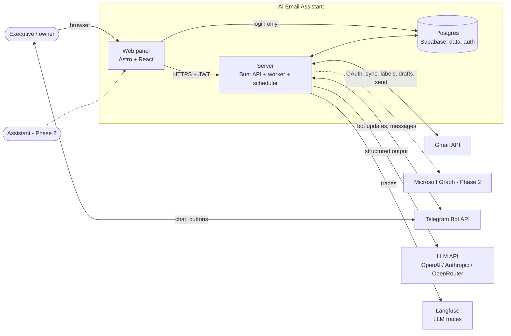
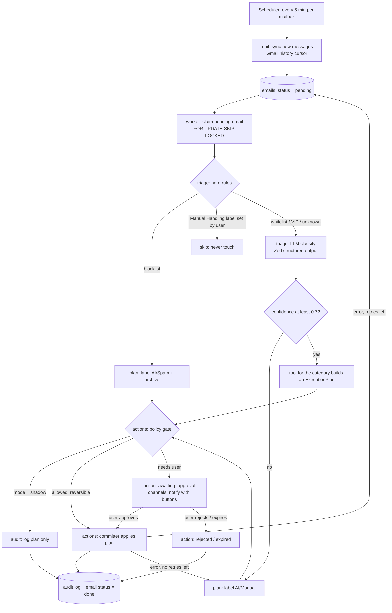
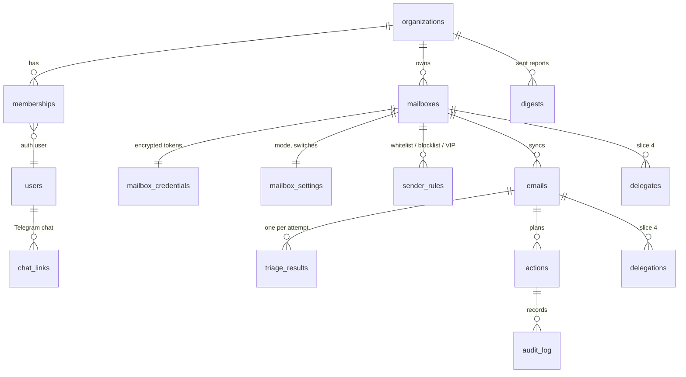

# Architecture — AI Email Assistant

> **Proposed 2026-11-01.** Based on `docs/product-brief.md`. Decisions are in `docs/decisions/` (ADR 0001–0009).
> The old specs in `.ai/architecture/` are history. When they disagree with this file, this file wins.

## 1. Goals and constraints

| Driver | Consequence for the architecture |
|---|---|
| SaaS for business owners and managers | Tenant-aware data model from day one; strict tenant isolation; GDPR. |
| Trust is the product value | Every decision is logged with its reason; actions are reversible where possible. |
| No send without the user's direct command | The LLM never acts. Code plans, a policy gate checks, a committer acts. "Send" needs an approval record. |
| Telegram first, mobile app later | One channel-neutral backend API for notices, approvals and commands. |
| Gmail first, Microsoft 365 later | Mail access behind a provider port. |
| Polish + English, < 200 mails/day/mailbox, small LLM budget | Polling is enough; one cheap model for classification; a better model only for drafts. |
| One developer | One repo, one deployable server process, few moving parts. |

## 2. System context



## 3. Repository layout

One repo, Bun workspaces (ADR 0002).

```
apps/
  web/                 Astro + React + Tailwind + shadcn. Talks only to the server API (+ Supabase Auth for login).
  server/              Bun + Hono. One process; entry flags can start only api / worker / scheduler later.
    src/modules/
      tenancy/         organizations, members, roles, tenant context
      mail/            MailProvider port; gmail/ adapter; sync cursor; OAuth connect; credentials
      triage/          rules engine, classifier (LLM), tools that build plans
      actions/         policy gate, committer, approvals, retries
      delegation/      delegates, delegations, chaser       (slice 4)
      reports/         digest builder, schedule
      channels/        ChatChannel port; telegram/ adapter; chat linking
      config/          per-mailbox switches, mode, lists (whitelist, blocklist), style text
      audit/           append-only action log
    src/platform/      db, llm client, logger, env config, scheduler, http
packages/
  core/                pure TypeScript: domain types, Zod schemas, plan types, rule logic. No I/O. Used by server and web.
supabase/              SQL migrations (source of truth), seed, config
evals/                 prompt evaluation runner + synthetic / anonymized cases (no real mail in git)
docs/                  product-brief.md, architecture.md, decisions/, known-alerts.md
```

Full list of modules, sub-modules, jobs and pages: `docs/modules.md`.

Module rules:
- A module exposes one `index.ts`. Other modules import only from it.
- `packages/core` has no I/O. Business rules there are unit-tested without mocks.
- Ports (interfaces) live in the module that owns them: `MailProvider` in `mail`, `ChatChannel` in `channels`.

## 4. The email pipeline



Each step that crosses a module border is a DB status change that the next worker picks up (see `docs/modules.md` §2).

Pipeline rules:
1. **Hard rules before AI.** A whitelisted sender is never spam. A mail with the user's Manual Handling label is never touched.
2. **The LLM returns data only.** Output: category, confidence, reason, extracted fields. The LLM never names a free-form recipient: it picks a delegate id from the list it was given.
3. **Tools are pure.** A tool turns (email, analysis, config) into an `ExecutionPlan`. Tools live in `packages/core` where possible.
4. **The policy gate decides.** Inputs: mailbox mode, tool switch, action risk, sender VIP status. Output per action: apply / await approval / log only.
5. **Only the committer has side effects.** It applies one action at a time, records the provider result, then writes the audit row in the same DB transaction as the status change.
6. **Exactly-once per email.** Unique key `(mailbox_id, provider_message_id)`. Each action has an idempotency key. A retry never repeats an action that has `applied` status.
7. **Retry with backoff.** Soft errors (timeout, 429) → retry up to 3 times with exponential backoff. Then the email gets `AI/Manual` and status `failed`.

### Mailbox modes and action risk

| Mode | Labels / archive | Drafts | Send |
|---|---|---|---|
| `shadow` (default for a new mailbox) | log only | log only | never |
| `assist` | applied | created | only after explicit user approval |

There is no auto-send mode in MVP (ADR 0003). Each tool also has an ON/OFF switch per mailbox.

Default action set (Gmail labels act as folders; all reversible):

| Category | Plan in `assist` mode |
|---|---|
| Spam / noise | label `AI/Spam`, remove from Inbox (not Gmail Spam, so the user can undo it easily) |
| Notification | label `AI/Notification`, mark read, archive |
| Info | summary saved, label `AI/Info`, archive |
| Urgent / VIP | label `AI/Urgent`, star, push notice now |
| Delegation (slice 4) | delegation draft + `delegations` row + approval request |
| Needs the user / unsure | label `AI/Manual`, stays in Inbox |

### Approval flow (Telegram)

```mermaid
sequenceDiagram
    participant W as Worker
    participant DB as Postgres
    participant TG as Telegram
    participant U as User
    participant C as Committer
    participant G as Gmail

    W->>DB: action(send_draft) status=awaiting_approval
    W->>TG: message "Draft to Jan: ... [Send] [Reject]" (callback = action id)
    U->>TG: taps [Send]
    TG->>C: callback query (chat id, action id)
    C->>DB: check chat → user → org owns action; status still awaiting
    C->>DB: status=approved, approved_by, approved_at, channel
    C->>G: drafts.send
    C->>DB: status=applied + audit row (same transaction)
    C->>TG: edit message "✅ Sent"
```

A direct command ("send it", "send a reminder to Jan") is also an approval. It is recorded the same way.

## 5. Data model (MVP, tenant-aware)



| Table | Key columns |
|---|---|
| `organizations` | id, name, timezone, data_retention_days |
| `memberships` | org_id, user_id, role (`owner` / `assistant`) |
| `mailboxes` | id, org_id, provider (`gmail`), address, status (`active` / `auth_error` / `paused`), sync_cursor |
| `mailbox_credentials` | mailbox_id, encrypted_refresh_token, key_version, scopes — **no client access** (ADR 0009) |
| `mailbox_settings` | mailbox_id, mode, tool_switches jsonb, digest_times, style_text |
| `sender_rules` | mailbox_id, pattern (address or domain), kind (`whitelist` / `blocklist` / `vip`) |
| `emails` | id, org_id, mailbox_id, provider_message_id, thread_id, from, to, subject, received_at, body_text (retention-limited), status, attempts, locked_at |
| `triage_results` | email_id, category, confidence, reason, model, prompt_version, tokens, created_at |
| `actions` | id, org_id, email_id, type, payload jsonb, status (`planned` / `ready` / `logged` / `awaiting_approval` / `approved` / `applied` / `rejected` / `expired` / `failed`), notified_at, idempotency_key, approved_by, approved_at |
| `audit_log` | id, org_id, email_id, action_id, actor (`system` / user id), event, reason, data jsonb, created_at — append-only |
| `chat_links` | user_id, channel (`telegram`), external_chat_id, linked_at |
| `digests` | org_id, user_id, period, content, sent_at |

Tenancy:
- Every domain table has `org_id` (copied down for simple RLS and simple backend filters).
- RLS is on for every table. Policy: `org_id` in the user's memberships. `mailbox_credentials` has RLS on and no policies.
- The server uses a direct DB connection (it bypasses RLS). So every repository function takes a `TenantContext` and filters by `org_id`. Tests check this.

Data retention: `body_text` is cleared after `data_retention_days` (default 30). Metadata, results and audit rows stay.

## 6. Integrations

### Gmail (ADR 0004)
- OAuth 2.0 web flow; scope `gmail.modify` (read, labels, drafts, send). Refresh token stored encrypted.
- Sync: `users.history.list` from the stored `historyId` every 5 minutes. On the first connect, take only mail from the last 24 hours. If the history id is too old, re-sync a 24-hour window.
- Labels `AI/*` are created on connect.
- Later: Pub/Sub push (`users.watch`) instead of polling.
- Before the first external customer: Google OAuth verification + CASA security assessment (restricted scope).
- An app in "Testing" status gets refresh tokens that expire after 7 days. For the pilot, the user re-connects weekly.

### Telegram (ADR 0005)
- One bot. Linking: the web panel (or a CLI in early slices) creates a one-time token. The user opens `t.me/<bot>?start=<token>`. The server stores `chat_id` for that user.
- The server accepts updates only from linked chats.
- Dev: long polling (no public HTTPS needed). Production: webhook with the secret-token header.
- Messages hold short notices and links, not full mail bodies (Telegram is not end-to-end encrypted for bots).
- Inline buttons carry only the action id (callback data is max 64 bytes).

### LLM (ADR 0007)
- Vercel AI SDK; provider and model are config. Two roles: `classifier` (cheap, fast) and `writer` (drafts, summaries).
- Structured output with Zod schemas from `packages/core`.
- Prompt injection defense: the email is put in a marked data block; the output schema has enums and ids only; the policy gate checks every action anyway.
- Each call is traced in Langfuse with the prompt version. `triage_results` stores model + prompt version.
- `evals/` holds labeled cases (synthetic or anonymized). A prompt change must pass the eval before merge.

## 7. Security and privacy

- **Credentials:** AES-256-GCM in the server with a key from env (`CREDENTIALS_KEY`, with a key version for rotation). Never sent to the web app.
- **Tenant isolation:** RLS for any Supabase access + `TenantContext` in every server query.
- **Web → server:** Supabase JWT, verified on the server. The web app does not read domain tables directly.
- **Logs:** no mail bodies and no tokens in logs.
- **LLM provider:** zero-retention / no-training settings; a DPA before the first customer; mark the provider in the privacy policy.
- **EU data:** Supabase project in an EU region; server hosted in the EU for production.
- **Delete:** deleting a mailbox removes credentials, emails and results; deleting an organization removes everything.

## 8. Reliability and operations

- Scheduler in the server process: mailbox sync (5 min), digests (user's times, organization timezone), chaser (daily, slice 4).
- Work queue = `emails` table with `status`, `attempts`, `locked_at`, claimed with `FOR UPDATE SKIP LOCKED`. Safe with more than one worker later.
- Gmail 429 / 5xx → exponential backoff. Auth error → mailbox `auth_error`, a Telegram notice, other mailboxes continue.
- Health endpoint: DB reachable, last successful sync per mailbox.
- Logging: `log` util with levels and a `[module]` prefix. Errors also go to a Telegram admin chat (later).

## 9. Testing

- `bun test` for `packages/core` (rules, policy, plans) — pure, no mocks.
- Adapter contract tests: a fake `MailProvider` and a fake `ChatChannel` implement the same port as the real ones.
- Integration tests against local Supabase (`supabase start`) for repositories and tenant filters.
- Prompt evals in `evals/` (accuracy per category, whitelist rule = 100%).
- Web: Playwright smoke tests from slice 5.
- CI: GitHub Actions — lint, typecheck, `bun test`.

## 10. Deployment

- **Dev / demo:** the azyl server (skill `vps-ssh`): Podman, path `/email_assistant/` on port 53816. Shared server: not for customer data.
- **Production:** an EU host (VPS or container platform) + Supabase in an EU region. Two containers: `server`, `web`.
- Config through env only; `.env.example` lists every key. The server checks env with Zod at start.

## 11. Delivery slices

Detail, scope, sizes and dependencies: `docs/roadmap.md`.

| Slice | Content | Done when |
|---|---|---|
| S0 Foundation | Workspaces layout, env check, logger, CI, new migration (tenancy, mailboxes, credentials, settings, rules, emails, triage_results, actions, audit_log), local Supabase | CI green; migration applies on a clean local DB |
| S1 Shadow triage | Gmail OAuth connect, history sync, rules, LLM classify, plans logged (mode `shadow`), eval runner | One week of the user's mail classified; accuracy measured on ≥ 100 labeled mails |
| S2 Telegram | Bot, chat linking, digest at set times, urgent notice | The user gets the digest in Telegram each day |
| S3 Assist actions | Committer, labels / archive / summary / manual, tool switches, mode switch | `assist` mode runs one week without a wrong irreversible action |
| S4 Drafts + approval + delegation | Delegation + clarification drafts (no general reply writing in MVP), approve / reject / send buttons, delegations, chaser | A delegation goes out only after a button tap and is followed up |
| S5 Web panel | Login, connect mailbox, switches, lists, delegates, audit view | The user can set up a mailbox without the CLI |
| S6 Pre-sale | Google verification + CASA, onboarding, billing, assistant role, account deletion | First external customer can sign up |
| Phase 2 | Style learning, two-way chat + voice, meetings + calendar, Microsoft 365, mobile app, RAG | — |

## 12. What happens to the current code

| Current | Decision |
|---|---|
| `backend/` (Bun package) | Becomes `apps/server/`. |
| `src/` Astro starter | Becomes `apps/web/`. |
| `backend/supabase/migrations/2025…_mental_model_schema.sql` | Replaced by the S0 migration (no production data exists — confirm that no hosted Supabase project uses it). |
| `IDatabaseProvider` / `SupabaseAdapter` (generic CRUD) | Removed. Typed repositories per module with transactions. |
| `ImapEmailProvider` | Kept aside as a possible IMAP adapter (Phase 2). Not used in MVP. |
| `OpenAIAdapter` / `ILLMProvider` | Replaced by the AI SDK client in `platform/llm`. |
| `Providers` factory | Removed; each module builds its adapters from config. |
| `utils/log.ts` | Kept and extended (levels, module prefix). |
| `.ai/` docs | Kept as history. `.ai/AGENT.md` is rewritten in S0 to match this file. |
