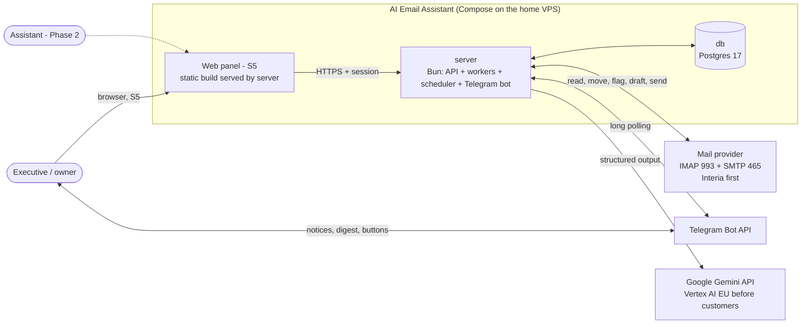
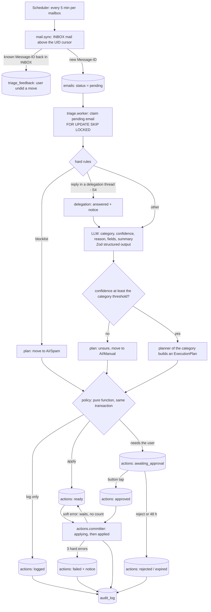
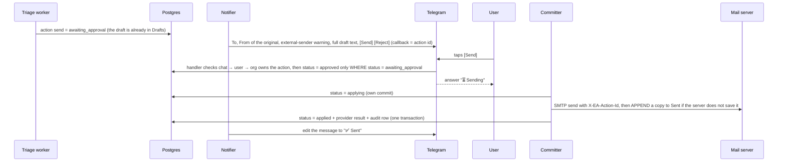
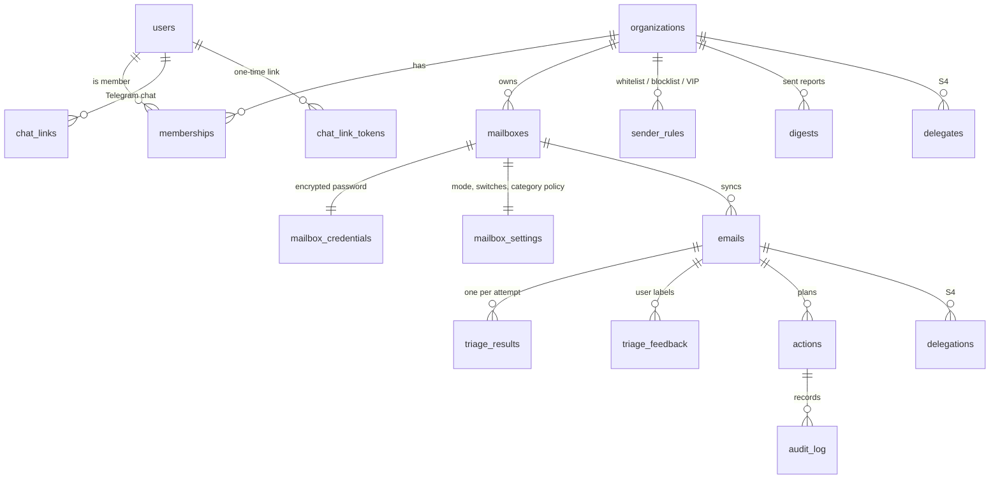

# Architecture — AI Email Assistant

> **Proposed 2026-11-01, revised 2026-11-02** after the cold review (`tasks/done/mvp-plan-review.md`) and the user's answers:
> pilot mailbox = Interia over IMAP, pilot host = home VPS, own Postgres. Based on `docs/product-brief.md`.
> Decisions are in `docs/decisions/` (ADR 0001–0012). The old specs in `.ai/architecture/` are history. When they disagree with this file, this file wins.

## 1. Goals and constraints

| Driver | Consequence for the architecture |
|---|---|
| SaaS for business owners and managers | Tenant-aware data model from day one; strict tenant isolation; GDPR. |
| Trust is the product value | Every decision is logged with its reason; every mailbox change has an Undo; the user can correct each decision. |
| No send without the user's direct command | The LLM never acts. Code plans, a policy checks, a committer acts. "Send" needs an approval record. |
| Telegram first, mobile app later | One channel-neutral backend API for notices, approvals and commands. |
| IMAP + SMTP first (Interia), Gmail / Microsoft 365 later | Mail access behind a `MailProvider` port (ADR 0010). |
| Polish + English, < 200 mails/day/mailbox, small LLM budget | Polling is enough; one cheap model call per mail; cost caps (ADR 0012). |
| One developer, home VPS | One repo, one server process, two containers (`server`, `db`), no inbound port for the pilot. |

## 2. System context



All connections from the server go out. The pilot needs no inbound port until the web panel (S5).

## 3. Repository layout

One repo, Bun workspaces (ADR 0002).

```
apps/
  server/              Bun + Hono. One process: API, workers, scheduler, Telegram bot.
    src/modules/
      tenancy/         organizations, users, memberships, roles, tenant context
      mail/            MailProvider port; imap/ adapter; sync cursor; connect; credentials
      triage/          rules, classifier (LLM), planners, policy call, feedback
      actions/         committer, approvals, undo, retries
      delegation/      delegates, delegations, chaser       (S4)
      reports/         digest builder, schedule
      channels/        ChatChannel port; telegram/ adapter; chat linking
      config/          per-mailbox mode and switches, category policy, sender rules, style text
      audit/           append-only action log
    src/platform/      db, llm client, crypto, logger, env config, scheduler, http
  web/                 Web panel (S5). Talks only to the server API.
packages/
  core/                Pure TypeScript: domain types, Zod schemas, categories, rules, policy, planners, digest. No I/O.
db/migrations/         SQL migrations (source of truth)
deploy/                compose.yaml, Dockerfile for server, backup script
evals/                 Eval runner + synthetic and injection cases (no real mail in git)
docs/                  product-brief.md, architecture.md, modules.md, roadmap.md, decisions/, known-alerts.md, code-patterns.md
```

Full list of modules, sub-modules, jobs and pages: `docs/modules.md`. Code rules for agents: `docs/code-patterns.md`.

Module rules:
- A module exposes one `index.ts`. Other modules import only from it.
- `packages/core` has no I/O. Business rules there are unit-tested without mocks.
- Ports (interfaces) live in the module that owns them: `MailProvider` in `mail`, `ChatChannel` in `channels`.

## 4. The email pipeline

### 4.1 Flow



Each step that crosses a module border is a DB status change that the next worker picks up (`docs/modules.md` §2).

Pipeline rules:
1. **Hard rules before AI.** Blocklisted sender → spam, no LLM call. Whitelisted or VIP sender → the classifier gets the category list without `spam`.
   The system reads only INBOX, so mail in the user's own folders is never touched.
2. **The LLM returns data only:** category, confidence, reason code + short reason, extracted fields, a delegate id from a given list,
   and the summary for `info` mail. It never names a free-form recipient.
3. **Planners are pure.** A planner turns (email, analysis, config) into an `ExecutionPlan`. Planners live in `packages/core`.
4. **The policy decides, inside the triage transaction.** The triage worker calls the pure policy and writes actions as
   `ready`, `awaiting_approval` or `logged`. There is no separate gate job and no `planned` status. Truth table: §4.3.
5. **Only the committer changes the mailbox or sends.** It applies one action at a time.
   For a non-idempotent action (`create_draft`, `send`) it first commits status `applying`. After the call it writes
   the provider result, the audit row and the new status in one transaction.
6. **Exactly-once.** Unique key per email: `(mailbox_id, message_id_header)`. Each action has an idempotency key.
   Drafts and sent mail carry the header `X-EA-Action-Id`. When the committer finds an action in `applying` after a crash,
   it searches Drafts / Sent for that header before any retry.
7. **Retries live on the row that failed.** LLM errors retry the email (`emails.attempts`); mailbox errors retry the action (`actions.attempts`).
   Soft errors (timeout, 429, 503, lost connection) wait with backoff and do not count. After 3 hard errors:
   an email becomes `unsure` (reason `triage_error`); an action becomes `failed`, and the user gets a notice.
8. **Cost limits.** A daily cap of LLM calls per mailbox (default 300). Mail older than 7 days is not sent to the LLM;
   the digest lists it as "not processed" (ADR 0012).

### 4.2 Categories and folders

One category per mail (Zod enum `Category` in `packages/core`). One folder per mail. Tags use IMAP keywords when the server allows them; else they live only in the DB.

| Category | Meaning | Plan in `assist` mode |
|---|---|---|
| `urgent` | Needs the user today | Flag, stays in INBOX, Telegram notice now |
| `needs_reply` | Needs the user's own answer. Meeting requests go here in MVP (meetings are Phase 2) | Stays in INBOX; digest section NEEDS ACTION |
| `delegation` (S4) | A task for a delegate | Delegation draft + `delegations` row + approval request |
| `info` | Information, no action | Summary saved; move to `AI/Info` |
| `notification` | Automatic mail from systems | Mark read; move to `AI/Notifications` |
| `spam` | Unwanted mail (blocklist or AI) | Move to `AI/Spam` (not the provider's spam folder, so Undo is easy) |
| `unsure` | Low confidence, or triage failed 3 times | Move to `AI/Manual`; digest section NEEDS ACTION |

- **VIP** is a sender flag (`sender_rules.kind = vip`), not a category. A VIP is also whitelisted. The system never moves or marks read a VIP mail automatically.
- **`AI/Manual`** is the "Manual Handling" folder of the product brief: the system puts mail there and never reads that folder again.
- Folder names come from `mailboxes.folder_map` (per provider). The connect step creates the `AI/*` folders.
- Confidence threshold: one per category, set from the S1b eval data (start value 0.7). Stored in `mailbox_settings.category_policy`.

### 4.3 Mailbox modes and the policy table

| Mode | Meaning |
|---|---|
| `shadow` (default for a new mailbox) | The system changes nothing in the mailbox. It logs what it would do and reports it. |
| `assist` | The system applies allowed actions. Send happens only after the user's approval. |

There is no auto-send mode in MVP (ADR 0003). Each action type has an ON/OFF switch per mailbox (`tool_switches`).
A category gets automatic moves only after it passes the go/no-go bar of the S1b report (default: precision ≥ 98%).

| Action | `shadow` | `assist` | Sender is VIP |
|---|---|---|---|
| Telegram notice, digest line | apply | apply | apply |
| Save summary (DB only) | apply | apply | apply |
| Move to an `AI/*` folder | log only | apply if the switch is ON and the category passed go/no-go; else log only | log only |
| Mark read | log only | same as move | log only |
| Flag | log only | apply if the switch is ON | apply if the switch is ON |
| Create draft (APPEND to Drafts) | log only | apply if the switch is ON | apply if the switch is ON |
| Send (SMTP) | never | await approval | await approval |
| Undo (reverse plan) | — | apply on the user's tap | apply on the user's tap |

### 4.4 Feedback, Undo and the success metric

- **Feedback sources:** labeling CLI (S1b); ✅ / ✏️ buttons under each digest line (S2); the Undo button (S3);
  a mail that the user moves back to INBOX (the sync finds its known `Message-ID`); the web panel (S5).
  Every source writes a `triage_feedback` row. A known mail that comes back to INBOX is never triaged again (no loop).
- **Undo:** the committer applies the reverse plan (move back to INBOX, mark unread, remove the flag).
  The original action gets status `undone`, and a feedback row "wrong" is written.
- **Eval on real mail:** the eval runner reads the labels from `triage_feedback` in the DB. Real labels never go to git.
  Real-mail evals use mail younger than 30 days (the body is cleared after that, §7).
- **Success metric** ("share of mail handled without the user", target 80–90%):
  handled = mail in `spam`, `notification`, `info`, or `delegation` sent after one tap, with an applied plan
  that the user did not undo or correct within 7 days. Share = handled ÷ all triaged mail. One line in the weekly digest.

### 4.5 Approval flow (Telegram)



- Before S5 the approval message shows the full draft text, because there is no web link to the draft. From S5 it shows a link to the web panel.
- A second tap finds the status changed and does nothing. An expired or rejected action cannot send.
- "Send all reminders" (brief, follow-up) is one approval for a listed set of reminder actions.

### 4.6 Status flows

```
emails.status:   pending → processing → triaged → done          (done = all its actions have an end status)
                                └→ pending                      (LLM soft error: waits; hard error: attempts + 1)
                                └→ triaged as `unsure`          (after 3 hard errors, reason triage_error)
actions.status:  ready → applying → applied → undone            (undone by the Undo button)
                 awaiting_approval → approved → applying → applied
                                   → rejected | expired         (expired after 48 h)
                 logged                                         (shadow mode or policy "log only")
                 ready / approved / applying → failed           (after 3 hard errors; notice to the user)
```

## 5. Data model (MVP, tenant-aware)



| Table | Key columns | Slice |
|---|---|---|
| `organizations` | id, name, timezone, data_retention_days (default 30), style_text | S0 |
| `users` | id, email, display_name (login method decided in S5, ADR 0011) | S0 |
| `memberships` | org_id, user_id, role (`owner` / `assistant`), digest_times | S0 |
| `mailboxes` | id, org_id, protocol (`imap`), address, imap_host, imap_port, smtp_host, smtp_port, status (`active` / `auth_error` / `paused`), uidvalidity, last_uid, last_synced_at, capabilities jsonb, folder_map jsonb | S1a |
| `mailbox_credentials` | mailbox_id, encrypted_secret, secret_kind (`password` / `app_password`), key_version — server only (ADR 0009) | S1a |
| `mailbox_settings` | mailbox_id, mode, tool_switches jsonb, category_policy jsonb (auto on/off + threshold per category) | S1a |
| `sender_rules` | org_id, mailbox_id (null = all mailboxes), pattern (address or domain), kind (`whitelist` / `blocklist` / `vip`) | S1b |
| `emails` | id, org_id, mailbox_id, message_id_header, uid, folder, thread_key, in_reply_to, references, direction, from, to, cc, subject, received_at, body_text (retention), status, attempts, next_attempt_at, locked_at | S1a |
| `triage_results` | email_id, org_id, category, vip, confidence, reason_code, reason, fields jsonb, model, prompt_version, tokens_in, tokens_out, latency_ms, created_at | S1b |
| `triage_feedback` | org_id, email_id, true_category, source (`cli` / `telegram` / `undo` / `imap_move` / `web`), user_id, created_at | S1b |
| `actions` | id, org_id, email_id, type, payload jsonb, status (§4.6), attempts, next_attempt_at, last_error, provider_result jsonb, idempotency_key, reverses_action_id, notified_at, approved_by, approved_at, approved_via | S1b |
| `audit_log` | id, org_id, email_id, action_id, actor (`system` / user id), event, reason_code, data jsonb (ids, codes, numbers only), created_at — append-only | S1b |
| `chat_links` | user_id, channel (`telegram`), external_chat_id, linked_at | S2 |
| `chat_link_tokens` | token_hash, user_id, expires_at (15 min), used_at | S2 |
| `digests` | org_id, user_id, period_start, period_end, content (retention), sent_at | S2 |
| `delegates` | id, org_id, name, email, competence_tags, active | S4 |
| `delegations` | id, org_id, email_id, delegate_id, action_id, task_summary, due_at, status (`drafted` → `sent` → `answered` / `overdue` → `done`), sent_message_id, last_reminder_at, answered_email_id | S4 |

Each slice adds the migration for its own tables (column "Slice").

Tenancy:
- Every domain table has `org_id` (copied down for simple filters).
- The server uses its own DB role `app`. Every repository function takes a `TenantContext` and filters by `org_id`. Integration tests check this (ADR 0011).
- No client reads the DB directly. Option for S6: RLS for the server role with `set_config('app.org_id', …)` per transaction.

## 6. Integrations

### 6.1 Mail: IMAP + SMTP (ADR 0010)

- **Connect:** CLI `bun run mailbox:connect` (S1a), web form in S5. It asks for the address and the password (an app password if the provider has one),
  tests the IMAP and SMTP login, reads the server capabilities and the special-use folders (Drafts, Sent, Trash),
  creates the `AI/*` folders, and stores the encrypted secret. TLS certificates are always checked.
- **Sync cursor:** INBOX `UIDVALIDITY` + last UID. Every 5 minutes: fetch UIDs above the cursor. IMAP IDLE (push) can come later.
- **Which mail is new:** a message in INBOX whose `Message-ID` the DB does not know, not sent by the mailbox owner,
  and without the header `X-EA-Action-Id`. Mail without a `Message-ID`: key = hash of from, date, subject and size.
- **Known mail back in INBOX:** the user undid a move. Write `triage_feedback` (source `imap_move`). Never triage it again.
- **First connect:** only INBOX mail from the last 24 hours.
- **After an outage:** the next sync takes all UIDs above the cursor (IMAP keeps them). Mail older than 7 days is stored but not sent to the LLM.
- **UIDVALIDITY change:** rescan INBOX mail of the last 7 days; the `Message-ID` key stops duplicates.
- **Threads:** `thread_key` = the first `Message-ID` in `References`, else `In-Reply-To`, else the mail's own `Message-ID`.
  The LLM gets the last 3 mails with the same `thread_key` from the DB as context.
- **Move:** `UID MOVE` if the server has MOVE; else `UID COPY` + `\Deleted` + `UID EXPUNGE` (needs UIDPLUS). A move gives a new UID;
  the system finds the mail again by `Message-ID` (`SEARCH HEADER Message-ID`).
- **Mark read / flag:** `\Seen` / `\Flagged`.
- **Draft:** APPEND to the Drafts folder with the `\Draft` flag and the header `X-EA-Action-Id`.
- **Send:** SMTP (`nodemailer`) with `X-EA-Action-Id`, `In-Reply-To` and `References`. Then APPEND a copy to Sent, but only if the server
  does not save sent mail by itself (S1a checks this at Interia). Before a retry, search Sent for the header.
- **Capabilities to check per mailbox (S1a):** IDLE, MOVE, UIDPLUS, CONDSTORE, SPECIAL-USE, custom keywords (`PERMANENTFLAGS \*`), auto-save of sent mail.
- **Interia setup:** the user turns on "korzystam z programu pocztowego" (Ustawienia → Główne ustawienia → Parametry).
  IMAP `poczta.interia.pl:993`, SMTP `poczta.interia.pl:465`, both SSL/TLS, login = the full address.
- **Later:** Gmail (OAuth, or an app password with 2-Step Verification) and Microsoft 365 (OAuth / Graph; password IMAP is off) as new adapters.
  Gmail OAuth needs Google verification and a yearly CASA assessment (`notes/2026-11-02-external-facts-gmail-gemini-telegram.md`).

### 6.2 Telegram (ADR 0005)
- One bot per environment: a dev bot and a pilot bot. Telegram allows only one update consumer per bot token.
- Long polling on the dev machine and on the home VPS. A webhook with the `X-Telegram-Bot-Api-Secret-Token` header only when the server has a public HTTPS address.
- Linking: the web panel (or a CLI before S5) creates a one-time token bound to one user, valid for 15 minutes.
  The user opens `t.me/<bot>?start=<token>`. The server stores the `chat_id` for that user.
- The server accepts updates only from linked chats. Inline buttons carry only the action id (`callback_data` is max 64 bytes).
- Content on Telegram: notices, digest lines (sender, subject, AI summary), draft text for approval. No raw mail bodies.
  Bot chats are not end-to-end encrypted; the user accepts this content on Telegram servers.

### 6.3 LLM (ADR 0007, ADR 0012)
- Google Gemini through `@google/genai`, only inside `platform/llm.ts`. Model ids from config: `GEMINI_MODEL` (dev: `gemini-3.8-flash`),
  optional `GEMINI_MODEL_CLASSIFIER`. Two roles: `classifier` (one call per mail, summary included) and `writer` (drafts, S4).
- Structured output: JSON schema from the Zod schema in `packages/core`; the result is checked with Zod again.
- Each call: timeout 30 s; lowest thinking setting for `classifier`; 429 / 503 / timeout are soft errors; a rate limiter keeps calls under the tier limit.
- `triage_results` stores model, prompt version, tokens in/out and latency.
- **Data by stage:** pilot = Gemini API paid tier (55-day abuse logging, no EU location; accepted by the user 2026-11-02).
  Before the first external customer = Vertex AI with the EU endpoint and its zero-data-retention setup.
- **Billing gate:** free tier only with test data. Cloud Billing on before the system reads real mail (first point: S1b).
- `evals/` holds synthetic and injection cases. A prompt or model change must pass the eval before merge (§9).

## 7. Security and privacy

- **Credentials (ADR 0009):** AES-256-GCM in the server, key `CREDENTIALS_KEY` from env with a key version. The secret is decrypted only in memory.
  It never goes to logs, to the web app or to Telegram. Prefer an app password: the stored secret opens the whole mailbox.
- **TLS:** IMAP and SMTP always check certificates.
- **Tenant isolation:** `TenantContext` in every server query; DB role `app` without superuser rights; tests for the filters (ADR 0011).
- **Untrusted text in and out.** Mail text is untrusted, and so is text that the LLM writes from it.
  - The email goes into a marked data block; the output schema has enums and ids only; the policy checks every action.
  - Delegation drafts quote the original mail and add an instruction from a template. The LLM fills only fields (task, due date).
  - Links, bank account numbers and phone numbers in LLM text are removed or marked.
  - The approval message shows the recipient, the original sender with an "external sender" warning, and the full draft (§4.5).
  - `evals/` has prompt-injection cases from S1b; S4 has a test that an injected mail never reaches approval without the warning.
- **Logs:** no mail bodies, no passwords, no keys.
- **Retention:**

  | Data | Where | Kept |
  |---|---|---|
  | Mail body text | `emails.body_text` | 30 days (`organizations.data_retention_days`) |
  | Subject, addresses | `emails` | 90 days, then cleared (the row stays for counts) |
  | Summaries, draft text, reasons | `actions.payload`, `triage_results.reason` | 90 days |
  | Digest text | `digests.content` | 90 days |
  | Audit events (ids, codes, numbers) | `audit_log` | until the mailbox or organization is removed |
  | Labels (no mail text) | `triage_feedback` | until the mailbox or organization is removed |

- **Delete:** removing a mailbox deletes its credentials, emails, results, feedback, actions and audit rows (one privileged function),
  and tells the user to change the mailbox password. Removing an organization deletes everything.
- **Privacy by stage:**

  | | Pilot (the user's own mail) | External customers (S6) |
  |---|---|---|
  | LLM | Gemini API paid tier; 55-day abuse logging; no EU location | Vertex AI EU endpoint; zero-data-retention setup |
  | Server + DB | home VPS of the user | hosted EU VPS |
  | Papers | — | Privacy policy names Google as processor; DPA with Google |

## 8. Reliability and operations

- **Scheduler** (in the server process, `croner`, one tick never overlaps the next): mail sync every 5 min per mailbox;
  triage worker, committer and notifier every 15 s; digest at each member's times (organization timezone); approval expiry hourly;
  retention cleanup daily; chaser daily (S4).
- **Work queue:** `emails` and `actions` rows with `status`, `attempts`, `next_attempt_at`, `locked_at`, claimed with `FOR UPDATE SKIP LOCKED`.
- **Mailbox errors:** IMAP/SMTP login error → mailbox `auth_error`, a Telegram notice, other mailboxes continue. Connection errors → backoff.
- **Liveness:** the server sends a heartbeat every 5 min to an external dead-man's-switch service (outbound only). The service alerts when heartbeats stop.
  A Telegram admin notice goes out when the last good sync is older than 30 min. Every digest shows "last sync HH:MM", also when it is empty.
- **`GET /health`:** DB reachable, last good sync per mailbox.
- **Backups (before S3):** a nightly `pg_dump`, encrypted (for example with `age`), copied off the VPS. One restore test per month.
- **Logging:** `log` util with levels and a `[module]` prefix.

## 9. Testing

- **Unit** (`bun test`, `packages/core`): categories, rules, policy, planners, digest. Pure, no mocks, no containers.
- **Integration:** repositories and tenant filters against Postgres in a container. Start the container once; each test runs in a transaction that rolls back.
- **Mail adapter:** contract tests — the fake `MailProvider` and the IMAP adapter pass the same suite.
  CI runs the IMAP adapter against a local mail-server container (for example GreenMail). Check that it has the same extensions as Interia.
- **Test mailbox:** a second Interia account for tests only. A seed script APPENDs the synthetic eval mails into its INBOX (APPEND does not send).
  Use it before the billing gate and for the 48-hour sync test (S1a).
- **Evals** (`evals/`): synthetic and injection cases in git; real labels only in the DB. Report per category: precision and recall; whitelist rule 100%.
  CI runs the eval only when `prompts/`, `evals/` or the model config change, with a paid key and a budget alert.
- **Web:** Playwright smoke tests (S5).
- **CI:** GitHub Actions — lint, typecheck, unit tests, integration tests (service containers: Postgres, mail server).
- **Containers and time (estimates):**

  | Step | Container use | Time |
  |---|---|---|
  | Dev loop on the Mac | only `db` runs in a container; the server runs with `bun --watch` | restart < 1 s |
  | Unit tests | none | seconds |
  | Integration tests | `db` (and the mail server) already running | seconds to start, plus test time |
  | CI | service containers start in parallel with checkout and install | about +10–20 s per run |
  | Server image build (deploy only) | `oven/bun` base; the dependency layer is cached while `bun.lock` does not change | first build about 1–2 min, later about 10–30 s |
  | Postgres image | stock `postgres:17`, no build | one pull, start in seconds |

## 10. Deployment

- **Dev:** the user's Mac. `docker compose up db`, server with `bun --watch`, the dev Telegram bot, the test Interia mailbox.
- **Pilot:** the home VPS, on all the time. Compose (Docker or Podman) with two services:
  - `db`: `postgres:17`, a named volume, no public port;
  - `server`: an image built on the VPS from the repo, `restart: unless-stopped`, env file with mode 600.
  No inbound port: IMAP, SMTP, Telegram long polling and Gemini are outbound connections.
  The web panel (S5) needs inbound access: a reverse proxy with TLS or a tunnel (decide in S5).
- **Production for external customers (S6):** a hosted EU VPS with the same Compose files (availability, physical security, GDPR duties of a processor).
- **azyl dev server:** demos with test data only. Its home folder is shared with other projects (skill `vps-ssh`).
- **Config:** env only; `.env.example` lists every key; the server checks env with Zod at start.

## 11. Delivery slices

Detail, scope, sizes and dependencies: `docs/roadmap.md`. Goal, done-when, plan and status of each slice: its task file in `tasks/`.

| Slice | Content | Task file |
|---|---|---|
| S0 Foundation | Workspaces, env check, logger, DB layer + migration runner, tenancy tables, Compose `db` for dev, CI, `/health`, old code removed | `s0-foundation.md` |
| S1a IMAP read + pilot host | IMAP adapter (read), connect CLI, encrypted password, sync with the IMAP rules, test mailbox, Compose on the home VPS, heartbeat, backups | `s1a-imap-read-pilot-host.md` |
| S1b Shadow triage | Hard rules, classifier, planners, policy (`shadow`), audit, feedback table, labeling CLI, eval runner, cost caps; billing gate before real mail | `s1b-shadow-triage.md` |
| S2 Telegram | Bot, chat linking, shadow digest with feedback buttons, urgent and `auth_error` notices, commands | `s2-telegram.md` |
| S3 Assist actions | Committer, folder moves / mark read / flag, Undo, retries, go/no-go per category, mode switch | `s3-assist-actions.md` |
| S4 Drafts + approval + delegation | Delegation and clarification drafts, approval with buttons, send by SMTP, delegations, chaser, injection guards | `s4-drafts-approvals-delegation.md` |
| S5 Web panel (lite) | Login, connect mailbox, link Telegram, settings, rules, activity | `s5-web-panel.md` |
| S6 Pre-sale | Sign-up, billing, deletion, hosted EU production, Vertex AI EU, privacy policy + DPA, cost model | `s6-pre-sale.md` |
| Phase 2 | Gmail and Microsoft 365 adapters (OAuth; Gmail needs Google verification), style learning, two-way chat + voice, meetings + calendar, mobile app, RAG | — |

## 12. What happens to the current code

| Current | Decision |
|---|---|
| `backend/` (Bun package) | Becomes `apps/server/` (S0). |
| `src/` Astro starter | Becomes `apps/web/` (S0); the web stack is decided at the S5 start (static build served by the server is preferred). |
| `backend/supabase/` and migration `20251202212208_…` | Removed in S0 (ADR 0011). New SQL migrations in `db/migrations/`. |
| `IDatabaseProvider` / `SupabaseAdapter` (generic CRUD) | Removed. Typed repositories per module with transactions. |
| `ImapEmailProvider` | Reference only for the new `mail/imap/` adapter (S1a): UID cursor, `mailparser` for bodies, TLS check on. |
| `get_provider.ts` (`Providers` factory) | Removed. It turns off the TLS check for Interia (line 35). |
| `OpenAIAdapter` / `ILLMProvider` | Replaced by `platform/llm.ts` (Gemini). |
| Dependencies `openai`, `express`, `helmet`, `cors`, `googleapis`, `@supabase/supabase-js`, `dotenv` | Removed in S0 (Bun reads `.env`). `imapflow` and `@google/genai` stay. |
| `utils/log.ts` | Kept and extended (levels, module prefix). |
| `.ai/` docs | Kept as history. Code rules for agents: `docs/code-patterns.md`. |
