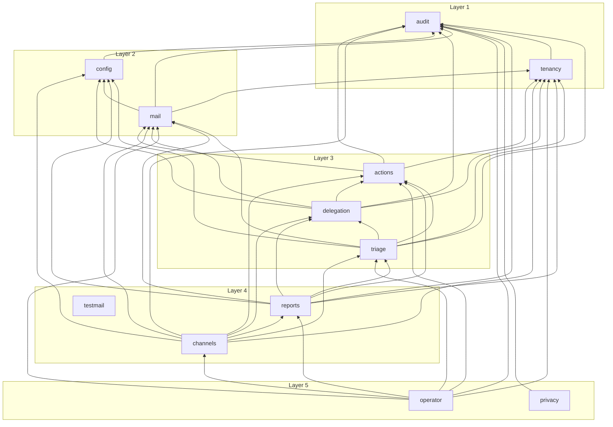

# Server module graph

> Generated by `bun run graph:modules` from the imports in `apps/server/src/modules/` (test files not counted). Do not edit: change the code, then run the command. `apps/server/src/modules/layers.test.ts` fails when this file is stale.

Arrow = "imports". Layer 1 is the lowest. `platform` sits below layer 1; the composition roots (`apps/server/src/*.ts`, `apps/server/src/scripts/`) sit above layer 5. Layers and the allowed same-layer edges: `apps/server/src/modules/layers.json`. Rules: `docs/code-patterns.md` § Layers and borders.

