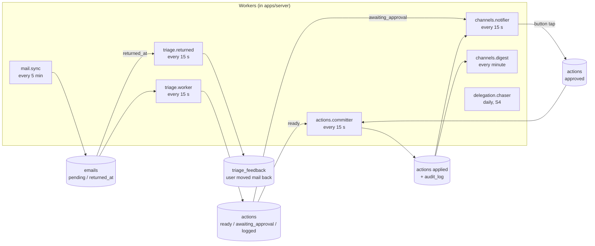
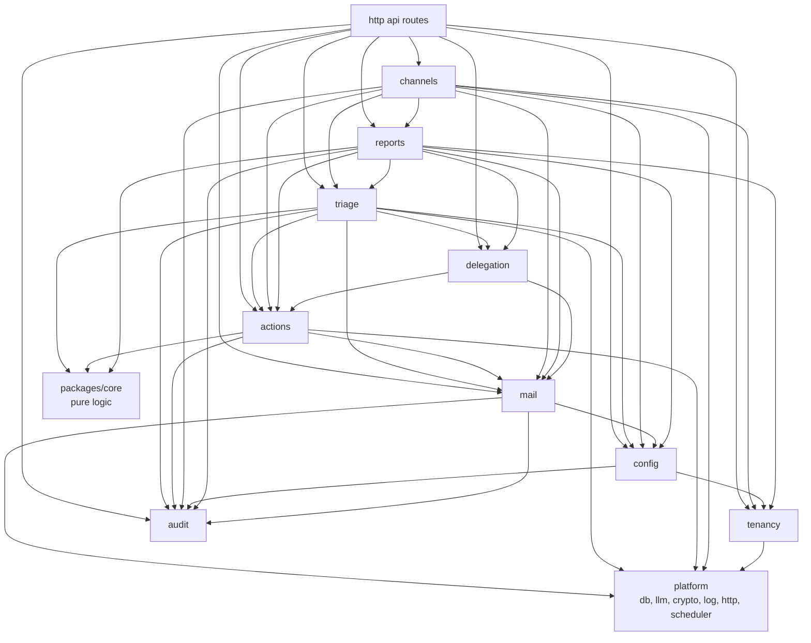

# Module catalog — AI Email Assistant

> **Accepted 2026-11-02** (user). Revised 2026-11-02 after the cold review (IMAP first, own Postgres, feedback and Undo) and a second review (`tasks/done/docs-and-adr-review.md`).
> Detail for `docs/architecture.md` sections 3–5. Decisions: `docs/decisions/`.

## 1. Big picture

- **One repository** (monorepo, Bun workspaces). Not many repos: one developer, shared types, one CI, atomic changes.
  A future mobile app also goes into this repo as `apps/mobile`.
- **Two containers in the pilot:** `server` (one Bun process; from S5 it also serves the web build) and `db` (Postgres 17). Compose files in `deploy/`.
- **One shared package:** `packages/core` (pure logic + Zod schemas, no I/O).

```
email_assistant/
├─ apps/
│  ├─ server/        Bun + Hono: HTTP API, workers, scheduler, Telegram bot
│  ├─ web/           Web panel (S5)
│  └─ mobile/        (Phase 2) mobile app
├─ packages/
│  └─ core/          domain types, Zod schemas, categories, rules, policy, planners, digest builder
├─ db/migrations/    SQL migrations
├─ deploy/           compose.yaml, server Dockerfile, backup script
├─ evals/            prompt evaluation
└─ docs/
```

## 2. How the modules talk

Principle: **the database holds the state; small workers move it forward.**
A module does not call the next module in a long chain. It writes a row with a new status. The next worker picks it up.



Small jobs (not in the picture): `actions.expiry` (hourly), `platform.retention` (daily), `platform.heartbeat` (every 5 min).

Why:
- **Crash safety.** If the process stops, no work is lost. On restart each worker continues from the DB state.
- **No import cycles.** Example: `actions` needs to ask for approval and `channels` needs to approve actions.
  `actions` only sets `awaiting_approval`; `channels.notifier` reads it. `channels` calls `actions.approve()` on a button tap.
- **Visible state.** Each email and action has a status you can query and show.
- Latency is seconds to minutes. This is fine for email. Urgent notices go out within one notifier tick after triage (≤ 10 min after arrival).

Direct calls stay for reads and simple commands (for example `triage` reads `config` rules; API routes call module services).
The triage worker calls the pure policy from `packages/core` in its own transaction (no separate gate job).

Module dependencies (arrow = "uses"):



`triage → delegation`: the hard rule "reply in a delegation thread" reads open delegations (S4).
`triage → actions`: the triage worker writes the action rows through `actions.createPlanned()` in its transaction. The returned job (`triage/returned.ts`, S3) locks and updates the original move through `lockLatestOriginalMove` and `markUndone`.
`triage → audit`: the triage worker and `triage/backfill.ts` write audit rows through `audit.recordAudit()` in their transactions.
`channels → triage`: the ✅ / ✏️ buttons and the Undo button write feedback through `triage.recordFeedback()`.
`channels → actions`: the Undo tap calls `actions.undo()` (S3); the notifier reads the failed actions (`listFailedUnnotified`, `markNotified`); `/status` counts the actions (`countActionsSince`).
`actions → mail`: the committer and Undo use `locateMessage`, `listFolderUids`, `openMailboxProvider`, `updateEmailLocation` and the port (S3).
`config → audit`: the setters write the `mailbox.*_changed` audit rows in their transaction (S3).
`config` gets `expireReady` as a dependency (`SettingsDeps.expireReady`, passed by the caller from the `actions` index) and never imports `actions` at run time:
`config → actions → mail → config` would be a cycle (`mail/connect.ts` imports `insertDefaultSettings`).
`channels → config`, `channels → audit`: the digest and `/status` read the mailbox mode; `/pause` and `/resume` write `mailbox.paused` / `mailbox.resumed` audit rows.
`reports → mail`, `reports → config`: the digest reads the mailboxes (status, last sync, waiting mail) and their mode. `channels → reports`; `reports` never imports `channels` (no cycle).
`mail → audit`: a status change (`updateMailboxPassword`) and its audit row go in one transaction.
`mail → config`, `mail → audit` (`mail/connect.ts`): `insertDefaultSettings` and `recordAudit`.
`actions` never calls `triage`, and `mail` never calls `triage`: they set columns that the triage worker reads (no import cycles).

## 3. Modules in `apps/server`

Each module folder: `index.ts` (public API), `service.ts`, `repo.ts` (DB), `routes.ts` (HTTP, if any), `jobs.ts` (workers, if any), `*.test.ts`.
Code rules: `docs/code-patterns.md`.

### 3.0 `platform` — technical base (not a business module)

| Part | Does | Tech |
|---|---|---|
| `config` | Reads and checks env at start; fails fast on a missing key | Zod |
| `db` | Postgres pool, transactions, `TenantContext`, generated types, migration runner | Kysely + kysely-codegen, `pg`; `dbmate` (chosen in S0) |
| `llm` | Roles `classifier` / `writer`, structured output, timeout, rate limiter, soft-error rules | `@google/genai` (Gemini), Zod |
| `crypto` | AES-256-GCM encrypt / decrypt with key version | `node:crypto` |
| `log` | Levels, `[module]` prefix, no mail bodies or secrets | own `log` util |
| `http` | Hono app, session check (S5), error handler, `/health` | Hono |
| `scheduler` | Cron-like timers for jobs; one tick never overlaps the next | croner |
| `retention` (job) | Clears text columns after their retention time (`docs/architecture.md` §7) | — |
| `heartbeat` (job) | Pings the external dead-man's-switch service | — |

### 3.1 `tenancy` — who is who (S0)

- **Owns:** `organizations`, `users`, `memberships`.
- **Does:** creates the pilot organization and user (CLI `bun run org:create`, S0); owns style text and digest times; resolves `TenantContext` from a session (web) or a linked chat (Telegram); checks roles.
- **Built in S2:** `getMembership` (a member's role by `org_id` and `user_id`) and `setDigestTimes` (CLI `bun run digest:times`; the new default of `digest_times` is `{08:00,16:00}`).
- **Later:** login (S5), self sign-up (S6), invite assistant (Phase 2).

### 3.2 `mail` — access to mailboxes (S1a)

| Sub-module | Does |
|---|---|
| `port.ts` | `MailProvider` port. Read: `serverInfo`, `inboxStatus`, `fetchAbove`, `searchInboxSince`, `fetchByUids`, `fetchBodyText`, `close`. S3 folder-aware read: `fetchMetaIn`, `searchSinceIn`, `fetchByUidsIn`. S3 write: `ensureFolder`, `moveMessage`, `deleteMessage`, `setFlags`. `findByMessageId` is removed (it never works at Interia). `MailAuthError`, `MailNotFoundError`. Draft and send come in S4 |
| `imap/client.ts` | `ImapMailProvider` over TLS (`imapflow`): INBOX status (STATUS / highest UID fallback for `UIDNEXT`), UID fetch, search, body text; S3: the write methods (own `UID COPY` + `UID EXPUNGE` when the server has no MOVE; every imapflow `false` is a `HardError`), the option `forceCopyMove` for tests |
| `imap/mapper.ts` | IMAP message → `MessageMeta` / body text (`mailparser`, `html-to-text`), size limit |
| `imap/smtp.ts` | SMTP login check (`nodemailer`); send comes in S4 |
| `imap/probe.ts`, `imap/tools.ts` | Write probes for `mailbox:check --probe`; APPEND for the seed tool (test only) |
| `imap/probe-move.ts` | S3 spike (`assertTestAddress`, `probeMove`): checks the move facts on the test mailbox with one synthetic mail (CLI `mailbox:probe-move`) |
| `locate.ts` | `locateMessage`, `locateKeyOf`: finds a known mail in a folder by identity, with no header search; skips `\Deleted` and the UIDs of `excludeUids` (architecture §6.1) |
| `open.ts` | `openMailboxProvider`: decrypts the secret in memory and opens a provider; the committer opens its connection with it |
| `connect.ts` | `connectMailbox`: IMAP + SMTP login check, capabilities, folder map, encrypted secret, default settings (CLI `mailbox:connect`) |
| `check.ts` | `checkMailbox`: read-only capability report, optional write probes (CLI `mailbox:check`) |
| `sync-rules.ts` | Pure rules: `Message-ID` normalize, content hash, dedup keys, thread key, cursor filter, decisions for incoming mail; S3: `sameMailIdentity`, `isDeleted` |
| `sync.ts` | `syncMailbox`: modes `initial` (24 h), `incremental` (UID cursor), `rescan` (7 days after a UIDVALIDITY change); S3: the below-cursor return check at the end of an incremental sync. `backfillInbox` (S1b): one-off, read-only fetch of the last 1–180 days; stores missing mail with `backfilled_at`; the cursor never moves |
| `jobs.ts` | `createMailSyncJob`: every 5 min for each active mailbox (`listSyncTargets`); one mailbox error never stops the others |
| `repo.ts` | `mailboxes`, `mailbox_credentials`, `emails` queries; guarded cursor update; `forceRescan`; S3: `listRecentlyMoved`, `listFolderUids`, `listReturned`, `clearReturned`, `updateEmailLocation`, `setFolderMapEntry`, `setUndoPending`, `getEmailMailbox` |
| `seed.ts`, `audit.ts`, `tools.ts` | 48-hour test tools: `mailbox:seed` (test address only; S1b: `--eval-cases synthetic\|injection\|all` seeds the eval cases), `mailbox:rescan`, `mailbox:audit`; S1b: `backfillMailbox` (backfill only); the script `mailbox:backfill` then calls `triage.requeueBackfillWindow` |
| `fake/` | In-memory `MailProvider` for tests; `test/contract/` runs the same suite on fake and GreenMail |

- **Owns:** `mailboxes`, `mailbox_credentials`, `emails`.
- **Built in S2:** `listMailboxes` (id, address, status, `last_synced_at`, `status_changed_at`, `created_at`), `countWaiting` (mail that waits for triage in all mailboxes),
  `changeMailboxStatus` (conditional `active` ↔ `paused`; never touches `auth_error`) and the column `mailboxes.status_changed_at` (moves only when the status really changes).
  `updateMailboxPassword` (in `connect.ts`): IMAP and SMTP login test, new encrypted secret, `auth_error` → `active`, audit row `mailbox.password_changed` in one transaction; CLI `bun run mailbox:password` (password on stdin only).
- **Built in S3:** the write port and the identity locate (above); `listRecentlyMoved` (moves of the last 7 days, for the below-cursor check); `updateEmailLocation` (`folder`, `uid`, `inbox_uid`, `moved_at`, `undo_pending_at` in the committer's transaction);
  `setFolderMapEntry` (the real folder path after `ensureFolder`); `listReturned` and `clearReturned` (the returned job); `listFolderUids` (the `excludeUids` of the locate); the columns `inbox_uid`, `moved_at`, `undo_pending_at`.
  `findByMessageId` is removed. CLI `bun run mailbox:probe-move` (test address only).
- **Rules:** `docs/architecture.md` §6.1.
- **Later:** `gmail/` and `graph/` (Microsoft 365) adapters with OAuth (Phase 2); IMAP IDLE.

### 3.3 `config` — user settings (S1a, UI in S5)

- **Owns:** `mailbox_settings` (mode `shadow` / `assist`, tool switches, category policy), `sender_rules` (whitelist, blocklist, VIP; address or domain;
  per organization, optional per mailbox). Style text (`organizations`) and digest times (`memberships`) belong to `tenancy`;
  `config`, `reports` and the API read and write them through `tenancy`'s `index.ts`.
- **Does:** validation (for example: the owner's own address cannot be a delegate); default settings for a new mailbox (mode `shadow`, all automatic moves off).
- **Built in S1a:** `config/repo.ts` reads and writes `mailbox_settings` (defaults on connect).
- **Built in S1b:** `sender_rules` (`listSenderRules`, `insertSenderRule`) and the CLI `bun run rules:add` / `rules:list` (the pattern is an address or a domain with a dot, lower case). Other validation comes later.
- **Built in S3:** `service.ts`: `getSettingsView`, `setMode`, `setCategoryAuto`, `setToolSwitch`, `closedBy`. Each setter locks the settings row, writes the change and its audit row (`mailbox.mode_changed`, `mailbox.policy_changed`, `mailbox.switch_changed`) in one transaction,
  and, when the change closes a gate (also `setMode assist` without `--keep-switches`, for each switch it turns off), expires the `ready` rows it closes through `SettingsDeps.expireReady`. CLI `bun run mailbox:settings` (`show`, `mode`, `auto`, `switch`, `expire-ready`); `auto … on` runs the real-mail go/no-go check in the script (it composes `triage` and `config`).

### 3.4 `triage` — understand each email (S1b)

| Sub-module | Does |
|---|---|
| `rules` (in `core`) | Hard rules before AI: blocklist → spam; whitelist / VIP → no `spam` in the allowed list; `noreply` detection; reply in a delegation thread (S4) |
| `classifier` | Builds the prompt (email in a marked data block + sender context + last 3 thread mails), calls `llm.classifier`, validates `TriageAnalysis` (category, confidence, reason, fields, summary for `info`) |
| `prompts/` | Versioned prompt texts; the version id goes to `triage_results` |
| `planners` (in `core`) | One per category: `urgent`, `needs_reply`, `info`, `notification`, `spam`, `unsure`; `delegation` in S4. Each returns an `ExecutionPlan` |
| `policy` (in `core`) | Pure truth table (`docs/architecture.md` §4.3): `apply` / `await_approval` / `log_only` per action |
| `feedback` | `recordFeedback()` (verdict, optional true category) from CLI, Telegram, Undo, web; turns `emails.returned_at` into feedback; labeling CLI `bun run triage:label` |
| `worker` (job) | Claims `pending` emails (`SKIP LOCKED`), runs rules → classifier → planner → policy, saves `triage_results` + `actions` in one transaction, sets email `triaged` |

- **Owns:** `triage_results`, `triage_feedback`.
- **Built in S2:** read queries for the digest and the buttons: `listTriagedBetween` and `countTriagedBetween` (triaged mail in a period, by category), `latestFeedback` and `getLabelTarget` (the latest label of a mail; the mail behind a button, filtered by organization). `recordFeedback` takes `skipIfSame`: the same answer as the latest row writes nothing.
- **Built in S1b** (`apps/server/src/modules/triage/`; `packages/core` has the rules, planners, policy and metrics):
  - `service.ts`: `triageOne` (age rule, hard rules, daily cap, classifier, save), `saveTriage` (result, actions and audit rows in one transaction; a lost claim writes nothing; it share-locks the settings row and compares the settings version, so a batch planned under old settings writes nothing), `finishTriageError`.
  - `jobs.ts`: `createTriageJob`, started by `main.ts` as `triage.worker` every 15 s. It follows `TRIAGE_LLM_SCOPE` (`off` builds no worker). Per mailbox: settings, rules, claim, loop. One mailbox error never stops the others.
  - `pause.ts`: `createLlmPause`, the LLM client pause (5 min, doubling to 60 min). Error rules: `docs/architecture.md` §4.1 rule 7. Shutdown waits up to 30 s for a batch.
  - `feedback.ts`, `label-input.ts`: `recordFeedback`, `listForLabeling`, `parseLabelInput`; CLI `bun run triage:label` (interactive, or one label with flags; Enter or `w` on an `unsure` row asks again, because a true category is needed). Rows get source `cli`.
  - `returned.ts` (S3): `processReturned` and `createReturnedJob`, started by `main.ts` as `triage.returned` every 15 s (always on, no LLM). One transaction per mail: it locks the latest original move (the Undo lock), sets it `undone` (`user_moved_back`), writes the `imap_move` feedback row when the rules of architecture §4.4 allow, clears `returned_at` and writes `email.returned`. One mail's error never stops the others.
  - `backfill.ts`: `requeueBackfillWindow` (`skipped / too_old` real mail of the window → `pending`, one `email.requeued` audit row for each mail, one transaction).
  - `eval*.ts`: `runEval`, `buildRealReport`, `renderEvalReport`; CLI `bun run eval`. `bun run triage:cost` prints tokens, latency and cost per mail and per mailbox per month from stored results.

### 3.5 `actions` — the only place that changes the mailbox (S3; S1b writes `logged` rows)

Built in S1b: `createPlanned`, `listActionsForEmail`, `listSummaries`. The triage worker writes the rows with the status that the policy gives (§4.3). In `shadow` mode, mailbox changes are `logged`; a `save_summary` row is `ready` and waits for the committer.

**Built in S3** (`apps/server/src/modules/actions/`; the error rules are in `docs/architecture.md` §4.1 rules 6 and 7):

| File | Does |
|---|---|
| `repo.ts` | The queries: `claimActions` / `countClaimable` (`FOR UPDATE SKIP LOCKED`, the 24-hour and 7-day limits, the scope filter), `finishAction` and `releaseAction` (conditional on the `locked_at` token), `expireStaleReady`, `expireReadyOriginals`, `countReadyOriginals`, `insertReverse`, `lockActionsForUndo`, `lockLatestOriginalMove`, `markUndone`, `listFailedUnnotified`, `markNotified`, `countActionsSince` |
| `scope.ts` | `claimFilterFor(scope, mailboxAddress)` maps `ACTIONS_SCOPE` to the claim filter; `scopeAdmits` is the same check for one mail (the Undo tap) |
| `apply.ts` | `applyAction`: `save_summary` (DB only), `flag` / `mark_read` (set or, for a reverse, remove the flag), `move` (the ensure rule); the error mapping (soft, hard, `mail_not_found`, `bad_payload`, login); the location, status, `applied_at` and audit row in one transaction |
| `move.ts` | `ensureMoved`: the ensure of a move (locate in target and source, delete a leftover, move) |
| `committer.ts` | `createCommitterJob` (`actions.committer`, every 15 s): per active mailbox, expire stale rows, claim, open one connection when needed, apply in the order of architecture §4.1 rule 7; `createFolderResolver` (`ensureFolder` once per key per run) |
| `expire.ts` | `expireReady`: sets `ready` originals to `expired` with audit rows; used by Undo, `mailbox:settings expire-ready` and the settings setters |
| `undo.ts` | `undo()`: the reverse rows of one mail (architecture §4.4). The caller writes the feedback row |

Planned for S4: `approvals` (`approve`, `reject`: conditional update on `awaiting_approval`), the `applying` status for `create_draft` and `send` with recovery by `X-EA-Action-Id` (send: at-most-once, architecture §4.1 rule 6), and the `expiry` job (`awaiting_approval` 48 h after `notified_at` → `expired`; a send whose draft is `failed` or `undone` → `expired`, `draft_missing`).

- **Owns:** `actions`.
- **Built in S2:** `listActionsForEmails` (the plans of many mails in one query, for "what the system would do" in digest lines and notices).
- **ACTIONS_SCOPE:** the committer reads `ACTIONS_SCOPE` (`off`, `synthetic`, `all`; architecture §4.3) and reads no mailbox settings: the policy decided at triage time.
- **Rule:** a `send` action is applied only with an approval record (ADR 0003).

### 3.6 `audit` — what happened and why (S1b)

- **Owns:** `audit_log` (append-only; the DB role `app` has only INSERT and SELECT).
- **Does:** `record(event)` inside other modules' transactions; queries for the digest and the web activity view. No mail text in `data`.
- **Built in S1b:** `recordAudit`, `countLlmCallsSince` (the daily cap), the event names in `auditEvents`: `email.triaged`, `email.skipped`, `action.planned`, `llm.call`, `email.requeued`.
- **Built in S2:** the events `chat.linked`, `chat.unlinked`, `mailbox.paused`, `mailbox.resumed`, `mailbox.password_changed`; `countEventsBetween` (for the digest).
- **Built in S3:** the events `action.applied`, `action.failed`, `action.expired`, `action.undo_requested`, `action.undone`, `email.returned`, `mailbox.folder_created`, `mailbox.mode_changed`, `mailbox.policy_changed`, `mailbox.switch_changed`. `data` holds ids, action types, folder keys, attempts, codes and booleans.

### 3.7 `reports` — digest and metrics (S2)

| Sub-module | Does |
|---|---|
| `renderDigest` (in `core/digest/`) | Pure: the digest text and buttons from items, counts and mailbox state: NEEDS ACTION first, then OTHER MAIL, at most 15 lines with buttons, at most 4096 characters, "+N more", "last sync HH:MM" (also when empty). Weekly handled share and reminders come later (S3, S4) |
| `digest` (job, in `channels`) | At each member's digest times (organization timezone); also on demand (`/digest`). It lives in `channels` (§3.8), because `reports` never imports `channels` |

- **Owns:** `digests`.
- **Built in S2** (`apps/server/src/modules/reports/`):
  - `repo.ts`: `insertDigest` (slot key unique per member), `lastDigestSlotKey`, `lastSentDigestEnd`, `markDigestSent`. A digest row holds the slot key, the period and `sent_at`; the text is in `outbox.text`.
  - `digest.ts`: `digestPeriodStart` (since the last sent digest of the member; the first digest: link time − 24 h; never more than 7 days back) and `buildDigestMessage` (reads triaged mail, actions, mailboxes, settings and the audit count, then calls `renderDigest`).

### 3.8 `channels` — talk to the user (S2)

| Sub-module | Does |
|---|---|
| `port.ts` | `ChatChannel` interface (`send`, `edit`), `ChannelError` kinds, `LinkedChat`, `UpdateHandlers`, the command names. `sendApproval(action)` comes in S4 |
| `telegram/` | The only place that imports `grammy`: `bot.ts` (the update router), `polling.ts` (long polling, `setMyCommands`), `api.ts` (send, edit, plain text, no link preview), `errors.ts` (`telegramErrorLabel`, `toChannelError`), `check.ts` (`checkBot` for `telegram:check`), `runtime.ts` (bot + notifier + digest job for `main.ts`). A webhook comes only with a public HTTPS address |
| `linking.ts` | One-time token (15 min, one member, only its SHA-256 hash is stored) → `t.me/<bot>?start=<token>` → `chat_links`; `unlinkUser` |
| `commands.ts` | `/help`, `/status`, `/digest`, `/pause`, `/resume` (`/pause` and `/resume` only for the role `owner`); `createUpdateHandlers` |
| `callbacks.ts` | Button tap → chat link → `triage.recordFeedback` (✅ / ✏️ picker, `skipIfSame`) → answer → edit message. A mail of another organization gets the same answer as an unknown id. S3: the Undo tap (`fu:<emailId>`): `actions.undo()` and, when a reverse row was created, the `undo` feedback row in the same transaction; the answer is a toast. `actions.approve / reject` come in S4 |
| `notices.ts` | `detectNotices`: urgent, `auth_error`, sync late and sync works again → `outbox` rows; S3: `action_failed` (one notice per failed action (not for `save_summary`) to the linked owners, `actions.notified_at` set in the same transaction) |
| `digest-job.ts` | `scheduleDigests`: a digest row and an outbox row in one transaction for each due slot (a missed slot is sent within 6 hours) |
| `sender.ts` | `createOutboxSender`: claims due `outbox` rows, sends them, handles 429, 401, 403, 400 and network errors; quiet hours for notices |
| `repo.ts` | `chat_links`, `chat_link_tokens`, `outbox` queries |
| `texts.ts`, `fake/channel.ts` | Fixed reply texts; the fake `ChatChannel` for tests |

- **Owns:** `chat_links`, `chat_link_tokens`, `outbox`.
- **Built in S3:** the digest keyboard gets a third button ↩️ per line whose mail has an applied move, mark read or flag (`isUndoable` in `core/digest/undo.ts`); `/status` shows the `ACTIONS_SCOPE` and the applied, undone and failed counts of the last 24 hours; the outbox kind `action_failed`.
- **Jobs (started by `main.ts`):** `channels.notifier` every 15 s (`detectNotices`, then the sender) and `channels.digest` every minute (`scheduleDigests`). Without `TELEGRAM_BOT_TOKEN` neither job and no polling runs (`telegram is off`).
- **Entry points without a `TenantContext`:** listed in `docs/code-patterns.md`.
- **Later:** `mobile/` (push to the app), `whatsapp/`, and the `assistant` module (intents, chat state, voice).

### 3.9 `delegation` — hand work to people and follow up (S4)

| Sub-module | Does |
|---|---|
| `delegates` | CRUD; competence tags; active flag |
| `planner` (in `core`) | Delegation plan: delegate id from the list, task summary, due date; missing data → clarification draft. The draft quotes the original mail |
| `tracking` | `delegations` statuses: `drafted` → `sent` → `answered` / `overdue` → `done`; reply detection by `In-Reply-To` / `References` |
| `chaser` (job) | Daily: overdue items without a reply → reminder draft → approval request ("send all" = one approval for the list) |

- **Owns:** `delegates`, `delegations`.

### 3.10 HTTP API (routes from each module, composed in `platform/http`)

| Route group | Used by | Slice |
|---|---|---|
| `GET /health` | heartbeat, monitoring | S0 |
| `/auth/*` (login method decided in S5) | web | S5 |
| `/me`, `/mailboxes` (connect, pause, remove) | web | S5 |
| `/settings`, `/rules` | web | S5 |
| `/actions` (list, approve, reject, undo) | web, mobile later | S5 |
| `/activity`, `/feedback` | web | S5 |
| `/channels/telegram/link` | web | S5 (CLI before) |
| `/delegates`, `/delegations` | web | Phase 2 web; Telegram + CLI in S4 |

Before S5, the CLI scripts call the module services directly (no HTTP).

### 3.11 Phase 2 modules (not built in MVP)

| Module | Does |
|---|---|
| `assistant` | Two-way chat: intents (new email, find mail, status, reminders), chat state, voice → text |
| `brain` | Style learning (sent mail, draft vs sent diff), trust score per contact, competence extraction |
| `meetings` | Calendar port (Google first), conflict check, slot proposals |
| `billing` | Plans, payments, limits (S6) |

## 4. `apps/web` — pages

| Page | Content | Slice |
|---|---|---|
| Login | Method decided at the S5 start (own `users` table) | S5 |
| Onboarding checklist | Connect mailbox → link Telegram → choose mode → optional lists | S5 |
| Mailboxes | Status, connect (address + password), pause, remove | S5 |
| Settings | Mode, tool switches, category policy, digest times, style text | S5 |
| Rules | Whitelist, blocklist, VIP | S5 |
| Activity | What happened to each mail and why; Undo; ✅ / ✏️ feedback | S5 |
| Approvals | Pending actions with approve / reject (Telegram has them from S4) | Phase 2 web |
| Digests | Past reports (Telegram has them from S2) | Phase 2 web |
| Delegation | Delegates and open delegations | Phase 2 web |
| Account | Delete mailbox / account and data | S6 |

Until S5 the user works through Telegram and CLI scripts (`org:create`, `mailbox:connect`, `triage:label`, `delegates:add`, and the S2 scripts below).

S2 scripts (`package.json`):
- `telegram:check` — calls `getMe` with the token from env and prints the bot user name.
- `telegram:link` — prints a one-time link `t.me/<bot>?start=<token>` for a member (valid 15 minutes).
- `telegram:unlink` — removes the chat link of a member.
- `digest:times` — sets the digest times of a member (`--times 08:00,16:00` or `none`).
- `mailbox:password` — new mailbox password on stdin; tests the login and leaves `auth_error`.

S3 scripts (`package.json`):

- `mailbox:settings` — `show`, `mode`, `auto`, `switch`, `expire-ready` for one mailbox (go/no-go gate, audit rows; runbook: `deploy/README.md` "Assist mode").
- `mailbox:probe-move` — checks the Interia move facts with one synthetic mail on the test mailbox (`TEST_MAILBOX_ADDRESS` only).

## 5. `packages/core` — shared pure logic

- `types/`: `Email`, `Category`, `TriageAnalysis`, `ExecutionPlan`, `Action`, `ActionStatus`, `MailboxMode`.
- `schemas/`: Zod schemas for LLM output, API input and output.
- `rules/`, `policy/`, `planners/`, `digest/`, `metrics/`: pure functions with unit tests.
- No imports from `apps/*`, no DB, no network.

## 6. Status flows

See `docs/architecture.md` §4.6 (one source).
