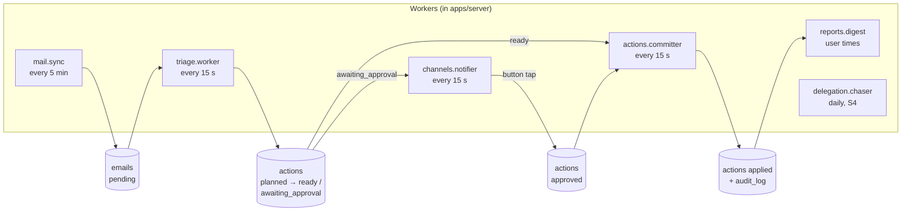
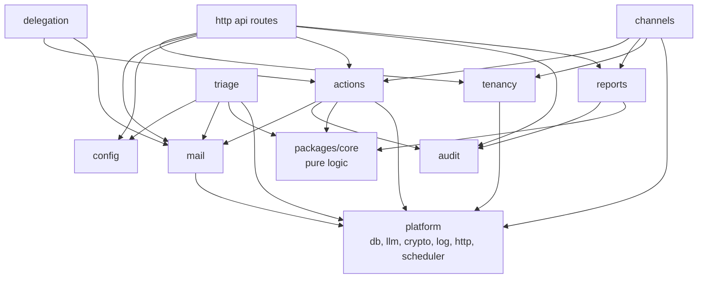

# Module catalog — AI Email Assistant

> **Proposed 2026-11-02.** Detail for `docs/architecture.md` sections 3–5. Decisions: `docs/decisions/`.

## 1. Big picture

- **One repository** (monorepo, Bun workspaces). Not many repos: one developer, shared types, one CI, atomic changes.
  A future mobile app also goes into this repo as `apps/mobile`.
- **Three deployable parts:** `apps/server` (one Bun process), `apps/web` (Astro), Postgres (Supabase).
- **One shared package:** `packages/core` (pure logic + Zod schemas, no I/O).

```
email_assistant/
├─ apps/
│  ├─ server/        Bun + Hono: HTTP API, workers, scheduler, Telegram bot
│  ├─ web/           Astro + React: web panel
│  └─ mobile/        (Phase 2) mobile app
├─ packages/
│  └─ core/          domain types, Zod schemas, rules, policy, planners, digest builder
├─ supabase/         SQL migrations, seed
├─ evals/            prompt evaluation
└─ docs/
```

## 2. How the modules talk

Principle: **the database holds the state; small workers move it forward.**
A module does not call the next module in a long chain. It writes a row with a new status. The next worker picks it up.



Why:
- **Crash safety.** If the process stops, no work is lost. On restart each worker continues from the DB state.
- **No import cycles.** Example: `actions` needs to ask for approval and `channels` needs to approve actions.
  `actions` only sets `awaiting_approval`; `channels.notifier` reads it. `channels` calls `actions.approve()` on a button tap.
- **Visible state.** Each email and action has a status you can query and show in the web panel.
- Latency is seconds to minutes. This is fine for email. Urgent notices go out within one notifier tick.

Direct calls stay for reads and simple commands (for example `triage` reads `config` rules; `api` routes call module services).

Module dependencies (arrow = "uses"):



## 3. Modules in `apps/server`

Each module folder: `index.ts` (public API), `service.ts`, `repo.ts` (DB), `routes.ts` (HTTP, if any), `jobs.ts` (workers, if any), `*.test.ts`.

### 3.0 `platform` — technical base (not a business module)

| Part | Does | Tech |
|---|---|---|
| `config` | Reads and checks env at start; fails fast on a missing key | Zod |
| `db` | Postgres pool, transactions, `TenantContext`, generated types | Kysely + kysely-codegen (confirm in S0) |
| `llm` | Model roles `classifier` / `writer`, structured output, retries, tracing | Vercel AI SDK, Langfuse |
| `crypto` | AES-256-GCM encrypt / decrypt with key version | Web Crypto / `node:crypto` |
| `log` | Levels, `[module]` prefix, no mail bodies or tokens | own `log` util |
| `http` | Hono app, JWT check (Supabase), error handler, `/health` | Hono |
| `scheduler` | Cron-like timers for jobs; one tick never overlaps the next | croner |

### 3.1 `tenancy` — who is who (S0)

- **Owns:** `organizations`, `memberships`.
- **Does:** creates the pilot organization; resolves `TenantContext` from a JWT (web) or a linked chat (Telegram); checks roles.
- **Later:** self sign-up, invite assistant (S6 / Phase 2).

### 3.2 `mail` — access to mailboxes (S1)

| Sub-module | Does |
|---|---|
| `port.ts` | `MailProvider` interface: `syncSince(cursor)`, `getMessage`, `ensureLabels`, `modifyLabels`, `archive`, `markRead`, `createDraft`, `sendDraft`, `getThread` |
| `gmail/oauth` | Connect flow (consent URL, callback), token refresh, scope check |
| `gmail/client` | Gmail API calls with backoff on 429 / 5xx |
| `gmail/mapper` | Gmail message → `Email` (headers, thread id, HTML → plain text, size limit) |
| `connections` | Mailbox list / add / pause / remove; `mailbox_credentials` (encrypted); status `active` / `auth_error` |
| `sync` (job) | Every 5 min per active mailbox: history since cursor → upsert `emails` with status `pending`; new cursor |
| `fake/` | In-memory `MailProvider` for tests |

- **Owns:** `mailboxes`, `mailbox_credentials`, `emails`.
- **Later:** `graph/` (Microsoft 365), `imap/` (other providers), Gmail push (Pub/Sub).

### 3.3 `config` — user settings (S1, UI in S5)

- **Owns:** `mailbox_settings` (mode `shadow` / `assist`, tool switches, digest times, style text), `sender_rules` (whitelist, blocklist, VIP; address or domain).
- **Does:** validation (for example: the owner's own address cannot be a delegate); default settings for a new mailbox.

### 3.4 `triage` — understand each email (S1)

| Sub-module | Does |
|---|---|
| `rules` (in `core`) | Hard rules before AI: blocklist → spam; whitelist → never spam; user's Manual label → skip; `noreply` detection |
| `classifier` | Builds the prompt (email in a marked data block + sender context), calls `llm.classifier`, validates `TriageAnalysis` (category, confidence, reason, fields) |
| `prompts/` | Versioned prompt texts; the version id goes to `triage_results` and Langfuse |
| `planners` (in `core`) | One per category: spam, notification, info, urgent, manual; delegation and reply in S4. Each returns an `ExecutionPlan` (list of actions) |
| `summarizer` | For info mail: `llm.writer` makes a short summary that goes into the plan payload |
| `worker` (job) | Claims `pending` emails (`SKIP LOCKED`), runs rules → classifier → planner, saves `triage_results` + `actions` (status `planned`), sets email `triaged` |

- **Owns:** `triage_results`.

### 3.5 `actions` — the only place with side effects (S1 log-only, S3 apply)

| Sub-module | Does |
|---|---|
| `policy` (in `core`) | For each planned action: `apply` / `await_approval` / `log_only`, from mode, tool switch, risk, VIP |
| `gate` | Runs policy on `planned` actions → status `ready`, `awaiting_approval` or `logged` |
| `committer` (job) | Takes `ready` and `approved` actions, calls `MailProvider`, sets `applied` / `failed`, writes `audit_log` in the same transaction; idempotency key per action |
| `approvals` | `approve(actionId, user, channel)`, `reject(...)`; expiry job (for example after 48 h → `expired`) |
| `retry` | Backoff for soft errors; after 3 failures → plan "label AI/Manual" |

- **Owns:** `actions`.
- **Rule:** a `send` action is applied only with an approval record (ADR 0003).

### 3.6 `audit` — what happened and why (S1)

- **Owns:** `audit_log` (append-only).
- **Does:** `record(event)` inside other modules' transactions; queries for the digest and the web audit view.

### 3.7 `reports` — digest and urgent notices (S2)

| Sub-module | Does |
|---|---|
| `builder` (in `core`) | From audit + actions since the last digest: sections URGENT → NEEDS ACTION → DONE AUTOMATICALLY → REMINDERS |
| `renderers` | Telegram text (short, links), web view (full) |
| `digest` (job) | At each user's digest times (organization timezone); also on demand (`/digest` command) |

- **Owns:** `digests`.

### 3.8 `channels` — talk to the user (S2)

| Sub-module | Does |
|---|---|
| `port.ts` | `ChatChannel` interface: `send`, `sendApproval(action)`, `edit`, and handlers for commands and button taps |
| `telegram/bot` | Bot client, long polling (dev) / webhook with secret token (prod) | 
| `telegram/linking` | One-time token → `t.me/<bot>?start=<token>` → saves `chat_links` |
| `telegram/commands` | `/start`, `/help`, `/digest`, `/pause`, `/resume`, `/status` |
| `telegram/callbacks` | Button tap → check chat → user → org → `actions.approve/reject` → edit message |
| `notifier` (job) | Sends approval requests for new `awaiting_approval` actions and urgent notices (sets `notified_at`) |

- **Owns:** `chat_links`.
- **Tech:** grammY (Telegram bot framework for TypeScript).
- **Later:** `mobile/` (push to the app), `whatsapp/`, and the `assistant` module (intents, chat state, voice).

### 3.9 `delegation` — hand work to people and follow up (S4)

| Sub-module | Does |
|---|---|
| `delegates` | CRUD; competence tags; active flag |
| `planner` (in `core`) | Delegation plan: delegate id from the list, task summary, due date; missing data → "ask" draft |
| `tracking` | `delegations` statuses: `drafted` → `sent` → `answered` / `overdue` → `done` |
| `chaser` (job) | Daily: overdue items without a reply in the thread → reminder draft → approval request |

- **Owns:** `delegates`, `delegations`.

### 3.10 HTTP API (routes from each module, composed in `platform/http`)

| Route group | Used by | Slice |
|---|---|---|
| `GET /health` | monitoring | S0 |
| `/oauth/google/start`, `/oauth/google/callback` | web, CLI | S1 |
| `/me`, `/mailboxes` | web | S1 / S5 |
| `/settings`, `/rules` | web | S5 |
| `/actions` (list pending, approve, reject) | web, mobile later | S4 / S5 |
| `/audit`, `/digests` | web | S5 |
| `/channels/telegram/link`, `/channels/telegram/webhook` | web, Telegram | S2 |
| `/delegates`, `/delegations` | web | S4 / S5 |

### 3.11 Phase 2 modules (not built in MVP)

| Module | Does |
|---|---|
| `assistant` | Two-way chat: intents (new email, find mail, status, reminders), chat state, voice → text |
| `brain` | Style learning (sent mail, draft vs sent diff), trust score per contact, competence extraction |
| `meetings` | Calendar port (Google first), conflict check, slot proposals |
| `billing` | Plans, payments, limits (S6) |

## 4. `apps/web` — pages

| Page | Content | Slice |
|---|---|---|
| Login | Supabase Auth (email link or Google sign-in) | S5 |
| Onboarding checklist | Connect Gmail → link Telegram → choose mode → optional lists | S5 |
| Mailboxes | Status, connect / re-connect, pause, remove | S5 |
| Settings | Mode, tool switches, digest times, style text | S5 |
| Rules | Whitelist, blocklist, VIP | S5 |
| Approvals | Pending actions with approve / reject | S5 |
| Activity | Audit log: what happened to each mail and why | S5 |
| Digests | Past reports | S5 |
| Delegation | Delegates and open delegations | S5 |
| Account | Delete mailbox / account and data | S6 |

Until S5 the user works through Telegram and a few CLI scripts (connect Gmail, create organization).

## 5. `packages/core` — shared pure logic

- `types/`: `Email`, `TriageAnalysis`, `ExecutionPlan`, `Action`, `ActionStatus`, `MailboxMode`, `Category`.
- `schemas/`: Zod schemas for LLM output, API input and output.
- `rules/`, `policy/`, `planners/`, `digest/`: pure functions with unit tests.
- No imports from `apps/*`, no DB, no network.

## 6. Status flows

```
emails.status:   pending → processing → triaged → done
                                 └→ failed (after 3 tries; email gets AI/Manual)
actions.status:  planned → ready → applied
                         → awaiting_approval → approved → applied
                                             → rejected | expired
                         → logged            (shadow mode)
                   ready/approved → failed   (after retries)
```
