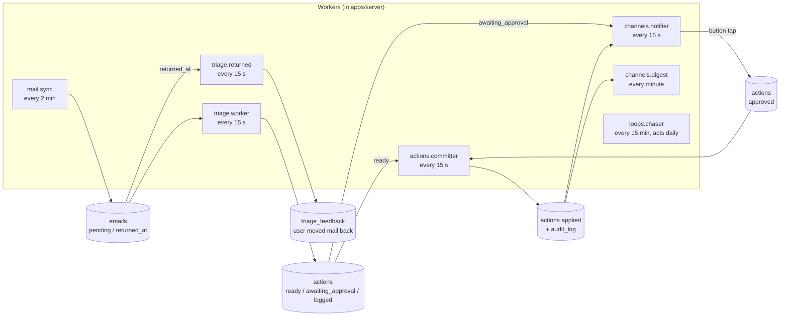

# Module catalog — AI Email Assistant

> **Accepted 2026-11-02** (user). Revised 2026-11-02 after the cold review (IMAP first, own Postgres, feedback and Undo) and a second review (`spec/features/done/2026-11/F009-docs-and-adr-review/plan.md`).
> Detail for `docs/architecture.md` sections 3–5. Decisions: `docs/decisions/`.

## 1. Big picture

- **One repository** (monorepo, Bun workspaces). Not many repos: one developer, shared types, one CI, atomic changes.
  A future mobile app also goes into this repo as `apps/mobile`.
- **Two containers in the pilot:** `server` (one Bun process; it also serves the web build) and `db` (Postgres 17). Compose files in `deploy/`.
- **One shared package:** `packages/core` (pure logic + Zod schemas, no I/O).

```
email_assistant/
├─ apps/
│  ├─ server/        Bun + Hono: HTTP API, workers, scheduler, Telegram bot
│  ├─ web/           Web panel
│  └─ mobile/        (Phase 2) mobile app
├─ packages/
│  └─ core/          domain types, Zod schemas, categories, rules, policy, planners, digest builder
├─ db/migrations/    SQL migrations
├─ deploy/           compose.yaml, server Dockerfile, backup script
├─ evals/            prompt evaluation
└─ docs/
```

## 2. How the modules talk

Principle: **the database holds the state; small workers move it forward.**
A module does not call the next module in a long chain. It writes a row with a new status. The next worker picks it up.



Small jobs (not in the picture): `actions.expiry` (hourly), `platform.retention` (daily at 02:40; composed in `apps/server/src/retention.ts`), `channels.operator` (hourly at minute 13), `ops.slo` (every 5 min at second 30; `modules/operator`, [operations.md](capabilities/operations.md)), `platform.heartbeat` (every 5 min).

Why:

- **Crash safety.** If the process stops, no work is lost. On restart each worker continues from the DB state.
- **No import cycles.** Example: `actions` needs to ask for approval and `channels` needs to approve actions.
  `actions` only sets `awaiting_approval`; `channels.notifier` reads it. `channels` calls `actions.approve()` on a button tap.
- **Visible state.** Each email and action has a status you can query and show.
- Latency is seconds to minutes. This is fine for email. Urgent notices go out within one notifier tick after triage (≤ 10 min after arrival).

Direct calls stay for reads and simple commands (for example `triage` reads `config` rules; API routes call module services).
The triage worker calls the pure policy from `packages/core` in its own transaction (no separate gate job).

Module dependencies are generated: [`docs/diagrams/module-graph.md`](diagrams/module-graph.md), written by `bun run graph:modules`; `apps/server/src/modules/layers.test.ts` fails when it is stale or when the code has an edge that the layers do not permit. Layers and the allowed same-layer edges: `apps/server/src/modules/layers.json`. Rules: `docs/code-patterns.md` § Layers and borders. The lines below give the reason for some edges; the generated file is the edge list.

`triage → delegation`: the triage worker reads the active delegates (`listDelegates`), builds the draft plan from them, creates the `delegations` row (`createDelegation`) and detects a delegate's reply (`detectReply`, `markAnswered`) in its transaction.
`channels → delegation`: the Done tap calls `closeDelegation`; the notifier reads answered delegations and delegate names; `/status` counts open delegations.
`reports → delegation`: the digest reads the delegate names and the open delegations.
`delegation → actions | mail | config | tenancy | audit`: the service closes the reminder sends (`expireReminderActions`); the chaser plans reminders with `createPlanned` and reads the settings, the organization timezone and the audit count.
**Hooks pattern:** `actions` must not import `delegation` (`delegation → actions` already exists, so the reverse edge would be a cycle). `actions` defines the interface `DelegationHooks` (`actions/hooks.ts`: `onSent`, `onReminderSent`, `onCancelled`, `onWentOut`, `isOpen`, `onSuperseded` and `activeDelegate`); `delegation` implements it (`delegationHooks`); `actions` defines `ApprovalHooks` too (`onDecided`, with `noApprovalHooks`), which `channels` implements (`cardEditHooks`) so that a decision edits the Telegram cards without an `actions → channels` edge; `main.ts` and `scripts/job-run.ts` wire it into the committer, the expiry job and the Telegram handlers. There is no `actions → delegation` edge.
`triage → actions`: the triage worker writes the action rows through `actions.createPlanned()` in its transaction. The returned job (`triage/returned.ts`) locks and updates the original move through `lockLatestOriginalMove` and `markUndone`.
`triage → audit`: the triage worker and `triage/backfill.ts` write audit rows through `audit.recordAudit()` in their transactions.
`channels → triage`: the ✅ / ✏️ buttons and the Undo button write feedback through `triage.recordFeedback()`.
`channels → actions`: the Undo tap calls `actions.undo()`; the notifier reads the failed actions (`listFailedUnnotified`, `markNotified`); `/status` counts the actions (`countActionsSince`).
`actions → mail`: the committer and Undo use `locateMessage`, `listFolderUids`, `openMailboxProvider`, `updateEmailLocation` and the port.
`tenancy → audit`: `tenancy/service.ts` writes the `org.timezone_changed` and `org.style_changed` audit rows in the transaction of `updateOrganizationSettings`.
`config → audit`: the setters write the `mailbox.*_changed` audit rows in their transaction.
`config` gets `expireReady` as a dependency (`SettingsDeps.expireReady`, passed by the caller from the `actions` index) and never imports `actions`: `config` is in a lower layer, and the filter type `ExpireFilter` lives in `@ea/core`.
`channels → config`, `channels → audit`: the digest and `/status` read the mailbox mode; `/pause` and `/resume` write `mailbox.paused` / `mailbox.resumed` audit rows.
`reports → mail`, `reports → config`: the digest reads the mailboxes (status, last sync, waiting mail) and their mode. `channels → reports`; `reports` never imports `channels` (no cycle).
`mail → audit`: a status change (`updateMailboxPassword`) and its audit row go in one transaction.
`mail → config`, `mail → audit` (`mail/connect.ts`): `insertDefaultSettings` and `recordAudit`.
`mail → tenancy`, `triage → tenancy`, `actions → tenancy`: the sync, triage and committer loops call `isOrgSuspended` before each mailbox; `connectMailbox` calls `getOrgPlan` for the mailbox limit. `tenancy` imports only `audit` and `platform`, so there is no cycle. `channels → tenancy | mail`: the Telegram handlers call `isOrgSuspended`; `channels/operator.ts` calls `listOrganizations` and `listAuthErrorMailboxesBefore`.
**Composition file `retention.ts`:** `apps/server/src/retention.ts` sits beside `web.ts` and `composition.ts`. It imports the clear functions of `mail`, `triage`, `actions`, `delegation` and `channels` and `listOrganizations` of `tenancy`, and builds the job `platform.retention`. It passes `isOpenDelegationDraft` of `delegation` as the keep rule of `clearActionPayloads`, so `actions` never imports `delegation`. `platform` imports no module, so the job cannot live in `platform`.
`actions` never calls `triage`, and `mail` never calls `triage`: they set columns that the triage worker reads (no import cycles).

## 3. Modules in `apps/server`

Each module folder: `index.ts` (public API), `service.ts`, `repo.ts` (DB; or a `repo/` folder, `docs/code-patterns.md` § Size and shape), `routes.ts` (HTTP, if any), `jobs.ts` (workers, if any), `*.test.ts`.
Code rules: `docs/code-patterns.md`.

### 3.0 `platform` — technical base (not a business module)

| Part              | Does                                                                                                                                                                          | Tech                                                                |
| ----------------- | ----------------------------------------------------------------------------------------------------------------------------------------------------------------------------- | ------------------------------------------------------------------- |
| `config`          | Reads and checks env at start; fails fast on a missing key                                                                                                                    | Zod                                                                 |
| `db`              | Postgres pool, transactions, `TenantContext`, tenant scope and the scoped driver (`app.org_id` for RLS), generated types, migration runner                                    | Kysely + kysely-codegen, `pg`; `dbmate`                             |
| `llm`             | Roles from the role table (`classifier`, `judge`, `drafter`, `extractor`), `generate` by role, structured output, timeout, provider and role rate limiters, soft-error rules  | `@google/genai` (Gemini), `openai` (OpenAI), Zod; provider registry |
| `crypto`          | AES-256-GCM encrypt / decrypt with key version                                                                                                                                | `node:crypto`                                                       |
| `log`             | Levels, `[module]` prefix, no mail bodies or secrets                                                                                                                          | own `log` util                                                      |
| `http`            | Hono app: session and tenant middleware (the tenant scope of each `/api` request), hardening (origin check, body limit, headers, CSP), static pages, error handler, `/health` | Hono                                                                |
| `auth`            | Better Auth instance (`platform/auth.ts`): login, sessions, password change; the `/api/auth/*` allow-list                                                                     | Better Auth (ADR 0016)                                              |
| `scheduler`       | Cron-like timers for jobs; one tick never overlaps the next; a job tick runs without a tenant scope                                                                           | croner                                                              |
| `retention` (job) | `platform.retention`, built in `apps/server/src/retention.ts`: clears text columns after their retention time (`docs/architecture.md` §7)                                     | —                                                                   |
| `heartbeat` (job) | Pings the external dead-man's-switch service                                                                                                                                  | —                                                                   |

### 3.1 `tenancy` — who is who

- **Owns:** `organizations`, `users`, `memberships`, `org_features`.
- **Does:** creates the pilot organization and user (CLI `bun run org:create`); owns style text and digest times; resolves `TenantContext` from a session (web) or a linked chat (Telegram); checks roles.
- `getMembership` (a member's role by `org_id` and `user_id`) and `setDigestTimes` (CLI `bun run digest:times`; the new default of `digest_times` is `{08:00,16:00}`).
- Login through Better Auth (`platform/auth.ts`, ADR 0016; no sign-up). `web:invite` (CLI `bun run web:invite --org-id <uuid> [--user-id <uuid>]`) makes the first-password link for a member. `listMembershipsOfUser` (the user gives the tenant; the oldest membership wins). `updateOrganizationSettings` (timezone and style text; writes `org.timezone_changed` and `org.style_changed`). Routes: §3.10.
- The plan state: `organizations.plan`, `trial_ends_at`, `max_mailboxes`, `resumed_at`. `getOrgPlan`, `isOrgSuspended`, `listOrganizations` (repo) and `setOrgPlan` (service: one transaction, audit row `org.plan_changed`, an injected `onSuspended` hook; `resumed_at` is set when the plan leaves `suspended`). `createOrganizationWithOwner` takes an optional plan. CLIs: `bun run org:create --plan trial|active [--trial-days N]`, `bun run org:plan --org-id <uuid> [--plan …] [--trial-days N] [--max-mailboxes N]`, `bun run org:status [--org-id <uuid>]` (ids, codes, dates and counts only). Rules of `suspended`: `docs/capabilities/tenancy-and-plans.md` § Rules, rule 3.
- Feature flags: `getOrgFeature`, `listOrgFeatureRows`, `upsertOrgFeature`, `listOrgFeatureRowsOfAll` (repo), `isFeatureOn`, `featureStates`, `featureStatesOfAll`, `configureFeatures` (`features.ts`), `setOrgFeature` (service, audit row `org.flag_changed`); CLI `bun run org:flag`; the operator route `GET /api/operator/flags` (`operator/routes.ts`, guarded by `requireOperator` in `platform/http.ts`). The registry is in `packages/core/src/features.ts`.
- `listSecurityLog`, `GET /api/security-log`, `/api/me` `operator` and `features`; `operatorRoutes` moved to `operator`.
- **Later:** self sign-up, invite assistant (Phase 2).

### 3.2 `mail` — access to mailboxes

| Sub-module                        | Does                                                                                                                                                                                                                                                                                                                                                                                                                                                                                                                                                                                                                                                                                                                                                                                                                                                                       |
| --------------------------------- | -------------------------------------------------------------------------------------------------------------------------------------------------------------------------------------------------------------------------------------------------------------------------------------------------------------------------------------------------------------------------------------------------------------------------------------------------------------------------------------------------------------------------------------------------------------------------------------------------------------------------------------------------------------------------------------------------------------------------------------------------------------------------------------------------------------------------------------------------------------------------- |
| `port.ts`                         | `MailProvider` port. Read (per folder since ADR 0014): `serverInfo`, `listFolders`, `folderStatus(folder)`, `fetchAbove(folder, lastUid)`, `fetchContent(folder, uid)` (text and capture), `fetchFlagsIn(folder, uids)` (flags and identity of many UIDs), `close`. Folder-aware read: `fetchMetaIn`, `searchSinceIn`, `fetchByUidsIn`. Write: `ensureFolder`, `moveMessage`, `deleteMessage`, `setFlags`; ADR 0014: `transferByAppend` (APPEND + `UID EXPUNGE`, for the rescue into INBOX and an Undo into a `sort` folder). The INBOX-only calls `inboxStatus`, `searchInboxSince` and `fetchByUids` are removed. Send side: `appendMessage` (returns the UID when the server has UIDPLUS), the `MailSender` port (`send`, `close`) and `SmtpSendError` with `SmtpStage`. `findByMessageId` is removed (it never works at Interia). `MailAuthError`, `MailNotFoundError` |
| `imap/client.ts`                  | `ImapMailProvider` over TLS (`imapflow`): folder status (the largest of STATUS, SELECT and highest UID + 1 for `UIDNEXT`, ADR 0014), UID fetch, search, body text; the write methods (own `UID COPY` + `UID EXPUNGE` when the server has no MOVE; every imapflow `false` is a `HardError`), the option `forceCopyMove` for tests                                                                                                                                                                                                                                                                                                                                                                                                                                                                                                                                           |
| `imap/mapper.ts`                  | IMAP message → `MessageMeta` / body text (`mailparser`, `html-to-text`), size limit                                                                                                                                                                                                                                                                                                                                                                                                                                                                                                                                                                                                                                                                                                                                                                                        |
| `imap/smtp.ts`                    | SMTP login check (`nodemailer`; `security: "tls" \| "starttls"`); `openSmtpSender` (own `SMTPConnection`, one connection per send, the logger hook that marks the content phase) and `classifySmtpError` (the stage rule, `docs/capabilities/drafts-and-send.md` § Rules)                                                                                                                                                                                                                                                                                                                                                                                                                                                                                                                                                                                                  |
| `imap/compose.ts`                 | `composeMessage`: the raw bytes of an `OutgoingMessage` (nodemailer `MailComposer`); the draft APPEND and the SMTP send use the same bytes                                                                                                                                                                                                                                                                                                                                                                                                                                                                                                                                                                                                                                                                                                                                 |
| `imap/probe.ts`, `imap/tools.ts`  | Write probes for `mailbox:check --probe`; APPEND for the seed tool (test only)                                                                                                                                                                                                                                                                                                                                                                                                                                                                                                                                                                                                                                                                                                                                                                                             |
| `imap/probe-move.ts`              | Spike (`assertTestAddress`, `probeMove`): checks the move facts on the test mailbox with one synthetic mail (CLI `mailbox:probe-move`)                                                                                                                                                                                                                                                                                                                                                                                                                                                                                                                                                                                                                                                                                                                                     |
| `imap/probe-send.ts`              | Spike (`probeSend`, `isAllowedRecipient`): one synthetic mail through the draft, SMTP, Sent and INBOX paths on the test mailbox (CLI `mailbox:probe-send`)                                                                                                                                                                                                                                                                                                                                                                                                                                                                                                                                                                                                                                                                                                                 |
| `locate.ts`                       | `locateMessage`, `locateKeyOf`: finds a known mail in a folder by identity, with no header search; skips `\Deleted` and the UIDs of `excludeUids` (architecture §6.1). `locateByActionId`: finds the system's own draft or sent mail by the header `X-EA-Action-Id` (UID hint, then `SEARCH SINCE` and a header FETCH)                                                                                                                                                                                                                                                                                                                                                                                                                                                                                                                                                     |
| `open.ts`                         | `openMailboxProvider`: decrypts the secret in memory and opens a provider; the committer opens its connection with it                                                                                                                                                                                                                                                                                                                                                                                                                                                                                                                                                                                                                                                                                                                                                      |
| `connect.ts`                      | `connectMailbox`: IMAP + SMTP login check, capabilities, folder map, encrypted secret, default settings (CLI `mailbox:connect`)                                                                                                                                                                                                                                                                                                                                                                                                                                                                                                                                                                                                                                                                                                                                            |
| `check.ts`                        | `checkMailbox`: read-only capability report, optional write probes (CLI `mailbox:check`)                                                                                                                                                                                                                                                                                                                                                                                                                                                                                                                                                                                                                                                                                                                                                                                   |
| `sync-rules.ts`                   | Pure rules: `Message-ID` normalize, content hash, dedup keys, thread key, cursor filter, decisions for incoming mail; `sameMailIdentity`, `isDeleted`, `matchMoved`, `decideBelowCursorCopy`, `dropHeldMetas`                                                                                                                                                                                                                                                                                                                                                                                                                                                                                                                                                                                                                                                              |
| `sync.ts`                         | `syncMailbox`: ADR 0014: one run per mailbox, folder by folder (INBOX, the `sort` folders, the spam folder), one cursor per folder. Modes `initial` (24 h), `incremental` (UID cursor), `rescan` (7 days after a UIDVALIDITY change); `fetchSince`. It also re-exports the run types, `CursorMovedError` and the `RETURN_CHECK_*` limits, so their import path stays                                                                                                                                                                                                                                                                                                                                                                                                                                                                                                       |
| `sync-run.ts`                     | The types of a run (`SyncDeps`, `SyncResult`, `MailboxSyncResult`, `RunState`), `CursorMovedError`, `emptyResult`, `newRow`, `withRunCopies`                                                                                                                                                                                                                                                                                                                                                                                                                                                                                                                                                                                                                                                                                                                               |
| `sync-chunk.ts`                   | One chunk of a folder: `planChunk` (provider calls and DB reads), `applyChunk` (the writes of a chunk and its cursor in one transaction), `setCursor`; the capture write                                                                                                                                                                                                                                                                                                                                                                                                                                                                                                                                                                                                                                                                                                   |
| `sync-below-cursor.ts`            | The below-cursor return check at the end of an incremental sync (`checkReturnedBelowCursor`); it stores a copy below the cursor as `#n` (`planCopy`)                                                                                                                                                                                                                                                                                                                                                                                                                                                                                                                                                                                                                                                                                                                       |
| `sync-backfill.ts`                | `backfillInbox`: one-off, read-only fetch of the last 1–180 days; stores missing mail with `backfilled_at`; the cursor never moves; `historyRefusalBeforeOpen`, `HISTORY_SKIP_REASON`                                                                                                                                                                                                                                                                                                                                                                                                                                                                                                                                                                                                                                                                                      |
| `moves.ts`                        | `findUserMoves`: the flag refresh's gone mail at the same UID in the synced folders below their cursors; writes `returned` or a move between folders under the folder lock                                                                                                                                                                                                                                                                                                                                                                                                                                                                                                                                                                                                                                                                                                 |
| `sent-switch.ts`                  | `setSentSync`: the Sent read switch per mailbox (consent; one transaction: flag check for on, state row lock, write, delete of stored Sent mail on off, audit `mailbox.sent_sync_changed`); `connectMailbox` sets it from the flag `sent_sync`                                                                                                                                                                                                                                                                                                                                                                                                                                                                                                                                                                                                                             |
| `sent-view.ts`                    | `getSentSyncView`: the `sentSync` field of the settings view (flag, switch, folder, first pass, newest user mail, stored count of 30 days, error code; null while flag and switch are off)                                                                                                                                                                                                                                                                                                                                                                                                                                                                                                                                                                                                                                                                                 |
| `sent-sync.ts`                    | `syncSentHeaders`, `syncSentFolder`: the Sent read (ADR 0029): the header pass and the text step; takes a `SentFolderReader`; the guarded writes under the `mailbox_sent_sync` row lock                                                                                                                                                                                                                                                                                                                                                                                                                                                                                                                                                                                                                                                                                    |
| `sent-texts.ts`                   | `fetchSentTexts`: the text step of the Sent read (100 mails per run, oldest first)                                                                                                                                                                                                                                                                                                                                                                                                                                                                                                                                                                                                                                                                                                                                                                                         |
| `sent-rules.ts`                   | Pure rules of the Sent read: windows, mode, parent id, `toNewSentEmail`, `firstPerDedupKey`                                                                                                                                                                                                                                                                                                                                                                                                                                                                                                                                                                                                                                                                                                                                                                                |
| `jobs.ts`                         | `createMailSyncJob`: every `MAIL_SYNC_EVERY_MIN` minutes (default 2) for each active mailbox (`listSyncTargets`); one mailbox error never stops the others; the Sent pass runs last on the same connection and never fails the run (`sentOriginOf` is injected from `actions`)                                                                                                                                                                                                                                                                                                                                                                                                                                                                                                                                                                                             |
| `repo/`                           | One file per aggregate behind `repo/index.ts`: `mailboxes.ts` (row, status, summary), `folders.ts` (synced folders, cursors, `forceRescan`), `credentials.ts`, `emails.ts` (`MailKind`, row writes and reads), `copies.ts` (copy identity, `listFolderUids`, `listRecentlyMoved`, `listMoveCandidates`), `targets.ts` (cross-organization lists), `claims.ts` (triage claim and queue), `lookup.ts` (thread, Message-ID), `retention.ts`, `sent-emails.ts` and `sent-state.ts` (the tables `sent_emails` and `mailbox_sent_sync`). `mailboxes`, `mailbox_credentials`, `mailbox_folders` (ADR 0014: the synced folders and their cursors), `emails` queries; guarded cursor update; `forceRescan`; `listRecentlyMoved`, `listFolderUids`, `listReturned`, `clearReturned`, `updateEmailLocation`, `setFolderMapEntry`, `setMovePending`, `getEmailMailbox`                 |
| `seed.ts`, `audit.ts`, `tools.ts` | 48-hour test tools: `mailbox:seed` (test address only; `--folder <path>` APPENDs into another folder; `--eval-cases synthetic\|injection\|all` seeds the eval cases), `mailbox:rescan`, `mailbox:audit`; `backfillMailbox` (backfill only); the script `mailbox:backfill` then calls `triage.requeueBackfillWindow`                                                                                                                                                                                                                                                                                                                                                                                                                                                                                                                                                        |
| `fake/`                           | In-memory `MailProvider` (and `fake/sender.ts`: a `MailSender` with scripted outcomes) for tests; `test/contract/` runs the same suite on fake and GreenMail                                                                                                                                                                                                                                                                                                                                                                                                                                                                                                                                                                                                                                                                                                               |

- **Owns:** `mailboxes`, `mailbox_credentials`, `mailbox_folders`, `emails`.
- `listMailboxes` (id, address, status, `last_synced_at`, `status_changed_at`, `created_at`), `countWaiting` (mail that waits for triage in all mailboxes),
  `changeMailboxStatus` (a conditional change between any two statuses; callers: pause and resume, and `host_blocked` in and out) and the column `mailboxes.status_changed_at` (moves only when the status really changes).
  `updateMailboxPassword` (in `connect.ts`): IMAP and SMTP login test, new encrypted secret, `auth_error` or `host_blocked` → `active`, audit row `mailbox.password_changed` in one transaction; CLI `bun run mailbox:password` (password on stdin only).
- The write port and the identity locate (above); `listRecentlyMoved` (moves of the last 7 days, for the below-cursor check); `updateEmailLocation` (`folder`, `uid`, `source_uid`, `moved_at`, `move_pending_at` in the committer's transaction);
  `setFolderMapEntry` (the real folder path after `ensureFolder`); `listReturned` and `clearReturned` (the returned job); `listFolderUids` (the `excludeUids` of the locate); the columns `source_uid`, `moved_at`, `move_pending_at`.
  `findByMessageId` is removed. CLI `bun run mailbox:probe-move` (test address only).
- `appendMessage` (port, IMAP adapter and fake); `MailSender`, `openSmtpSender`, `SmtpSendError` and the stage rule; `composeMessage`; `locateByActionId`; `listMailboxTargets` (serves the expiry job with `active`, `paused`, `auth_error` and `host_blocked` mailboxes, and the host re-check with `host_blocked` ones; `listSyncTargets` stays as a wrapper for active ones); `mailboxHasUidplus`;
  the own-mail skip wired (`isOwnActionId` from `actions`, passed by `main.ts` to the sync and to `backfillMailbox`). CLI `bun run mailbox:probe-send` (test address only). Facts: `notes/2026-11-07-send-approval-facts.md`.
- The mailbox limit: `connectMailbox` refuses a mailbox above `organizations.max_mailboxes` with `MailboxLimitError` (web `409 mailbox_limit`; the count runs under an advisory lock after the IMAP check). `listMailboxTargets` and `listSyncTargets` skip mailboxes of `suspended` organizations (`includeSuspended`); `countSyncTargets` and `listAuthErrorMailboxesBefore`; the retention clear functions `clearMailBodies` and `clearMailHeaders`; the skip reason `suspended_backlog`.
- Header capture and the flag store. `imap/mapper.ts` parses the headers of a mail (display name, `Reply-To`, `Return-Path`, `Authentication-Results`, `List-Unsubscribe`, `List-Id`, attachments, link hosts) with no new fetch; `sync-chunk.ts` writes one `email_headers` row in the transaction that stores the mail (`repo/headers.ts`). `refreshFlags` (`repo/flags.ts`, `flags.ts`) keeps `email_flags` (`\Seen`, `\Answered`, `\Flagged` with the first time of each) at most every 10 min per mailbox. Both tables have retention (`repo/retention.ts`). The sync interval is `MAIL_SYNC_EVERY_MIN` (default 2). `docs/capabilities/sync.md` rules 6 and 18.
- `host-status.ts` (`checkMailboxHosts`, `recheckBlockedHosts`, `markHostBlocked`), `inspectMailbox` (`check.ts`).
- **Rules:** `docs/architecture.md` §6.1.
- **Later:** `gmail/` and `graph/` (Microsoft 365) adapters with OAuth (Phase 2); IMAP IDLE.

### 3.3 `config` — user settings

- **Owns:** `mailbox_settings` (mode `shadow` / `assist`, tool switches, category policy), `sender_rules` (whitelist, blocklist, VIP; address or domain;
  per organization, optional per mailbox). Style text (`organizations`) and digest times (`memberships`) belong to `tenancy`;
  `config`, `reports` and the API read and write them through `tenancy`'s `index.ts`.
- **Does:** validation (for example: the owner's own address cannot be a delegate); default settings for a new mailbox (mode `shadow`, all automatic moves off).
- `config/repo.ts` reads and writes `mailbox_settings` (defaults on connect).
- `sender_rules` (`listSenderRules`, `insertSenderRule`) and the CLI `bun run rules:add` / `rules:list` (the pattern is an address or a domain with a dot, lower case). Other validation comes later.
- `service.ts`: `getSettingsView`, `setMode`, `setCategoryAuto`, `setToolSwitch`, `closedBy`. Each setter locks the settings row, writes the change and its audit row (`mailbox.mode_changed`, `mailbox.policy_changed`, `mailbox.switch_changed`) in one transaction,
  and, when the change closes a gate (also `setMode assist` without `--keep-switches`, for each switch it turns off), expires the `ready` rows it closes through `SettingsDeps.expireReady`. CLI `bun run mailbox:settings` (`show`, `mode`, `auto`, `switch`, `expire-ready`); `auto … on` runs the real-mail go/no-go check in the script (it composes `triage` and `config`).

### 3.4 `triage` — understand each email

| Sub-module             | Does                                                                                                                                                                                                                                                |
| ---------------------- | --------------------------------------------------------------------------------------------------------------------------------------------------------------------------------------------------------------------------------------------------- |
| `rules` (in `core`)    | Hard rules before AI: blocklist → spam; whitelist / VIP → no `spam` in the allowed list; `noreply` detection; reply in a delegation thread (`detectReply` in `delegation`, run by the triage transaction on every save path)                        |
| `classifier`           | Builds the prompt (email in a marked data block + sender context + last 3 thread mails), calls `llm.generate` with role `classifier` and the registry prompt, validates `TriageAnalysis` (category, confidence, reason, fields, summary for `info`) |
| `prompts/`             | Versioned prompt texts; the version id goes to `triage_results`. `classifier-v2` (the category `delegation`, the `Delegates` block, the fields `delegate_id`, `task`, `clarification`)                                                              |
| `planners` (in `core`) | One per category: `urgent`, `needs_reply`, `info`, `notification`, `spam`, `unsure`; `delegation` (`delegationInputOf`, `planDelegation`: a delegation draft + send, or a clarification draft + send, or nothing). Each returns an `ExecutionPlan`  |
| `policy` (in `core`)   | Pure truth table (`docs/architecture.md` §4.3): `apply` / `await_approval` / `log_only` per action                                                                                                                                                  |
| `feedback`             | `recordFeedback()` (verdict, optional true category) from CLI, Telegram, Undo, web; turns `emails.returned_at` into feedback; labeling CLI `bun run triage:label`                                                                                   |
| `worker` (job)         | Claims `pending` emails (`SKIP LOCKED`), runs rules → classifier → planner → policy, saves `triage_results` + `actions` in one transaction, sets email `triaged`                                                                                    |

- **Owns:** `triage_results`, `triage_feedback`.
- Read queries for the digest and the buttons: `listTriagedBetween` and `countTriagedBetween` (triaged mail in a period, by category), `latestFeedback` and `getLabelTarget` (the latest label of a mail; the mail behind a button, filtered by organization). `recordFeedback` takes `skipIfSame`: the same answer as the latest row writes nothing.
- **Files** (`apps/server/src/modules/triage/`; `packages/core` has the rules, planners, policy and metrics):
  - `service.ts`: `triageOne` (age rule, hard rules, daily cap, classifier, save), `saveTriage` (result, actions and audit rows in one transaction; a lost claim writes nothing; it share-locks the settings row and compares the settings version, so a batch planned under old settings writes nothing), `finishTriageError`.
  - `jobs.ts`: `createTriageJob`, started by `main.ts` as `triage.worker` every 15 s. It follows `TRIAGE_LLM_SCOPE` (`off` builds no worker). Per mailbox: settings, rules, claim, loop. One mailbox error never stops the others.
  - `pause.ts`: `createLlmPause`, the LLM client pause (5 min, doubling to 60 min). Error rules: [capabilities/triage.md](capabilities/triage.md) § Rules. Shutdown waits up to 30 s for a batch.
  - `feedback.ts`, `label-input.ts`: `recordFeedback`, `listForLabeling`, `parseLabelInput`; CLI `bun run triage:label` (interactive, or one label with flags; Enter or `w` on an `unsure` row asks again, because a true category is needed). Rows get source `cli`.
  - `returned.ts`: `processReturned` and `createReturnedJob`, started by `main.ts` as `triage.returned` every 15 s (always on, no LLM). One transaction per mail: it locks the latest original move (the Undo lock), sets it `undone` (`user_moved_back`), writes the `imap_move` feedback row when the rules of `docs/capabilities/actions-and-undo.md` § Rules allow, clears `returned_at` and writes `email.returned`. One mail's error never stops the others.
  - `jobs.ts` reads the active delegates once per mailbox run (debug event `triage_delegates` with `count`) and passes them to the classifier and the planner; with no delegate the category `delegation` is not allowed. `service.ts`: `createPlanned` writes the draft and the send with `dependsOn`; `createDelegationRow` makes the `delegations` row and merges its id into both payloads; `markReply` marks the delegation `answered` when the mail comes from the delegate in the thread of the sent mail. `classifier-v2` is the prompt. `eval*.ts`: `delegation.json` (12 cases), `inj-13` to `inj-16`, the check `injectionHolds`.
  - `backfill.ts`: `requeueBackfillWindow` (`skipped / too_old` and `skipped / history_check` real mail of the window → `pending`, one `email.requeued` audit row for each mail, one transaction).
  - `eval*.ts`: `runEval`, `buildRealReport`, `renderEvalReport`; CLI `bun run eval`. `bun run triage:cost` prints tokens, latency and cost per mail and per mailbox per month from stored results.
  - `suspended_backlog` (`triageOne`: mail from before a pause is `skipped` after a resume, no LLM call); `triage.worker` skips mailboxes of `suspended` organizations and calls the operator hook `onCapReached` when a mailbox reaches the daily cap; the scope `all` has no address (`TriageScope` = `synthetic` or `all`); the retention clear function `clearTriageTexts`.

### 3.5 `actions` — the only place that changes the mailbox

Planning and reads: `createPlanned`, `listActionsForEmail`, `listSummaries`. The triage worker writes the rows with the status that the policy gives (§4.3). In `shadow` mode, mailbox changes are `logged`; a `save_summary` row is `ready` and waits for the committer.

**Files** (`apps/server/src/modules/actions/`; the error rules are in `docs/capabilities/actions-and-undo.md` § Rules):

| File           | Does                                                                                                                                                                                                                                                                                                                                                                                                                                                                                                                                                                                                                                                                                                                        |
| -------------- | --------------------------------------------------------------------------------------------------------------------------------------------------------------------------------------------------------------------------------------------------------------------------------------------------------------------------------------------------------------------------------------------------------------------------------------------------------------------------------------------------------------------------------------------------------------------------------------------------------------------------------------------------------------------------------------------------------------------------- |
| `repo/`        | One file per aggregate behind `repo/index.ts`: `planned.ts`, `reads.ts`, `filters.ts`, `claims.ts`, `lifecycle.ts` (`markApplying`, `finishAction`, `releaseAction`), `expiry.ts`, `undo.ts`, `sends.ts`, `drafts.ts`, `notify.ts`, `approvals.ts` (approval expiry, `countApprovals`), `retention.ts`. The queries: `claimActions` / `countClaimable` (`FOR UPDATE SKIP LOCKED`, the 24-hour and 7-day limits, the scope filter), `finishAction` and `releaseAction` (conditional on the `locked_at` token), `expireStaleReady`, `expireReadyOriginals`, `countReadyOriginals`, `insertReverse`, `lockActionsForUndo`, `lockLatestOriginalMove`, `markUndone`, `listFailedUnnotified`, `markNotified`, `countActionsSince` |
| `anchor.ts`    | `ActionAnchor`, `anchorOfRow`, `emailIdOf`, `ActionAnchorError`: an action hangs on a mail (`email_id`) or on an open loop (`loop_id`); `emailIdOf` throws `loop_anchor` for a loop row; the claim, `getDraft` / `lockDraft`, the send limits and the Sent origin read both anchors; the readers of cards, lists and notices filter `email_id IS NOT NULL` until the follow-up card and notices read them                                                                                                                                                                                                                                                                                                                   |
| `scope.ts`     | `claimFilterFor(scope, mailboxAddress)` maps `ACTIONS_SCOPE` to the claim filter; `scopeAdmits` is the same check for one mail (the Undo tap)                                                                                                                                                                                                                                                                                                                                                                                                                                                                                                                                                                               |
| `apply.ts`     | `applyAction`: `save_summary` (DB only), `flag` / `mark_read` (set or, for a reverse, remove the flag), `move` (the ensure rule); the error mapping (soft, hard, `mail_not_found`, `bad_payload`, login); the location, status, `applied_at` and audit row in one transaction Dispatch through `APPLY_HANDLERS` (one entry per type with its `needs`; the committer reads the needs too); shared types in `apply-shared.ts`.                                                                                                                                                                                                                                                                                                |
| `move.ts`      | `ensureMoved`: the ensure of a move (locate in target and source, delete a leftover, move)                                                                                                                                                                                                                                                                                                                                                                                                                                                                                                                                                                                                                                  |
| `committer.ts` | `createCommitterJob` (`actions.committer`, every 15 s): per active mailbox, expire stale rows, claim, open one connection when needed, apply in the order of `docs/capabilities/actions-and-undo.md` § Rules; `createFolderResolver` (`ensureFolder` once per key per run)                                                                                                                                                                                                                                                                                                                                                                                                                                                  |
| `expire.ts`    | `expireReady`: sets `ready` originals to `expired` with audit rows; used by Undo, `mailbox:settings expire-ready` and the settings setters                                                                                                                                                                                                                                                                                                                                                                                                                                                                                                                                                                                  |
| `undo.ts`      | `undo()`: the reverse rows of one mail (`docs/capabilities/actions-and-undo.md` § Rules). `undoWithFeedback` (`triage/undo.ts`) writes the feedback row                                                                                                                                                                                                                                                                                                                                                                                                                                                                                                                                                                     |

**More files** (same folder; the draft and send rules and the approval flow are in `docs/capabilities/drafts-and-send.md`, the status flows in `docs/capabilities/actions-and-undo.md` § Data and `docs/capabilities/delegation.md` § Data):

- `drafts.ts`: `applyDraft` (`applying`, build, locate by action id, APPEND, recovery, `send_closed`), `buildDraftMessage`, `removeDraft` (the reverse `create_draft` row: locate, delete, original `undone`).
- `send.ts`: `applySend` (`applying` in its own commit, one SMTP call, `applied` at once, the recovery by the Sent search); it calls the parts below and re-exports the names of `send-outcome.ts`.
- `send-outcome.ts`: `sendOutcomeOf` (the table in `docs/capabilities/drafts-and-send.md` § Rules) and the constants `SEND_RETRY_WAIT_MS`, `SEND_HARD_TRIES`, `SOFT_CAP_MARK`, `SENT_COPY_PENDING_MAX_AGE_MS`.
- `send-prepare.ts`: `prepare` (the payloads, the draft and the message of a send) and `replyHasGaps`.
- `send-failure.ts`: `failSend` and the failure paths of a send (payload, compose, SMTP, copy check, recovery).
- `send-finish.ts`: `finishApplied` (the `applied` commit) and `saveSentCopy` (step 5, the Sent copy).
- `send-close.ts`: `closeForReason` and `closeSendOfClosedLoop` (a claimed send that ends `expired` before the SMTP call).
- `transitions.ts`: the map of `actions.status` as data (statuses, edges, the guard of each writer function, entry writers, pair rules). No runtime code reads it; `actions-transitions.test.ts` compares it with the guards and the CHECK lists in Postgres.
- `approvals.ts`: `approve`, `reject`, `approveSet`, `rejectSet`, `sendAgain`. Each locks the send row first and changes the status with a conditional update. The role check is the caller's (the Telegram handler).
- `expiry.ts`: `expireSend` (the cascade: send, draft, delegation), `closeDraftOfSend`, `expireReminderActions`, and `createExpiryJob` (`actions.expiry`, hourly). It sits beside `expire.ts`.
- `hooks.ts`: `DelegationHooks` and `noDelegationHooks` (the hooks pattern, §2); `LoopHooks`, `LoopAnchor` and `noLoopHooks`: `anchorOf`, `isOpen` (locks the loop) and `onFollowUpSent`. `loops` implements them (`loopHooks`); `composition.ts` wires them into the committer, so a follow-up reads and updates its loop with no `actions → loops` edge. `scope.ts` also has `sendFilterFor` and `sendScopeAdmits` for `SEND_SCOPE`.
- `constants.ts`: `STALE_AFTER_MS` (moved from `committer.ts`, so that `expiry.ts` never imports the committer), `APPROVAL_TTL_MS`, `UNNOTIFIED_TTL_MS`, `HARD_ERROR_TRIES`, `RETRY_WAIT_MS`.
- `repo.ts` (now `repo/`) added the claims for drafts and sends (`SendClaimFilter`), `countHeldSends`, `markApplying`, `lockSend` / `lockDraft`, `insertSendAgain`, `listExpiredApprovals`, the notice queries (`listSendsToNotify`, `listSetsToNotify`, `listSendResultsToNotify`, `markResultNotified`), `countApprovals`, `setDelegationId`, `isOwnActionId`.
- `apply.ts` and `committer.ts` dispatch `create_draft` and `send` to these files; the committer opens the SMTP sender only when it claims a send. Since the handler table, a new type is one `APPLY_HANDLERS` entry (`docs/code-patterns.md` § Add an action type or a draft kind).

- **Owns:** `actions`.
- `listActionsForEmails` (the plans of many mails in one query, for "what the system would do" in digest lines and notices).
- **ACTIONS_SCOPE:** the committer reads `ACTIONS_SCOPE` (`off`, `synthetic`, `all`; architecture §4.3) and reads no mailbox settings: the policy decided at triage time.
- **Rule:** a `send` action is applied only with an approval record (ADR 0003): the committer claims only `approved` sends with `approved_at` set, and the database refuses a `send` in `approved`, `applying` or `applied` without it.
- **SEND_SCOPE:** the committer reads `SEND_SCOPE` (`off`, `self`, `all`; architecture §4.3) for the send only. A draft is made under `ACTIONS_SCOPE`.
- The scopes `all` carry no mailbox address (`ActionsScope`, `SendScope`): every active mailbox of a not `suspended` organization, by the mode and the switches. The committer skips `suspended` organizations (the approval expiry still runs for them). The retention clear functions `clearActionPayloads` and `clearActionErrors`; "Send again" on a failed send with a cleared payload answers `draft_gone`.
- `send-limit.ts` (`startSendWithinLimits`: lock, count, `markApplying` or hold, in one transaction), `actions.send_started_at`, `listRecentSends`, `lockMailboxSends`, `listSendLimitHolds`, `countFailedSendsSince`, `lastSendAppliedAt`.
- `edit.ts` (`editApproval`: the panel edit as a superseding draft and send, `supersedes_action_id`, the status reason `superseded`; the rules are in `docs/capabilities/drafts-and-send.md` rule 12) with `repo/edit.ts`; `repo/approval-reads.ts` (`listApprovalSends`, `countWaitingApprovals`: the reads of the approvals page and of the nav badge); `hooks.ts` (`ApprovalHooks`, `DelegationHooks.onSuperseded`, `DelegationHooks.activeDelegate`); `approve` and `reject` take `via: "web"` and answer `superseded` with `currentId` for a replaced send.
- `action_feedback` (`repo/feedback.ts`: the reject reason and the mistake mark of a send) and the metric readers `listHiddenMoveRows`, `listRejectRows`, `listMistakeRows` (`repo/metrics.ts`). The two owner routes `POST /api/actions/:id/reject-reason` and `POST /api/actions/:id/mistake` (`routes.ts`, flag `mistake_capture`) write the same rows as the Telegram taps. `docs/capabilities/drafts-and-send.md` rule 11.

### 3.6 `audit` — what happened and why

- **Owns:** `audit_log` (append-only; the DB role `app` has only INSERT and SELECT).
- **Does:** `record(event)` inside other modules' transactions; queries for the digest and the web activity view. No mail text in `data`.
- `recordAudit`, `recordLlmCall` (one `llm.call` row with `role` and `prompt_version`), `countLlmCallsSince` (the daily cap; counts per role, rows without a role are classifier rows), the event names in `auditEvents`: `email.triaged`, `email.skipped`, `action.planned`, `llm.call`, `email.requeued`.
- The events `chat.linked`, `chat.unlinked`, `mailbox.paused`, `mailbox.resumed`, `mailbox.password_changed`; `countEventsBetween` (for the digest).
- The events `action.applied`, `action.failed`, `action.expired`, `action.undo_requested`, `action.undone`, `email.returned`, `mailbox.folder_created`, `mailbox.mode_changed`, `mailbox.policy_changed`, `mailbox.switch_changed`. `data` holds ids, action types, folder keys, attempts, codes and booleans.
- The events `action.applying`, `action.approved`, `action.rejected`, `action.send_again`, `action.sent_copy_failed`, `delegate.added`, `delegate.changed`, `delegation.created`, `delegation.sent`, `delegation.answered`, `delegation.overdue`, `delegation.cancelled`, `delegation.done`, `delegation.chaser_run`; `countMailboxEventsBetween` (the chaser's once-per-day gate).
- The events `action.edited` (data `previous_action_id`, `version`, `delegate_changed`, `via`; never text) and `delegation.remind_requested` (data `delegation_id`, `reminder`, `via`).
- `listAuditEvents`, `sumLlmCallsByModelSince`, the event `action.send_limited` (data `limit`, `until`, `mailbox_id`).
- `latestLlmPause` (`llm-pause.ts`: the LLM pause read from the newest `llm.call` rows, for `/status` and the digest).
- `metrics.ts`: `weekStats` and `recentWeekStats`, the one service that the Monday report, `GET /api/stats` and `bun run stats:week` call. It reads rows through the readers of the modules that own the tables (`triage/metrics-repo.ts`, `actions/repo/metrics.ts`, `delegation/metrics-repo.ts`, `audit/metrics-repo.ts`, and `channels/metrics-repo.ts` through the port `UrgentNoticeReader`) and passes plain rows to `packages/core/src/metrics/`. `routes.ts` adds `GET /api/stats` (flag `stats_page`). `docs/capabilities/measurement.md`.

### 3.7 `reports` — digest and metrics

| Sub-module                                  | Does                                                                                                                                                                                                                                                               |
| ------------------------------------------- | ------------------------------------------------------------------------------------------------------------------------------------------------------------------------------------------------------------------------------------------------------------------ |
| `renderDigestWithBrief` (in `core/digest/`) | Pure: the digest text and buttons from items, counts and mailbox state: NEEDS ACTION first, then OTHER MAIL, at most 15 lines with buttons, at most 4096 characters, "+N more", "last sync HH:MM" (also when empty). Weekly handled share and reminders come later |
| `digest` (job, in `channels`)               | At each member's digest times (organization timezone); also on demand (`/digest`). It lives in `channels` (§3.8), because `reports` never imports `channels`                                                                                                       |

- **Owns:** `digests`.
- The activity route (`routes.ts`, `GET /api/activity`) reads the request locale (`users.locale`, else the first tag of `Accept-Language`, else English) and passes `textsFor(locale)` to `listActivity`, so the AI line and the action phrases are in the panel's language.
- **Files** (`apps/server/src/modules/reports/`):
  - `repo.ts`: `insertDigest` (slot key unique per member), `lastDigestSlotKey`, `lastSentDigestEnd`, `markDigestSent`. A digest row holds the slot key, the period and `sent_at`; the text is in `outbox.text`.
  - The digest reads the delegate names (so a line says `draft a delegation to <name>`), the draft task per mail and the open delegations. A `logged` send reads "would ask you to send it". The footer shows `Delegations: <n> waiting for a reply, <m> overdue`. The handled-share line of the digest is behind the flag `handled_share`.
  - `digest.ts`: `digestPeriodStart` (since the last sent digest of the member; the first digest: link time − 24 h; never more than 7 days back) and `buildDigestMessage` (reads triaged mail, actions, mailboxes, settings and the audit count, then calls `renderDigestWithBrief`). `digest-brief.ts` holds the loads that feed it: `loadBrief` (the open-loops brief) and `loadSpamReview` (the spam review line); `digest.ts` re-exports `spamReviewUrlOf` and `SPAM_REVIEW_MAX_PERIOD_MS` from it.

### 3.8 `channels` — talk to the user

| Sub-module        | Does                                                                                                                                                                                                                                                                                                                                                                                                                                                                                                                                                                                                                                                                                                                                                |
| ----------------- | --------------------------------------------------------------------------------------------------------------------------------------------------------------------------------------------------------------------------------------------------------------------------------------------------------------------------------------------------------------------------------------------------------------------------------------------------------------------------------------------------------------------------------------------------------------------------------------------------------------------------------------------------------------------------------------------------------------------------------------------------- |
| `port.ts`         | `ChatChannel` interface (`send`, `edit`), `ChannelError` kinds, `LinkedChat`, `UpdateHandlers`, the command names. Approval messages go through the outbox like every notice (no `sendApproval` method)                                                                                                                                                                                                                                                                                                                                                                                                                                                                                                                                             |
| `telegram/`       | The only place that imports `grammy`: `bot.ts` (the update router), `polling.ts` (long polling, `setMyCommands`), `api.ts` (send, edit, plain text, no link preview), `errors.ts` (`telegramErrorFields`, `telegramErrorLabel`, `toChannelError`), `check.ts` (`checkBot` for `telegram:check`), `runtime.ts` (bot + notifier + digest job for `main.ts`). A webhook comes only with a public HTTPS address                                                                                                                                                                                                                                                                                                                                         |
| `linking.ts`      | One-time token (15 min, one member, only its SHA-256 hash is stored) → `t.me/<bot>?start=<token>` → `chat_links`; `unlinkUser`                                                                                                                                                                                                                                                                                                                                                                                                                                                                                                                                                                                                                      |
| `commands.ts`     | `/help`, `/status`, `/digest`, `/pause`, `/resume` (`/pause` and `/resume` only for the role `owner`); `createUpdateHandlers`; `/status` is in `commands-status.ts`, `/pause` and `/resume` are in `commands-switch.ts`, and `telegramDetailOf` is in `commands-shared.ts` (`commands.ts` re-exports them)                                                                                                                                                                                                                                                                                                                                                                                                                                          |
| `callbacks.ts`    | Button tap → chat link → `triage.recordFeedback` (✅ / ✏️ picker, `skipIfSame`) → answer → edit message. A mail of another organization gets the same answer as an unknown id. The Undo tap (`fu:<emailId>`): `actions.undo()` and, when a reverse row was created, the `undo` feedback row in the same transaction; the answer is a toast. The taps `ap:` `ar:` `as:` `rs:` `ag:` `dd:` (approve, reject, send all, skip all, send again, done): the owner role is checked first (`dd:` is open to every linked member), then `approve`, `reject`, `approveSet`, `rejectSet`, `sendAgain` or `closeDelegation`; the answer is a toast and the original message gets one line                                                                       |
| `notices/`        | The detector registry: one file per detector (`urgent.ts`, `action-failed.ts`, `auth-error.ts`, `sync.ts`, `approval.ts`, `approval-set.ts`, `send-result.ts`, `delegation-answered.ts`, `send-held.ts`, `host-blocked.ts`, `sent-missing.ts`) and `mailbox-removed.ts`; `index.ts` lists them in `detectors` and runs them per organization (`detectNotices`): urgent, `auth_error`, sync late and sync works again → `outbox` rows; `action_failed` (one notice per failed action (not for `save_summary`) to the linked owners, `actions.notified_at` set in the same transaction); `approval`, `approval_set`, `send_result` (owners) and `delegation_answered` (every linked member); a broken row is skipped with one `warn` line per process |
| `notice-queue.ts` | `queueNotice`: the only producer path into `outbox` (view, locale; a check render)                                                                                                                                                                                                                                                                                                                                                                                                                                                                                                                                                                                                                                                                  |
| `digest-job.ts`   | `scheduleDigests`: a digest row and an outbox row in one transaction for each due slot (a missed slot is sent within 6 hours)                                                                                                                                                                                                                                                                                                                                                                                                                                                                                                                                                                                                                       |
| `sender.ts`       | `createOutboxSender`: renders each row from its view (`renderNotice` of `@ea/core`) and stores the sent text; claims due `outbox` rows, sends them, handles 429, 401, 403, 400 and network errors; quiet hours for notices                                                                                                                                                                                                                                                                                                                                                                                                                                                                                                                          |
| `repo/`           | `chat_links`, `chat_link_tokens`, `outbox` queries by aggregate behind `repo/index.ts`: `links.ts` (chat links and link tokens), `outbox.ts` (insert, claim, send results), `digest-marks.ts`, `cancel.ts`, `retention.ts`, `stats.ts`                                                                                                                                                                                                                                                                                                                                                                                                                                                                                                              |
| `fake/channel.ts` | The fake `ChatChannel` for tests (the reply texts are in `packages/core/src/texts/`)                                                                                                                                                                                                                                                                                                                                                                                                                                                                                                                                                                                                                                                                |

- **Owns:** `chat_links`, `chat_link_tokens`, `outbox`.
- The digest keyboard gets a third button ↩️ per line whose mail has an applied move, mark read or flag (`isUndoable` in `core/digest/undo.ts`); `/status` shows the `ACTIONS_SCOPE` and the applied, undone and failed counts of the last 24 hours; the outbox kind `action_failed`.
- The four notice kinds `approval`, `approval_set`, `send_result`, `delegation_answered` (texts from `packages/core/src/digest/approvals.ts`, which re-exports `approval-results.ts` and `approval-edit.ts`: `renderApprovalRequest`, `renderApprovalSetRequest`, `renderSendResult`, `renderDelegationAnswered`, `approvalEdit`); the six taps above; `/status` lines `Approvals: <n> waiting for your tap`, `Send: <scope>`, `Delegations: <n> waiting for a reply, <m> overdue`; `/help` lines for the buttons. `CallbackDeps` carries `hooks`, `uidplus` and `sendScope`.
- **Jobs (started by `main.ts`):** `channels.notifier` every 15 s (`detectNotices`, then the sender) and `channels.digest` every minute (`scheduleDigests`). Without `TELEGRAM_BOT_TOKEN` neither job and no polling runs (`telegram is off`).
- The operator notices (`operator.ts`, `createOperatorNotices`): `trial_ending`, `llm_cap`, `auth_error_24h`, `auth_mail_failed` by a direct send to `OPERATOR_TELEGRAM_CHAT_ID`, or a `warn` line; the dedup is an audit row `operator.notice`. Job `channels.operator` (hourly at minute 13). `suspended` in the Telegram handlers (`createUpdateHandlers`: the answer "account paused" with `OPERATOR_CONTACT`), `listLinkedChats` and `claimDueOutbox` skip `suspended` organizations, `cancelPendingOutboxOfOrg` (the suspend hook), and the retention clear functions `clearOutboxTexts` and `deleteOldLinkTokens`. Rules: `docs/capabilities/digest-and-notices.md` § Rules.
- The notice kind `send_held` (`notices/send-held.ts`, text `renderSendHeldNotice` in `core/digest/notices.ts`): one notice per owner, active mailbox and UTC day when `actions.listSendLimitHolds` finds sends held by a send limit (key `send_held:<mailbox id>:<UTC date>`); a mailbox with no hold loses its pending row. The hourly operator run also scans the holds (`runSendLimits`) and sends the `send_limit` text.
- The operator notice `send_limit` (once per mailbox and UTC day; `channels/operator.ts`), `countFailedOutboxSince`, `lastOutboxSentAt`.
- The notice kind `weekly_report` (`notices/weekly-report.ts`, dedup `weekly_report:<weekStart>`, flag `weekly_report`): on Monday each linked member gets the numbers of the last finished week at the member's first digest time from 07:00 (else 08:00). `NoticeDeps`, `DigestJobDeps` and `DigestRequest` carry `testMail`; the digest adds the handled-share line behind the flag `handled_share`.
- Taps: `action-feedback-taps.ts` (callbacks `rw:<p|c|n>:<action id>` and `mk:<action id>`: the reject reason and the mistake mark, flag `mistake_capture`), `answered-taps.ts` and the `/review` answered check (flag `answered_check`, writes `triage_feedback` rows with source `answered_check`), and `metrics-repo.ts` (`listUrgentNoticeTimes`). The weekly detector is the line above.
- The follow-up card, result and failure notices, and the consent gate. `loopConsentOf(db, ctx, userIds)` (`channels/consent.ts`) is the one gate of open-loop data in Telegram (consent newer than the user's last `chat.unlinked` row); `notices/loop-consent.ts` splits the owners and queues the `loop_consent` line (kind `loop_consent`, key `loop_consent:<approval or result>:<UTC date>`, migration `20261115190001_outbox_loop_consent.sql`). `channels` imports `loops` for `loopHooks()` (the loop anchor of a card and the edit lock); `actions` reads loop sends through `SendRow` (`email` null, `loop_id`, `mailbox_id`) and `LoopHooks`. New detector `follow-up-closed.ts`; `detectForOrg` catches each detector.
- The notice kind `sent_missing` (`notices/sent-missing.ts`, text `renderSentMissingNotice` in `core/digest/notices.ts`, run after the host-blocked detector): one notice per owner and quiet period for a mailbox whose user mail is absent from Sent for 7 days (`SENT_MISSING_AFTER_MS`). It reads `mail.listSentHealth` and the flag `sent_sync`; key `sent_missing:<mailbox id>:<quiet since ms>`. No flag, no switch, a mailbox that is not `active`, an error code, a last pass older than 1 hour (`SENT_PASS_FRESH_MS`), or less than 7 quiet days cancel the pending rows (`cancelPendingOutbox`). Migration `20261115150001_outbox_sent_missing.sql`.
- The notice kind `approval_edit` (`card-edits.ts`: `queueCardEdits`, `cardEditHooks`, one row per sent approval card and outcome; `card-edits-repo.ts`; `card-edit-check.ts`: `checkCardEdit`; `held-reason.ts`: `heldReason`), the edit branch of `sender.ts` (edits the message in place, skips quiet hours; the failure codes `answered_elsewhere`, `stale_edit`, `no_target`, `edit_failed`), the panel line on the approval card (`notices/approval.ts`, flag `approvals_page` and `WEB_BASE_URL`), and the routes of the approvals page: `approval-routes.ts` (`approvalRoutes`), `approvals-read.ts` (`listApprovals`, `getApprovalDetail`, `stateOf`; it sits here because it needs `delegation` and `config`) and `approval-api-docs.ts`. Migration `20261115130001_approval_edit.sql`. Rules: `docs/capabilities/digest-and-notices.md` rule 13 and `docs/capabilities/drafts-and-send.md` rules 12 to 14.
- The reply review. Notice kinds `replies_ready` (`notices/replies-ready.ts`: one count per owner, at most every 2 h, key `replies_ready:<user id>:<first send id>`, no `email_id`), `reply_prompt` (the ForceReply question after a Redraft tap, key `reply_prompt:<send>:<n>`) and `reply_result` (`notices/reply-results.ts`, key `reply_result:<request id>`); a review card is kind `approval` with the key `approval:<send>:r<n>` (`reply-review.ts`, `review-keys.ts`). The taps `rv`, `rk` (`reply-taps.ts`) and `rd`, `ra`, `ru`, `dr` plus the line of text (`reply-redraft.ts`); the consent gate `replyConsentOf` (`consent.ts`); the panel routes `reply-routes.ts` (`POST /replies`, `POST /approvals/:id/redraft`, `/recipients`, `GET /replies/requests/:id`). The approval detector skips payload kind `reply` for good. Edges: `channels → replies`, `reports → replies`.
- Notices are facts: `outbox.view`, `channel`, `locale`, `detail`; renderers in `packages/core/src/notices/`; the detector registry `notices/`; `docs/code-patterns.md` § Notices are facts.
- **Entry points without a `TenantContext`:** listed in `docs/code-patterns.md`.
- **Later:** `mobile/` (push to the app), `whatsapp/`, and the `assistant` module (intents, chat state, voice).

### 3.9 `delegation` — hand work to people and follow up

| Sub-module            | Does                                                                                                                                                 |
| --------------------- | ---------------------------------------------------------------------------------------------------------------------------------------------------- |
| `delegates`           | CRUD; competence tags; active flag                                                                                                                   |
| `planner` (in `core`) | Delegation plan: delegate id from the list, task summary, due date; missing data → clarification draft. The draft quotes the original mail           |
| `tracking`            | `delegations` statuses: `drafted` → `sent` → `answered` / `overdue` → `done`, and `cancelled`; reply detection by `In-Reply-To` / `References`       |
| `chaser` (job)        | Every 15 min, acts once a day from 07:30: overdue items without a reply → reminder draft → approval request ("send all" = one approval for the list) |

- **Owns:** `delegates`, `delegations`.
- **Files** (`apps/server/src/modules/delegation/`):
  - `repo/` (`delegates.ts`, `delegations.ts` for the writes, `delegations-read.ts`): the queries of both tables (`insertDelegate`, `listDelegates`, `insertDelegation`, `lockDelegation`, `findOpenDelegationByMessageIds`, `listDueDelegations`, the conditional status setters, `countOpenDelegations`, `listAnsweredUnnotified`, `markAnsweredNotified`). The index exports only the service, the read functions and the state functions, no raw writers.
  - `service.ts`: `addDelegate` (refuses a mailbox address of the organization), `setDelegateState`, `createDelegation`, `detectReply`, `markAnswered`, `cancelDelegation`, `closeDelegation`, and `delegationHooks` (the implementation of `DelegationHooks`). Each closing function locks the delegation first, then its reminder sends.
  - `chaser.ts`: `createChaserJob`, `runChaserForMailbox`, `reminderDecision`. Rules: `docs/capabilities/delegation.md` § Rules.
  - CLIs: `delegates:add|list|disable|enable`, `delegations:list|done` (§4; runbook `deploy/README.md` "Delegates").
  - The chaser skips `suspended` organizations (`listSyncTargets`); the retention clear function `clearDelegationTasks`.
  - `service.ts` adds `updateDelegate` (name, tags, active; one `delegate.changed` row) and `cancelByUser` (the user's cancel, reason `user_cancelled`, final); `remind.ts`: `remindNow` (a reminder now, same draft builder as the chaser, no gap and no clock gate); `list.ts`: `listDelegationItems` and the cursor of the list; `routes.ts`: `delegateRoutes` and `delegationRoutes` (flag `delegation_pages`); `api-docs.ts`. Rules: `docs/capabilities/delegation.md` rules 11 to 14.

### 3.10 HTTP API (routes from each module, composed in `platform/http` and `web.ts`)

The routers are mounted under `/api` (`api.route("/", …)` in `apps/server/src/web-routers.ts`); the paths below have no `/api` prefix, except the `/api/auth/*` row. Every `/api` route needs a session and a tenant (`requireSession`, `requireTenant`). An unknown `/api` path is 404 `not_found` only with a session; without a session it is 401. Role `owner` = `requireOwner`; `member` = any member.

| Method and path                                                                          | Role     | Module       |
| ---------------------------------------------------------------------------------------- | -------- | ------------ |
| `GET /health` (no session)                                                               | public   | `platform`   |
| `GET, POST /api/auth/*` (allow-list only; no session)                                    | public   | `platform`   |
| `GET /me`                                                                                | member   | `tenancy`    |
| `GET /openapi.json` (the OpenAPI file of every route, ADR 0023)                          | member   | `platform`   |
| `GET /mailboxes`                                                                         | member   | `mail`       |
| `POST /mailboxes`                                                                        | owner    | `mail`       |
| `POST /mailboxes/:id/password`                                                           | owner    | `mail`       |
| `POST /mailboxes/:id/pause`                                                              | owner    | `mail`       |
| `POST /mailboxes/:id/resume`                                                             | owner    | `mail`       |
| `DELETE /mailboxes/:id`                                                                  | owner    | `mail`       |
| `GET /channels/telegram`                                                                 | member   | `channels`   |
| `POST /channels/telegram/link`                                                           | member   | `channels`   |
| `DELETE /channels/telegram/link`                                                         | member   | `channels`   |
| `PATCH /me/telegram-detail` (flag `telegram_minimal`)                                    | member   | `channels`   |
| `PATCH /organization/telegram-lock` (flag `telegram_minimal`)                            | owner    | `channels`   |
| `POST /onboarding/keep-mode`                                                             | owner    | `tenancy`    |
| `GET /organization`                                                                      | member   | `tenancy`    |
| `PATCH /organization`                                                                    | owner    | `tenancy`    |
| `PATCH /me/digest-times`                                                                 | member   | `tenancy`    |
| `PATCH /me/locale`                                                                       | member   | `tenancy`    |
| `GET /me/sessions`                                                                       | member   | `tenancy`    |
| `POST /me/terms`                                                                         | member   | `tenancy`    |
| `GET /security-log` (owner; flag `security_log`)                                         | owner    | `tenancy`    |
| `GET /operator/flags`                                                                    | operator | `operator`   |
| `GET /operator/orgs`, `GET /operator/orgs/:orgId`                                        | operator | `operator`   |
| `GET /operator/notices?days=N`                                                           | operator | `operator`   |
| `POST /operator/orgs/:orgId/plan`, `POST /operator/orgs/:orgId/flags`                    | operator | `operator`   |
| `GET /settings/:mailboxId`                                                               | member   | `config`     |
| `PATCH /settings/:mailboxId/mode`                                                        | owner    | `config`     |
| `PATCH /settings/:mailboxId/switches/:name`                                              | owner    | `config`     |
| `PATCH /settings/:mailboxId/auto/:category`                                              | owner    | `config`     |
| `PATCH /settings/:mailboxId/sync-folders/:key`                                           | owner    | `config`     |
| `PATCH /settings/:mailboxId/sent-sync`                                                   | owner    | `config`     |
| `GET /rules`                                                                             | member   | `config`     |
| `POST /rules`                                                                            | owner    | `config`     |
| `DELETE /rules/:id`                                                                      | owner    | `config`     |
| `GET /activity`                                                                          | member   | `reports`    |
| `GET /stats`                                                                             | member   | `reports`    |
| `POST /actions/:id/reject-reason`                                                        | owner    | `actions`    |
| `POST /actions/:id/mistake`                                                              | owner    | `actions`    |
| `POST /feedback`                                                                         | member   | `triage`     |
| `POST /actions/undo`                                                                     | member   | `triage`     |
| `GET /approvals`, `GET /approvals/:id` (flag `approvals_page`)                           | member   | `channels`   |
| `POST /approvals/:id/approve`, `/reject`, `/edit` (flag `approvals_page`)                | owner    | `channels`   |
| `GET /delegates` (flag `delegation_pages`)                                               | member   | `delegation` |
| `POST /delegates`, `PATCH /delegates/:id` (flag `delegation_pages`)                      | owner    | `delegation` |
| `GET /delegations` (flag `delegation_pages`)                                             | member   | `delegation` |
| `POST /delegations/:id/done` (flag `delegation_pages`)                                   | member   | `delegation` |
| `POST /delegations/:id/remind`, `POST /delegations/:id/cancel` (flag `delegation_pages`) | owner    | `delegation` |

- `/api/auth/*` allow-list (`AUTH_ALLOWED_PATHS` in `platform/auth.ts`): `/sign-in/email`, `/sign-out`, `/get-session`, `/reset-password`, `/change-password`, `/revoke-other-sessions`, `/revoke-sessions`, and `GET /reset-password/<token>`; `POST /request-password-reset` too, only when the auth-mail sender is on. Every other path is 404. `/list-sessions` is not open: it returns tokens (use `GET /me/sessions`).
- Pages are not routes of a module: `platform/http` serves the Astro build (`WEB_DIST`) with a session check. `/login`, `/setup`, `/forgot`, the legal pages `/legal/{pl,en}/{privacy,terms,dpa}` and the assets are public; `/` redirects to `/onboarding` or `/activity`.
- **Phase 2 web (not built):** a list of all actions (moves, flags, drafts); the approvals, delegates and delegations pages are built.

### 3.11 Phase 2 modules (not built in MVP)

| Module      | Does                                                                                           |
| ----------- | ---------------------------------------------------------------------------------------------- |
| `assistant` | Two-way chat: intents (new email, find mail, status, reminders), chat state, voice → text      |
| `brain`     | Style learning (sent mail, draft vs sent diff), trust score per contact, competence extraction |
| `meetings`  | Calendar port (Google first), conflict check, slot proposals                                   |
| `billing`   | Dropped: no payments; the plan state lives in tenancy                                          |

### 3.12 `operator` — the operator console (layer 5)

- **Owns:** every `/api/operator/*` route: `GET /flags`, `GET /orgs`, `GET /orgs/:orgId`, `GET /notices?days=N`, `POST /orgs/:orgId/plan`, `POST /orgs/:orgId/flags`. No table. Guard: `requireOperator` (ADR 0027). Rules: `docs/code-patterns.md` § HTTP routes.
- **Does:** `listOperatorOrgs`, `getOperatorOrg`, `listOperatorNotices` read one organization at a time through tenant-scoped functions and answer with ids, codes, counts and dates only. `changeOrgPlan` and `changeOrgFlag` call `setOrgPlan` and `setOrgFeature` with the operator's user id as actor; the audit rows go into the target organization, as for `org:plan` and `org:flag`.
- **Reads:** `tenancy` (`listOrganizations`, `getOrgPlan`, `featureStates`), `mail` (mailboxes), `actions` (holds, failed sends, last send), `channels` (failed outbox, last notice), `audit` (notices, LLM calls), `reports` (last digest) and `triage` (last triage).
- **Imports:** only the `index.ts` of lower layers; no module imports `operator`.

### 3.13 `privacy` — delete, export and data requests (layer 5)

- **Owns:** `DELETE /api/organization` (owner, flag `org_delete`), the CLIs `org:delete`, `org:export` and `org:dsr`, the registries `EXPORT_MAP`, `DSR_ADDRESS_MAP`, `NOT_PERSONAL` and `NO_PERSONAL_TABLES`, the registry `NOTICE_MAIL_CONTENT`, and the table `dsr_tombstones` with the function `delete_organization` and the trigger `emails_skip_tombstoned` (migration `20261114160001`). Rules: `docs/capabilities/account-data.md`.
- **Does:** `deleteOrganization` (one transaction, then the privileged function), `exportOrganization` (an `age`-encrypted file of one read-only snapshot), `findSubjectData` and `eraseSubjectData` (the match, tombstones, the scrub of kept rows, one audit row with the address hash). The erase runs generic SQL over the registries: the exception to "the module that owns a text column clears it" (`docs/code-patterns.md` § Data access).
- **Reads and writes:** `audit` (`recordAudit`), `tenancy` (membership, organization, `isFeatureOn`), `contacts` (the sender profile rows of a person: find by hash, lock, delete, and the address join of the export) and `channels` (`closeWaitingApprovalSetsSince`, `SENDER_STALE_MS`, the same predicate as the resume hook).
- **Imports:** only the `index.ts` of lower layers; no module imports `privacy`.

### 3.14 `loops` — open loops of the user's own sent mail (layer 3)

- **Owns:** `extractSent`, the one LLM call that reads a mail that the user sent (role `extractor`, prompt `extractor-v1`) and returns the resolved ask, promise and due dates. The pure part is in `packages/core/src/loops/` (`extractorOutputSchema`, `sentSkipReason`, `extractorInputOf`, `resolveDue`). The eval of that call (`runExtractorCase`, `scoreExtractor`, the report, the gate file and `extractorGateEvidence`) is in the same module and runs with `bun run eval --sim <scenario> --part sent-dev|sent-holdout --extractor` (`evals/README.md`). `loopHooks` (the implementation of `LoopHooks`) and `onSentOff`, which also ends the waiting follow-up sends (`loop_closed`). `analyzeSent` and `createLoopJobs` (the job `loops.analyze`): the rules without a model (promise, thread, delegation, code filters), the cap, the one call and the write of the analysis row and the loops. `replyMatch`, `matchReplies` and `createLoopMatchJob` (the job `loops.match`): the close rules for open `waiting` and `delegated` loops (`docs/capabilities/open-loops.md` rule 3); the pure rules `normalizeSubject`, `isAutoReply` and `replyMatch` are in `packages/core/src/loops/replies.ts`. `delegateMail` (`delegate.ts`): the Delegate command; it reads `config`, `mail`, `tenancy` and `triage`, and calls `delegation` and `actions` for the rows (`docs/capabilities/delegation.md` rule 10). `draftFollowUp`, `planFollowUpPair` (`follow-up-draft.ts`) and the commands `laterLoop`, `doneLoop`, `dropLoop`, `reopenLoop`, `untrackLoop` (`loop-commands.ts`): the follow-up draft and the taps, with a `via` (`docs/capabilities/open-loops.md` rule 4). `runLoopChaser` and `createLoopChaserJob` (the job `loops.chaser`): the one chaser; it calls the delegation part of `delegation/chaser.ts` and then the loop part (rule 6). `listLoops`, `briefLoopsOf`, `loadLoopBrief` and `markBriefShown` (the readers of the panel list and of the brief), `loopRoutes` (`routes.ts`, the `/api/loops` routes), `clearLoopTexts` (retention), `loopDueRows` (M2). The module owns the tables `open_loops` and `sent_analyses`; `actions` owns `actions.loop_id` and reads the loop through `LoopHooks`; `channels` owns the loop taps, the brief keyboard and the consent gate (`loopConsentOf`); `reports` builds the brief block of the first digest. Decision: ADR 0036.
- **Does:** the code filters (`sentSkipReason`) decide which mail goes to the model. The model gets the subject, the local sent date, the number of recipients and the first 8,000 characters of the text. No header address (From, To, Cc) goes to the model. The body goes as written, inside the nonce data block, so an address in a signature can reach the model (triage does the same). LLM text is untrusted: Zod checks the answer, the code empties an `ask` or `promise` that holds an address, a link or a long number, and the code resolves every date.
- **Edges (same layer, named in `layers.json`):** `loops → actions`, `loops → delegation`, `loops → triage` (the prompt registry; the suspicion of a thread). No module of layers 1–3 imports `loops`; `channels` and `reports` may.

### 3.15 `trust` — earn the right to act on its own (layer 5)

- **Owns (built so far):** the tables `history_checks`, `history_check_items` and `autonomy_trips` (migration `20261115180001`) and their repository: `queueHistoryCheck` (one open check per mailbox, by a partial unique index), `latestHistoryCheck`, `historyResultFor` (the newest `done` check; a newer `no_result` check does not hide a `fail`), `activeTripsOf`, `insertTrip` (one trip per grant) and `clearTrips`. Later stages add the grant, the history job, the re-gate, the tripwire and the trust view (`spec/features/active/F110-e4-b-earn-trust/`).
- **Imports:** only the `index.ts` of lower layers (`channels`, `reports`, `triage`, `config`, `mail`, `audit`, `tenancy`); no module imports `trust`. `reports` gets trust data by a parameter that the composition root fills.

### 3.16 `contacts` — what each sender is to the user (layer 3)

- **Owns (built so far):** the table `sender_profiles` (one row per contact of a mailbox: counts, medians and dates of 90 days, keyed by `senderKeyHash`, never an address). `readSenderActivity` (composes the typed readers that the `mail`, `triage` and `delegation` modules own over their tables: mail window, counts, own addresses, Sent counts, reply delays, newest results and feedback, delegations per delegate; it holds no SQL, and `activity-sql-scan.test.ts` keeps it so; the plain addresses stay in memory), `refreshMailboxProfiles` (one transaction: the flag `sender_context`, the per-mailbox advisory lock `profileLockKey` with try, the read, the upsert that writes only rows whose values changed, the zeroing of rows that left the window), the job `contacts.refresh` (`createContactsRefreshJob`: hourly at minute 7, each active mailbox of each organization that is not suspended; a mailbox error is logged by code and the run goes on), `senderFlags` (`suggestions` and `contactWait` are true only with `sender_context` on), `sentCoverage` (flag `sent_sync`, the mailbox switch and `first_pass_at`) and `readProfiles` (`SenderHistory` of `(mailbox, address)` pairs in one query). One address rule: `normalizeAddress` in `@ea/core` (trim, lower case, Greek final sigma and Turkish dotted I folded) and its SQL form `normalizedAddress` give the same text on every path, and the key hash comes from that text.
- **Privacy functions (`privacy.ts`):** `deleteOldProfiles` and `deleteEndedSuggestions` (retention, called by `retention.ts`), `lockProfilesOfOrg`, `senderContextRowsOf` and `deleteSenderContextRowsOf` (the data-request match and erase of `privacy`), `senderAddressesOfProfiles` (the address join of the organization export).
- **Imports:** `config` (sender rules), `mail` (mailboxes, targets, Sent state, test-mail filter, the sender activity readers), `tenancy` (flags); the same-layer edges `contacts → delegation` (active delegate addresses, delegation counts) and `contacts → triage` (newest result and feedback counts) are named in `layers.json`.

### 3.17 `replies` — checked reply drafts for mail that needs an answer (layer 3)

- **Owns:** the tables `reply_requests` (the work list of the drafter: trigger `auto` / `tap` / `redraft` / `sample`, status, reason code, the user's instruction line, the sample text) and `mailbox_profiles` (display name, signature, writing style); the drafter call `draftReply` (role `drafter`, prompt `drafter-v1` in `triage/prompts`, no tools); the jobs `replies.drafter` (every 15 s: scan, claim, draft, write) and `replies.sweep` (every 5 min: close open replies that were answered, got a newer mail, moved or turned suspicious); the services `requestReply`, `redraftReply`, `setReplyRecipients`; the profile and the style preview (`getProfileView`, `updateMailboxProfile`, `createStylePreview`); the sample drafts (`sampleReplies`); `clearReplyTexts` (retention); the routes under `/api/mailboxes/:id` (profile, preview, reply samples); the eval of the drafter (`drafter-eval*.ts`, `bun run eval --drafter`). The pure part is in `packages/core/src/replies/` (`replyEligibility`, `checkReplyBody`, `replyRecipients`, `quoteReply`, the profile rules, `draftCopyKey`).
- **Does:** the drafter job writes the pair `create_draft` + `send` of kind `reply` in one transaction (keys `<request id>:create_draft` and `:send`; advisory lock on the thread; the thread rule closes an older open reply as `newer_mail`). It never sends and never moves mail. The send path (the answered pass, the copy hash check, the lifetime, `closeSend`, `replaceApproval`) is in `actions`; the review in Telegram and the panel routes are in `channels`. Rules: [capabilities/reply-drafts.md](capabilities/reply-drafts.md).
- **Imports:** only the `index.ts` of lower layers (`audit`, `tenancy`, `config`, `mail`) and, in its own layer, `actions` (the pair writer, `replaceApproval`, `closeSend`, the open-reply readers) and `triage` (the prompt registry, `suspicionOf`); both edges are named in `layers.json`. `channels` and `reports` import `replies` (the services, the request readers, the outcome rows); no module of layers 1 to 3 imports it.

## 4. `apps/web` — pages

| Page                 | Content                                                                                                                                                                   |
| -------------------- | ------------------------------------------------------------------------------------------------------------------------------------------------------------------------- |
| Login                | E-mail and password (Better Auth, ADR 0016); `/login`                                                                                                                     |
| Setup                | First password and password reset from a `web:invite` link; `/setup`                                                                                                      |
| Onboarding checklist | Connect mailbox → link Telegram → choose mode → optional lists                                                                                                            |
| Mailboxes            | Status, connect (address + password), pause, remove                                                                                                                       |
| Settings             | Per mailbox: mode, tool switches, category policy, sync folders. Digest times. Organization card: timezone, signature. Account card: change password, sign out everywhere |
| Rules                | Whitelist, blocklist, VIP                                                                                                                                                 |
| Activity             | What happened to each mail and why; Undo; ✅ / ✏️ feedback                                                                                                                |
| Stats                | The weekly numbers of the last 8 finished weeks, read-only (`/stats`, flag `stats_page`); the cells come from `apps/web/src/lib/stats-view.ts`                            |
| Approvals            | Sends that wait for a tap or are held: the full draft and the mail it answers, approve, reject (optional reason), edit; a nav badge (`/approvals`, flag `approvals_page`) |
| Digests              | Past reports (not built; Telegram has them)                                                                                                                               |
| Delegations          | The delegations in four tabs, remind now, done, cancel (`/delegations`, flag `delegation_pages`)                                                                          |
| Delegates            | The delegates: add, edit name and tags, turn off and on (`/delegates`, same flag; a header tab of Delegations)                                                            |
| Account page         | Delete mailbox / account and data (the Account card in Settings holds the password and sign-out)                                                                          |
| Operator console     | `/operator` (operators only; others get the 404 page): organizations with plan, flags, mailboxes, failures and LLM calls today; notices; plan and flag changes (ADR 0027) |

Before the web panel the user worked through Telegram and CLI scripts (`org:create`, `mailbox:connect`, `triage:label`, `delegates:add`, and the Telegram scripts below).

Telegram and digest scripts (`package.json`):

- `telegram:check` — calls `getMe` with the token from env and prints the bot user name.
- `telegram:link` — prints a one-time link `t.me/<bot>?start=<token>` for a member (valid 15 minutes).
- `telegram:unlink` — removes the chat link of a member.
- `digest:times` — sets the digest times of a member (`--times 08:00,16:00` or `none`).
- `mailbox:password` — new mailbox password on stdin; tests the login and leaves `auth_error` or `host_blocked`.

Web scripts (`package.json`):

- `web:invite` — prints a one-time first-password link for a member (`--org-id`, optional `--user-id`).

Mailbox settings and move scripts (`package.json`):

- `mailbox:settings` — `show`, `mode`, `auto`, `switch`, `sync-folder`, `sent-sync`, `urgency`, `expire-ready` for one mailbox (go/no-go gate, audit rows; runbook: `deploy/README.md` "Assist mode").
- `mailbox:probe-move` — checks the Interia move facts with one synthetic mail on the test mailbox (`TEST_MAILBOX_ADDRESS` only).

Delegation, job and send scripts (`package.json`):

- `delegates:add` / `delegates:list` / `delegates:disable` / `delegates:enable` — manage the delegates of an organization (`--org-id`; `add` takes `--name`, `--email`, `--tags`; `list --all` shows disabled ones).
- `delegations:list` (`--status`, `--limit`) / `delegations:done` — list delegations, close an answered or overdue one.
- `job:run --name actions.expiry|loops.chaser|delegation.chaser|actions.committer|channels.notifier|platform.retention|loops.analyze|loops.match|contacts.refresh|replies.drafter|replies.sweep [--force]` — runs one job once with the deps of `main.ts`. `--force` is only for the chaser (`loops.chaser`; `delegation.chaser` is its alias) and skips its time gate. Do not run the committer while the server runs on the same database.
- `mailbox:probe-send` — checks the Interia draft, SMTP, Sent and own-mail facts with one synthetic mail on the test mailbox (`TEST_MAILBOX_ADDRESS` only; the password on stdin).

## 5. `packages/core` — shared pure logic

- `types/`: `Email`, `Category`, `TriageAnalysis`, `ExecutionPlan`, `Action`, `ActionStatus`, `MailboxMode`.
- `schemas/`: Zod schemas for LLM output, API input and output.
- `rules/`, `policy/`, `planners/`, `digest/`, `metrics/`: pure functions with unit tests. `metrics/` holds M1–M5, M7 and M8, `buildWeekStats`, `weekRange` and `weekStatsSchema`; every metric of the weekly report is defined there (`docs/code-patterns.md` § Metrics).
- Delegation and send pieces: `triage/payloads.ts` (the draft and send payload schemas), `triage/planners.ts` (`planDelegation`, `delegationInputOf`), `triage/untrusted-text.ts` (`markUntrustedText`), `outgoing/` (`buildOutgoingMessage`, the templates, the quote, `isExternalSender`, `approvalViewOf`), `digest/approvals.ts` (the approval, set, result and answered texts), `digest/callback.ts` (the six new taps).
- Approval and delegation page pieces: `web/approvals.ts` and `web/delegation.ts` (the schemas of the new routes, shared with the panel), `outgoing/user-text.ts` (`cleanUserText`, `EDIT_SUBJECT_MAX`, `EDIT_BODY_MAX`), `outgoing/view-schema.ts` (the approval view schema), and the approval edit texts in `texts/approvals-{en,pl}.ts`.
- No imports from `apps/*`, no DB, no network.

## 6. Status flows

See `docs/architecture.md` §4.6: it links to the capability page that holds each status flow.
