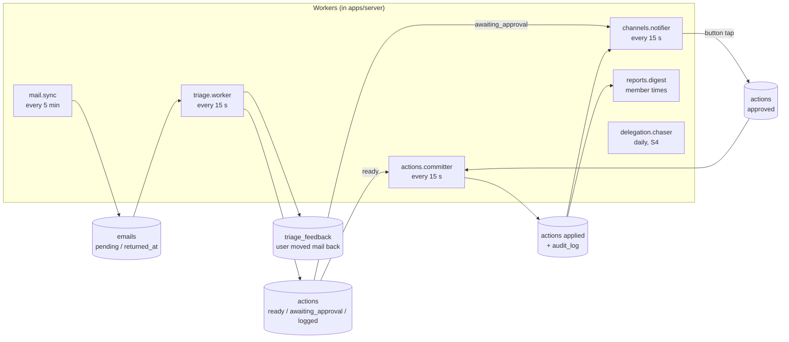
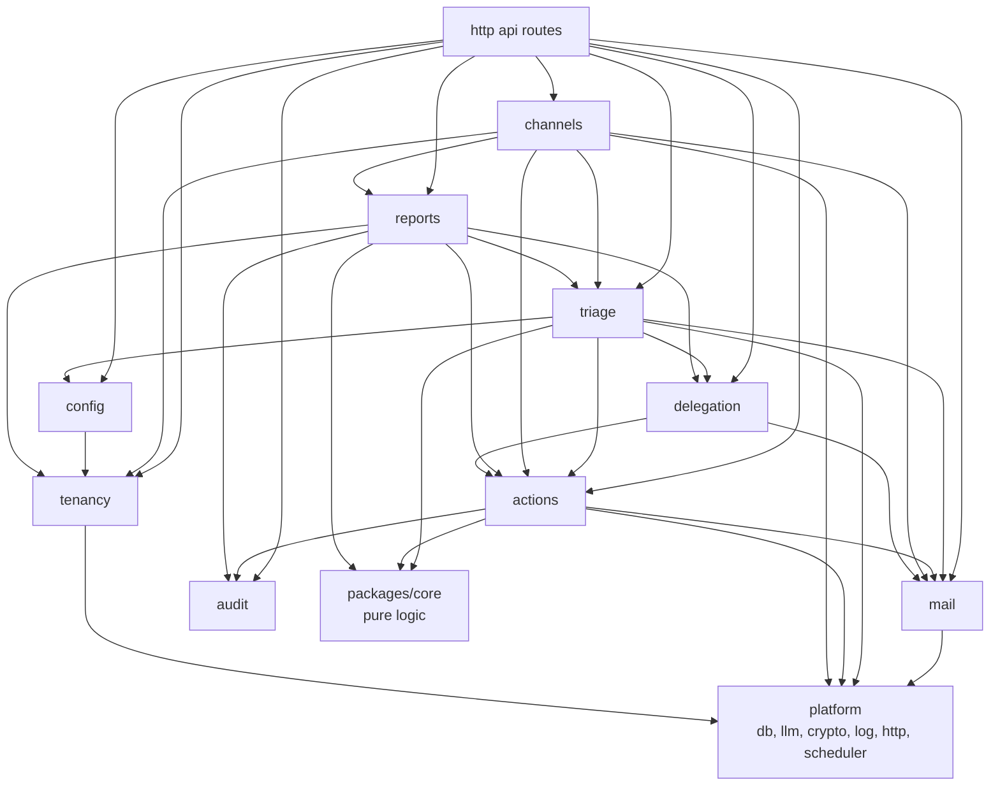

# Module catalog — AI Email Assistant

> **Accepted 2026-11-02** (user). Revised 2026-11-02 after the cold review (IMAP first, own Postgres, feedback and Undo) and a second review (`tasks/done/docs-and-adr-review.md`).
> Detail for `docs/architecture.md` sections 3–5. Decisions: `docs/decisions/`.

## 1. Big picture

- **One repository** (monorepo, Bun workspaces). Not many repos: one developer, shared types, one CI, atomic changes.
  A future mobile app also goes into this repo as `apps/mobile`.
- **Two containers in the pilot:** `server` (one Bun process; from S5 it also serves the web build) and `db` (Postgres 17). Compose files in `deploy/`.
- **One shared package:** `packages/core` (pure logic + Zod schemas, no I/O).

```
email_assistant/
├─ apps/
│  ├─ server/        Bun + Hono: HTTP API, workers, scheduler, Telegram bot
│  ├─ web/           Web panel (S5)
│  └─ mobile/        (Phase 2) mobile app
├─ packages/
│  └─ core/          domain types, Zod schemas, categories, rules, policy, planners, digest builder
├─ db/migrations/    SQL migrations
├─ deploy/           compose.yaml, server Dockerfile, backup script
├─ evals/            prompt evaluation
└─ docs/
```

## 2. How the modules talk

Principle: **the database holds the state; small workers move it forward.**
A module does not call the next module in a long chain. It writes a row with a new status. The next worker picks it up.



Small jobs (not in the picture): `actions.expiry` (hourly), `platform.retention` (daily), `platform.heartbeat` (every 5 min).

Why:
- **Crash safety.** If the process stops, no work is lost. On restart each worker continues from the DB state.
- **No import cycles.** Example: `actions` needs to ask for approval and `channels` needs to approve actions.
  `actions` only sets `awaiting_approval`; `channels.notifier` reads it. `channels` calls `actions.approve()` on a button tap.
- **Visible state.** Each email and action has a status you can query and show.
- Latency is seconds to minutes. This is fine for email. Urgent notices go out within one notifier tick after triage (≤ 10 min after arrival).

Direct calls stay for reads and simple commands (for example `triage` reads `config` rules; API routes call module services).
The triage worker calls the pure policy from `packages/core` in its own transaction (no separate gate job).

Module dependencies (arrow = "uses"):



`triage → delegation`: the hard rule "reply in a delegation thread" reads open delegations (S4).
`triage → actions`: the triage worker writes the action rows through `actions.createPlanned()` in its transaction.
`channels → triage`: the ✅ / ✏️ buttons and the Undo button write feedback through `triage.recordFeedback()`.
`actions` never calls `triage`, and `mail` never calls `triage`: they set columns that the triage worker reads (no import cycles).

## 3. Modules in `apps/server`

Each module folder: `index.ts` (public API), `service.ts`, `repo.ts` (DB), `routes.ts` (HTTP, if any), `jobs.ts` (workers, if any), `*.test.ts`.
Code rules: `docs/code-patterns.md`.

### 3.0 `platform` — technical base (not a business module)

| Part | Does | Tech |
|---|---|---|
| `config` | Reads and checks env at start; fails fast on a missing key | Zod |
| `db` | Postgres pool, transactions, `TenantContext`, generated types, migration runner | Kysely + kysely-codegen, `pg`; `dbmate` (chosen in S0) |
| `llm` | Roles `classifier` / `writer`, structured output, timeout, rate limiter, soft-error rules | `@google/genai` (Gemini), Zod |
| `crypto` | AES-256-GCM encrypt / decrypt with key version | `node:crypto` |
| `log` | Levels, `[module]` prefix, no mail bodies or secrets | own `log` util |
| `http` | Hono app, session check (S5), error handler, `/health` | Hono |
| `scheduler` | Cron-like timers for jobs; one tick never overlaps the next | croner |
| `retention` (job) | Clears text columns after their retention time (`docs/architecture.md` §7) | — |
| `heartbeat` (job) | Pings the external dead-man's-switch service | — |

### 3.1 `tenancy` — who is who (S0)

- **Owns:** `organizations`, `users`, `memberships`.
- **Does:** creates the pilot organization and user (CLI `bun run org:create`, S0); owns style text and digest times; resolves `TenantContext` from a session (web) or a linked chat (Telegram); checks roles.
- **Later:** login (S5), self sign-up (S6), invite assistant (Phase 2).

### 3.2 `mail` — access to mailboxes (S1a)

| Sub-module | Does |
|---|---|
| `port.ts` | `MailProvider` read port: `serverInfo`, `inboxStatus`, `fetchAbove`, `searchInboxSince`, `fetchByUids`, `fetchBodyText`, `findByMessageId`, `close`; `MailAuthError`. Write methods (move, flags, draft, send) come in S3/S4 |
| `imap/client.ts` | `ImapMailProvider` over TLS (`imapflow`): INBOX status (STATUS / highest UID fallback for `UIDNEXT`), UID fetch, search, body text |
| `imap/mapper.ts` | IMAP message → `MessageMeta` / body text (`mailparser`, `html-to-text`), size limit |
| `imap/smtp.ts` | SMTP login check (`nodemailer`); send comes in S4 |
| `imap/probe.ts`, `imap/tools.ts` | Write probes for `mailbox:check --probe`; APPEND for the seed tool (test only) |
| `connect.ts` | `connectMailbox`: IMAP + SMTP login check, capabilities, folder map, encrypted secret, default settings (CLI `mailbox:connect`) |
| `check.ts` | `checkMailbox`: read-only capability report, optional write probes (CLI `mailbox:check`) |
| `sync-rules.ts` | Pure rules: `Message-ID` normalize, content hash, dedup keys, thread key, cursor filter, decisions for incoming mail |
| `sync.ts` | `syncMailbox`: modes `initial` (24 h), `incremental` (UID cursor), `rescan` (7 days after a UIDVALIDITY change) |
| `jobs.ts` | `createMailSyncJob`: every 5 min for each active mailbox (`listSyncTargets`); one mailbox error never stops the others |
| `repo.ts` | `mailboxes`, `mailbox_credentials`, `emails` queries; guarded cursor update; `forceRescan` |
| `seed.ts`, `audit.ts`, `tools.ts` | 48-hour test tools: `mailbox:seed` (test address only), `mailbox:rescan`, `mailbox:audit` |
| `fake/` | In-memory `MailProvider` for tests; `test/contract/` runs the same suite on fake and GreenMail |

- **Owns:** `mailboxes`, `mailbox_credentials`, `emails`.
- **Rules:** `docs/architecture.md` §6.1.
- **Later:** `gmail/` and `graph/` (Microsoft 365) adapters with OAuth (Phase 2); IMAP IDLE.

### 3.3 `config` — user settings (S1a, UI in S5)

- **Owns:** `mailbox_settings` (mode `shadow` / `assist`, tool switches, category policy), `sender_rules` (whitelist, blocklist, VIP; address or domain;
  per organization, optional per mailbox). Style text (`organizations`) and digest times (`memberships`) belong to `tenancy`;
  `config`, `reports` and the API read and write them through `tenancy`'s `index.ts`.
- **Does:** validation (for example: the owner's own address cannot be a delegate); default settings for a new mailbox (mode `shadow`, all automatic moves off).
- **Built in S1a:** `config/repo.ts` reads and writes `mailbox_settings` (defaults on connect). `sender_rules` and validation come in S1b.

### 3.4 `triage` — understand each email (S1b)

| Sub-module | Does |
|---|---|
| `rules` (in `core`) | Hard rules before AI: blocklist → spam; whitelist / VIP → no `spam` in the allowed list; `noreply` detection; reply in a delegation thread (S4) |
| `classifier` | Builds the prompt (email in a marked data block + sender context + last 3 thread mails), calls `llm.classifier`, validates `TriageAnalysis` (category, confidence, reason, fields, summary for `info`) |
| `prompts/` | Versioned prompt texts; the version id goes to `triage_results` |
| `planners` (in `core`) | One per category: `urgent`, `needs_reply`, `info`, `notification`, `spam`, `unsure`; `delegation` in S4. Each returns an `ExecutionPlan` |
| `policy` (in `core`) | Pure truth table (`docs/architecture.md` §4.3): `apply` / `await_approval` / `log_only` per action |
| `feedback` | `recordFeedback()` (verdict, optional true category) from CLI, Telegram, Undo, web; turns `emails.returned_at` into feedback; labeling CLI `bun run triage:label` |
| `worker` (job) | Claims `pending` emails (`SKIP LOCKED`), runs rules → classifier → planner → policy, saves `triage_results` + `actions` in one transaction, sets email `triaged` |

- **Owns:** `triage_results`, `triage_feedback`.

### 3.5 `actions` — the only place that changes the mailbox (S3; S1b writes `logged` rows)

| Sub-module | Does |
|---|---|
| `committer` (job) | Takes `ready` and `approved` actions (a send only after its draft is `applied`); `applying` before `create_draft` and `send`; calls `MailProvider`; sets `applied` / `failed` and `emails.folder`; writes `audit_log` in the same transaction; recovery from `applying` by `X-EA-Action-Id` (send: at-most-once, `docs/architecture.md` §4.1 rule 6) |
| `approvals` | `approve(actionId, user, channel)`, `reject(...)` — conditional update on `awaiting_approval` |
| `undo` | `undo(actionId, user)`: creates the reverse action (`ready`). The committer applies it, then sets the original `undone` and `emails.folder` in one transaction. The caller writes the feedback row |
| `expiry` (job) | `awaiting_approval` 48 h after `notified_at` → `expired`; a send whose draft is `failed` or `undone` → `expired` (`draft_missing`) |
| `retry` | Backoff for soft errors (no count); hard errors count; after 3 → `failed` + notice |

- **Owns:** `actions`.
- **Rule:** a `send` action is applied only with an approval record (ADR 0003).

### 3.6 `audit` — what happened and why (S1b)

- **Owns:** `audit_log` (append-only; the DB role `app` has only INSERT and SELECT).
- **Does:** `record(event)` inside other modules' transactions; queries for the digest and the web activity view. No mail text in `data`.

### 3.7 `reports` — digest and metrics (S2)

| Sub-module | Does |
|---|---|
| `builder` (in `core`) | From actions and audit since the last digest: URGENT → NEEDS ACTION → DONE AUTOMATICALLY → REMINDERS; "last sync"; "not processed" items; weekly handled share (`docs/architecture.md` §4.4) |
| `renderers` | Telegram text (short lines with ✅ / ✏️ buttons), web view (S5) |
| `digest` (job) | At each member's digest times (organization timezone); also on demand (`/digest`) |

- **Owns:** `digests`.

### 3.8 `channels` — talk to the user (S2)

| Sub-module | Does |
|---|---|
| `port.ts` | `ChatChannel` interface: `send`, `sendApproval(action)`, `edit`, handlers for commands and button taps |
| `telegram/bot` | grammY bot client, long polling (webhook with secret token only with a public HTTPS address) |
| `telegram/linking` | One-time token (15 min, one user) → `t.me/<bot>?start=<token>` → saves `chat_links` |
| `telegram/commands` | `/start`, `/help`, `/digest`, `/pause`, `/resume`, `/status` |
| `telegram/callbacks` | Button tap → check chat → user → org → `actions.approve / reject / undo` or `triage.recordFeedback` → answer → edit message |
| `notifier` (job) | Sends approval requests, urgent and `auth_error` notices, result edits ("✅ Sent"); sets `notified_at` |

- **Owns:** `chat_links`, `chat_link_tokens`.
- **Later:** `mobile/` (push to the app), `whatsapp/`, and the `assistant` module (intents, chat state, voice).

### 3.9 `delegation` — hand work to people and follow up (S4)

| Sub-module | Does |
|---|---|
| `delegates` | CRUD; competence tags; active flag |
| `planner` (in `core`) | Delegation plan: delegate id from the list, task summary, due date; missing data → clarification draft. The draft quotes the original mail |
| `tracking` | `delegations` statuses: `drafted` → `sent` → `answered` / `overdue` → `done`; reply detection by `In-Reply-To` / `References` |
| `chaser` (job) | Daily: overdue items without a reply → reminder draft → approval request ("send all" = one approval for the list) |

- **Owns:** `delegates`, `delegations`.

### 3.10 HTTP API (routes from each module, composed in `platform/http`)

| Route group | Used by | Slice |
|---|---|---|
| `GET /health` | heartbeat, monitoring | S0 |
| `/auth/*` (login method decided in S5) | web | S5 |
| `/me`, `/mailboxes` (connect, pause, remove) | web | S5 |
| `/settings`, `/rules` | web | S5 |
| `/actions` (list, approve, reject, undo) | web, mobile later | S5 |
| `/activity`, `/feedback` | web | S5 |
| `/channels/telegram/link` | web | S5 (CLI before) |
| `/delegates`, `/delegations` | web | Phase 2 web; Telegram + CLI in S4 |

Before S5, the CLI scripts call the module services directly (no HTTP).

### 3.11 Phase 2 modules (not built in MVP)

| Module | Does |
|---|---|
| `assistant` | Two-way chat: intents (new email, find mail, status, reminders), chat state, voice → text |
| `brain` | Style learning (sent mail, draft vs sent diff), trust score per contact, competence extraction |
| `meetings` | Calendar port (Google first), conflict check, slot proposals |
| `billing` | Plans, payments, limits (S6) |

## 4. `apps/web` — pages

| Page | Content | Slice |
|---|---|---|
| Login | Method decided at the S5 start (own `users` table) | S5 |
| Onboarding checklist | Connect mailbox → link Telegram → choose mode → optional lists | S5 |
| Mailboxes | Status, connect (address + password), pause, remove | S5 |
| Settings | Mode, tool switches, category policy, digest times, style text | S5 |
| Rules | Whitelist, blocklist, VIP | S5 |
| Activity | What happened to each mail and why; Undo; ✅ / ✏️ feedback | S5 |
| Approvals | Pending actions with approve / reject (Telegram has them from S4) | Phase 2 web |
| Digests | Past reports (Telegram has them from S2) | Phase 2 web |
| Delegation | Delegates and open delegations | Phase 2 web |
| Account | Delete mailbox / account and data | S6 |

Until S5 the user works through Telegram and CLI scripts (`org:create`, `mailbox:connect`, `triage:label`, `telegram:link`, `delegates:add`).

## 5. `packages/core` — shared pure logic

- `types/`: `Email`, `Category`, `TriageAnalysis`, `ExecutionPlan`, `Action`, `ActionStatus`, `MailboxMode`.
- `schemas/`: Zod schemas for LLM output, API input and output.
- `rules/`, `policy/`, `planners/`, `digest/`, `metrics/`: pure functions with unit tests.
- No imports from `apps/*`, no DB, no network.

## 6. Status flows

See `docs/architecture.md` §4.6 (one source).
