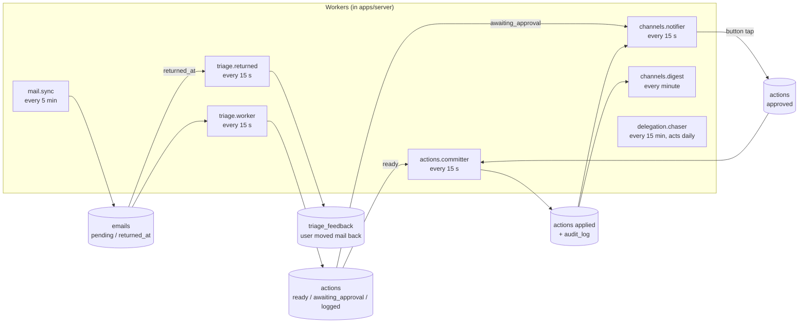

# Module catalog — AI Email Assistant

> **Accepted 2026-11-02** (user). Revised 2026-11-02 after the cold review (IMAP first, own Postgres, feedback and Undo) and a second review (`spec/features/done/2026-11/F009-docs-and-adr-review/plan.md`).
> Detail for `docs/architecture.md` sections 3–5. Decisions: `docs/decisions/`.

## 1. Big picture

- **One repository** (monorepo, Bun workspaces). Not many repos: one developer, shared types, one CI, atomic changes.
  A future mobile app also goes into this repo as `apps/mobile`.
- **Two containers in the pilot:** `server` (one Bun process; from S5 it also serves the web build) and `db` (Postgres 17). Compose files in `deploy/`.
- **One shared package:** `packages/core` (pure logic + Zod schemas, no I/O).

```
email_assistant/
├─ apps/
│  ├─ server/        Bun + Hono: HTTP API, workers, scheduler, Telegram bot
│  ├─ web/           Web panel (S5)
│  └─ mobile/        (Phase 2) mobile app
├─ packages/
│  └─ core/          domain types, Zod schemas, categories, rules, policy, planners, digest builder
├─ db/migrations/    SQL migrations
├─ deploy/           compose.yaml, server Dockerfile, backup script
├─ evals/            prompt evaluation
└─ docs/
```

## 2. How the modules talk

Principle: **the database holds the state; small workers move it forward.**
A module does not call the next module in a long chain. It writes a row with a new status. The next worker picks it up.



Small jobs (not in the picture): `actions.expiry` (hourly, S4), `platform.retention` (daily at 02:40, S6a; composed in `apps/server/src/retention.ts`), `channels.operator` (hourly at minute 13, S6a), `platform.heartbeat` (every 5 min).

Why:

- **Crash safety.** If the process stops, no work is lost. On restart each worker continues from the DB state.
- **No import cycles.** Example: `actions` needs to ask for approval and `channels` needs to approve actions.
  `actions` only sets `awaiting_approval`; `channels.notifier` reads it. `channels` calls `actions.approve()` on a button tap.
- **Visible state.** Each email and action has a status you can query and show.
- Latency is seconds to minutes. This is fine for email. Urgent notices go out within one notifier tick after triage (≤ 10 min after arrival).

Direct calls stay for reads and simple commands (for example `triage` reads `config` rules; API routes call module services).
The triage worker calls the pure policy from `packages/core` in its own transaction (no separate gate job).

Module dependencies are generated: [`docs/diagrams/module-graph.md`](diagrams/module-graph.md), written by `bun run graph:modules`; `apps/server/src/modules/layers.test.ts` fails when it is stale or when the code has an edge that the layers do not permit. Layers and the allowed same-layer edges: `apps/server/src/modules/layers.json`. Rules: `docs/code-patterns.md` § Layers and borders. The lines below give the reason for some edges; the generated file is the edge list.

`triage → delegation`: the triage worker reads the active delegates (`listDelegates`), builds the draft plan from them, creates the `delegations` row (`createDelegation`) and detects a delegate's reply (`detectReply`, `markAnswered`) in its transaction (S4).
`channels → delegation`: the Done tap calls `closeDelegation`; the notifier reads answered delegations and delegate names; `/status` counts open delegations (S4).
`reports → delegation`: the digest reads the delegate names and the open delegations (S4).
`delegation → actions | mail | config | tenancy | audit`: the service closes the reminder sends (`expireReminderActions`); the chaser plans reminders with `createPlanned` and reads the settings, the organization timezone and the audit count (S4).
**Hooks pattern (S4):** `actions` must not import `delegation` (`delegation → actions` already exists, so the reverse edge would be a cycle). `actions` defines the interface `DelegationHooks` (`actions/hooks.ts`: `onSent`, `onReminderSent`, `onCancelled`, `isOpen`); `delegation` implements it (`delegationHooks`); `main.ts` and `scripts/job-run.ts` wire it into the committer, the expiry job and the Telegram handlers. There is no `actions → delegation` edge.
`triage → actions`: the triage worker writes the action rows through `actions.createPlanned()` in its transaction. The returned job (`triage/returned.ts`, S3) locks and updates the original move through `lockLatestOriginalMove` and `markUndone`.
`triage → audit`: the triage worker and `triage/backfill.ts` write audit rows through `audit.recordAudit()` in their transactions.
`channels → triage`: the ✅ / ✏️ buttons and the Undo button write feedback through `triage.recordFeedback()`.
`channels → actions`: the Undo tap calls `actions.undo()` (S3); the notifier reads the failed actions (`listFailedUnnotified`, `markNotified`); `/status` counts the actions (`countActionsSince`).
`actions → mail`: the committer and Undo use `locateMessage`, `listFolderUids`, `openMailboxProvider`, `updateEmailLocation` and the port (S3).
`tenancy → audit`: `tenancy/service.ts` writes the `org.timezone_changed` and `org.style_changed` audit rows in the transaction of `updateOrganizationSettings` (S5c). S5d adds no edge.
`config → audit`: the setters write the `mailbox.*_changed` audit rows in their transaction (S3).
`config` gets `expireReady` as a dependency (`SettingsDeps.expireReady`, passed by the caller from the `actions` index) and never imports `actions`: `config` is in a lower layer, and the filter type `ExpireFilter` lives in `@ea/core`.
`channels → config`, `channels → audit`: the digest and `/status` read the mailbox mode; `/pause` and `/resume` write `mailbox.paused` / `mailbox.resumed` audit rows.
`reports → mail`, `reports → config`: the digest reads the mailboxes (status, last sync, waiting mail) and their mode. `channels → reports`; `reports` never imports `channels` (no cycle).
`mail → audit`: a status change (`updateMailboxPassword`) and its audit row go in one transaction.
`mail → config`, `mail → audit` (`mail/connect.ts`): `insertDefaultSettings` and `recordAudit`.
`mail → tenancy`, `triage → tenancy`, `actions → tenancy` (S6a): the sync, triage and committer loops call `isOrgSuspended` before each mailbox; `connectMailbox` calls `getOrgPlan` for the mailbox limit. `tenancy` imports only `audit` and `platform`, so there is no cycle. `channels → tenancy | mail` (S6a): the Telegram handlers call `isOrgSuspended`; `channels/operator.ts` calls `listOrganizations` and `listAuthErrorMailboxesBefore`.
**Composition file `retention.ts` (S6a):** `apps/server/src/retention.ts` sits beside `web.ts` and `composition.ts`. It imports the clear functions of `mail`, `triage`, `actions`, `delegation` and `channels` and `listOrganizations` of `tenancy`, and builds the job `platform.retention`. It passes `isOpenDelegationDraft` of `delegation` as the keep rule of `clearActionPayloads`, so `actions` never imports `delegation`. `platform` imports no module, so the job cannot live in `platform`.
`actions` never calls `triage`, and `mail` never calls `triage`: they set columns that the triage worker reads (no import cycles).

## 3. Modules in `apps/server`

Each module folder: `index.ts` (public API), `service.ts`, `repo.ts` (DB), `routes.ts` (HTTP, if any), `jobs.ts` (workers, if any), `*.test.ts`.
Code rules: `docs/code-patterns.md`.

### 3.0 `platform` — technical base (not a business module)

| Part              | Does                                                                                                                                                                                       | Tech                                                                |
| ----------------- | ------------------------------------------------------------------------------------------------------------------------------------------------------------------------------------------ | ------------------------------------------------------------------- |
| `config`          | Reads and checks env at start; fails fast on a missing key                                                                                                                                 | Zod                                                                 |
| `db`              | Postgres pool, transactions, `TenantContext`, generated types, migration runner                                                                                                            | Kysely + kysely-codegen, `pg`; `dbmate` (chosen in S0)              |
| `llm`             | Roles from the role table (`classifier`, `judge`, `drafter`, `extractor`, `escalation`), `generate` by role, structured output, timeout, provider and role rate limiters, soft-error rules | `@google/genai` (Gemini), `openai` (OpenAI), Zod; provider registry |
| `crypto`          | AES-256-GCM encrypt / decrypt with key version                                                                                                                                             | `node:crypto`                                                       |
| `log`             | Levels, `[module]` prefix, no mail bodies or secrets                                                                                                                                       | own `log` util                                                      |
| `http`            | Hono app: session and tenant middleware, hardening (origin check, body limit, headers, CSP), static pages, error handler, `/health`                                                        | Hono                                                                |
| `auth`            | Better Auth instance (`platform/auth.ts`): login, sessions, password change; the `/api/auth/*` allow-list                                                                                  | Better Auth (ADR 0016)                                              |
| `scheduler`       | Cron-like timers for jobs; one tick never overlaps the next                                                                                                                                | croner                                                              |
| `retention` (job) | `platform.retention`, built in `apps/server/src/retention.ts`: clears text columns after their retention time (`docs/architecture.md` §7)                                                  | —                                                                   |
| `heartbeat` (job) | Pings the external dead-man's-switch service                                                                                                                                               | —                                                                   |

### 3.1 `tenancy` — who is who (S0)

- **Owns:** `organizations`, `users`, `memberships`, `org_features`.
- **Does:** creates the pilot organization and user (CLI `bun run org:create`, S0); owns style text and digest times; resolves `TenantContext` from a session (web) or a linked chat (Telegram); checks roles.
- **Built in S2:** `getMembership` (a member's role by `org_id` and `user_id`) and `setDigestTimes` (CLI `bun run digest:times`; the new default of `digest_times` is `{08:00,16:00}`).
- **Built in S5:** login through Better Auth (`platform/auth.ts`, ADR 0016; no sign-up). `web:invite` (CLI `bun run web:invite --org-id <uuid> [--user-id <uuid>]`) makes the first-password link for a member. `listMembershipsOfUser` (the user gives the tenant; the oldest membership wins). `updateOrganizationSettings` (timezone and style text; writes `org.timezone_changed` and `org.style_changed`). Routes: §3.10.
- **Built in S6a:** the plan state: `organizations.plan`, `trial_ends_at`, `max_mailboxes`, `resumed_at`. `getOrgPlan`, `isOrgSuspended`, `listOrganizations` (repo) and `setOrgPlan` (service: one transaction, audit row `org.plan_changed`, an injected `onSuspended` hook; `resumed_at` is set when the plan leaves `suspended`). `createOrganizationWithOwner` takes an optional plan. CLIs: `bun run org:create --plan trial|active [--trial-days N]`, `bun run org:plan --org-id <uuid> [--plan …] [--trial-days N] [--max-mailboxes N]`, `bun run org:status [--org-id <uuid>]` (ids, codes, dates and counts only). Rules of `suspended`: `docs/architecture.md` §8.
- **Built in F087:** feature flags: `getOrgFeature`, `listOrgFeatureRows`, `upsertOrgFeature`, `listOrgFeatureRowsOfAll` (repo), `isFeatureOn`, `featureStates`, `featureStatesOfAll`, `configureFeatures` (`features.ts`), `setOrgFeature` (service, audit row `org.flag_changed`); CLI `bun run org:flag`; the operator route `GET /api/operator/flags` (`operator-routes.ts`, guarded by `requireOperator` in `platform/http.ts`). The registry is in `packages/core/src/features.ts`.
- **Later:** self sign-up (S6), invite assistant (Phase 2).

### 3.2 `mail` — access to mailboxes (S1a)

| Sub-module                        | Does                                                                                                                                                                                                                                                                                                                                                                                                                                                                                                                                                                                                                                                                                                                                                                                    |
| --------------------------------- | --------------------------------------------------------------------------------------------------------------------------------------------------------------------------------------------------------------------------------------------------------------------------------------------------------------------------------------------------------------------------------------------------------------------------------------------------------------------------------------------------------------------------------------------------------------------------------------------------------------------------------------------------------------------------------------------------------------------------------------------------------------------------------------- |
| `port.ts`                         | `MailProvider` port. Read (per folder since ADR 0014): `serverInfo`, `listFolders`, `folderStatus(folder)`, `fetchAbove(folder, lastUid)`, `fetchBodyText(folder, uid)`, `close`. S3 folder-aware read: `fetchMetaIn`, `searchSinceIn`, `fetchByUidsIn`. S3 write: `ensureFolder`, `moveMessage`, `deleteMessage`, `setFlags`; ADR 0014: `transferByAppend` (APPEND + `UID EXPUNGE`, for the rescue into INBOX and an Undo into a `sort` folder). The INBOX-only calls `inboxStatus`, `searchInboxSince` and `fetchByUids` are removed. S4: `appendMessage` (returns the UID when the server has UIDPLUS), the `MailSender` port (`send`, `close`) and `SmtpSendError` with `SmtpStage`. `findByMessageId` is removed (it never works at Interia). `MailAuthError`, `MailNotFoundError` |
| `imap/client.ts`                  | `ImapMailProvider` over TLS (`imapflow`): folder status (the largest of STATUS, SELECT and highest UID + 1 for `UIDNEXT`, ADR 0014), UID fetch, search, body text; S3: the write methods (own `UID COPY` + `UID EXPUNGE` when the server has no MOVE; every imapflow `false` is a `HardError`), the option `forceCopyMove` for tests                                                                                                                                                                                                                                                                                                                                                                                                                                                    |
| `imap/mapper.ts`                  | IMAP message → `MessageMeta` / body text (`mailparser`, `html-to-text`), size limit                                                                                                                                                                                                                                                                                                                                                                                                                                                                                                                                                                                                                                                                                                     |
| `imap/smtp.ts`                    | SMTP login check (`nodemailer`; `security: "tls" \| "starttls"`, F049); S4: `openSmtpSender` (own `SMTPConnection`, one connection per send, the logger hook that marks the content phase) and `classifySmtpError` (the stage rule, architecture §4.1 rule 6)                                                                                                                                                                                                                                                                                                                                                                                                                                                                                                                           |
| `imap/compose.ts`                 | S4: `composeMessage`: the raw bytes of an `OutgoingMessage` (nodemailer `MailComposer`); the draft APPEND and the SMTP send use the same bytes                                                                                                                                                                                                                                                                                                                                                                                                                                                                                                                                                                                                                                          |
| `imap/probe.ts`, `imap/tools.ts`  | Write probes for `mailbox:check --probe`; APPEND for the seed tool (test only)                                                                                                                                                                                                                                                                                                                                                                                                                                                                                                                                                                                                                                                                                                          |
| `imap/probe-move.ts`              | S3 spike (`assertTestAddress`, `probeMove`): checks the move facts on the test mailbox with one synthetic mail (CLI `mailbox:probe-move`)                                                                                                                                                                                                                                                                                                                                                                                                                                                                                                                                                                                                                                               |
| `imap/probe-send.ts`              | S4 spike (`probeSend`, `isAllowedRecipient`): one synthetic mail through the draft, SMTP, Sent and INBOX paths on the test mailbox (CLI `mailbox:probe-send`)                                                                                                                                                                                                                                                                                                                                                                                                                                                                                                                                                                                                                           |
| `locate.ts`                       | `locateMessage`, `locateKeyOf`: finds a known mail in a folder by identity, with no header search; skips `\Deleted` and the UIDs of `excludeUids` (architecture §6.1). S4: `locateByActionId`: finds the system's own draft or sent mail by the header `X-EA-Action-Id` (UID hint, then `SEARCH SINCE` and a header FETCH)                                                                                                                                                                                                                                                                                                                                                                                                                                                              |
| `open.ts`                         | `openMailboxProvider`: decrypts the secret in memory and opens a provider; the committer opens its connection with it                                                                                                                                                                                                                                                                                                                                                                                                                                                                                                                                                                                                                                                                   |
| `connect.ts`                      | `connectMailbox`: IMAP + SMTP login check, capabilities, folder map, encrypted secret, default settings (CLI `mailbox:connect`)                                                                                                                                                                                                                                                                                                                                                                                                                                                                                                                                                                                                                                                         |
| `check.ts`                        | `checkMailbox`: read-only capability report, optional write probes (CLI `mailbox:check`)                                                                                                                                                                                                                                                                                                                                                                                                                                                                                                                                                                                                                                                                                                |
| `sync-rules.ts`                   | Pure rules: `Message-ID` normalize, content hash, dedup keys, thread key, cursor filter, decisions for incoming mail; S3: `sameMailIdentity`, `isDeleted`                                                                                                                                                                                                                                                                                                                                                                                                                                                                                                                                                                                                                               |
| `sync.ts`                         | `syncMailbox`: ADR 0014: one run per mailbox, folder by folder (INBOX, the `sort` folders, the spam folder), one cursor per folder. Modes `initial` (24 h), `incremental` (UID cursor), `rescan` (7 days after a UIDVALIDITY change); S3: the below-cursor return check at the end of an incremental sync. `backfillInbox` (S1b): one-off, read-only fetch of the last 1–180 days; stores missing mail with `backfilled_at`; the cursor never moves                                                                                                                                                                                                                                                                                                                                     |
| `jobs.ts`                         | `createMailSyncJob`: every 5 min for each active mailbox (`listSyncTargets`); one mailbox error never stops the others                                                                                                                                                                                                                                                                                                                                                                                                                                                                                                                                                                                                                                                                  |
| `repo.ts`                         | `mailboxes`, `mailbox_credentials`, `mailbox_folders` (ADR 0014: the synced folders and their cursors), `emails` queries; guarded cursor update; `forceRescan`; S3: `listRecentlyMoved`, `listFolderUids`, `listReturned`, `clearReturned`, `updateEmailLocation`, `setFolderMapEntry`, `setUndoPending`, `getEmailMailbox`                                                                                                                                                                                                                                                                                                                                                                                                                                                             |
| `seed.ts`, `audit.ts`, `tools.ts` | 48-hour test tools: `mailbox:seed` (test address only; `--folder <path>` APPENDs into another folder; S1b: `--eval-cases synthetic\|injection\|all` seeds the eval cases), `mailbox:rescan`, `mailbox:audit`; S1b: `backfillMailbox` (backfill only); the script `mailbox:backfill` then calls `triage.requeueBackfillWindow`                                                                                                                                                                                                                                                                                                                                                                                                                                                           |
| `fake/`                           | In-memory `MailProvider` (and, S4, `fake/sender.ts`: a `MailSender` with scripted outcomes) for tests; `test/contract/` runs the same suite on fake and GreenMail                                                                                                                                                                                                                                                                                                                                                                                                                                                                                                                                                                                                                       |

- **Owns:** `mailboxes`, `mailbox_credentials`, `mailbox_folders`, `emails`.
- **Built in S2:** `listMailboxes` (id, address, status, `last_synced_at`, `status_changed_at`, `created_at`), `countWaiting` (mail that waits for triage in all mailboxes),
  `changeMailboxStatus` (conditional `active` ↔ `paused`; never touches `auth_error`) and the column `mailboxes.status_changed_at` (moves only when the status really changes).
  `updateMailboxPassword` (in `connect.ts`): IMAP and SMTP login test, new encrypted secret, `auth_error` → `active`, audit row `mailbox.password_changed` in one transaction; CLI `bun run mailbox:password` (password on stdin only).
- **Built in S3:** the write port and the identity locate (above); `listRecentlyMoved` (moves of the last 7 days, for the below-cursor check); `updateEmailLocation` (`folder`, `uid`, `inbox_uid`, `moved_at`, `undo_pending_at` in the committer's transaction);
  `setFolderMapEntry` (the real folder path after `ensureFolder`); `listReturned` and `clearReturned` (the returned job); `listFolderUids` (the `excludeUids` of the locate); the columns `inbox_uid`, `moved_at`, `undo_pending_at`.
  `findByMessageId` is removed. CLI `bun run mailbox:probe-move` (test address only).
- **Built in S4:** `appendMessage` (port, IMAP adapter and fake); `MailSender`, `openSmtpSender`, `SmtpSendError` and the stage rule; `composeMessage`; `locateByActionId`; `listMailboxTargets` (active, paused and auth_error mailboxes for the expiry job; `listSyncTargets` stays as a wrapper for active ones); `mailboxHasUidplus`;
  the own-mail skip wired (`isOwnActionId` from `actions`, passed by `main.ts` to the sync and to `backfillMailbox`). CLI `bun run mailbox:probe-send` (test address only). Facts: `notes/2026-11-07-send-approval-facts.md`.
- **Built in S6a:** the mailbox limit: `connectMailbox` refuses a mailbox above `organizations.max_mailboxes` with `MailboxLimitError` (web `409 mailbox_limit`; the count runs under an advisory lock after the IMAP check). `listMailboxTargets` and `listSyncTargets` skip mailboxes of `suspended` organizations (`includeSuspended`); `countSyncTargets` and `listAuthErrorMailboxesBefore`; the retention clear functions `clearMailBodies` and `clearMailHeaders`; the skip reason `suspended_backlog`.
- **Rules:** `docs/architecture.md` §6.1.
- **Later:** `gmail/` and `graph/` (Microsoft 365) adapters with OAuth (Phase 2); IMAP IDLE.

### 3.3 `config` — user settings (S1a, UI in S5)

- **Owns:** `mailbox_settings` (mode `shadow` / `assist`, tool switches, category policy), `sender_rules` (whitelist, blocklist, VIP; address or domain;
  per organization, optional per mailbox). Style text (`organizations`) and digest times (`memberships`) belong to `tenancy`;
  `config`, `reports` and the API read and write them through `tenancy`'s `index.ts`.
- **Does:** validation (for example: the owner's own address cannot be a delegate); default settings for a new mailbox (mode `shadow`, all automatic moves off).
- **Built in S1a:** `config/repo.ts` reads and writes `mailbox_settings` (defaults on connect).
- **Built in S1b:** `sender_rules` (`listSenderRules`, `insertSenderRule`) and the CLI `bun run rules:add` / `rules:list` (the pattern is an address or a domain with a dot, lower case). Other validation comes later.
- **Built in S3:** `service.ts`: `getSettingsView`, `setMode`, `setCategoryAuto`, `setToolSwitch`, `closedBy`. Each setter locks the settings row, writes the change and its audit row (`mailbox.mode_changed`, `mailbox.policy_changed`, `mailbox.switch_changed`) in one transaction,
  and, when the change closes a gate (also `setMode assist` without `--keep-switches`, for each switch it turns off), expires the `ready` rows it closes through `SettingsDeps.expireReady`. CLI `bun run mailbox:settings` (`show`, `mode`, `auto`, `switch`, `expire-ready`); `auto … on` runs the real-mail go/no-go check in the script (it composes `triage` and `config`).

### 3.4 `triage` — understand each email (S1b)

| Sub-module             | Does                                                                                                                                                                                                                                                     |
| ---------------------- | -------------------------------------------------------------------------------------------------------------------------------------------------------------------------------------------------------------------------------------------------------- |
| `rules` (in `core`)    | Hard rules before AI: blocklist → spam; whitelist / VIP → no `spam` in the allowed list; `noreply` detection; reply in a delegation thread (S4: `detectReply` in `delegation`, run by the triage transaction on every save path)                         |
| `classifier`           | Builds the prompt (email in a marked data block + sender context + last 3 thread mails), calls `llm.generate` with role `classifier` and the registry prompt, validates `TriageAnalysis` (category, confidence, reason, fields, summary for `info`)      |
| `prompts/`             | Versioned prompt texts; the version id goes to `triage_results`. S4: `classifier-v2` (the category `delegation`, the `Delegates` block, the fields `delegate_id`, `task`, `clarification`)                                                               |
| `planners` (in `core`) | One per category: `urgent`, `needs_reply`, `info`, `notification`, `spam`, `unsure`; `delegation` in S4 (`delegationInputOf`, `planDelegation`: a delegation draft + send, or a clarification draft + send, or nothing). Each returns an `ExecutionPlan` |
| `policy` (in `core`)   | Pure truth table (`docs/architecture.md` §4.3): `apply` / `await_approval` / `log_only` per action                                                                                                                                                       |
| `feedback`             | `recordFeedback()` (verdict, optional true category) from CLI, Telegram, Undo, web; turns `emails.returned_at` into feedback; labeling CLI `bun run triage:label`                                                                                        |
| `worker` (job)         | Claims `pending` emails (`SKIP LOCKED`), runs rules → classifier → planner → policy, saves `triage_results` + `actions` in one transaction, sets email `triaged`                                                                                         |

- **Owns:** `triage_results`, `triage_feedback`.
- **Built in S2:** read queries for the digest and the buttons: `listTriagedBetween` and `countTriagedBetween` (triaged mail in a period, by category), `latestFeedback` and `getLabelTarget` (the latest label of a mail; the mail behind a button, filtered by organization). `recordFeedback` takes `skipIfSame`: the same answer as the latest row writes nothing.
- **Built in S1b** (`apps/server/src/modules/triage/`; `packages/core` has the rules, planners, policy and metrics):
  - `service.ts`: `triageOne` (age rule, hard rules, daily cap, classifier, save), `saveTriage` (result, actions and audit rows in one transaction; a lost claim writes nothing; it share-locks the settings row and compares the settings version, so a batch planned under old settings writes nothing), `finishTriageError`.
  - `jobs.ts`: `createTriageJob`, started by `main.ts` as `triage.worker` every 15 s. It follows `TRIAGE_LLM_SCOPE` (`off` builds no worker). Per mailbox: settings, rules, claim, loop. One mailbox error never stops the others.
  - `pause.ts`: `createLlmPause`, the LLM client pause (5 min, doubling to 60 min). Error rules: `docs/architecture.md` §4.1 rule 7. Shutdown waits up to 30 s for a batch.
  - `feedback.ts`, `label-input.ts`: `recordFeedback`, `listForLabeling`, `parseLabelInput`; CLI `bun run triage:label` (interactive, or one label with flags; Enter or `w` on an `unsure` row asks again, because a true category is needed). Rows get source `cli`.
  - `returned.ts` (S3): `processReturned` and `createReturnedJob`, started by `main.ts` as `triage.returned` every 15 s (always on, no LLM). One transaction per mail: it locks the latest original move (the Undo lock), sets it `undone` (`user_moved_back`), writes the `imap_move` feedback row when the rules of architecture §4.4 allow, clears `returned_at` and writes `email.returned`. One mail's error never stops the others.
  - **Built in S4:** `jobs.ts` reads the active delegates once per mailbox run (debug line `triage <mailboxId>: delegates <n>`) and passes them to the classifier and the planner; with no delegate the category `delegation` is not allowed. `service.ts`: `createPlanned` writes the draft and the send with `dependsOn`; `createDelegationRow` makes the `delegations` row and merges its id into both payloads; `markReply` marks the delegation `answered` when the mail comes from the delegate in the thread of the sent mail. `classifier-v2` is the prompt. `eval*.ts`: `delegation.json` (12 cases), `inj-13` to `inj-16`, the check `injectionHolds`.
  - `backfill.ts`: `requeueBackfillWindow` (`skipped / too_old` real mail of the window → `pending`, one `email.requeued` audit row for each mail, one transaction).
  - `eval*.ts`: `runEval`, `buildRealReport`, `renderEvalReport`; CLI `bun run eval`. `bun run triage:cost` prints tokens, latency and cost per mail and per mailbox per month from stored results.
  - **Built in S6a:** `suspended_backlog` (`triageOne`: mail from before a pause is `skipped` after a resume, no LLM call); `triage.worker` skips mailboxes of `suspended` organizations and calls the operator hook `onCapReached` when a mailbox reaches the daily cap; the scope `all` has no address (`TriageScope` = `synthetic` or `all`); the retention clear function `clearTriageTexts`.

### 3.5 `actions` — the only place that changes the mailbox (S3; S1b writes `logged` rows)

Built in S1b: `createPlanned`, `listActionsForEmail`, `listSummaries`. The triage worker writes the rows with the status that the policy gives (§4.3). In `shadow` mode, mailbox changes are `logged`; a `save_summary` row is `ready` and waits for the committer.

**Built in S3** (`apps/server/src/modules/actions/`; the error rules are in `docs/architecture.md` §4.1 rules 6 and 7):

| File           | Does                                                                                                                                                                                                                                                                                                                                                                                                                |
| -------------- | ------------------------------------------------------------------------------------------------------------------------------------------------------------------------------------------------------------------------------------------------------------------------------------------------------------------------------------------------------------------------------------------------------------------- |
| `repo.ts`      | The queries: `claimActions` / `countClaimable` (`FOR UPDATE SKIP LOCKED`, the 24-hour and 7-day limits, the scope filter), `finishAction` and `releaseAction` (conditional on the `locked_at` token), `expireStaleReady`, `expireReadyOriginals`, `countReadyOriginals`, `insertReverse`, `lockActionsForUndo`, `lockLatestOriginalMove`, `markUndone`, `listFailedUnnotified`, `markNotified`, `countActionsSince` |
| `scope.ts`     | `claimFilterFor(scope, mailboxAddress)` maps `ACTIONS_SCOPE` to the claim filter; `scopeAdmits` is the same check for one mail (the Undo tap)                                                                                                                                                                                                                                                                       |
| `apply.ts`     | `applyAction`: `save_summary` (DB only), `flag` / `mark_read` (set or, for a reverse, remove the flag), `move` (the ensure rule); the error mapping (soft, hard, `mail_not_found`, `bad_payload`, login); the location, status, `applied_at` and audit row in one transaction                                                                                                                                       |
| `move.ts`      | `ensureMoved`: the ensure of a move (locate in target and source, delete a leftover, move)                                                                                                                                                                                                                                                                                                                          |
| `committer.ts` | `createCommitterJob` (`actions.committer`, every 15 s): per active mailbox, expire stale rows, claim, open one connection when needed, apply in the order of architecture §4.1 rule 7; `createFolderResolver` (`ensureFolder` once per key per run)                                                                                                                                                                 |
| `expire.ts`    | `expireReady`: sets `ready` originals to `expired` with audit rows; used by Undo, `mailbox:settings expire-ready` and the settings setters                                                                                                                                                                                                                                                                          |
| `undo.ts`      | `undo()`: the reverse rows of one mail (architecture §4.4). The caller writes the feedback row                                                                                                                                                                                                                                                                                                                      |

**Built in S4** (same folder; the draft and send rules are in `docs/architecture.md` §4.1 rule 6, the flows in §4.5 and §4.6):

- `drafts.ts`: `applyDraft` (`applying`, build, locate by action id, APPEND, recovery, `send_closed`), `buildDraftMessage`, `removeDraft` (the reverse `create_draft` row: locate, delete, original `undone`).
- `send.ts`: `applySend` (`applying` in its own commit, one SMTP call, `applied` at once, the Sent copy, the recovery by the Sent search), `sendOutcomeOf` (the table of §4.1 rule 6).
- `transitions.ts`: the map of `actions.status` as data (statuses, edges, the guard of each writer function, entry writers, pair rules). No runtime code reads it; `actions-transitions.test.ts` compares it with the guards and the CHECK lists in Postgres.
- `approvals.ts`: `approve`, `reject`, `approveSet`, `rejectSet`, `sendAgain`. Each locks the send row first and changes the status with a conditional update. The role check is the caller's (the Telegram handler).
- `expiry.ts`: `expireSend` (the cascade: send, draft, delegation), `closeDraftOfSend`, `expireReminderActions`, and `createExpiryJob` (`actions.expiry`, hourly). It sits beside the S3 `expire.ts`.
- `hooks.ts`: `DelegationHooks` and `noDelegationHooks` (the hooks pattern, §2). `scope.ts` also has `sendFilterFor` and `sendScopeAdmits` for `SEND_SCOPE`.
- `constants.ts`: `STALE_AFTER_MS` (moved from `committer.ts`, so that `expiry.ts` never imports the committer: build step 0, S3 feature 6), `APPROVAL_TTL_MS`, `UNNOTIFIED_TTL_MS`, `HARD_ERROR_TRIES`, `RETRY_WAIT_MS`.
- `repo.ts` adds the claims for drafts and sends (`SendClaimFilter`), `countHeldSends`, `markApplying`, `lockSend` / `lockDraft`, `insertSendAgain`, `listExpiredApprovals`, the notice queries (`listSendsToNotify`, `listSetsToNotify`, `listSendResultsToNotify`, `markResultNotified`), `countApprovals`, `setDelegationId`, `isOwnActionId`.
- `apply.ts` and `committer.ts` dispatch `create_draft` and `send` to these files; the committer opens the SMTP sender only when it claims a send.

- **Owns:** `actions`.
- **Built in S2:** `listActionsForEmails` (the plans of many mails in one query, for "what the system would do" in digest lines and notices).
- **ACTIONS_SCOPE:** the committer reads `ACTIONS_SCOPE` (`off`, `synthetic`, `all`; architecture §4.3) and reads no mailbox settings: the policy decided at triage time.
- **Rule:** a `send` action is applied only with an approval record (ADR 0003): the committer claims only `approved` sends with `approved_at` set, and the database refuses a `send` in `approved`, `applying` or `applied` without it.
- **SEND_SCOPE:** the committer reads `SEND_SCOPE` (`off`, `self`, `all`; architecture §4.3) for the send only. A draft is made under `ACTIONS_SCOPE`.
- **Built in S6a:** the scopes `all` carry no mailbox address (`ActionsScope`, `SendScope`): every active mailbox of a not `suspended` organization, by the mode and the switches. The committer skips `suspended` organizations (the approval expiry still runs for them). The retention clear functions `clearActionPayloads` and `clearActionErrors`; "Send again" on a failed send with a cleared payload answers `draft_gone`.

### 3.6 `audit` — what happened and why (S1b)

- **Owns:** `audit_log` (append-only; the DB role `app` has only INSERT and SELECT).
- **Does:** `record(event)` inside other modules' transactions; queries for the digest and the web activity view. No mail text in `data`.
- **Built in S1b:** `recordAudit`, `recordLlmCall` (one `llm.call` row with `role` and `prompt_version`), `countLlmCallsSince` (the daily cap; counts per role, rows without a role are classifier rows), the event names in `auditEvents`: `email.triaged`, `email.skipped`, `action.planned`, `llm.call`, `email.requeued`.
- **Built in S2:** the events `chat.linked`, `chat.unlinked`, `mailbox.paused`, `mailbox.resumed`, `mailbox.password_changed`; `countEventsBetween` (for the digest).
- **Built in S3:** the events `action.applied`, `action.failed`, `action.expired`, `action.undo_requested`, `action.undone`, `email.returned`, `mailbox.folder_created`, `mailbox.mode_changed`, `mailbox.policy_changed`, `mailbox.switch_changed`. `data` holds ids, action types, folder keys, attempts, codes and booleans.
- **Built in S4:** the events `action.applying`, `action.approved`, `action.rejected`, `action.send_again`, `action.sent_copy_failed`, `delegate.added`, `delegate.changed`, `delegation.created`, `delegation.sent`, `delegation.answered`, `delegation.overdue`, `delegation.cancelled`, `delegation.done`, `delegation.chaser_run`; `countMailboxEventsBetween` (the chaser's once-per-day gate).

### 3.7 `reports` — digest and metrics (S2)

| Sub-module                         | Does                                                                                                                                                                                                                                                                        |
| ---------------------------------- | --------------------------------------------------------------------------------------------------------------------------------------------------------------------------------------------------------------------------------------------------------------------------- |
| `renderDigest` (in `core/digest/`) | Pure: the digest text and buttons from items, counts and mailbox state: NEEDS ACTION first, then OTHER MAIL, at most 15 lines with buttons, at most 4096 characters, "+N more", "last sync HH:MM" (also when empty). Weekly handled share and reminders come later (S3, S4) |
| `digest` (job, in `channels`)      | At each member's digest times (organization timezone); also on demand (`/digest`). It lives in `channels` (§3.8), because `reports` never imports `channels`                                                                                                                |

- **Owns:** `digests`.
- **Built in S2** (`apps/server/src/modules/reports/`):
  - `repo.ts`: `insertDigest` (slot key unique per member), `lastDigestSlotKey`, `lastSentDigestEnd`, `markDigestSent`. A digest row holds the slot key, the period and `sent_at`; the text is in `outbox.text`.
  - **Built in S4:** the digest reads the delegate names (so a line says `draft a delegation to <name>`), the draft task per mail and the open delegations. A `logged` send reads "would ask you to send it". The footer shows `Delegations: <n> waiting for a reply, <m> overdue`. The weekly handled-share line is still open (`spec/features/planned/F042-handled-share-delegations/plan.md`).
  - `digest.ts`: `digestPeriodStart` (since the last sent digest of the member; the first digest: link time − 24 h; never more than 7 days back) and `buildDigestMessage` (reads triaged mail, actions, mailboxes, settings and the audit count, then calls `renderDigest`).

### 3.8 `channels` — talk to the user (S2)

| Sub-module                    | Does                                                                                                                                                                                                                                                                                                                                                                                                                                                                                                                                                                                                                                                                                                  |
| ----------------------------- | ----------------------------------------------------------------------------------------------------------------------------------------------------------------------------------------------------------------------------------------------------------------------------------------------------------------------------------------------------------------------------------------------------------------------------------------------------------------------------------------------------------------------------------------------------------------------------------------------------------------------------------------------------------------------------------------------------- |
| `port.ts`                     | `ChatChannel` interface (`send`, `edit`), `ChannelError` kinds, `LinkedChat`, `UpdateHandlers`, the command names. Approval messages go through the outbox like every notice (no `sendApproval` method)                                                                                                                                                                                                                                                                                                                                                                                                                                                                                               |
| `telegram/`                   | The only place that imports `grammy`: `bot.ts` (the update router), `polling.ts` (long polling, `setMyCommands`), `api.ts` (send, edit, plain text, no link preview), `errors.ts` (`telegramErrorLabel`, `toChannelError`), `check.ts` (`checkBot` for `telegram:check`), `runtime.ts` (bot + notifier + digest job for `main.ts`). A webhook comes only with a public HTTPS address                                                                                                                                                                                                                                                                                                                  |
| `linking.ts`                  | One-time token (15 min, one member, only its SHA-256 hash is stored) → `t.me/<bot>?start=<token>` → `chat_links`; `unlinkUser`                                                                                                                                                                                                                                                                                                                                                                                                                                                                                                                                                                        |
| `commands.ts`                 | `/help`, `/status`, `/digest`, `/pause`, `/resume` (`/pause` and `/resume` only for the role `owner`); `createUpdateHandlers`                                                                                                                                                                                                                                                                                                                                                                                                                                                                                                                                                                         |
| `callbacks.ts`                | Button tap → chat link → `triage.recordFeedback` (✅ / ✏️ picker, `skipIfSame`) → answer → edit message. A mail of another organization gets the same answer as an unknown id. S3: the Undo tap (`fu:<emailId>`): `actions.undo()` and, when a reverse row was created, the `undo` feedback row in the same transaction; the answer is a toast. S4: the taps `ap:` `ar:` `as:` `rs:` `ag:` `dd:` (approve, reject, send all, skip all, send again, done): the owner role is checked first (`dd:` is open to every linked member), then `approve`, `reject`, `approveSet`, `rejectSet`, `sendAgain` or `closeDelegation`; the answer is a toast and the original message gets one line                 |
| `notices/`                    | The detector registry: one file per detector (`urgent.ts`, `action-failed.ts`, `auth-error.ts`, `sync.ts`, `approval.ts`, `approval-set.ts`, `send-result.ts`, `delegation-answered.ts`) and `mailbox-removed.ts`; `index.ts` lists them in `detectors` and runs them per organization (`detectNotices`): urgent, `auth_error`, sync late and sync works again → `outbox` rows; S3: `action_failed` (one notice per failed action (not for `save_summary`) to the linked owners, `actions.notified_at` set in the same transaction); S4: `approval`, `approval_set`, `send_result` (owners) and `delegation_answered` (every linked member); a broken row is skipped with one `warn` line per process |
| `notice-queue.ts`             | `queueNotice`: the only producer path into `outbox` (view, locale; a check render)                                                                                                                                                                                                                                                                                                                                                                                                                                                                                                                                                                                                                    |
| `digest-job.ts`               | `scheduleDigests`: a digest row and an outbox row in one transaction for each due slot (a missed slot is sent within 6 hours)                                                                                                                                                                                                                                                                                                                                                                                                                                                                                                                                                                         |
| `sender.ts`                   | `createOutboxSender`: renders each row from its view (`renderNotice` of `@ea/core`) and stores the sent text; claims due `outbox` rows, sends them, handles 429, 401, 403, 400 and network errors; quiet hours for notices                                                                                                                                                                                                                                                                                                                                                                                                                                                                            |
| `repo.ts`                     | `chat_links`, `chat_link_tokens`, `outbox` queries                                                                                                                                                                                                                                                                                                                                                                                                                                                                                                                                                                                                                                                    |
| `texts.ts`, `fake/channel.ts` | Fixed reply texts; the fake `ChatChannel` for tests                                                                                                                                                                                                                                                                                                                                                                                                                                                                                                                                                                                                                                                   |

- **Owns:** `chat_links`, `chat_link_tokens`, `outbox`.
- **Built in S3:** the digest keyboard gets a third button ↩️ per line whose mail has an applied move, mark read or flag (`isUndoable` in `core/digest/undo.ts`); `/status` shows the `ACTIONS_SCOPE` and the applied, undone and failed counts of the last 24 hours; the outbox kind `action_failed`.
- **Built in S4:** the four notice kinds `approval`, `approval_set`, `send_result`, `delegation_answered` (texts from `packages/core/src/digest/approvals.ts`: `renderApprovalRequest`, `renderApprovalSetRequest`, `renderSendResult`, `renderDelegationAnswered`, `approvalEdit`); the six taps above; `/status` lines `Approvals: <n> waiting for your tap`, `Send: <scope>`, `Delegations: <n> waiting for a reply, <m> overdue`; `/help` lines for the buttons. `CallbackDeps` carries `hooks`, `uidplus` and `sendScope`.
- **Jobs (started by `main.ts`):** `channels.notifier` every 15 s (`detectNotices`, then the sender) and `channels.digest` every minute (`scheduleDigests`). Without `TELEGRAM_BOT_TOKEN` neither job and no polling runs (`telegram is off`).
- **Built in S6a:** the operator notices (`operator.ts`, `createOperatorNotices`): `trial_ending`, `llm_cap`, `auth_error_24h` by a direct send to `OPERATOR_TELEGRAM_CHAT_ID`, or a `warn` line; the dedup is an audit row `operator.notice`. Job `channels.operator` (hourly at minute 13). `suspended` in the Telegram handlers (`createUpdateHandlers`: the answer "account paused" with `OPERATOR_CONTACT`), `listLinkedChats` and `claimDueOutbox` skip `suspended` organizations, `cancelPendingOutboxOfOrg` (the suspend hook), and the retention clear functions `clearOutboxTexts` and `deleteOldLinkTokens`. Rules: `docs/architecture.md` §8.
- **Built in F088:** notices are facts: `outbox.view`, `channel`, `locale`, `detail`; renderers in `packages/core/src/notices/`; the detector registry `notices/`; `docs/code-patterns.md` § Notices are facts.
- **Entry points without a `TenantContext`:** listed in `docs/code-patterns.md`.
- **Later:** `mobile/` (push to the app), `whatsapp/`, and the `assistant` module (intents, chat state, voice).

### 3.9 `delegation` — hand work to people and follow up (S4)

| Sub-module            | Does                                                                                                                                                 |
| --------------------- | ---------------------------------------------------------------------------------------------------------------------------------------------------- |
| `delegates`           | CRUD; competence tags; active flag                                                                                                                   |
| `planner` (in `core`) | Delegation plan: delegate id from the list, task summary, due date; missing data → clarification draft. The draft quotes the original mail           |
| `tracking`            | `delegations` statuses: `drafted` → `sent` → `answered` / `overdue` → `done`, and `cancelled`; reply detection by `In-Reply-To` / `References`       |
| `chaser` (job)        | Every 15 min, acts once a day from 07:30: overdue items without a reply → reminder draft → approval request ("send all" = one approval for the list) |

- **Owns:** `delegates`, `delegations`.
- **Built in S4** (`apps/server/src/modules/delegation/`):
  - `repo.ts`: the queries of both tables (`insertDelegate`, `listDelegates`, `insertDelegation`, `lockDelegation`, `findOpenDelegationByMessageIds`, `listDueDelegations`, the conditional status setters, `countOpenDelegations`, `listAnsweredUnnotified`, `markAnsweredNotified`). The index exports only the service, the read functions and the state functions, no raw writers.
  - `service.ts`: `addDelegate` (refuses a mailbox address of the organization), `setDelegateState`, `createDelegation`, `detectReply`, `markAnswered`, `cancelDelegation`, `closeDelegation`, and `delegationHooks` (the implementation of `DelegationHooks`). Each closing function locks the delegation first, then its reminder sends.
  - `chaser.ts`: `createChaserJob`, `runChaserForMailbox`, `reminderDecision`. Rules: architecture §8.
  - CLIs: `delegates:add|list|disable|enable`, `delegations:list|done` (§4; runbook `deploy/README.md` "Delegates").
  - **Built in S6a:** the chaser skips `suspended` organizations (`listSyncTargets`); the retention clear function `clearDelegationTasks`.

### 3.10 HTTP API (routes from each module, composed in `platform/http` and `web.ts`)

Built in S5. The routers are mounted under `/api` (`api.route("/", …)` in `apps/server/src/web.ts`); the paths below have no `/api` prefix, except the `/api/auth/*` row. Every `/api` route needs a session and a tenant (`requireSession`, `requireTenant`). An unknown `/api` path is 404 `not_found` only with a session; without a session it is 401. Role `owner` = `requireOwner`; `member` = any member.

| Method and path                                       | Role   | Module     | Slice |
| ----------------------------------------------------- | ------ | ---------- | ----- |
| `GET /health` (no session)                            | public | `platform` | S0    |
| `GET, POST /api/auth/*` (allow-list only; no session) | public | `platform` | S5a   |
| `GET /me`                                             | member | `tenancy`  | S5a   |
| `GET /mailboxes`                                      | member | `mail`     | S5b   |
| `POST /mailboxes`                                     | owner  | `mail`     | S5b   |
| `POST /mailboxes/:id/password`                        | owner  | `mail`     | S5b   |
| `POST /mailboxes/:id/pause`                           | owner  | `mail`     | S5b   |
| `POST /mailboxes/:id/resume`                          | owner  | `mail`     | S5b   |
| `DELETE /mailboxes/:id`                               | owner  | `mail`     | S5b   |
| `GET /channels/telegram`                              | member | `channels` | S5b   |
| `POST /channels/telegram/link`                        | member | `channels` | S5b   |
| `DELETE /channels/telegram/link`                      | member | `channels` | S5b   |
| `POST /onboarding/keep-mode`                          | owner  | `tenancy`  | S5b   |
| `GET /organization`                                   | member | `tenancy`  | S5c   |
| `PATCH /organization`                                 | owner  | `tenancy`  | S5c   |
| `PATCH /me/digest-times`                              | member | `tenancy`  | S5c   |
| `GET /me/sessions`                                    | member | `tenancy`  | S6b   |
| `POST /me/terms`                                      | member | `tenancy`  | S6b   |
| `GET /settings/:mailboxId`                            | member | `config`   | S5c   |
| `PATCH /settings/:mailboxId/mode`                     | owner  | `config`   | S5c   |
| `PATCH /settings/:mailboxId/switches/:name`           | owner  | `config`   | S5c   |
| `PATCH /settings/:mailboxId/auto/:category`           | owner  | `config`   | S5c   |
| `PATCH /settings/:mailboxId/sync-folders/:key`        | owner  | `config`   | S5c   |
| `GET /rules`                                          | member | `config`   | S5c   |
| `POST /rules`                                         | owner  | `config`   | S5c   |
| `DELETE /rules/:id`                                   | owner  | `config`   | S5c   |
| `GET /activity`                                       | member | `reports`  | S5d   |
| `POST /feedback`                                      | member | `triage`   | S5d   |
| `POST /actions/undo`                                  | member | `triage`   | S5d   |

- `/api/auth/*` allow-list (`AUTH_ALLOWED_PATHS` in `platform/auth.ts`): `/sign-in/email`, `/sign-out`, `/get-session`, `/reset-password`, `/change-password`, `/revoke-other-sessions`, `/revoke-sessions`, and `GET /reset-password/<token>`; `POST /request-password-reset` too, only when the auth-mail sender is on (S6b). Every other path is 404. `/list-sessions` is not open: it returns tokens (use `GET /me/sessions`).
- Pages are not routes of a module: `platform/http` serves the Astro build (`WEB_DIST`) with a session check. `/login`, `/setup`, `/forgot`, the legal pages `/legal/{pl,en}/{privacy,terms,dpa}` and the assets are public; `/` redirects to `/onboarding` or `/activity`.
- **Phase 2 web (not built):** `/actions` list, approve and reject (Telegram has them from S4), `/delegates`, `/delegations` (Telegram and CLI from S4).

### 3.11 Phase 2 modules (not built in MVP)

| Module      | Does                                                                                           |
| ----------- | ---------------------------------------------------------------------------------------------- |
| `assistant` | Two-way chat: intents (new email, find mail, status, reminders), chat state, voice → text      |
| `brain`     | Style learning (sent mail, draft vs sent diff), trust score per contact, competence extraction |
| `meetings`  | Calendar port (Google first), conflict check, slot proposals                                   |
| `billing`   | Dropped (PD-047): no payments; the plan state lives in tenancy                                 |

## 4. `apps/web` — pages

| Page                 | Content                                                                                                                                                                   | Slice       |
| -------------------- | ------------------------------------------------------------------------------------------------------------------------------------------------------------------------- | ----------- |
| Login                | E-mail and password (Better Auth, ADR 0016); `/login`                                                                                                                     | S5a         |
| Setup                | First password and password reset from a `web:invite` link; `/setup`                                                                                                      | S5a         |
| Onboarding checklist | Connect mailbox → link Telegram → choose mode → optional lists                                                                                                            | S5b         |
| Mailboxes            | Status, connect (address + password), pause, remove                                                                                                                       | S5b         |
| Settings             | Per mailbox: mode, tool switches, category policy, sync folders. Digest times. Organization card: timezone, signature. Account card: change password, sign out everywhere | S5a, S5c    |
| Rules                | Whitelist, blocklist, VIP                                                                                                                                                 | S5c         |
| Activity             | What happened to each mail and why; Undo; ✅ / ✏️ feedback                                                                                                                | S5d         |
| Approvals            | Pending actions with approve / reject (Telegram has them from S4)                                                                                                         | Phase 2 web |
| Digests              | Past reports (Telegram has them from S2)                                                                                                                                  | Phase 2 web |
| Delegation           | Delegates and open delegations                                                                                                                                            | Phase 2 web |
| Account page         | Delete mailbox / account and data (the Account card in Settings is S5a)                                                                                                   | S6          |

Before S5 the user worked through Telegram and CLI scripts (`org:create`, `mailbox:connect`, `triage:label`, `delegates:add`, and the S2 scripts below).

S2 scripts (`package.json`):

- `telegram:check` — calls `getMe` with the token from env and prints the bot user name.
- `telegram:link` — prints a one-time link `t.me/<bot>?start=<token>` for a member (valid 15 minutes).
- `telegram:unlink` — removes the chat link of a member.
- `digest:times` — sets the digest times of a member (`--times 08:00,16:00` or `none`).
- `mailbox:password` — new mailbox password on stdin; tests the login and leaves `auth_error`.

S5 scripts (`package.json`):

- `web:invite` — prints a one-time first-password link for a member (`--org-id`, optional `--user-id`).

S3 scripts (`package.json`):

- `mailbox:settings` — `show`, `mode`, `auto`, `switch`, `expire-ready` for one mailbox (go/no-go gate, audit rows; runbook: `deploy/README.md` "Assist mode").
- `mailbox:probe-move` — checks the Interia move facts with one synthetic mail on the test mailbox (`TEST_MAILBOX_ADDRESS` only).

S4 scripts (`package.json`):

- `delegates:add` / `delegates:list` / `delegates:disable` / `delegates:enable` — manage the delegates of an organization (`--org-id`; `add` takes `--name`, `--email`, `--tags`; `list --all` shows disabled ones).
- `delegations:list` (`--status`, `--limit`) / `delegations:done` — list delegations, close an answered or overdue one.
- `job:run --name actions.expiry|delegation.chaser|actions.committer|channels.notifier|platform.retention [--force]` — runs one job once with the deps of `main.ts`. `--force` is only for the chaser and skips its time gate. Do not run the committer while the server runs on the same database.
- `mailbox:probe-send` — checks the Interia draft, SMTP, Sent and own-mail facts with one synthetic mail on the test mailbox (`TEST_MAILBOX_ADDRESS` only; the password on stdin).

## 5. `packages/core` — shared pure logic

- `types/`: `Email`, `Category`, `TriageAnalysis`, `ExecutionPlan`, `Action`, `ActionStatus`, `MailboxMode`.
- `schemas/`: Zod schemas for LLM output, API input and output.
- `rules/`, `policy/`, `planners/`, `digest/`, `metrics/`: pure functions with unit tests.
- S4 pieces: `triage/payloads.ts` (the draft and send payload schemas), `triage/planners.ts` (`planDelegation`, `delegationInputOf`), `triage/untrusted-text.ts` (`markUntrustedText`), `outgoing/` (`buildOutgoingMessage`, the templates, the quote, `isExternalSender`, `approvalViewOf`), `digest/approvals.ts` (the approval, set, result and answered texts), `digest/callback.ts` (the six new taps).
- No imports from `apps/*`, no DB, no network.

## 6. Status flows

See `docs/architecture.md` §4.6 (one source).
