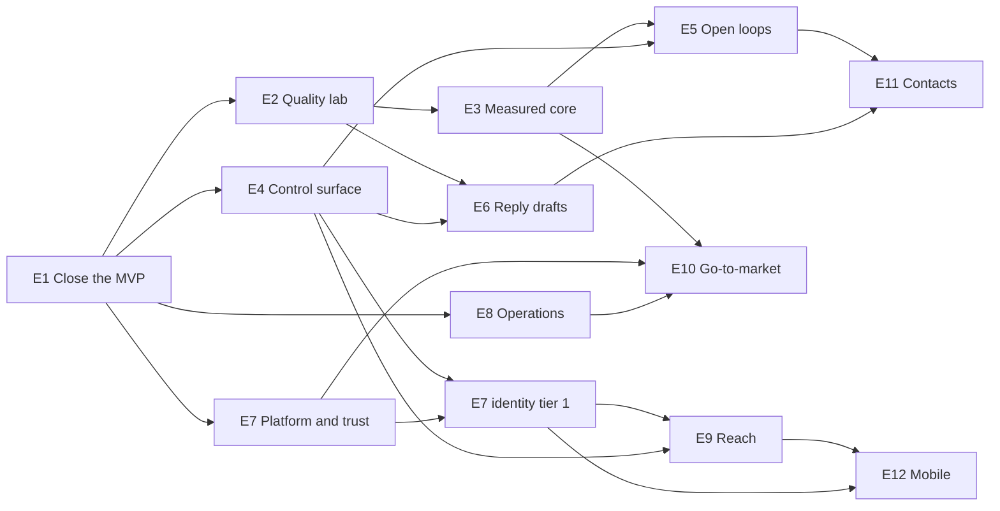

# Stage 2 execution plan: discovery, planning, build

> Written 2026-11-12 after the owner approved the plan (PD-001–PD-011). Changed 2026-11-12 (PD-012): discovery runs for all epics first, then planning. This file tells the next sessions what to run, in which order, and what can run in parallel.
>
> **To start the next discovery session:** open a new agent session in this repo and paste
> `Run the next Stage 2 discovery session: docs/product/stage-2/discovery-prompt.md`
> The agent takes the first row with status `queued` in §3. To run one epic out of order, paste `Run docs/product/stage-2/discovery-prompt.md for epic E04` instead.

## 1. The route per epic

| Step | Who | Input | Output | Done when |
| --- | --- | --- | --- | --- |
| A. Product discovery | Owner + agent, 1–2 h | `epics/E<nn>-*.md` § "Open product questions" with defaults; the capability map | The epic page marked "ready to plan"; rows in `decisions.md`; an ADR when a design rule changes | Every open question has a decision row |
| B. Implementation planning | Agent with the `plan-task` skill; owner approves | The ready epic page, `docs/capabilities/`, the code | A Limen feature folder `spec/features/planned/F<nnn>-<slug>/` (`ticket.md`, `plan.md`, `stages/`); large epics become 2–3 tickets | Owner says go on the ticket |
| C. Build | Limen coordinator and worker jobs | The ticket | Stages landed on `master`, deployed to the VPS at the epic checkpoint; the capability page updated (PD-009) | Exit criteria of the epic page hold |

Rules:
- **Discovery first (PD-012).** A runs for every epic before any B, except E1 (no open product question) and E12 (deferred, see §3). E1 goes through B and C in parallel with the discovery sessions, because the E2 build needs E1 landed.
- A is short when the owner answers "go with defaults". Keep A and B apart: product choices first, file lists second.
- A question that needs measured numbers (E2 reports, E3 metrics) or a spike on a real provider gets a default now and a "second pass" trigger. The epic is then `decided, second pass after <trigger>`. A second pass is a short A session (about 15 min) on that question only; after it the epic is `ready to plan`.
- B starts after the A queue in §3 is empty. B then runs rolling, in wave order (§2): the next one or two epics whose status is `ready to plan`.

## 2. Dependencies and waves

| Wave | Epics (parallel inside the wave) | Starts when | Note |
| --- | --- | --- | --- |
| 0 | E1 | now | No discovery needed (only PD-007 open); go straight to `plan-task`. The discovery queue (§3) runs next to it |
| 1 | E2, E4, E7 (S6c, S6e, S6f, send limits, console, flags), E8 | E1 landed | Four independent lanes. Practical limit: two in build at once (owner checkpoints, one migration at a time) |
| 2 | E3, E6, E7 identity tier 1 | E3 after E2; E6 after E2 and E4; identity after E4 and the rest of E7 | E6 discovery runs after the first E2 eval shows draft quality |
| 3 | E5, E9, E10 | E5 after E3 and E4; E9 after E7 identity and E4; E10 after E3, E7, E8 | The owner re-reads the epic table after E3 (numbers may move E5 and E6) |
| 4 | E11, E12 | E11 after E5 and E6; E12 after E9 and E7 identity | E12 only if the PWA (E9) is not enough |

Critical path (longest chain): E1 → E2 → E3 → E5 → E11. Everything else has slack and fills the parallel lanes.

## 3. Discovery queue (step A) — the tracker

One session each, top to bottom, one at a time (never two at once: each session reads the decisions of the earlier ones). The session updates its own row when it ends. Status values: `queued` → `in session` → `ready to plan` or `decided, second pass after <trigger>` → (second pass) `ready to plan`. Other values: `no discovery`, `deferred`.

| # | Epic | Status | Decisions it must produce | Second pass (trigger) | Note |
| --- | --- | --- | --- | --- | --- |
| — | E1 Close the MVP | no discovery | — (PD-007 stays the owner's call) | — | Planning (`plan-task`) and build run now, next to this queue |
| 1 | E2 Quality lab | ready to plan | generator model, default scenario volume and languages, the arbiter labels, run budget | — | Done 2026-11-13 (PD-013–PD-028). Two `plan-task` runs: E2a Offline lab, then E2b Live lab. E3, E6, E10 need only E2a |
| 2 | E4 Control surface | ready to plan | approvals surface, the "what I would have done" report form, accessibility bar; split into 2 tickets | — | Done 2026-11-13 (PD-029–PD-036, ADR 0022, 0023, 0028 drafts). Two `plan-task` runs: E4-A Act from the panel, then E4-B Earn trust. PD-030 changes the E3 gate: E3 sets the history-check numbers |
| 3 | E7 Platform and trust | decided, second pass after OIDC spike | Polish UI keep or defer, data-subject request flow, Google and Microsoft both or Microsoft first | OIDC spike result (first stage of identity B; only PD-040, PD-041 wait) | Done 2026-11-13 (PD-037–PD-050). Seven tickets (epic notes §11): Polish UI, platform controls, identity A after F082; then account data → papers and cost → VPS production; identity B after its spike. All but identity B are ready to plan |
| 4 | E8 Operations | ready to plan | log store choice, alert channel | — | Done 2026-11-13 (PD-051–PD-055). Three `plan-task` runs: a tiny log-rotation ticket next to E1, then E8a Logs, then E8b Alerts and releases. Owner step before E8b and E2b: grow the VPS root volume (PD-055) |
| 5 | E3 Measured core | decided, second pass after the first E2a holdout report | M3 definition, cost target, per-category model | First E2a holdout report (only PD-060 escalation and PD-061 classifier work list wait) | Done 2026-11-13 (PD-056–PD-069). Two `plan-task` runs: E3a Measure (needs only E1, wave 1, ready to plan now), then E3b Improve (after E2a) |
| 6 | E6 Reply drafts | decided, second pass after the E6a prototype | draft for every `needs_reply` or on tap, expiry, style source | E2a draft judge exists and the E6a stage-1 prototype ran on the `needs_reply` holdout (only PD-071, PD-072 model, PD-083 wait) | Done 2026-11-13 (PD-070–PD-084, ADR 0033 draft). Two `plan-task` runs: E6a Reply drafts (needs E2a, E3a, E4-A, E5a, E7 flags; stage 1 is the prototype), then E6b Style from Sent (gated). F043 replaced |
| 7 | E5 Open loops | queued | wait before follow-up, commitments scope, draft or line, Sent sync depth; ADR draft "read Sent" | E3 numbers (open-loop volume, M2) | |
| 8 | E9 Reach | decided, second pass after the E9a spike | Telegram content choice; Graph vs IMAP XOAUTH2 default | E9a stage 1 spike on the Microsoft 365 test tenant and the owner's Gmail (only PD-086, PD-087 wait) | Done 2026-11-13 (PD-085–PD-095, ADR 0031, 0032 drafts). Two `plan-task` runs: E9a Mailbox OAuth (needs E7 send limits and flags; stage 1 is the spike), E9b Phone channel (needs E4-A, E4-B; ready to plan). F048 replaced, F075 Telegram half absorbed, F040 to E5. Owner step: one Microsoft 365 Business Basic seat |
| 9 | E10 Go-to-market | ready to plan | docs site tool and location, language | — | Done 2026-11-13 (PD-096–PD-103, ADR 0030 draft). Two `plan-task` runs: E10a Docs site (after E1 and a new small "Panel to Astro 7" ticket), then E10b Public pages and demo (after E2b, E3a, E7 papers, E4-B, E8). Static status page dropped |
| 10 | E11 Contacts | queued | contacts page or data only, sanitizer vs local model | E3 and E6 numbers | |
| — | E12 Mobile | deferred | go or no-go | after the E9 PWA is in use | Its only question depends on the PWA; no session until then |

When the last `queued` row is done, the session that finished it tells the owner: "Discovery queue empty. Next: second passes as their triggers arrive; planning in wave order (§2)."

## 4. Parallel rules (from `CLAUDE.md`)

- Only one checkout at a time runs `bun run test:int`. Only one at a time adds a DB migration or changes `bun.lock`. The coordinator serializes migration stages across parallel epics.
- Each Limen job gets its own DB (`scripts/limen-prepare.sh`); parallel epics are safe at the job level.
- VPS deploys happen one at a time, at each epic checkpoint, with the owner's go.
- `spec/vision.md` is owner-owned: agents propose text; the owner applies it.

## 5. How to start each session

- Discovery: paste the launch line at the top of this file. The agent reads `discovery-prompt.md`, takes the next `queued` row of §3, reads the frame, the epic, the other epics, the code and the web, validates the epic, and returns a short verdict with a decision list that "go with defaults" answers.
- Second pass: paste `Run the second pass of docs/product/stage-2/discovery-prompt.md for epic E03` when the row's trigger has arrived.
- Planning: invoke the `plan-task` skill with the ready epic page as the source; it writes the Limen feature folder. For E7, run it once per segment (S6c, S6e, S6f, identity).
- Build: the Limen coordinator, standing models in `spec/build.md` § TRACK.

## 6. Owner time (estimate)

| Step | Sessions | Owner time |
| --- | --- | --- |
| Discovery queue (§3) | 10 × about 1 h ("go with defaults" makes it shorter) | about 10 h |
| Second passes | 6 × about 15 min (E3, E5, E6, E7 identity, E9, E11) | about 1.5 h |
| Ticket approvals | about 14 tickets × 15 min | about 3.5 h |
| VPS checkpoints | one per epic, about 30 min | about 6 h |

## 7. How each session starts (recipe)

- **Discovery and second-pass sessions need no handoff.** The launch line at the top of this file is enough: the prompt and the tracker in §3 hold the state.
- **Planning sessions get one handoff each**, written in a new conversation when the owner says "prepare a handoff for the next epic". The agent that writes it:
  1. Reads `README.md`, this file, `decisions.md`, the epic page (with its "Discovery" section), and the last handoff (`~/.pi/agent/notes/*handoff-stage2-*.md`) to learn the state.
  2. Picks the next epic whose §3 status is `ready to plan`, in wave order (§2).
  3. Writes `~/.pi/agent/notes/YYYY-MM-DD-handoff-stage2-e<nn>-<slug>.md` with the `handoff` skill: state not orders; the owner's exact words; what the epic needs and what depends on it (§2); the planned tickets it absorbs; the traps (vision is owner-owned, commit by path, one migration at a time, other sessions in `spec/features/active/`). Goal: the owner invokes `plan-task` on the epic page.
  4. Shows the summary, waits for the owner's OK, then ends with the `/handoff-open` line.

The first planning session is E1: `~/.pi/agent/notes/2026-11-12-handoff-stage2-e01-close-the-mvp.md`.
