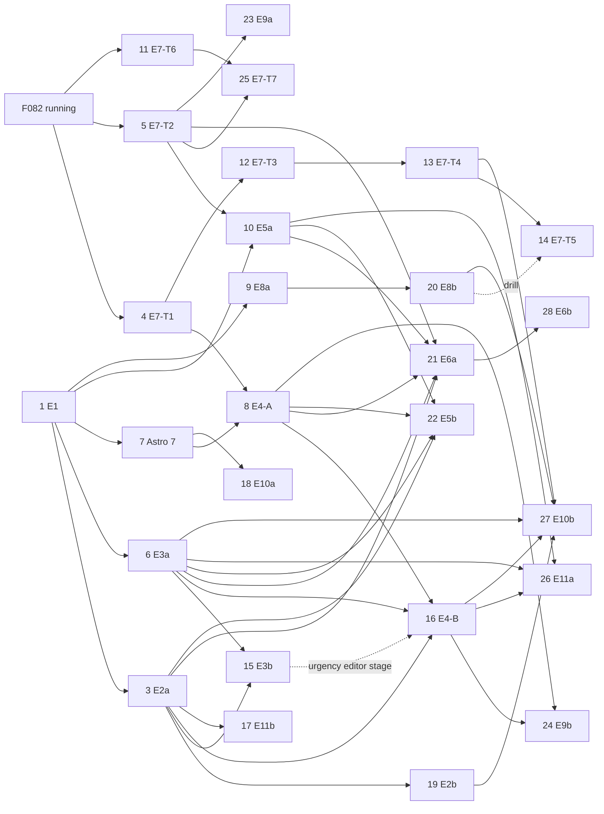

# Stage 2 execution plan: discovery, planning, build

> Written 2026-11-12 after the owner approved the plan (PD-001–PD-011). Changed 2026-11-12 (PD-012): discovery runs for all epics first, then planning. This file tells the next sessions what to run, in which order, and what can run in parallel.
>
> **To start the next discovery session:** open a new agent session in this repo and paste
> `Run the next Stage 2 discovery session: docs/product/stage-2/discovery-prompt.md`
> The agent takes the first row with status `queued` in §3. To run one epic out of order, paste `Run docs/product/stage-2/discovery-prompt.md for epic E04` instead.

## 1. The route per epic

| Step | Who | Input | Output | Done when |
| --- | --- | --- | --- | --- |
| A. Product discovery | Owner + agent, 1–2 h | `epics/E<nn>-*.md` § "Open product questions" with defaults; the capability map | The epic page marked "ready to plan"; rows in `decisions.md`; an ADR when a design rule changes | Every open question has a decision row |
| B. Implementation planning | Agent with the `plan-task` skill; owner approves | The ready epic page, `docs/capabilities/`, the code | A Limen feature folder `spec/features/planned/F<nnn>-<slug>/` (`ticket.md`, `plan.md`, `stages/`); large epics become 2–3 tickets | Owner says go on the ticket |
| C. Build | Limen coordinator and worker jobs | The ticket | Stages landed on `master`, deployed to the VPS at the epic checkpoint; the capability page updated (PD-009) | Exit criteria of the epic page hold |

Rules:
- **Discovery first (PD-012).** A runs for every epic before any B, except E1 (no open product question) and E12 (deferred, see §3). E1 goes through B and C in parallel with the discovery sessions, because the E2 build needs E1 landed.
- A is short when the owner answers "go with defaults". Keep A and B apart: product choices first, file lists second.
- A question that needs measured numbers (E2 reports, E3 metrics) or a spike on a real provider gets a default now and a "second pass" trigger. The epic is then `decided, second pass after <trigger>`. A second pass is a short A session (about 15 min) on that question only; after it the epic is `ready to plan`.
- B starts after the A queue in §3 is empty (true since 2026-11-13). B runs per ticket in the order of § 2.3; the coordinator starts builds by the rule of § 2.4.

## 2. Tickets, dependencies and order (after discovery, 2026-11-13)

> Source of truth for the Stage 2 order. Written after all discovery sessions ended; it replaces the epic-level graph of 2026-11-12, which had edges that discovery removed (`E4 → E7i`, `E7i → E9`, `E6 → E11`, PD-050, PD-113) and no ticket split. Planning sessions (step B) and the Limen coordinator (step C) read this section. A planning session that changes a ticket's needs updates its row here in the same commit.

### 2.1 Ticket table

One row per `plan-task` run. "Plan name" is the working name until `plan-task` gives the F-number; the planning session writes the F-number into the last column. "Needs" lists what must be **landed** (in `spec/features/done/`) before the build starts; planning may run earlier. "Gate" lists a second pass or an owner step that must be done before the build starts (or before the named stage).

| # | Plan name | Epic page | Stages | Needs (landed) | Gate | F-number |
| --- | --- | --- | --- | --- | --- | --- |
| 0 | Foundation group: CI green, module borders, feature flags, notices as facts, event logs, LLM roles, repo split, RLS (`07-foundation-plan.md`; tickets exist, `plan.md` written) | `06-architecture-review.md` | ≈ 28 | —; runs next to E1. F087 is the first slice of E7-T2, F089 the first stage of E8a | Owner: start the group; F092 RLS yes or no | F093, F086, F087, F088, F089, F090, F091, F092 |
| 1 | E1 Close the MVP (capability map, docs boundary, NEXT sweep of the old planned tickets) | E01 | ≈ 10 | — (F077 landed) | Owner: F047 A phone test; vision text OK (owner-owned) | F095 |
| 2 | E8-LR Log rotation | E08 (PD-054) | ≈ 1 | — | — | F096 |
| 3 | E2a Offline lab | E02 | 22 | E1 | Owner audit of 50 cases per corpus version (after the F097 corpus freeze, stage 20; does not stop the build) | F097 |
| 4 | E7-T1 Polish UI (i18n frame first) | E07 notes §11 | ≈ 6 | F082 | — | F098 |
| 5 | E7-T2 Platform controls (send limits, feature flags, operator console, security log) | E07 notes §11 | ≈ 12 | F082 | — | F099 |
| 6 | E3a Measure | E03 | ≈ 13 | E1; E7-T2 before its user-visible stages (flags) | — | F100 |
| 7 | Panel to Astro 7 | E10 (PD-098 area, notes §5) | ≈ 3 | E1 | — | F101 |
| 8 | E4-A Act from the panel | E04 | ≈ 20 | E1, E7-T1, Astro 7 | — | F102 |
| 9 | E8a Logs | E08 | ≈ 8 | E1 | — | F103 |
| 10 | E5a Read Sent | E05 | ≈ 7 | E1, E7-T2 | — | F104 |
| 11 | E7-T6 Identity A (TOTP, backup codes, break-glass) | E07 notes §11 | ≈ 4 | F082 | — | F105 |
| 12 | E7-T3 Account data (delete, export, DSR) | E07 notes §11 | ≈ 8 | F082, E7-T1 | — | F106 |
| 13 | E7-T4 Papers and cost | E07 notes §11 | ≈ 6 | E7-T3 | — | F107 |
| 14 | E7-T5 Production on the VPS | E07 notes §11 | ≈ 4 | E7-T1 … T4; the E8b drill proves its restore | — | F108 |
| 15 | E3b Improve | E03 | ≈ 14 | E2a, E3a | Second pass after the first E2a holdout report (PD-060, PD-061) | F109 |
| 16 | E4-B Earn trust | E04 | ≈ 25 | E4-A (command contract stage), E3a (flag store, header capture), E2a (urgency shape); the urgency-editor stage needs E3b's urgency command | — | F110 |
| 17 | E11b Private model option | E11 | ≈ 5 | E2a | Owner: OpenAI Europe project request (PD-111); second pass on the answer (PD-110) before the EU stage | F111 |
| 18 | E10a Docs site | E10 | ≈ 10 | E1, Astro 7 | — | F112 |
| 19 | E2b Live lab | E02 | ≈ 16 | E2a | Owner: grow the VPS root volume (PD-055) | F113 |
| 20 | E8b Alerts and releases (incl. the restore drill) | E08 | ≈ 6 | E8a | Owner: grow the VPS root volume (PD-055) | F114 |
| 21 | E6a Reply drafts | E06 | ≈ 17 | E2a, E3a, E4-A, E5a, E7-T2 | Stage 1 is the prototype; second pass after it (PD-071, PD-072, PD-083) before the later stages | F115 |
| 22 | E5b Open loops | E05 | ≈ 22 | E2a, E3a, E4-A, E5a | Second pass after the first E3a weekly report and the E2b live week (PD-119, PD-120, PD-122) | F116 |
| 23 | E9a Mailbox OAuth | E09 | ≈ 19 | F082, E7-T2 | Owner: one Microsoft 365 Business Basic seat; stage 1 is the spike; second pass after it (PD-086, PD-087) | F117 |
| 24 | E9b Phone channel (PWA, push, Telegram detail) | E09 | ≈ 14 | E4-A, E4-B | — | F118 |
| 25 | E7-T7 Identity B (OIDC) | E07 notes §11 | ≈ 10 | E7-T2, E7-T6 | Stage 1 is the spike; second pass after it (PD-040, PD-041) | F119 |
| 26 | E11a Sender context | E11 | ≈ 10 | E3a, E5a, E4-B | — | F120 |
| 27 | E10b Public pages and demo | E10 | ≈ 8 | E2b, E3a, E4-B, E7-T4, E8b | — | F121 |
| 28 | E6b Style from Sent | E06 | ≈ 4 | E6a, E5a | Gated: only if the E2a judge shows a gain | F122 |
| — | E12 Native mobile app | E12 | — | — | Deferred: discovery only after the E9b PWA is in use | — |

Stage counts are the discovery estimates; `plan-task` sets the real ones.

### 2.2 Graph

Critical path (longest chain of build work): E1 → E2a → E3b and E1 → E7-T1 → E4-A → E4-B → E9b / E11a. E4-A is the busiest node: E4-B, E5b, E6a and E9b wait for it. Plan it early and keep it moving.

### 2.3 Planning order (step B)

Run `plan-task` in the order of the # column. Planning is cheap and may run ahead of the build; a ticket that is planned but whose needs have not landed waits in `spec/features/planned/`. Exceptions: a ticket whose gate is a second pass on numbers (# 15, 22) is planned with its defaults, and its plan names the stage that waits for the second pass. E1 (# 1) is first: the old handoff `~/.pi/agent/notes/2026-11-12-handoff-stage2-e01-close-the-mvp.md` is still the input.

When a planning session finishes a ticket, in the same commit it:
1. writes the F-number into the § 2.1 row;
2. writes a `## Sequenced` section in the ticket's `ticket.md`: the F-numbers (or plan names, if not planned yet) of the "Needs" column, and the gate. The Limen coordinator manual uses the word "Sequenced" when it decides which tickets may run in parallel;
3. adds one line to `spec/build.md` NEXT in § 2.1 order: `FNNN-slug: <outcome>; sequenced after <F-numbers or plan names>; gate <gate or —>`. When E1 is planned, its line replaces the "E1 … not planned yet" line;
4. applies the cross-epic edits that other epics' discovery notes list for this epic (§ 2.5).

### 2.4 Start rule for the Limen coordinator (step C)

Limen has no dependency field. Each coordinator turn gets only the NOW and NEXT sections of `spec/build.md` injected (Limen `hook/communication.ts`, `boardDigest`), so the rule itself is the first NEXT line. NEXT order and the ticket's `## Sequenced` section carry the order.
- Start the first NEXT ticket whose `Sequenced` tickets are all in `spec/features/done/` and whose gate is done.
- No cap on parallel builds (owner decision 2026-11-13). One DB migration in build at a time. File overlaps in plan gates are advisory. Owner checkpoints do not stop the build; see `spec/build.md` for what still needs the owner.
- A ticket with a second-pass gate on a later stage builds up to that stage, then stops and asks the owner for the second pass.
- Owner steps (gates) are listed in the ticket; the coordinator asks for them when the ticket reaches the top of NEXT, not earlier.

### 2.5 Cross-epic edits that the planning sessions apply

Discovery sessions did not edit each other's pages. Each planning session reads these sections and applies the lines for its own epic:

| Source | Section |
| --- | --- |
| E2 | `epics/E02-discovery-notes.md` § 3 (applied to E3, E4, E6, E8, E10 on 2026-11-13) |
| E3 | `epics/E03-discovery-notes.md` § 5 |
| E4 | `epics/E04-discovery-notes.md` § 5 |
| E5 | `epics/E05-discovery-notes.md` § 6 |
| E6 | `epics/E06-discovery-notes.md` § 5 |
| E7 | `epics/E07-discovery-notes.md` § 10 (PD-050) |
| E8 | `epics/E08-operations.md` § Discovery, "Cross-epic notes" |
| E9 | `epics/E09-discovery-notes.md` § 4 |
| E10 | `epics/E10-discovery-notes.md` § 5 |
| E11 | `epics/E11-discovery-notes.md` § 5 (PD-114) |

## 3. Discovery queue (step A) — the tracker

One session each, top to bottom, one at a time (never two at once: each session reads the decisions of the earlier ones). The session updates its own row when it ends. Status values: `queued` → `in session` → `ready to plan` or `decided, second pass after <trigger>` → (second pass) `ready to plan`. Other values: `no discovery`, `deferred`.

| # | Epic | Status | Decisions it must produce | Second pass (trigger) | Note |
| --- | --- | --- | --- | --- | --- |
| — | E1 Close the MVP | no discovery | — (PD-007 stays the owner's call) | — | Planning (`plan-task`) and build run now, next to this queue |
| 1 | E2 Quality lab | ready to plan | generator model, default scenario volume and languages, the arbiter labels, run budget | — | Done 2026-11-13 (PD-013–PD-028). Two `plan-task` runs: E2a Offline lab, then E2b Live lab. E3, E6, E10 need only E2a |
| 2 | E4 Control surface | ready to plan | approvals surface, the "what I would have done" report form, accessibility bar; split into 2 tickets | — | Done 2026-11-13 (PD-029–PD-036, ADR 0022, 0023, 0028 drafts). Two `plan-task` runs: E4-A Act from the panel, then E4-B Earn trust. PD-030 changes the E3 gate: E3 sets the history-check numbers |
| 3 | E7 Platform and trust | decided, second pass after OIDC spike | Polish UI keep or defer, data-subject request flow, Google and Microsoft both or Microsoft first | OIDC spike result (first stage of identity B; only PD-040, PD-041 wait) | Done 2026-11-13 (PD-037–PD-050). Seven tickets (epic notes §11): Polish UI, platform controls, identity A after F082; then account data → papers and cost → VPS production; identity B after its spike. All but identity B are ready to plan |
| 4 | E8 Operations | ready to plan | log store choice, alert channel | — | Done 2026-11-13 (PD-051–PD-055). Three `plan-task` runs: a tiny log-rotation ticket next to E1, then E8a Logs, then E8b Alerts and releases. Owner step before E8b and E2b: grow the VPS root volume (PD-055) |
| 5 | E3 Measured core | decided, second pass after the first E2a holdout report | M3 definition, cost target, per-category model | First E2a holdout report (only PD-060 escalation and PD-061 classifier work list wait) | Done 2026-11-13 (PD-056–PD-069). Two `plan-task` runs: E3a Measure (needs only E1, wave 1, ready to plan now), then E3b Improve (after E2a) |
| 6 | E6 Reply drafts | decided, second pass after the E6a prototype | draft for every `needs_reply` or on tap, expiry, style source | E2a draft judge exists and the E6a stage-1 prototype ran on the `needs_reply` holdout (only PD-071, PD-072 model, PD-083 wait) | Done 2026-11-13 (PD-070–PD-084, ADR 0033 draft). Two `plan-task` runs: E6a Reply drafts (needs E2a, E3a, E4-A, E5a, E7 flags; stage 1 is the prototype), then E6b Style from Sent (gated). F043 replaced |
| 7 | E5 Open loops | decided, second pass after the first E3a pilot report and the E2b live week | wait before follow-up, commitments scope, draft or line, Sent sync depth; ADR draft "read Sent" | First E3a weekly report on the pilot (due loops per day, median reply time, promise-only replies) and the E2b live week (only PD-119 wait, PD-120 auto follow-up drafts, PD-122 others' promises) | Done 2026-11-13 (PD-115–PD-129, ADR 0029 draft). Two `plan-task` runs: E5a Read Sent (needs E1 and E7-T2 flags; ready to plan now; E4-B, E6a, E11a read it), then E5b Open loops (after E3a, E4-A, E5a). F040 absorbed |
| 8 | E9 Reach | decided, second pass after the E9a spike | Telegram content choice; Graph vs IMAP XOAUTH2 default | E9a stage 1 spike on the Microsoft 365 test tenant and the owner's Gmail (only PD-086, PD-087 wait) | Done 2026-11-13 (PD-085–PD-095, ADR 0031, 0032 drafts). Two `plan-task` runs: E9a Mailbox OAuth (needs E7 send limits and flags; stage 1 is the spike), E9b Phone channel (needs E4-A, E4-B; ready to plan). F048 replaced, F075 Telegram half absorbed, F040 to E5. Owner step: one Microsoft 365 Business Basic seat |
| 9 | E10 Go-to-market | ready to plan | docs site tool and location, language | — | Done 2026-11-13 (PD-096–PD-103, ADR 0030 draft). Two `plan-task` runs: E10a Docs site (after E1 and a new small "Panel to Astro 7" ticket), then E10b Public pages and demo (after E2b, E3a, E7 papers, E4-B, E8). Static status page dropped |
| 10 | E11 Contacts | decided, second pass after OpenAI answers the EU approval request | contacts page or data only, sanitizer vs local model | OpenAI answer to the EU project approval (owner step PD-111; only PD-110 waits) | Done 2026-11-13 (PD-104–PD-114, ADR 0034, 0035 drafts). Two `plan-task` runs: E11b Private model option (after E2a, wave 2), then E11a Sender context (after E3a, E5a, E4-B) |
| — | E12 Mobile | deferred | go or no-go | after the E9 PWA is in use | Its only question depends on the PWA; no session until then |

Discovery queue empty since 2026-11-13 (E5 was the last row to commit). Next: planning in the order of § 2.3, starting with E1; second passes when their triggers arrive (§ 2.1 "Gate").

## 4. Parallel rules (from `CLAUDE.md`)

- Only one checkout at a time runs `bun run test:int`. Only one at a time adds a DB migration or changes `bun.lock`. The coordinator serializes migration stages across parallel epics.
- Each Limen job gets its own DB (`scripts/limen-prepare.sh`); parallel epics are safe at the job level.
- VPS deploys happen one at a time, at each epic checkpoint, with the owner's go.
- `spec/vision.md` is owner-owned: agents propose text; the owner applies it.

## 5. How to start each session

- Discovery: paste the launch line at the top of this file. The agent reads `discovery-prompt.md`, takes the next `queued` row of §3, reads the frame, the epic, the other epics, the code and the web, validates the epic, and returns a short verdict with a decision list that "go with defaults" answers.
- Second pass: paste `Run the second pass of docs/product/stage-2/discovery-prompt.md for epic E03` when the row's trigger has arrived.
- Planning: invoke the `plan-task` skill once per § 2.1 row, with the epic page (and its notes section for that ticket) as the source; it writes the Limen feature folder. Then do the four steps of § 2.3.
- Build: the Limen coordinator, standing models in `spec/build.md` § TRACK.

## 6. Owner time (estimate)

| Step | Sessions | Owner time |
| --- | --- | --- |
| Discovery queue (§3) | 10 × about 1 h ("go with defaults" makes it shorter) | about 10 h |
| Second passes | 6 × about 15 min (E3, E5, E6, E7 identity, E9, E11) | about 1.5 h |
| Ticket approvals | about 14 tickets × 15 min | about 3.5 h |
| VPS checkpoints | one per epic, about 30 min | about 6 h |

## 7. How each session starts (recipe)

- **Discovery and second-pass sessions need no handoff.** The launch line at the top of this file is enough: the prompt and the tracker in §3 hold the state.
- **Planning sessions get one handoff each**, written in a new conversation when the owner says "prepare a handoff for the next epic". The agent that writes it:
  1. Reads `README.md`, this file, `decisions.md`, the epic page (with its "Discovery" section), and the last handoff (`~/.pi/agent/notes/*handoff-stage2-*.md`) to learn the state.
  2. Picks the first § 2.1 row with no F-number (the planning order of § 2.3).
  3. Writes `~/.pi/agent/notes/YYYY-MM-DD-handoff-stage2-e<nn>-<slug>.md` with the `handoff` skill: state not orders; the owner's exact words; what the ticket needs and what depends on it (§ 2.1, § 2.2); the planned tickets it absorbs; the traps (vision is owner-owned, commit by path, one migration at a time, other sessions in `spec/features/active/`). Goal: the owner invokes `plan-task` on the epic page.
  4. Shows the summary, waits for the owner's OK, then ends with the `/handoff-open` line.

The first planning session is E1 (§ 2.1 row 1): `~/.pi/agent/notes/2026-11-12-handoff-stage2-e01-close-the-mvp.md`.
