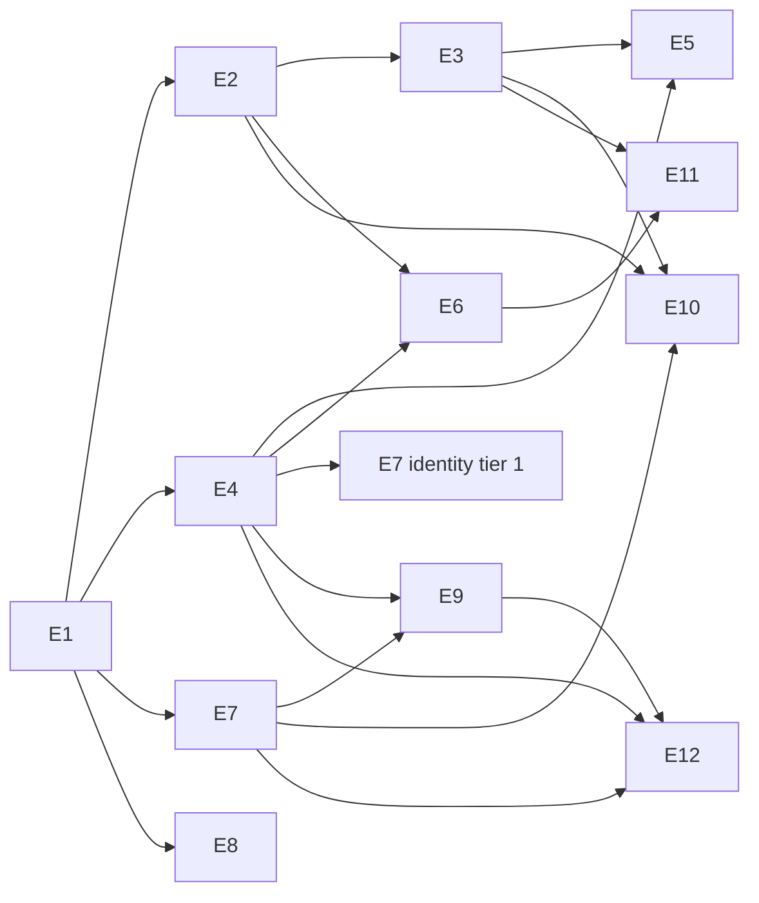

# Stage 2: Product readiness (post-MVP)

> Status 2026-11-12: plan approved by the owner with the defaults of `04-review-result.md` §6 (decisions PD-001–PD-011 in `decisions.md`; PD-007, the five conversations, stays open). Epic pages exist in `epics/`. Route (PD-012): discovery for all epics first, tracked in `05-execution-plan.md` §3; E1 is planned and built in parallel. To start the next discovery session, paste `Run the next Stage 2 discovery session: docs/product/stage-2/discovery-prompt.md`. Nothing here is a Limen ticket yet.

MVP = slices S0–S6a (`docs/roadmap.md`). Stage 2 makes the product sell-ready, but it is not sold (owner, 2026-11-12; `02-inventory-and-roadmap.md` §1).

## Files

| File | What |
| --- | --- |
| `01-review.md` | First review of the docs and the state (proof gaps, doc conflicts, S6 fit) |
| `02-inventory-and-roadmap.md` | Built vs not built, all ideas with sources, market scan, roadmap R0–R5, epics, SSO and mobile (§10), observability (§11), last items (§12) |
| `03-product-frame.md` | Boundary, thesis, users, principles, success metrics M1–M8, non-goals, exit criteria — one page, owner approves |
| `04-review-result.md` | Cold review of 01–03 by a second model: market input, findings R1–R18 with fixes, the proposed epic tiers, decisions for the owner |
| `discovery-prompt.md` | The one prompt for every epic's product discovery session and its second pass; started by a one-line launch |
| `05-execution-plan.md` | The route per epic (discovery, `plan-task`, Limen), the ticket table, dependency graph, planning order and coordinator start rule (§2), the discovery queue (tracker, §3), parallel rules, owner time |
| `06-architecture-review.md` | Architecture review of the code against the epic plans (2026-11-13): what stays, 17 findings with evidence, a foundation ticket group P0–P10 to build before the feature epics, 12 proposed code standards, 6 owner decisions |
| `07-foundation-plan.md` | The eight foundation tickets (F093, F086–F092) with order, parallel rules, how to run one, and where the code standards live. Diagram: `docs/diagrams/architecture-2026-11.html` |
| `epics/E<nn>-<slug>.md` | One page per epic: outcome, users, in scope, out of scope, dependencies, open product questions, risks, exit, size |
| `decisions.md` | Product decision log: PD-NNN, date, decision, owner words. Architecture decisions stay ADRs in `docs/decisions/` |

## Process

1. **Product frame** (`03-product-frame.md`): the owner approves the boundary, positioning, users and the metrics. Every later step checks against it.
2. **Cold review** of the whole plan by a second model (not the author model). Result in `04-review-result.md`; the owner accepts or rejects each finding.
3. **Epic map**: one page per epic in `epics/`: outcome, users, in scope, out of scope, dependencies, open product questions, risks, exit metric. A dependency graph in this README.
4. **Epic discovery** for all epics first (PD-012), one session at a time, in the queue of `05-execution-plan.md` §3: answer the open product questions with the owner → `decisions.md` entries and ADRs. Output: an epic page marked "ready to plan", or "decided, second pass after <trigger>" when a question waits for E2/E3 numbers or a spike.
5. **Planning**, after the queue is empty: one `plan-task` run per ticket of `05` §2.1, in its order (E1 first), into Limen feature folders (`spec/features/planned/`); each run adds its ticket to `spec/build.md` NEXT and a `## Sequenced` section to its ticket (`05` §2.3).
6. **Build** in Limen; each landed epic updates its page and the roadmap.

## Epics (proposed by `04-review-result.md` §5; the owner accepts or changes them)

The first draft (02 §9.5) had ten epics with no tiers. The review restated the thesis as "nothing slips, on any mailbox" (`03` §2), split the control surface from the new intelligence, and added tiers. **Must** = Stage 2 is not done without it. **Should** = in Stage 2 if the Must tier lands. **Later** = Stage 3 candidates.

| Id | Epic | Tier | Needs |
| --- | --- | --- | --- |
| E1 | Close the MVP (F077 deploy, F037, F047 A and B, docs agree, `build.md` NEXT, capability map, optional 5 target-executive conversations) | Must | — |
| E2 | Quality lab (simulated executive with urgency context and ground truth, live delegate personas, offline and live runners, scorer, demo organization, separate test mailbox) | Must | E1 |
| E3 | Measured core and unit cost (metrics M1–M8 in the weekly report, classifier work where E2 shows misses, phishing flag, cost per mailbox) | Must | E2 |
| E4 | Control surface and trust UX (delegates, delegation dashboard, approvals with full context and edit, "why" and confidence per row, autonomy per category with its accuracy, spam review, onboarding trust ladder, unsubscribe, focus mode, mail digest channel) | Must | E1 |
| E5 | Open loops (waiting-for-reply on own sent mail with follow-up draft, commitments from threads, manual delegation, "needs you today" brief) | Must | E3, E4 |
| E6 | Reply drafts and style (`needs_reply` drafts on the existing approval path, style text as writing style, send the edited draft; later: style cold start from Sent) | Must | E2, E4 |
| E7 | Platform and trust (S6b running as F082, S6c delete and export plus data-subject requests, S6e papers and cost model, S6f, send rate limits, operator console, feature flags, identity tier 1: OIDC, "SSO required", break-glass, TOTP) | Must (tier 1) | E1; identity after E4 |
| E8 | Operations (minimum: JSON logs with redaction, log rotation, log store on the tailnet, five SLO alerts, release checklist, restore drill; should: metrics, error tracking, traces, staging, IMAP IDLE) | Must (minimum) | E1 |
| E9 | Reach (Microsoft 365 OAuth first, Gmail in testing mode, PWA with web push, content-minimal Telegram) | Should | E7, E4 |
| E10 | Go-to-market readiness without sales (positioning, security-and-data page, pricing placeholder, user docs and FAQ, changelog, demo video) | Should | E2, E3, E7 |
| E11 | Contacts and context (contacts model, VIP suggestions, thread summaries, PII sanitizer or local-LLM option) | Should | E3, E6 |
| E12 | Native mobile app | Later | E4, E7, E9 |
| Stage 3 | Assistant agent with voice, plain-language rules, ask the inbox, calendar and meetings, EA review flow, Slack and Teams, SAML and SCIM (`02-…` §14) | Later | E4–E7, E9 |

Removed from Stage 2 (04 R11): mail analytics, snooze, attachment auto-filing, cold-email detector as a feature, event sourcing, vector DB, auto-booking. Documentation (02 §13): capability map in E1, the "landed feature updates its capability page" rule from then on, user docs in E10.

Discovery order (PD-012, `05` §3): E2 → E4 → E7 → E8 → E3 → E6 → E5 → E9 → E10 → E11; E12 deferred. Build order: `05` §2 (ticket table, graph and the coordinator start rule). After E3 the owner re-reads the table: the numbers may change the order.
