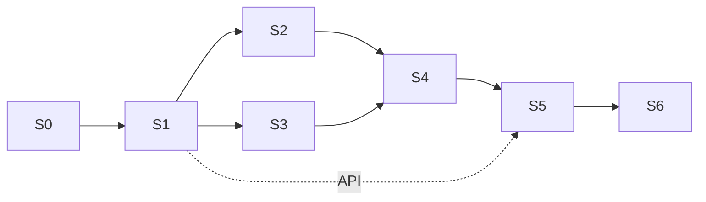

# Roadmap, scope and size — AI Email Assistant

> **Proposed 2026-11-02.** Explains the delivery slices S0–S6 from `docs/architecture.md` §11.
> The plan is known at module level (`docs/modules.md`). File-level plans are written per slice, as `tasks/active/<slice>.md`,
> when the slice starts. Results of S1 (real accuracy on real mail) can change S3–S5.

## 1. Scope

### In the MVP (S0–S5)
- Connect one or more Gmail mailboxes (OAuth), encrypted tokens.
- Fetch new mail every 5 minutes.
- Triage: hard rules (whitelist, blocklist, VIP, Manual label) + AI category:
  urgent, info (with summary), notification, spam, delegation, unsure → manual.
- Two mailbox modes: `shadow` (log only) and `assist` (labels, archive, drafts; send only after the user's approval).
- Drafts: delegation drafts and "ask for missing info" (clarification) drafts. No general reply writing in MVP.
- Delegation: delegates list, tracking, daily chaser with reminder drafts.
- Telegram: link chat, daily digest, urgent notices, approve / reject / send buttons, a few commands.
- Web panel: login, onboarding, mailboxes, settings, rules, approvals, activity (audit), digests, delegation.
- Audit log of every decision and action.
- Tenant-aware data model (one pilot organization).
- Prompt evaluation set and runner.

### Pre-sale (S6)
- Google OAuth verification + CASA security assessment, self sign-up, billing, assistant role, account and data deletion.

### Not in the MVP (Phase 2)
- Style learning, two-way chat with intents, voice notes, meeting handling + calendar, Microsoft 365, mobile app, WhatsApp, RAG / vector search.

## 2. Slices

Each slice ends with something that works end to end and that the user can try.

| Slice | Content | Result for the user | Size | Needs |
|---|---|---|---|---|
| **S0 Foundation** | Move to `apps/server`, `apps/web`, `packages/core`; env check; logger; DB layer; new migration (tenancy, mailboxes, credentials, settings, rules, emails, triage results, actions, audit); local Supabase; CI (lint, typecheck, test); remove old adapters | Nothing visible yet. Clean base, CI green | S | — |
| **S1 Shadow triage** | **Gate: Gemini Cloud Billing on before real mail.** Gmail OAuth connect (CLI + callback route); history sync; HTML → text; hard rules; LLM classifier with Zod schema; planners; policy in `shadow` mode; audit; eval runner + first labeled set | The system reads your mail and logs what it *would* do. You see accuracy numbers | L | S0 |
| **S2 Telegram** | Bot, chat linking, digest builder + schedule, urgent notices, `/digest` `/pause` `/status` | Daily digest and urgent notices on your phone | M | S1 |
| **S3 Assist actions** | Committer, Gmail labels / archive / mark read / star, summaries, manual label, retries, tool switches, mode switch | Your inbox gets cleaner for real; every change is reversible | M | S1 (S2 for notices) |
| **S4 Drafts, approvals, delegation** | Delegates, delegation + clarification drafts, approval flow with Telegram buttons, send after approval, delegation tracking, chaser | Delegations go out after one tap and are followed up | L | S2, S3 |
| **S5 Web panel** | Supabase login, onboarding checklist, all pages from `docs/modules.md` §4, API routes | Setup and control without the CLI | L | S1 (API), S3, S4 |
| **S6 Pre-sale** | Google verification + CASA, sign-up, billing, assistant role, deletion, production hosting in the EU | First external customer can sign up | L + external wait | S5 |

Order: `S0 → S1 → S2 and S3 (any order) → S4 → S5 → S6`.

## 3. Size of the MVP (S0–S5), rough estimate

| Item | Count |
|---|---|
| Deployable parts | 2 apps (server, web) + Postgres |
| Shared packages | 1 (`packages/core`) |
| Server business modules | 9: tenancy, mail, config, triage, actions, audit, reports, channels, delegation |
| Server platform parts | 7: config, db, llm, crypto, log, http, scheduler |
| Sub-modules | about 35 |
| Background jobs | 7: mail sync, triage worker, action gate, committer, notifier, digest, chaser (+ approval expiry) |
| DB tables | 14 |
| HTTP route groups | 8 |
| Web pages | 10 |
| External services | 4: Gmail API, Telegram Bot API, Google Gemini API, Supabase (DB + Auth) |
| Source files | about 180–220 (with tests) |
| Lines of TypeScript | about 12–18 thousand (with tests) |

Server runtime libraries (about 9): `hono`, `@googleapis/gmail` (or `googleapis`), `@google/genai`, `zod`,
`kysely` + `pg`, `croner`, `grammy`, `html-to-text`. Web: `astro`, `react`, `tailwindcss`, shadcn components, `@supabase/supabase-js`.

Hardest parts (most risk):
1. Classification accuracy on real Polish + English mail (S1). This is why S1 runs in shadow mode first.
2. Gmail sync edge cases: history gaps, token expiry (7 days in "Testing"), threads, HTML mail.
3. Exactly-once actions and approvals across crashes and retries (S3, S4).
4. Google verification + CASA before sale (S6): outside our control, takes weeks.

## 4. Agent tooling for the implementation

- No new agent skills are needed. Existing: `vps-ssh` (dev server), `gh-tickets` (issues), `handoff`.
- Repeated fixed jobs become saved scripts, not skills: `bun run db:types`, `bun run eval`, `bun run gmail:connect`.
- Each slice gets a task file in `tasks/active/` with a file-level plan before code starts.

## 5. LLM: Google Gemini (ADR 0007, decided 2026-11-02)

- SDK `@google/genai`, key `GEMINI_API_KEY`, model from config `GEMINI_MODEL` (dev: `gemini-3.8-flash`).
- All calls go through `platform/llm.ts` (`classify`, `write`). Langfuse later, if prompt work needs it.
- Setup check: `cd backend && bun run gemini:test` (script `backend/src/scripts/gemini_test.ts`).
- **Billing gate:** free tier only with test data. Turn on Cloud Billing before S1 runs on real Gmail, and before any real user.
