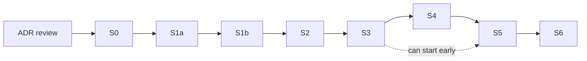

# Roadmap, scope and size — AI Email Assistant

> **Accepted 2026-11-02** (user). Revised 2026-11-02 after the cold review (`tasks/done/mvp-plan-review.md`) and the user's answers
> (Interia IMAP pilot, home VPS, own Postgres, changed slice plan accepted).
> Explains the delivery slices from `docs/architecture.md` §11. The plan is known at module level (`docs/modules.md`).
> Each slice has a task file (`tasks/planned/s0-foundation.md` … `s6-pre-sale.md`) with its goal, done-when and status.
> The file-level plan is written in that file when the slice moves to `tasks/active/`.
> Results of S1b (real accuracy on real mail) can change S3–S5 through the go/no-go table. Rules: `tasks/README.md`.

## 1. Scope

### Pilot MVP (S0–S4): the user's own Interia mailbox, Telegram + CLI

- Connect one or more IMAP mailboxes (address + password or app password), encrypted secrets.
- Fetch new mail every 5 minutes from INBOX and the provider's sort folders and spam folder (ADR 0014).
- Triage: hard rules (whitelist, blocklist, VIP) + AI category:
  `urgent`, `needs_reply`, `delegation`, `info` (with summary), `notification`, `spam`, `unsure`.
- Two mailbox modes: `shadow` (log only) and `assist` (folder moves, mark read, flags, drafts; send only after the user's approval).
- Feedback from the user (labels, ✅ / ✏️ buttons, Undo); a go/no-go bar per category before automatic moves.
- Drafts: delegation drafts and "ask for missing info" (clarification) drafts. No general reply writing in MVP.
- Delegation: delegates list, tracking, daily chaser with reminder drafts.
- Telegram: link chat, digest at set times, urgent and `auth_error` notices, approve / reject / send / undo buttons, a few commands.
- Audit log of every decision and action; the weekly "handled share" metric.
- Tenant-aware data model (one pilot organization). Prompt evaluation set and runner.
- Runs on the home VPS in Compose (`server` + `db`), with backups and a heartbeat.

### Sellable MVP (+ S5, S6)

- Web panel (lite): login, connect mailbox, link Telegram, settings, rules, activity.
- Sign-up, billing, account and data deletion, hosted EU production, Vertex AI EU, privacy policy and DPA, cost model.

### Not in the MVP (Phase 2)

- Gmail and Microsoft 365 adapters (OAuth; Gmail OAuth needs Google verification + CASA), web pages for approvals, digests and delegation,
  style learning, two-way chat with intents, voice notes, meetings + calendar, mobile app, WhatsApp, RAG / vector search,
  manual delegation from chat (old PRD US-012) and the Sent-folder check for manual delegations (`.ai/notes.md`), assistant role UI,
  a stats page (old PRD US-013; the MVP has the weekly "handled share" line in the digest).

## 2. Slices

Each slice ends with something that works end to end and that the user can try.

| Slice                                            | Content                                                                                                                                                                                                                                                                                                                  | Result for the user                                                                     | Size          | Needs                       |
| ------------------------------------------------ | ------------------------------------------------------------------------------------------------------------------------------------------------------------------------------------------------------------------------------------------------------------------------------------------------------------------------ | --------------------------------------------------------------------------------------- | ------------- | --------------------------- |
| **S0 Foundation**                                | Move to `apps/server`, `apps/web`, `packages/core`; env check; logger; DB layer + migration runner; tenancy tables; Compose `db` for dev; CI (lint, typecheck, unit + integration); `/health`; old code and deps removed                                                                                                 | Nothing visible yet. Clean base, CI green                                               | M             | ADR review                  |
| **S1a IMAP read + pilot host** (done 2026-11-04) | IMAP adapter (read part), connect CLI, encrypted password, capability check, sync with the IMAP rules, test mailbox seed, Compose on the home VPS, heartbeat, nightly encrypted backup                                                                                                                                   | Your Interia INBOX is copied into the system every 5 minutes, on the home VPS           | M             | S0                          |
| **S1b Shadow triage**                            | **Gate: free tier only for the temporary pilot mailbox (ADR 0013); Cloud Billing before any other person's mail.** Hard rules; classifier with Zod schema (summary in the same call); planners; policy in `shadow` mode; audit; feedback table + labeling CLI; eval runner with synthetic and injection cases; cost caps | The system logs what it _would_ do. You get precision per category and a go/no-go table | L             | S1a                         |
| **S2 Telegram**                                  | Bot (dev + pilot), chat linking, shadow digest with ✅ / ✏️ buttons, urgent and `auth_error` notices, "last sync" line, `/digest` `/pause` `/resume` `/status`                                                                                                                                                           | Digest and urgent notices on your phone; you correct the AI with one tap                | M             | S1b                         |
| **S3 Assist actions**                            | Committer with retries on the action row (idempotent actions go `ready → applied`; `applying` is for S4 drafts and send); folder moves, mark read, flag, summaries; Undo button; automatic moves only for categories that passed go/no-go; mode switch                                                                   | Your inbox gets cleaner for real; every change has Undo                                 | L             | S2                          |
| **S4 Drafts, approvals, delegation**             | Delegates (CLI), delegation + clarification drafts (quote the original), approval with Telegram buttons, SMTP send after approval, delegation tracking, chaser, injection guards                                                                                                                                         | Delegations go out after one tap and are followed up                                    | L (23 stages) | S3                          |
| **S5 Web panel (lite)**                          | Market check first (which mail the customers use); login; pages: onboarding, mailboxes, settings, rules, activity; API routes; web reachable from outside (proxy or tunnel)                                                                                                                                              | Setup and control without the CLI                                                       | M             | S3 (S4 for delegation data) |
| **S6 Pre-sale**                                  | Sign-up, billing, deletion, hosted EU production, Vertex AI EU, privacy policy + DPA, cost model                                                                                                                                                                                                                         | The first external customer can sign up                                                 | L             | S5                          |

S1b state (2026-11-05): built and tested (task file `tasks/done/s1b-shadow-triage.md`, stages 0–35, code done): hard rules, classifier `classifier-v1`, planners, policy, triage worker with LLM pause and daily cap, audit, feedback table and labeling CLI, eval runner (synthetic, injection, `--real`), cost report, backfill and re-queue, sender rules CLI, docs and notes (stage 35). First eval run (stage 34, `gemini-3.5-flash-lite`): whitelist and injection 12/12, no category at the 98% bar yet. Waiting, in `tasks/done/s1b-shadow-run.md`: the model comparison (stage 36) and the VPS stages 37–40 (deploy, one week of real mail in shadow mode, labels, cost, final eval and go/no-go table). S1b is not done until the go/no-go table exists. Update 2026-11-06: done (`tasks/done/s1b-shadow-run.md`). 123 real labels (180-day backfill), every category no-go (notification 96.2%, spam 83.6%; urgent, needs_reply, info too few). Pilot classifier: OpenAI `gpt-6-luna`.

S2 state (2026-11-07): done (task file `tasks/done/s2-telegram.md`, stages 0–24, group reviews at checkpoints 2 and 3): chat linking by a one-time token, the `outbox` with a sender, the digest job (08:00 and 16:00), urgent, `auth_error` and sync notices, ✅ / ✏️ buttons, `/digest`, `/status`, `/pause`, `/resume`, `/help`, and `mailbox:password` to leave `auth_error`. Dev run with `@Email_assistant_local_bot` on the phone (stage 21, 2026-11-07): all checks pass, urgent notice 3 min 54 s after the mail. VPS with `@Email_assistant_vps_bot` (stage 23, deployed 2026-11-06): the 08:00 digest arrived and ✅ taps write `telegram` feedback. The retention job for `outbox.text` is not built (`tasks/planned/retention-job.md`).

S3 state (2026-11-07): done (task file `tasks/done/s3-assist-actions.md`): the write port and the identity locate, the committer with the ensure rule and `ACTIONS_SCOPE`, the returned check below the UID cursor, Undo with reverse actions, the `triage.returned` job, the `action_failed` notice, the ↩️ digest button, and `mailbox:settings`. The dev run (stage 16), the restore test (stage 17) and the VPS seed-mail run on Interia (stage 19) passed. Since 2026-11-07T19:55:16Z the pilot mailbox runs `assist` on real mail (`urgent` flag, `notification` moves); the one-week result is in `tasks/planned/s3-assist-week-result.md` (blocked until 2026-11-14T20:00Z).

S4 state (2026-11-07): done (`tasks/done/s4-drafts-approvals-delegation.md`, 23 stages): delegates and delegations with CLIs, prompt `classifier-v2` (eval: one accepted miss, `info` precision −5.8), delegation and clarification drafts, approval with Telegram buttons, SMTP send behind `SEND_SCOPE`, the Sent copy, the expiry job, the chaser and `job:run`. Deployed on the VPS (`fa60c7b`, `SEND_SCOPE=all` since 2026-11-07 22:40Z; the only delegate is the user's own Gmail). The real-mail round trip and the week counts: `tasks/planned/s4-pilot-week.md`.

Order: `S0 → S1a → S1b → S2 → S3 → S4 → S5 → S6`.

Before each start (user steps):

- S1a: turn on "korzystam z programu pocztowego" in Interia; no second Interia account: the pilot mailbox is the test mailbox (user 2026-11-04); Docker or Podman on the home VPS.
- S1b: read the free-tier limits in AI Studio. Cloud Billing on before any other person's mail (ADR 0013).
- S2: create two Telegram bots (dev, pilot) with BotFather.
- S5: ask 5–10 target customers which mail provider they use (decides if Gmail / Microsoft 365 come before S6).

## 3. Size of the MVP (S0–S6), rough estimate

| Item                      | Count                                                                                                   |
| ------------------------- | ------------------------------------------------------------------------------------------------------- |
| Containers                | 2 in the pilot (`server`, `db`); the web build is served by `server`                                    |
| Shared packages           | 1 (`packages/core`)                                                                                     |
| Server business modules   | 9: tenancy, mail, config, triage, actions, audit, reports, channels, delegation                         |
| Server platform parts     | 9: config, db, llm, crypto, log, http, scheduler, retention, heartbeat                                  |
| Sub-modules               | about 40                                                                                                |
| Background jobs           | 9: mail sync, triage worker, committer, notifier, digest, approval expiry, retention, heartbeat, chaser |
| DB tables                 | 17                                                                                                      |
| HTTP route groups         | 8                                                                                                       |
| Web pages                 | 6 in S5-lite (+ account page in S6; 3 more in Phase 2)                                                  |
| External services (pilot) | 3: the IMAP/SMTP provider, Telegram Bot API, the LLM API (Gemini or OpenAI)                             |
| Source files              | about 160–200 (with tests)                                                                              |
| Lines of TypeScript       | about 10–16 thousand (with tests)                                                                       |

Server runtime libraries (about 11): `hono`, `imapflow`, `mailparser`, `nodemailer`, `html-to-text`, `@google/genai`, `zod`,
`kysely` + `pg`, `croner`, `grammy`, and the migration runner (chosen in S0). Web: decided at the S5 start.

Hardest parts (most risk):

1. Classification accuracy on real Polish + English mail (S1b). This is why S1b runs in shadow mode and S3 waits for the go/no-go table.
2. IMAP edge cases (S1a): provider differences (MOVE, UIDPLUS, keywords), UIDVALIDITY changes, mail without `Message-ID`,
   mail that the user moves back, threads built from headers.
3. Exactly-once drafts and moves, at-most-once send, and approvals across crashes and retries (S3, S4).
4. Prompt injection that reaches delegates through drafts (S4).
5. Home VPS operations: backups, liveness, updates (from S1a).

## 4. Agent tooling for the implementation

- No new agent skills are needed. Existing: `vps-ssh` (azyl demo server), `gh-tickets` (issues), `handoff`.
- Repeated fixed jobs become saved scripts, not skills: `bun run db:migrate`, `bun run db:types`, `bun run eval`,
  `bun run org:create`, `bun run mailbox:connect`, `bun run mailbox:check`, `bun run telegram:link`.
  S1b scripts: `bun run eval` (cases, or `--real` on labels), `bun run triage:label` (label results), `bun run triage:cost` (tokens, latency, cost),
  `bun run rules:add` / `rules:list` (sender rules), `bun run mailbox:seed --eval-cases` (eval mails into the test mailbox), `bun run mailbox:backfill` (one-off older mail and re-queue).
  S3 scripts: `bun run mailbox:settings` (mode, `auto` flags, switches, `expire-ready`), `bun run mailbox:probe-move` (Interia move facts on the test mailbox).
  S4 scripts: `bun run delegates:add` / `delegates:list` / `delegates:disable` / `delegates:enable`, `delegations:list` / `delegations:done`, `job:run` (one job once), `mailbox:probe-send` (Interia draft and send facts on the test mailbox).
  S2 scripts: `bun run telegram:check` (bot token check), `telegram:link` / `telegram:unlink` (chat link of a member), `digest:times` (digest times of a member), `mailbox:password` (new mailbox password; leaves `auth_error`).
- Code rules for agents: `docs/code-patterns.md`.
- Each slice has a task file in `tasks/`. It gets a file-level plan in `tasks/active/` before code starts (`tasks/README.md`).

## 5. LLM: Gemini and OpenAI (ADR 0007, ADR 0012, ADR 0013, ADR 0015)

- `LLM_PROVIDER` = `gemini` or `openai` (ADR 0015; the pilot VPS uses `openai`, `gpt-6-luna`). SDKs `@google/genai` and `openai`. Gemini: key `GEMINI_API_KEY`, model from config `GEMINI_MODEL` (dev: `gemini-3.8-flash`), `GEMINI_MODEL_CLASSIFIER` (default `gemini-3.5-flash-lite`, provisional: `docs/architecture.md` §6.3), `GEMINI_RPM`, `LLM_DAILY_CAP`, `TRIAGE_LLM_SCOPE`.
- All calls go through `platform/llm/` (`classify`; `write` comes in S4): timeout 30 s, rate limiter, 429 / 5xx / timeout = soft errors (pause: `docs/architecture.md` §4.1 rule 7).
- Setup check: `bun run llm:check --provider <gemini|openai>` from the repo root (script `apps/server/src/scripts/llm-check.ts`; `gemini:test` is an alias; env in the root `.env`). On 2026-11-02 the key worked, but the model returned `503 high demand`.
- **Billing gate:** free tier only with test data. The temporary pilot Interia mailbox counts as test data (ADR 0013, user 2026-11-04). Cloud Billing (or Vertex AI) on before any other person's mail.
- **Data:** pilot = Gemini API free tier for the temporary pilot mailbox (ADR 0013; the free-tier terms allow human review and training; accepted by the user 2026-11-04); the paid tier (55-day abuse logging, no EU location, accepted 2026-11-02) when billing goes on; Vertex AI EU before the first external customer (S6).
- **Cost:** about $20 per mailbox per month at 200 mails/day with `gemini-3.8-flash` now, about $40 from 2027-01-01 (price doubles).
  The S1b eval compares a Flash-Lite model for the classifier.
