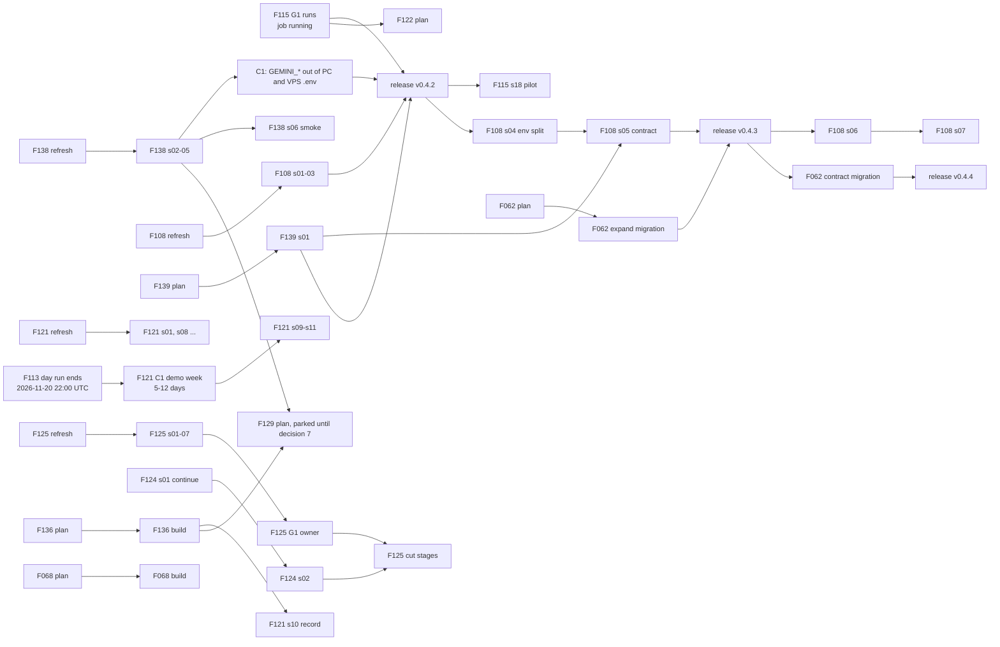

# Replan for parallel work (2026-11-20, 00:xx CET)

Written by the replan session (Claude Fable 5.1) for the owner and the coordinator. Input: `notes/2026-11-19-board-audit.md` (state at 21:56 CET), every open ticket folder, the code at `c7b4f058`, `scripts/plan-drift.sh` on every plan with a base. Nothing in the repo was changed by this session except this file. Every claim names its evidence; `[not verified]` marks the rest.

Changes since the audit (checked 2026-11-19 ~23:30 CET): the coordinator session (pi `01a1f3de`) started job `2026-11-19-f115-drafter-v2-gate-runs-holdou-86a2f371` at 21:54 CET (Opus, cap $3) after the owner added OpenAI credit. It runs the drafter-v2 dev effort comparison, the holdout and the injection set. CI run 44612003145 on `c7b4f058` still in progress. Same HEAD, same lanes, same unlanded branches as the audit.

## 0. Short answer

- 18 open tickets. Verdicts: keep and build 6 (F115, F108, F121, F124, F125, F138), plan then build 3 (F139, F062, F068), unpark and plan 1 (F136, recommended), plan after a gate 1 (F122), close as done 2 (F037, F047), close with a leftover ticket 1 (F111), drop 2 (F055, F060, recommended), keep parked 2 (F063, F129).
- Four plans need a refresh job before stage 01 (F108, F121, F138, F125; drift exit 1 on each). F124 needs none: its stage 01 is already built on a branch that merges clean.
- The owner rule "only active tickets" (end of `spec/build.md`) stops every item below. Decision 1 ends it.
- Wave 1 runs 8 to 10 jobs at once; the planner cap of 3 is the only cap that bites (8 planner jobs in 3 rounds).
- Two hard-limit slots are nearly free: no open ticket but F062 has a migration; only F138 stage 02 changes `bun.lock`.
- The VPS release train has three releases: v0.4.2 (F115 s17, F108 s01–03, F138 s02–05, F139), v0.4.3 (F108 s05, F062 expand), v0.4.4 (F062 contract).

## 1. Verdict per open ticket

| Ticket | Verdict | Evidence | Next step |
| --- | --- | --- | --- |
| F115 reply drafts (active) | keep; finish G1, release, pilot | 18/19 stages landed (`scripts/coord-scan.sh`). G1 runs in job `…86a2f371` (task text: dev medium vs low, holdout, injection, cap $3). `stages/stage-18-pilot.md` needs stage 17 in a release; `git log v0.4.1..master` = 60 commits, 0 migrations. | After the job: if the gate passes, the job points `prompts.drafter` to v2. Release v0.4.2, then stage 18 (coordinator, VPS). PD-083 owner check: `owner-check-20.md` (decision 13). |
| F138 OpenAI only | refresh, then build 02–05, shrink 06 | Drift 9/20 (`plan-drift.sh … 6aecc639`): `eval-judge-setup.ts`, `config-llm.ts`, `subprocessors.ts`, `terms.ts`, `evals/README.md` changed. Stage 01 landed (`0d9edf6e`, `334de262`). Plan D11 (F115 s02 runs move to s06) is overtaken: F115 ran holdout and injection on `gpt-6.1-terra` (`9c3888ff`, `notes/2026-11-19-f115-s02-prototype-run.md` § Update). `subprocessors.ts:56` still has the `gemini` row; 79 files under `apps packages deploy .env.example package.json` still name Gemini. `terms.ts:20` has `2026-11-19-2` (F115 s17), so D9 adds a third version this week. | Refresh job (round 1). Stage 06 keeps only the acceptance grep, the classifier smoke run (D13, Q4, about $0.3) and `llm:check`; the drafter runs are F115's. Stage 02 is the `bun.lock` slot. C1 (remove `GEMINI_*` from the PC and VPS `.env`) before the deploy that carries stage 02 (D2: a `gemini` value fails the start). |
| F124 parallel unit and int | keep; resume stage 01, no refresh | Branch `limen/2026-11-19-f124-stage-01-unit-waits-3600945b` (`f54dcf6d`, 5 files); `git merge-tree` with master: 0 conflicts. Drift 6/13 is comment renames (F132) and files the worker reads at HEAD. The refresh rule protects a plan "whose first stage has not built yet" (planner.md § Refresh job); stage 01 has built. | `limen continue` the stopped job: merge master, re-run the stage proof, then land `--keep-open`. Stage 02 after it (plan: never at the same time). Decision 10. |
| F125 test audit | refresh (numbers), then stages 01–07 | Drift 6/26. Ticket says "about 3,950 test cases"; `bun run test:unit:ci` alone had 6,988 passes on 2026-11-19 (`notes/2026-11-15-vps-deploy-queue.md` § v0.4.0). Stage 05 says "1,261 cases in 82 files", stage 06 "1,683 cases, 135 files": stale. Stages are read-only on tests, no conflict with any build. | Refresh job (round 2): new counts, the 150-item caps per reader stage re-checked. Cut stages (phase B) after F124 lands and after G1 (owner marks `audit/report.md`). |
| F108 production on the VPS | refresh, then build; two releases | Drift 4/20: `deploy/backup.sh` (`36c1a440` retry and lock), `deploy/compose.drill.yaml`, `deploy/README.md`, `deploy/test/backup.test.ts` (F114 s09). Build after F098, F099, F106, F107, F114: all in `done/` (`ls spec/features/done/2026-11`). ADR 0019 does not exist yet (`ls docs/decisions`). | Refresh job (round 1). Stage 01 then 02 ∥ 03; stage 04 = release v0.4.2 deploy plus env split; stage 05 after `env split ok`; stage 06 = release v0.4.3; stage 07 after it. |
| F121 public pages and demo | refresh, then build; C1 waits for the sim stack | Drift 7/56: `cost-model.ts` (`b48ccb7a`: `costToRun` now exists; plan said "not built yet"), `subprocessors.ts`, `openapi.ts`, `flagged-text.ts`, `legal-tables.ts`. All Build after tickets in `done/`. C1 needs the sim stack; F113 day run `day-20261120-215c` holds it until 2026-11-20 about 22:00 UTC and forbids restarts (`notes/2026-11-19-f113-c1-backup-blocked.md:20`). | Refresh job (round 1). Stages 01, 08 start at once; the DAG in § 4. C1 starts after the F113 day run ends; stages 09–11 wait 5–12 days for it. Stage 01 freezes docs-site deploys until G1 (decision 12). |
| F139 restore guard-empty | write the ticket, plan, build | `ticket.md` holds only the outcome line. Cause and fix idea: `deploy/restore.sh:181` step `guard-empty`; `db` health passes during the Postgres image init; a second run works (`docs/known-alerts.md:47–52`, `deploy/README.md:1054`). | Ticket text in § 2. Plan job (round 2, small). Stage 01 lands before F108 stage 05 (both edit `restore.sh`); its proof rides v0.4.2 as a drill rerun. |
| F062 drop cursor columns | new plan; the only migration | Old one-job plan ("write the plan when the task starts"). `grep -rn inbox_uid\|last_uid\|uidvalidity\|undo_pending_at apps packages`: 341 uses in 72 files. Rollback window of F058 (2026-11-09) is long past. | Plan job (round 3): expand (new columns, dual write) in v0.4.3, contract (drop) in v0.4.4. Owner said "keep: plan now" (owner-decisions line 246). |
| F068 actions transitions at runtime | new plan | Old plan names `modules/actions/repo.ts`; the folder is `modules/actions/repo/` (20 files) now; `transitions.ts` and `WRITER_GUARDS` exist. `[risky]` (send path). No migration. | Plan job (round 3). No dependency; low file overlap now that F102, F115, F116 are landed. |
| F122 style from Sent | keep planned; plan after F115 G1 | No plan (the 2026-11-19 plan job was stopped; branch has 0 commits over master). Gate "only if the E2a judge shows a gain" (`05-execution-plan.md` row 28; E06 decision 11: "ships only if the judge shows a tone gain"). The judge-gain section exists in every drafter report (`notes/2026-11-19-f115-s02-prototype-run.md` § Judge gain). Vision: "Phase 2, not MVP: style learning". | Decision 11: read the gate as a final ship-gate stage, plan in round 3 after the F115 G1 numbers exist, build in wave 4 after F115 closes. |
| F111 private model | close; leftover to a new parked ticket | Stages 01, 02, 03, 06 landed (`git log`: `1f915043` s06); 04 skipped (owner); 05 stopped: branch `limen/2026-11-19-f111-s05-own-model-holdout-runs-4666fa9b` holds 305 lines (an LM Studio chat adapter spike, `openai-chat.test.ts`, `questions-stage-05.md`), job failed "process group gone"; 07 parked in the stage file. Ticket § Status note 2026-11-19: "the owner stopped this work … want to do". | Decision 3: `outcome.md` for F111 (what landed, what not), `limen ticket done F111`; new parked ticket F140 for stages 05 and 07 with the branch name. |
| F037 S3 week result | close as done | `plan.md` § Results "Week result (F095 stage 09, 2026-11-14)"; commit `31dbc811`. Board line: "folded into F095; the coordinator closes it". | `git mv` to `done/2026-11/` with a one-line `outcome.md` (it is not in `active/`, so `limen ticket done` does not apply). |
| F047 S4 pilot week | close as done | `plan.md` § Results part A (F095 stage 10, `822ec907`), part B counts (`31dbc811`). | Same as F037. |
| F060 backfill per folder | drop (default) or keep parked | "Folded into F110" is false: F110 `stages/stage-05-history-backfill.md` lists "history backfill of folders other than INBOX (F060)" as out of scope. `sync-backfill.ts` exists; no operator asked for folder backfill since 2026-11-09. | Decision 4. Default: `dropped/2026-11/` with `outcome.md` "no need shown; reopen when an operator needs old mail of a sort folder". |
| F055 web live updates | drop (default) or keep parked | Trigger "look again after F101 and F102": both in `done/`. Polling works; E4-A rewrote the pages without it; no epic needs it. | Decision 5. Default: drop. |
| F063 junk LLM cap | keep parked | Trigger: a spam wave in the F100 weekly report (M7). Not met. | Move its line to `## PARKED`. |
| F129 CLI standard | keep parked; plan in round 3 at the earliest | Needs F138 stage 02 (removes `gemini:test`) and F136 (ports) first. Touches every script: widest overlap of the board. | Decision 7. Default: unpark for a round-3 plan, build in wave 4 when few other tickets build. |
| F136 parallel Playwright | unpark, plan, build (recommended) | Lock rule in 4 places (`grep -rn email-assistant-shared-tests.lock CLAUDE.md .agents docs`). Only F121 (stages 07, 10, 11, 12) and F136 itself use Playwright on this board; the F121 web stages are in waves 2–4. | Decision 2. Plan job (round 2). Build in wave 2; land before F121 stage 10. |

Tickets dropped already and still named in old texts: F023, F072, F076 (`927a311c`), F117. No action.

## 2. New tickets

### F139 · A restore into a fresh database volume starts without the guard-empty failure (write out the stub)

- **Outcome:** `deploy/restore.sh` on a fresh volume passes `guard-empty` at the first run. The operator never has to run the restore twice, and the drill record needs no "run it again" line.
- **Scope:** the readiness wait in `deploy/restore.sh` before `guard-empty` (`restore.sh:181`): wait until Postgres accepts a real query twice in a row with a pause between, or until the image init has ended (the Postgres image starts a temporary server during init, stops it, then starts the final one; `pg_isready` passes during the temporary phase). Same wait in any other script that starts `db` on a fresh volume (`deploy/README.md` § VPS lost / New host). A test in `deploy/test/` with a stub `docker` on `PATH` that answers "healthy" during init, then "the database system is shutting down", then ready. `docs/known-alerts.md` § restore drill: the fix line.
- **Out of scope:** the drill cadence, the backup path, `restore.sh --target new-host` behaviour beyond the wait, `credentials:check` at old tags.
- **Acceptance:** the stub test fails on the current script and passes after the change; `bun run test:unit:ci` green; one `restore.sh --target drill` rerun on the VPS (coordinator, pre-approved, about 9 min, on a release that carries the fix) ends `restore ok` at the first run with no `guard-empty` line; the counts equal the live ones as in the first drill.
- **Sequenced:** Plan after: none. Build after: none (F114 is in `done/`). Gate: —. Lands before F108 stage 05 (both edit `restore.sh`); the VPS rerun rides release v0.4.2 (not a deploy of the live stack: the drill project `ea-drill`).

### F140 · The own-model holdout numbers and the EU endpoint check of the private model option run when the owner asks (parked; only if decision 3 = keep)

- **Outcome:** `docs/own-model.md` holds measured holdout numbers of two own models, and the EU endpoint path is verified or its fallback recorded (former F111 stages 05 and 07).
- **Scope:** F111 `stages/stage-05-own-model-runs.md` and `stage-07-eu-endpoint.md` as written, with the LM Studio adapter spike of branch `limen/2026-11-19-f111-s05-own-model-holdout-runs-4666fa9b` as the starting seam (keep the branch; do not delete it). EU fallback after ADR 0037 (F138 stage 04): an own model in the EU, not Vertex.
- **Out of scope:** everything F111 landed (01, 02, 03, 06).
- **Acceptance:** F111 plan § Done when items for 05 and 07.
- **Sequenced:** Plan after: F138 stage 04 landed (ADR 0037 names the EU fallback). Build after: owner step: "run the own model" (LM Studio on `localhost:1234`, PD-112) or the EU project answer (PD-111). Gate: owner.

### Process fixes: no ticket

The handoff § After approval says to apply them as commits by path. Texts in § 8. Decision 14 confirms "direct commits, no ticket".

## 3. Ticket graph (real edges only)

Reason for each edge:

- F115 s18 ← v0.4.2: the stage file says keep `reply_drafts` off until the release holds stage 17 (consent `2026-11-19-2`).
- F122 plan ← F115 G1: the gate needs the judge-gain baseline of the drafter-v2 holdout report.
- F138 s02 → C1 env → v0.4.2: plan D2, a `gemini` value fails the start of the new image.
- F108 s01–03 → v0.4.2 → s04 → s05: plan D4 (expand, then contract; the old `release.sh` must deploy the new `migrate` service first).
- F139 s01 → F108 s05: both edit `deploy/restore.sh` (advisory overlap; F139 is one stage, so it goes first).
- F121 C1 ← F113 day run: one sim stack; the day run forbids restarts until it ends.
- F121 s10 ← F136: stage 10 records under the shared lock; without F136 it waits for every other Playwright user. Advisory: it can run under the lock if F136 is late.
- F125 cut stages ← F124 s02: ticket § Sequenced (same test files).
- F062 migrations ← release slots: one migration in build at a time; a rename needs expand and contract in two releases.
- F129 ← F138 s02, F136: `gemini:test` is an inventory candidate; the e2e port env is F136's seam.

No other edge is real. In particular F124, F125 s01–07, F068, F121 s01–08, F138 s03–05 and F108 s01 depend on nothing that is open.

## 4. Stage graph per ticket that will build

Marks: `VPS` = coordinator run on the VPS; `MIG` = DB migration; `LOCK` = `bun.lock` change; `PW` = Playwright (shared lock until F136); `LLM$` = real LLM spend; `OWNER` = owner hands needed. "Needs" lists the real dependency (file, interface, data), not "all earlier stages".

**F115** (active): 18 `VPS` `OWNER(O1 three real replies)` needs release v0.4.2 on the VPS and the G1 record. One job.

**F138** after refresh: 02 `LOCK` `[risky]` needs nothing open (stage 01 landed) → 03 needs 02 (deleted adapter leaves tests without a subject) ∥ 04 needs 02 (the registry row it documents) → 05 needs 03 and 04 (ADR number, `capability-map.test.ts`) → 06 `LLM$ ≈ $0.3` needs 05 and the local C1. Four worker jobs in sequence 02 → {03, 04} → 05, then 06.

**F124**: 01 (continue) needs nothing → 02 needs 01 landed (the 12 s check fails with the old waits). Review job for 02.

**F125** after refresh: 01 → 02 (needs `cases-static.tsv`) → {03 needs `junit-cases.tsv`; 05 and 06 need 01–02} → 04 needs 03 → 07 needs 04–06 → G1 `OWNER` → planner job for cut stages (needs F124 s02 landed). Up to 3 jobs at once in the middle.

**F108** after refresh: 01 `[risky]` → {02 needs `compose-lib.sh` interfaces of 01; 03 needs the names of 01} → 04 `VPS` = release v0.4.2 plus env split → 05 `[risky]` needs the `env split ok` record → 06 `VPS` = release v0.4.3 → 07 `VPS` needs 06 and F114 in `done/` (true). Chain by design (D4); at most 2 jobs at once.

**F121** after refresh: 01 `[risky]` → {02 `[risky]`, 03, 07 `PW` `[risky]`}; 08 needs nothing; 06 needs 02; 04 needs 02 and 03; 05 needs 04; 09 needs 08 and C1 `LLM$ ≤ $5` `VPS`; 10 `PW` needs 09 and C1; 11 `PW` `[risky]` needs 04 and 10; 12 `PW` needs 05, 06, 07, 11; 13 conditional after C2. Up to 5 jobs at once after 01.

**F139** after plan: 01 (code and stub test) → VPS drill rerun `VPS` after v0.4.2.

**F136** after plan `[not verified: stage count]`: expected 2–3 stages (ports from env per suite; per-job e2e DB in `limen-prepare.sh`; mail addresses per run; the lock text leaves the rules). Its land edits the Proof lines of F121 stages 07, 10, 11, 12 if they are still open.

**F062** after plan: expand stage `MIG` `[risky]` (new columns, dual write, readers on the new names) → rides v0.4.3 → contract stage `MIG` `[risky]` (drop old columns, stop the dual write) → rides v0.4.4. Code stages between them touch about 72 files: merge master before each proof.

**F068** after plan `[risky]`: expected 2–3 stages (shared guard helper in `actions/repo/*`; closed latent edges with tests; docs). No marks.

**F122** after plan (wave 4): expected 3–4 stages; one `LLM$` judge stage (about $1); one `[important: privacy]` default (own sent text to the LLM once, ADR 0029 amendment); a final ship-gate stage.

## 5. Waves

Wave 0 (after the owner answers § 9; no owner hands): the board commits of § After approval; F037, F047 closed; F111 closed and F140 written (decision 3); F139 ticket written; planner round 1 (refresh F108, F121, F138); `limen continue` F124 s01; quality pass `--role quality --detached` (P8); the v0.4.1 log lines ported (P7a). Running at once: 1 (F115 G1) + 3 planners + 1 worker + 1 quality = 6.

Wave 1 (as each round-1 refresh lands, about 1–2 h later): F138 s02 (`LOCK`); F108 s01; F121 s01 and s08; F124 s02 after s01 lands. Planner round 2: refresh F125, plan F139, plan F136. Running at once: 5 workers + 3 planners + F115 G1 tail = 8–9. Separator from wave 2: the landings of 01-stages whose interfaces the next stages use.

Wave 2: F108 s02 ∥ s03; F121 s02, s03, s07 (`PW`); F138 s03 ∥ s04; F139 s01; F136 s01…; F125 s01 → s02. Planner round 3: plan F062, plan F068, plan F122 (only after the F115 G1 numbers exist; else F129 takes the slot if decision 7 says so). Running at once: 10–12. Separator from wave 3: release v0.4.2 (one deploy at a time) needs F108 s01–03, F138 s02–05 and F139 s01 landed and C1 (env) done.

Wave 3: release v0.4.2 (`VPS`); F108 s04 (`VPS`, same session); F115 s18 (`VPS`); F138 s05 → s06 (`LLM$`); F121 s04, s06; F125 s03 ∥ s05 ∥ s06; F136 s02…; F062 expand code stage; F068 s01…. Running at once: 8–10. Separator from wave 4: F108 s05 needs the stage 04 record; F121 s09 needs C1 (calendar: F113 day run end plus 5–12 days, so about 2026-11-26 to 2026-12-03).

Wave 4: F108 s05 → release v0.4.3 (`VPS`, with F062 expand `MIG`) → s06 → s07; F121 s05, s09, s10, s11, s12; F125 s04 → s07 → G1 (`OWNER`); F062 contract `MIG` → v0.4.4; F122 build; F129 plan and build (decision 7). Running at once: 6–8.

Expected count of jobs at once: wave 0 = 6, wave 1 = 8–9, wave 2 = 10–12, wave 3 = 8–10, wave 4 = 6–8. The coordinator starts every ready stage at each wake (`spec/build.md` board scan rule); the waves are the expected shape, not gates.

## 6. Resource schedule

| Resource | Slot plan |
| --- | --- |
| DB migration (one in build) | F062 expand (wave 4, v0.4.3), F062 contract (v0.4.4). No other open ticket has a migration (F139, F136, F068, F124, F125, F121, F108, F138: none). |
| `bun.lock` (one at a time) | F138 stage 02 (wave 1). F136 plan must add no package (F121 D9 style); F129 later. |
| VPS releases (one deploy at a time; every deploy is a release) | **v0.4.2**: F115 s17 (on master), F108 s01–03 (`migrate` service; the release itself still migrates through `cli`), F138 s02–05 (C1 env edit on the VPS first), F139 s01. After it: F108 s04 (env split), F115 s18 flag on, F139 drill rerun. **v0.4.3**: F108 s05 (contract: `check-server-env.sh` in verify), F062 expand migration, F068, F124/F125 (no runtime effect). After it: F108 s06, s07. **v0.4.4**: F062 contract migration. Docs site: F121 stage 01 holds every tag deploy of the docs until G1 (decision 12). |
| Sim stack (`ea-sim`) | F113 day run until 2026-11-20 about 22:00 UTC, then `lab score --run day-20261120-215c` (F113 closed early; the score is a record only). Then F121 C1: `demo-reset --date`, run to day 5, `demo-export`, 5–12 days. |
| OpenAI key and quota (shared with production, P6) | Order and spend: (1) F115 G1 runs, running now, cap $3. (2) F113 day run, scheduled, cap $1. (3) F138 s06 smoke, about $0.3 (wave 3). (4) F121 C1 demo week, ≤ $5 (wave 3, after the day run). (5) F122 judge stage, about $1 (wave 4). Total ≤ $10.3 on top of about $3.6 spent in November (`F138 plan F5` $2.77 plus the F115 runs of 2026-11-19). Every run: `--budget-usd ≤ 1 --concurrency 2 --rpm 30`; any 429 stops the stage. Decision 8 (separate eval key) removes the production risk. |
| Playwright lock (until F136 lands) | F121 s07 (wave 2), s10, s11, s12 (wave 4); F136 proofs. At most one at a time; F136 first. |
| Hot files (advisory) | `deploy/restore.sh`: F139 s01 before F108 s05. `deploy/compose.yaml`: F108 s01 and s05 alone. `package.json` scripts: F124 s02, F138 s02, F136, F129: land conflicts resolve by "merge master, re-prove". `packages/core/src/legal/subprocessors.ts` and `terms.ts`: F138 s02 only (F121 does not touch legal texts). `docs/capabilities/*`: F138 s05, F108 s03, F121 s12: text merges. Test files: F124 and F125 cut stages (sequenced). |

## 7. Planner and refresh jobs

Cap 3. All with `--role planner --engine pi --provider claude-bridge --model claude-opus-5-5 --thinking medium --extension /home/artek/.pi/agent/npm/node_modules/pi-claude-bridge --timeout 3h`. No `--prepare`. Commit the replan, the audit and the F139 ticket on master first (planner worktrees start from HEAD).

| Round | Job | Kind | Label | Task text (paste whole) |
| --- | --- | --- | --- | --- |
| 1 | F108 | refresh | `plan refresh · F108` | `Refresh F108: make spec/features/planned/F108-e7-t5-production-on-the-vps/ true for HEAD. Plan base c68ce51e. Drift: deploy/backup.sh (36c1a440 retry and lock), deploy/compose.drill.yaml and deploy/test/backup.test.ts (F114 stage 09 drill), deploy/README.md (drill record, F115 stage 17 reply-drafts section). Check: the drill override of stage 01 against the new compose.drill.yaml; the stub-command pattern that stage 02 copies from backup.test.ts; the README sections stage 03 rewrites; the backup.sh lock against the stage 06 backup checks. F139 (restore guard-empty wait in deploy/restore.sh) lands before stage 05: write that stage 05 keeps the F139 wait. Write the real Needs of each stage as files and interfaces, not "stages 01-NN landed" (notes/2026-11-20-replan-parallel.md § 8.3). Stages 04, 06, 07 are coordinator VPS runs: keep them marked so.` |
| 1 | F121 | refresh | `plan refresh · F121` | `Refresh F121: make spec/features/planned/F121-e10b-public-pages-and-demo/ true for HEAD. Plan base c68ce51e. Drift: packages/core/src/metrics/cost-model.ts (b48ccb7a: costToRun and pilotCost now exist; the plan says "not built yet"), packages/core/src/legal/subprocessors.ts and apps/web/src/lib/legal-tables.ts (F115 stage 17 row openai, F118 stage 13), apps/server/src/platform/openapi.ts and openapi-routes.test.ts, apps/docs/src/flagged-text.ts, deploy/README.md. Check stage 03 against the real costToRun signature and docs/cost-model.md; stage 02 and 06 against the registry rows at HEAD; stage 01 and 11 against the current docs-deploy workflow. F138 (OpenAI only) removes the gemini registry row in its stage 02: the security page must not name Gemini. C1 (demo week) can start only after the F113 day run day-20261120-215c ends (2026-11-20 about 22:00 UTC): write that in § Coordinator steps. Write the real Needs of each stage (files, interfaces, data), not "stages 01-NN landed" (notes/2026-11-20-replan-parallel.md § 8.3); mark Playwright stages (07, 10, 11, 12) with the lock rule until F136 lands.` |
| 1 | F138 | refresh | `plan refresh · F138` | `Refresh F138: make spec/features/planned/F138-the-whole-project-calls-only-openai-no-gemini-code-key-config-or-doc-remains-and-the-evals-and-the-judge-run-on-openai-models/ true for HEAD. Plan base 6aecc639. Stage 01 landed (0d9edf6e, 334de262). Plan D11 is overtaken: F115 stage 02 ran the drafter holdout and injection on the gpt-6.1-terra judge inside F115 (9c3888ff; notes/2026-11-19-f115-s02-prototype-run.md § Update) and runs drafter-v2 now (job 2026-11-19-f115-drafter-v2-gate-runs-holdou-86a2f371). Shrink stage 06 to: the acceptance grep, bun run llm:check (both roles), the classifier smoke run (D13, Q4), and a pointer to the F115 reports; no drafter runs. Drift: apps/server/src/scripts/eval-judge-setup.ts and config-llm.ts (stage 01), apps/server/src/modules/triage/eval-results.ts, evals/README.md (F115 stage 02: judge-v2, --drafter-prompt, --judge-prompt), packages/core/src/legal/subprocessors.ts and packages/core/src/web/terms.ts (F115 stage 17 added row openai and TERMS_HISTORY 2026-11-19-2: stage 02 D9 adds the next entry after it), apps/web/src/legal/en/privacy.md, deploy/README.md. Check the D14 line "judge prompt stays judge-v1": the default is judge-v2 now (7c2dabaa). F111 stages 02-03 are landed: the D12 refresh note applies only to F111 stage 07 text, which moves to the parked ticket F140. Write the real Needs of each stage (notes/2026-11-20-replan-parallel.md § 8.3); stage 02 is the only bun.lock change.` |
| 2 | F125 | refresh | `plan refresh · F125` | `Refresh F125: make spec/features/planned/F125-every-test-file-is-measured-and-classified-and-only-owner-approved-weak-stale-or-duplicate-tests-are-cut-or-merged/ true for HEAD. Plan base 54fe78f. The counts are stale: the ticket says about 3,950 test cases; bun run test:unit:ci alone passed 6,988 cases on 2026-11-19. Recount per area with bun test --reporter=junit in a temp folder (no DB; unit only) and from the file list for apps/server/test (do not run the integration suite). Fix every count in ticket.md, plan.md and stages 04-06, and re-check the 150-item caps and the two-continuation rule against the new flagged counts; change the stage count only if the code forces it. Drift: apps/server/test/preload.ts, test/contract/mail-provider.ts, test/integration/imap-contract.test.ts, e2e-seed.test.ts, apps/web/src/lib/activity-text.test.ts, packages/core/package.json. F124 (parallel runs) lands before the cut stages; F136 (parallel Playwright) may change apps/web/e2e env handling: stage 06 reads it statically, note the overlap. Write the real Needs of each stage (notes/2026-11-20-replan-parallel.md § 8.3).` |
| 2 | F139 | plan | `plan · F139` | `Plan F139: write stages/ for spec/features/planned/F139-a-restore-into-a-fresh-database-volume-starts-without-the-guard-empty-failure/. Read the ticket (written 2026-11-20 from the drill record), deploy/restore.sh (step guard-empty at line 181 at c7b4f058), deploy/README.md § VPS lost / New host and § Drill, docs/known-alerts.md § restore drill, notes/2026-11-15-vps-deploy-queue.md § Restore drill record, deploy/test/backup.test.ts (stub-command pattern). Cause: the Postgres image runs a temporary server during init; pg_isready passes, then the server stops with "the database system is shutting down", then the final server starts. Decide the wait (two successful real queries with a pause, or a wait for the init to end) and record the rejected option. One worker stage with a stub test; one coordinator VPS stage: a drill rerun on the release that carries the fix (ea-drill project, not the live stack). Sequenced: before F108 stage 05 (both edit deploy/restore.sh). Small plan: plan.md well under 1,500 words. Needs lines name files and interfaces (notes/2026-11-20-replan-parallel.md § 8.3).` |
| 2 | F136 | plan | `plan · F136` | `Plan F136: write stages/ for spec/features/planned/F136-every-limen-job-runs-the-playwright-suites-in-parallel-with-no-shared-lock/. Read ticket.md and notes.md (seams and open questions), apps/web/e2e/env.ts, apps/web/e2e/playwright.config.ts, apps/docs/e2e/site.ts and its config, scripts/limen-prepare.sh, apps/server/src/scripts/e2e-seed.ts and e2e-seed-args.ts, CLAUDE.md § Rules (shared runtime), .agents/limen/styleguide.md, docs/code-patterns.md § Docs site. Answer the open questions of notes.md with probes in the worktree (two parallel runs on different ports; memory of two Chromium plus server runs); no new package (no bun.lock change). Decide: ports from env with a per-job default derived in limen-prepare.sh, or a free port found at start; per-job e2e DB in limen-prepare.sh; per-run mail addresses on the shared GreenMail. The last stage removes the lock rule from CLAUDE.md, the styleguide, docs/code-patterns.md and the Proof lines of the F121 stages that are still open (name them; the coordinator applies edits outside the folder). The plan touches no test file that F125 cuts (F125 is read-only until its G1). Needs lines name files and interfaces (notes/2026-11-20-replan-parallel.md § 8.3).` |
| 3 | F062 | plan | `plan · F062` | `Plan F062: write stages/ for spec/features/planned/F062-drop-mailbox-cursor-columns/. Read ticket.md, the old plan.md (goal, done-when), spec/features/done/2026-11/F058-sync-sort-folders/plan.md (D1, D5, D24; ADR 0014), apps/server/src/modules/mail/ (repo, sync, sync-backfill), apps/server/src/platform/db/schema.ts, docs/architecture.md § 5, docs/modules.md, docs/release-checklist.md and deploy/README.md § Release (roll back the code, not the migration; every deploy is a release). At HEAD 341 uses of inbox_uid, last_uid, uidvalidity, undo_pending_at in 72 files. Decide an expand-and-contract shape over two releases: expand = new columns (source_uid, move_pending_at), dual write, readers on the new names, drop of the mailboxes cursor dual write only when a rollback to the previous release still works; contract = drop the old columns one release later; each migration [risky] and the only migration in build at its time. Write the rollback SQL rule of each migration as a stage decision. Needs lines name files and interfaces (notes/2026-11-20-replan-parallel.md § 8.3).` |
| 3 | F068 | plan | `plan · F068` | `Plan F068: write stages/ for spec/features/planned/F068-actions-transitions-runtime/. Read ticket.md, the old plan.md, spec/features/done/2026-11/F067-state-machine-transitions/plan.md (D3), apps/server/src/modules/actions/transitions.ts and transitions.test.ts, every writer in apps/server/src/modules/actions/repo/ (the old plan names repo.ts; it is a folder now), docs/code-patterns.md § Data access and § Side effects, docs/architecture.md § 4.1 rule 6 and § 4.6. Decide one shared guard helper that builds WHERE status IN (…) from WRITER_GUARDS, which latent edges L1-L8 close, and a test per closed edge; no behaviour change for E1-E20. [risky]: the send path; Opus review. No migration. Needs lines name files and interfaces (notes/2026-11-20-replan-parallel.md § 8.3).` |
| 3 | F122 | plan | `plan · F122` | `Plan F122: write stages/ for spec/features/planned/F122-e6b-style-from-sent/. Read ticket.md, docs/product/stage-2/epics/E06-reply-drafts.md decision 11 and E06-discovery-notes.md § 3.9 (E6b), ADR 0029 decision 7 (needs one amendment: own sent text may reach the LLM once), ADR 0033, spec/features/active or done F115 (replies module, mailbox_profiles writing style, drafter eval harness, tuning-1.md § Judge gain), the sent texts F104 stores. Gate reading (owner decision 2026-11-20): the gate "only if the E2a judge shows a gain" is the last stage, a ship gate: the plan names the measure (tone_fits and form_of_address means on the lab-01 holdout with the mailbox style set from the suggestion versus the default) and the bar; the feature stays behind a flag until the gate passes. Baseline numbers: the drafter-v2 holdout report of F115 (evals/results/*drafter-v2*). Real LLM spend about $1 (one holdout run with judge); --budget-usd 1 --concurrency 2 --rpm 30. About 3-4 stages. Mark the privacy default [important: privacy]. Needs lines name files and interfaces (notes/2026-11-20-replan-parallel.md § 8.3).` |
| 3 (alt) | F129 | plan | `plan · F129` | Only if decision 7 unparks it: `Plan F129: write stages/ for spec/features/planned/F129-every-command-line-tool-follows-one-standard-and-agents-find-each-tool-its-risk-and-its-exit-codes-in-one-generated-list/. Read ticket.md, notes/2026-11-15-cli-standard.md, apps/server/src/platform/cli.ts, package.json scripts, scripts/limen-prepare.sh, .github/workflows/ci.yml. F138 stage 02 removed gemini:test; F136 owns the e2e port env: take both as landed. Inventory stage first (note § 4.10). Convert by area, each stage with every caller of a changed exit code. Needs lines name files and interfaces (notes/2026-11-20-replan-parallel.md § 8.3).` |

Round order by what each unblocks: round 1 opens F108 (the release train), F121 (the most parallel build stages) and F138 (the `bun.lock` slot and the legal text). Round 2 opens the read-only audit, the small F139 fix before v0.4.2, and the lock removal. Round 3 is the tech debt and the gated epic.

After each plan lands: copy the `[important]` items of `questions.md` to `docs/owner-decisions.md` (coordinator), run the drift check, move the ticket to `active/`, start every stage whose Needs are met.

## 8. Process fixes

### 8.1 `spec/build.md`

**TRACK** (three bullets; replaces the four now):

1. The standing-models bullet as it is (unchanged text).
2. Replace "Now: S6 pre-sale moves to Limen segment by segment …" with: `Now (2026-11-20): the Stage 2 rows are built except F108, F121, F122 (planned) and F117 (dropped). Open work runs in parallel waves: notes/2026-11-20-replan-parallel.md § 5 (waves), § 6 (slots: one migration in build, one bun.lock change, one VPS deploy, Playwright lock until F136). Start every ready stage at every wake; a VPS run or an owner step is not a stop (owner, 2026-11-13 and 2026-11-19). Ask the owner only for keys, secrets, real money, deletion of real data, outside publication.`
3. Merge the CI bullet and the review-findings bullet into one: keep the land check sentence, the `gh run list` sentence, the quarantine pointer and the review sort line; drop the 2026-11-14 history ("red several times … F123 … F126").

**NEXT**: delete every line of a ticket that is in `done/` or `dropped/` (F102, F104, F107, F110, F111, F113, F114, F116, F117, F118, F119, F120, F137, F071, F029, F064, F037, F047, F055, F060). Keep the rule paragraphs (Stage 2 order, Planning, Plan refresh, Board scan, Owner decisions, Order rule) but cut them to one sentence each with a pointer to this note; remove "with 5 to 7 jobs the quota lasts about one hour". New lines, one clause each:

- `F138 (OpenAI only): plan landed, stage 01 landed, needs refresh; then 02 (bun.lock slot) → {03, 04} → 05 → 06 (smoke run, about $0.3); C1 env edit before the deploy that carries 02.`
- `F108 (production on the VPS): plan landed, needs refresh; 01 → {02, 03} → 04 (release v0.4.2 + env split) → 05 → 06 (release v0.4.3) → 07; no migration.`
- `F121 (public pages and demo): plan landed, needs refresh; 01 and 08 first, DAG in plan § How to run; C1 demo week after the F113 day run ends; G1–G3 default: prepare, do not publish; stage 01 holds docs-site deploys until G1.`
- `F124 (parallel unit and int): plan landed, no refresh (stage 01 built on its branch); continue job …3600945b, then 02; no migration, no bun.lock.`
- `F125 (test audit): plan landed, needs refresh (counts); 01–07 read-only, run next to anything; G1 owner marks audit/report.md; cut stages after F124.`
- `F139 (restore guard-empty): ticket written 2026-11-20, needs plan; lands before F108 stage 05.`
- `F136 (parallel Playwright): unparked 2026-11-20, needs plan; no bun.lock; lands before F121 stage 10.`
- `F062 (drop cursor columns): needs plan; expand migration in v0.4.3, contract in v0.4.4; the only migrations on the board.`
- `F068 (actions transitions at runtime): needs plan; [risky]; no migration.`
- `F122 (style from Sent): needs plan after the F115 G1 numbers; the judge-gain gate is the last stage; build after F115 closes.`

**PARKED**: F063 (trigger: a spam wave in the weekly report), F129 (until decision 7; after F138 stage 02 and F136), F140 (F111 leftovers; owner step: own model or EU answer). Remove F136 from PARKED.

**Owner rule 2026-11-19** section: replace with `## Owner rule 2026-11-20: run the replan in parallel` and the text: `The 2026-11-19 rule ("only active tickets") ended on 2026-11-20 (owner). Planned tickets with a landed plan start as notes/2026-11-20-replan-parallel.md § 5 says, after their drift check or refresh. Only these limits hold: one migration in build, one bun.lock change, one VPS deploy (every deploy is a release), the Playwright lock until F136, the planner cap of three. The coordinator never waits for the owner except for keys, secrets, real money, deletion of real data and outside publication.`

### 8.2 `scripts/coord-scan.sh`

Three changes (the script reads only git, `limen jobs` and files; it still changes nothing):

1. After the active loop, a second loop over `spec/features/planned/F*/` **with** `stages/`: print `== FNNN (planned, plan landed)`, the `Build after:` and `Gate:` lines of `## Sequenced` with each named ticket marked `done` or `open` (`ls spec/features/done/*/FNNN-*`), the `Plan base:` sha from `plan.md`, and the drift exit code (`scripts/plan-drift.sh <folder> <base> >/dev/null; echo $?`): `0 ready`, `1 needs refresh`, `2 no base`. Then the stage list in the same LANDED / RUNNING / OPEN form.
2. In the OPEN line, add a mark after the state when the first 4 lines of the stage file hold `coordinator run`, `on the VPS` or `VPS` → `VPS`; `owner step` or `Gate: owner` → `OWNER`; `[risky]` → `risky`. So `OPEN` alone means "a worker can start it".
3. The "planned tickets without a plan folder" section stays, and gets the `## Sequenced` `Plan after:` line of each, so the coordinator sees which plans can start.

### 8.3 Rule for planners: `Needs` lines (add to `.agents/limen/planner.md` after § Plan size)

`## Needs lines (owner, 2026-11-20)` — `The Needs line of a stage names the real dependency: the file, interface, table, data file or record that this stage reads and an earlier stage or another ticket writes ("Needs stage 01: compose-lib.sh ea_compose_init; needs F107 stage 08: costToRun"). Never "stages 01–NN landed" or "green CI". Two stages with no shared file or interface get "May run next to NN". A stage that only the coordinator runs (VPS, deploy, real spend) says so in its first line. A stage that needs a release names the release content ("needs the release that carries stage 01"). The coordinator starts every stage whose Needs are met; a land conflict is resolved by "merge master, re-prove", not by waiting.`

The same rule in one line in `~/.pi/agent/skills/plan-task/references/plan-shape.md` (stage header) `[owner: the skill is outside the repo]`.

### 8.4 Other fixes

- P7a: port the v0.4.1 log lines from branch `limen/2026-11-19-f102-release-v0-4-1-s20-s07-s26-f796796b` by hand into `notes/2026-11-15-vps-deploy-queue.md` (the v0.4.1 section) and into the F102, F107, F110, F119 `plan.md` § Log in `done/2026-11/`; then `limen prune` or leave the branch.
- P7b: `limen continue 2026-11-19-f124-stage-01-unit-waits-3600945b "Merge master, run the stage 01 proof again, fix what broke; land check; final message"`.
- P8: `limen spawn --role quality --detached --engine pi --provider claude-bridge --model claude-sonnet-5-5 --thinking high --extension … --label "quality pass 2"` with the TRACK task (skip test files).
- P9: 93 `new` entries: a separate owner session; not part of this plan.
- P10: every stage spawn text of this plan says `limen land <job> --yes --keep-open` until the last stage.
- Commit the untracked notes (`notes/2026-11-19-board-audit.md`, `notes/2026-11-19-why-coordinator-ran-one-job.md`, this file) so planner worktrees see them. `notes/2026-11-14-*.md` and `notes/decision-docs/` are older leftovers: commit or delete (decision 15).

## 9. Owner decisions

Each item: options, the recommended default in bold. "Default" means the coordinator acts on it if the owner says only "go".

1. **The "only active tickets" rule (2026-11-19).** (a) **End it now; the waves of § 5 start.** (b) Keep it: then only F115 stage 18 runs and nothing else until F115 closes.
2. **F136 parallel Playwright.** (a) **Unpark; plan in round 2; build in wave 2.** (b) Keep parked: F121 web stages queue under the lock (about 4 stages, each 20–40 min).
3. **F111 rest (stage 05 own-model runs, stage 07 EU).** (a) **Close F111 with `outcome.md`; new parked ticket F140 holds 05 and 07 and names the s05 branch.** (b) Drop the rest and delete the branch. (c) Keep F111 in `planned/` as it is (the board then shows a half-done ticket forever).
4. **F060 backfill per folder.** (a) **Drop** (no need shown since 2026-11-09; F110 history check covers INBOX by design). (b) Keep parked with the trigger "an operator wants old mail of a sort folder".
5. **F055 web live updates.** (a) **Drop** (polling works; the pages were rewritten without it). (b) Keep parked.
6. **F063 junk LLM cap.** (a) **Keep parked** (trigger: spam wave in M7). (b) Drop.
7. **F129 CLI standard.** (a) **Unpark for a round-3 plan; build in wave 4 after F138 stage 02 and F136.** (b) Stay parked until the owner names it.
8. **A separate OpenAI key for evals (money, P6).** (a) **Yes: a second OpenAI project "email-assistant-evals" with its own monthly limit (suggest $15); its key goes into the PC `.env` only; the VPS keeps the production key. No code change (one `OPENAI_API_KEY`).** (b) No: every eval run can pause production triage when the limit hits.
9. **OpenAI spend order and cap for this plan.** (a) **F115 G1 (running, ≤ $3) → F113 day run (≤ $1) → F138 s06 (≈ $0.3) → F121 C1 (≤ $5) → F122 judge (≈ $1); total ≤ $10.3; every run `--budget-usd ≤ 1 --concurrency 2 --rpm 30`; any 429 stops the stage.** (b) Another order or cap.
10. **F124 refresh.** (a) **Skip the refresh (stage 01 already built; the worker merges master); record it in `docs/owner-decisions.md` as a rule exception.** (b) Run a refresh job first (one planner slot, about 1 h).
11. **F122 gate reading.** (a) **The gate "judge shows a gain" is the last stage (ship gate behind a flag); plan in round 3 after the F115 G1 numbers; build in wave 4.** (b) Do not plan F122 until the owner asks (vision: style learning is Phase 2).
12. **F121 stage 01 docs-site hold.** F121 D1 holds every tag deploy of the docs site while `OWNER_REVIEW_PENDING` is not empty, so docs changes of other tickets (F138 s05, F108 s03 capability pages) do not reach the public site until G1. (a) **Accept the hold; the owner does G1 (reads the built site) when stages 02–05 have landed, about wave 3.** (b) Land F121 stage 01 only after stages 02–06 are ready on branches (delays the whole ticket). (c) Change D1 so the hold covers only the five new page ids (a refresh-job change; the planner must say if the deploy gate can do that).
13. **PD-083 owner check of 20 drafts** (`spec/features/active/F115-e6a-reply-drafts/owner-check-20.md`). (a) **Answer the 20 lines (agree / disagree) before stage 18's exit record.** (b) Accept the plan default: stage 18 writes "not done" and the gate rests on the judge alone.
14. **Process fixes (§ 8).** (a) **Apply as direct commits by path on approval, no ticket.** (b) One ticket F141 for them.
15. **Untracked leftovers** `notes/2026-11-14-f095-u1-facts.md`, `notes/2026-11-14-progress-overview.md`, `notes/decision-docs/2026-11-09-next-task.html`. (a) **Commit the two notes; delete the HTML (an old generated view).** (b) Delete all three. (c) Commit all three.

Open owner items that this plan does not decide (from the audit § 7): browser checks after v0.4.1 (F102 /approvals, F107 terms dialog, F110 /report, F119 TOTP); F114 U2 Healthchecks URL; 93 `new` owner-decision entries.

## After approval (what the replan session or the coordinator commits)

1. Lane moves: F037, F047 → `done/2026-11/` with `outcome.md`; F055, F060 → `dropped/2026-11/` with `outcome.md` (decisions 4, 5); F111 → `done/2026-11/` with `outcome.md`, F140 written (decision 3); F139 `ticket.md` written out (§ 2).
2. `spec/build.md` TRACK, NEXT, PARKED, owner rule (§ 8.1); `limen board --write` for NOW and PROVEN.
3. `scripts/coord-scan.sh` (§ 8.2); `.agents/limen/planner.md` (§ 8.3).
4. P7a log lines; commit the audit, the cause note and this file.
5. `docs/owner-decisions.md` entries (coordinator only): the 15 answers above as `ok` or `changed`.
6. Hand the § 7 table to the coordinator; it starts round 1 and the wave-0 jobs. No build job is spawned by the replan session.

## 10. Owner answers (2026-11-20) and what was applied

Answers, in the owner's order: (1) end the "only active" rule: yes. (2) one OpenAI key for all: yes; no second key. A new ticket for a DeepSeek provider with a code audit of provider duplication: F141 (planned, plan after F138 stage 02). (3) spend: default. (4) the 20-draft check: the coordinator decides (plan default "not done" is allowed). New rule: production checks never block development; a check that must wait becomes a follow-up ticket. Parked tickets: "start them, up to you".

Verdicts changed by the answers:

- **Calendar waits.** F121 C1 (demo week) no longer gates stages 09–11: they build against the e2e seed (plan D5 fallback), and a follow-up ticket swaps the demo seed in when the export exists. F115 stage 18: the coordinator does the deploy, flag-on and checks 1–3 on v0.4.2; owner step O1 and the 20-draft check are records; the ticket closes with the stage 18 land. F139 drill rerun: a record on v0.4.2, not a block. F125 G1 (owner approves cuts) and F121 G1–G3 (publication) stay: they are owner approvals, not production checks. Rule text: `spec/build.md` § Owner rule 2026-11-20; `.agents/limen/planner.md` § Needs lines.
- **Evals and tests.** Owner question: can LLM use in tests be mocked? It already is: `bun run test:unit:ci` and `test:int:ci` use fakes and CI never calls an LLM. Real spend happens only in the eval holdout gates (`bun run eval --sim lab-01 --part holdout`), which run only when a prompt or a model changes (styleguide rule), and in the lab runs. A holdout gate measures the real model, so it cannot be mocked; its cost is $0.1–0.5 per run. November spend before the running F115 job: about $3.6. No change.
- **Parked.** F136 and F129 unparked (F129 plans after F138 stage 02 and F136 land; it has the widest file overlap, so it builds when few other tickets build). F063 stays parked (its trigger is a spam wave; nothing to build without one). F140 (the F111 leftovers) parked: it needs the owner's GPU time or OpenAI's EU answer.
- **F141 (DeepSeek provider).** Planner round 3, after F138 stage 02 lands: `Plan F141: write stages/ for spec/features/planned/F141-an-operator-switches-every-llm-call-to-deepseek-with-one-provider-name-and-one-api-key-and-all-provider-code-lives-in-one-registry/. Read ticket.md and notes.md (seams at c7b4f058), the provider registry apps/server/src/platform/llm/providers/index.ts, config-llm.ts, settings.ts, client.ts, endpoint.ts, packages/core price rows, packages/core/src/legal/subprocessors.ts, terms.ts, F138 plan.md D1-D4 (registry kept for a later provider; judge rule), ADR 0035 and 0037. Stage 01 is a read-only audit: every provider-specific code site outside the registry, in product, scripts, evals and the lab, with a table in the folder. Then: the deepseek row (adapter shape: DeepSeek is chat-completions only, check it; errors; prices with read date; rate limit; null effort), config keys, legal row and terms entry [important: privacy], the holdout gate stage (classifier and drafter, judge on another model, --budget-usd 1 --concurrency 2 --rpm 30, about $1-2), docs. Build after F138 is in done/. Needs lines name files and interfaces (notes/2026-11-20-replan-parallel.md § 8.3).`

Applied in this session (commits on `master`, 2026-11-20):

1. Lanes: F037, F047, F111 → `done/2026-11/` with `outcome.md`; F055, F060 → `dropped/2026-11/` with `outcome.md`; F139 ticket written; F140 and F141 created (`limen ticket new`) with `ticket.md` and `notes.md`.
2. `spec/build.md`: TRACK (3 bullets), NEXT (one clause per open ticket), PARKED (F063, F140), owner rule 2026-11-20; NOW and PROVEN regenerated (`limen board --write`).
3. `scripts/coord-scan.sh`: planned tickets with a plan are listed with Build after state and the drift check; OPEN stages carry `VPS`, `OWNER`, `risky`; the LANDED match reads only the subject before the colon (an F115 subject that named "F138 stage 06" showed it as landed); PARKED ids come from the bullet start only; "Plan base" in backticks is read.
4. `.agents/limen/planner.md` § Needs lines.
5. P7a: the v0.4.1 release records ported from branch `limen/2026-11-19-f102-release-v0-4-1-s20-s07-s26-f796796b` into `notes/2026-11-15-vps-deploy-queue.md` and the F102, F107, F110, F119 `plan.md` § Log in `done/`, plus F107 `pilot-cost.md`.
6. Notes committed: the audit, the cause note, the two 2026-11-14 notes, this file. `notes/decision-docs/2026-11-09-next-task.html` deleted (an old generated view).

Not done by this session (coordinator): `docs/owner-decisions.md` entries for the 15 answers (only the coordinator writes it); the planner round 1 spawns; `limen continue` of the F124 job; the quality pass; the local C1 `.env` edit. Entries to add, one per line, status `ok`: rule 2026-11-19 ended; one OpenAI key kept (P6 accepted); spend order and ≤ $10.3; F124 refresh skipped (rule exception); F122 gate as a ship stage; F121 docs hold accepted; 20-draft check on the plan default; F136 and F129 unparked; F111 closed with F140 parked; F055 and F060 dropped; F037 and F047 closed; production checks never block (new rule); F141 created.

## 2026-11-20 red CI: tests that read the real clock
- `channels-loop-taps-answers.test.ts` "Done on an overdue delegation" built its mail with `new Date()` while the digest ran at the fixed 2026-11-20T07:00Z. After 07:00Z real time the mail left the digest window, so the test failed on every commit (CI red from `dd782fca`; it also failed on the old green `b0863fc3` when run late). Fixed in `821e4ce2` (fixed `createdAt`).
- Follow-up (no ticket yet): 82 integration files use `new Date()`. Audit the ones that run against a fixed fake clock (digest, windows, retention, overdue). A ticket or a lint rule can follow; F125 stage 07 can name it in its report.
